# 概要设计总纲 — 自动化安全评估系统

> 版本：v1.0
> 日期：2026-10-16
> 上游文档：[PRD.md](./PRD.md)
> 下游文档：各模块详细设计（待编写）

---

## 1. 文档说明

### 1.1 编写目的

本文档在 PRD 已冻结的前提下，给出系统的**总体结构设计方案**：模块如何划分、层次如何组织、模块之间通过什么契约协作、关键流程如何时序推进、异常如何分级处置。

本文档**不包含**算法内部实现（污点传播的数据结构、探针构造的具体载荷生成等），那属于各模块的详细设计。

### 1.2 文档层级关系

| 层级 | 文档 | 回答的问题 |
|---|---|---|
| 需求层 | `需求.md` | 甲方要什么 |
| 产品层 | `PRD.md` | 做成什么样、为什么这么取舍 |
| **概要层** | **本文档** | **怎么切模块、模块间怎么协作** |
| 详细层 | 各模块详细设计（待编写） | 每个模块内部怎么实现 |

### 1.3 术语表

| 术语 | 含义 |
|---|---|
| SAST | 静态应用安全测试 |
| 污点分析 | 追踪外部不可信输入（Source）流向敏感操作（Sink）的数据流分析 |
| Source / Sink / Sanitizer | 污点源点 / 汇聚点 / 净化函数 |
| Finding | 静态分析产出的疑似漏洞记录 |
| PoC | 概念验证，此处特指**无害化**验证探针 |
| Nonce | 一次性的随机标记串，用于在响应中匹配以确认验证成功 |
| DAG | 有向无环图，攻击链的表示形式 |
| IDOR | 不安全的直接对象引用（平行越权） |
| RCE | 远程代码执行 |
| CVSS | 通用漏洞评分系统 |
| 控制面 / 数据面 | 持有编排逻辑与凭证的一侧 / 执行不可信代码的一侧 |

---

## 2. 系统总体架构

### 2.1 架构风格

系统采用 **控制面 / 数据面分离 + 分层单体** 架构：

- **分离**：编排逻辑与 LLM 凭证留在开发机（控制面），不可信代码执行下沉到阿里云 ECS（数据面）。两侧通过 MySQL / Redis / Docker-over-SSH 三条通道通信。
- **分层单体**：控制面内部是单一后端服务，但严格分层，层间单向依赖。选择单体而非微服务，是因为 2 vCPU 的资源约束下，多进程部署是纯负担；而分层已经提供了模块化的全部收益。
- **演进预留**：沙箱执行器定义了抽象接口，可从「进程内直连远程 Docker」演进为「独立 sandbox-runner 服务」，而不改动上层。

### 2.2 逻辑架构图

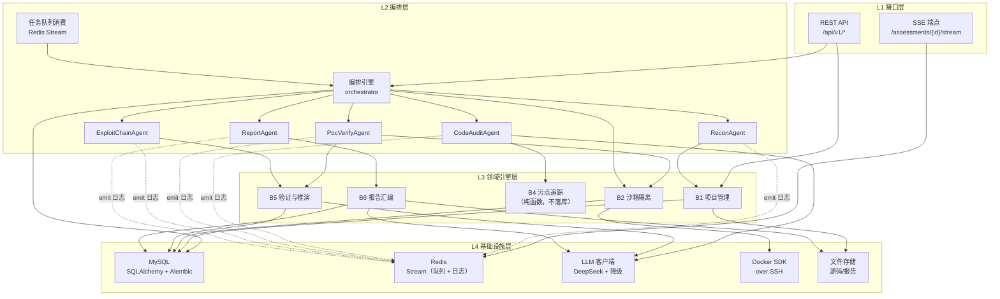

### 2.3 部署架构图

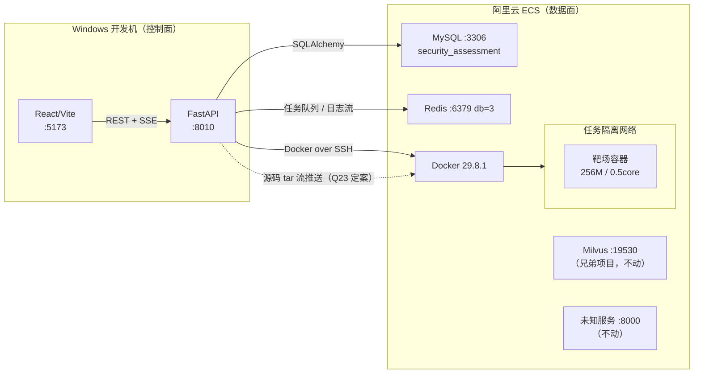

### 2.4 部署约束

| 约束 | 值 | 设计应对 |
|---|---|---|
| 阿里云 CPU | 2 vCPU | 沙箱并发度恒为 1，队列单 worker |
| 阿里云内存 | 7.3G（Milvus 占 2-4G，0 swap） | 容器硬限 256M；建议加 2G swap |
| 阿里云磁盘 | 剩 19G | 只用 `python:3.12-slim`；定期 prune |
| 本地 C 盘 | 剩 24G | 四类缓存目录全部重定向到 D 盘 |
| 本地无 Docker / Python | — | 沙箱走远程；Python 由 uv 自管 |

---

## 3. 模块划分

### 3.1 后端模块（对应需求 2.5.6）

| 编号 | 模块 | 职责 | 不负责 | 关键产出 |
|---|---|---|---|---|
| **B1** | 项目管理模块 | Git 克隆 / 压缩包解包 / 目录只读挂载准备 / 元数据解析 / 源码落盘 | 技术栈识别（属 ReconAgent） | `Project` 实体 + 源码工作区 |
| **B2** | 沙箱隔离模块 | 沙箱生命周期（创建/保活/网络隔离/销毁）/ 命令执行 / 资源配额 / 指标采集 / 僵尸清理 | 载荷构造（属 B5） | `SandboxHandle` + `ExecResult` |
| **B3** | 多 Agent 编排引擎 | 五阶段状态推进 / 阶段持久化 / 断点续跑 / 中断终止 / Agent 间数据传递 / 日志广播 | 任何领域算法 | `Assessment` 状态 + `AssessmentContext` |
| **B4** | 污点追踪引擎 | AST 解析 / 符号表 / Source-Sink 匹配 / 函数内传播 / 单层跨函数传播 / Sanitizer 消解 / CVSS 映射 | 沙箱执行 / 网络请求 | `list[Finding]` + `list[TaintStep]` |
| **B5** | PoC 验证与推演引擎 | 无害化探针构造 / 沙箱内验证执行 / 响应特征匹配 / 攻击链规则匹配 / DAG 构建 | 报告排版 | `verified Findings` + `list[AttackChain]` |
| **B6** | 报告汇编模块 | 数据汇总 / Jinja2 渲染 / HTML·MD·PDF 三格式导出 | 数据产生 | `Report` 文件 + 摘要 |

### 3.2 前端模块（对应需求 2.5.5）

| 编号 | 模块 | 职责 | 主要承载页面 |
|---|---|---|---|
| **F1** | 概览大盘模块 | 工程卡片、全局安全态势统计图、新建任务表单 | 项目概览大盘页 |
| **F2** | 流水线监控模块 | Agent 进度步进器、实时日志滚动视窗、运行状态徽标、资源指标曲线 | 工作台·流水线监控区 |
| **F3** | 漏洞视窗模块 | 源码上下文高亮、污点传播步进标记、Monaco Diff 比对渲染 | 工作台·漏洞详情与修复区 |
| **F4** | 拓扑图谱模块 | 攻击路径有向图渲染、节点点击联动、漏洞详情侧滑 | 工作台·漏洞与攻击链路区 |
| **F5** | 报告导出模块 | 报告排版渲染、在线预览、格式导出 | 安全报告中心页 |

### 3.3 模块依赖矩阵

后端（行 → 列 表示「行模块调用列模块」）：

| ↓调用方 \ 被调用→ | B1 | B2 | B3 | B4 | B5 | B6 |
|---|:--:|:--:|:--:|:--:|:--:|:--:|
| **B1** 项目管理 | — | | | | | |
| **B2** 沙箱隔离 | | — | | | | |
| **B3** 编排引擎 | ● | ● | — | ● | ● | ● |
| **B4** 污点追踪 | | | | — | | |
| **B5** 验证与推演 | | ● | | △ | — | |
| **B6** 报告汇编 | △ | | | | | — |

● = 直接调用　△ = 仅数据依赖（通过 `AssessmentContext` / 数据库读取，不直接调用）

**架构原则**：

1. **B4 零依赖**——污点追踪引擎是纯函数式的：输入源码文本，输出 Finding 列表。不碰数据库、不碰网络、不碰沙箱。这让它可以被单元测试直接驱动，是 `test_taint.py` 能写出来的前提。
2. **B3 是唯一的协调者**——各引擎之间不互相调用（B5 对 B4 只是读数据），所有跨模块协作由 B3 编排。新增引擎不会引发依赖爆炸。
3. **B2 不感知业务**——沙箱只知道「给我一个镜像、挂载、配额、命令」，不知道什么是漏洞。这让它可被替换为本地进程沙箱或独立服务。

前端（行 → 列 表示「行模块依赖列模块」）：

| ↓依赖方 \ 被依赖→ | F1 | F2 | F3 | F4 | F5 | 共享层 |
|---|:--:|:--:|:--:|:--:|:--:|:--:|
| **F1** 概览大盘 | — | | | | | api / store |
| **F2** 流水线监控 | | — | | | | api / useSSE |
| **F3** 漏洞视窗 | | | — | | | api / Monaco |
| **F4** 拓扑图谱 | | | ● | — | | api / ReactFlow |
| **F5** 报告导出 | | | | | — | api |

F4 依赖 F3：点击拓扑节点要联动展开漏洞详情。其余模块之间无横向依赖，只共享 `api/` 与 `store/`。

### 3.4 分层依赖规则

| 层 | 内容 | 允许依赖 |
|---|---|---|
| **L1 接口层** | `api/v1/*`、SSE 端点 | L2、L3、L4 |
| **L2 编排层** | `orchestrator/`、`agents/` | L3、L4 |
| **L3 领域引擎层** | `analysis/`、`verify/`、`chain/`、`sandbox/`、`report/` | L4 |
| **L4 基础设施层** | `core/`、`db/`、`llm/`、`models/` | 无（最底层） |

**强制规则**：禁止反向依赖。L3 不得 import `agents/`，L4 不得 import 任何上层。`analysis/` 连 `db/` 都不 import（它是纯函数库）。

---

## 4. 核心流程时序设计

### 4.1 主流程：项目建档与自动化评估

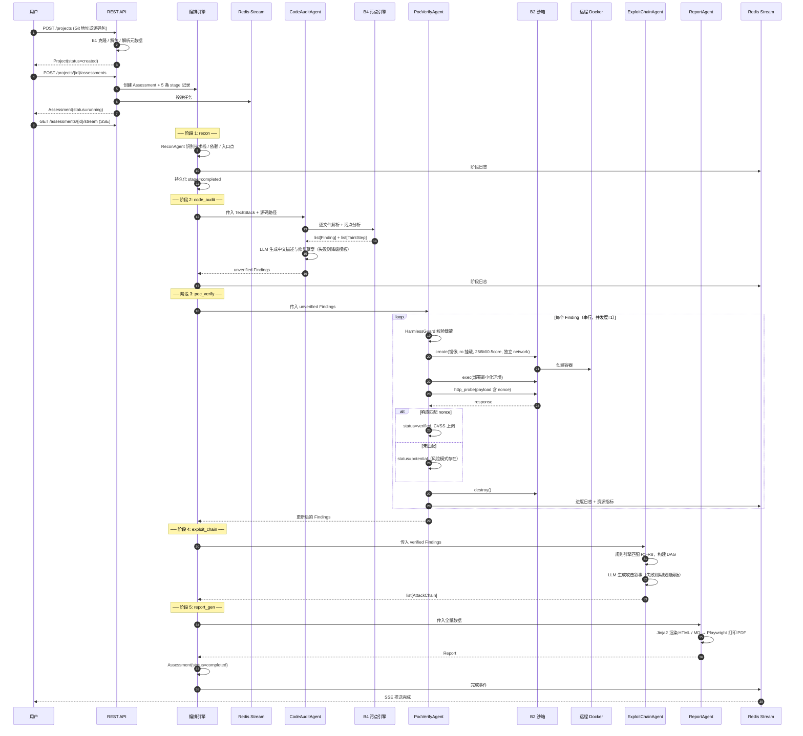

### 4.2 中断流程：终止评估

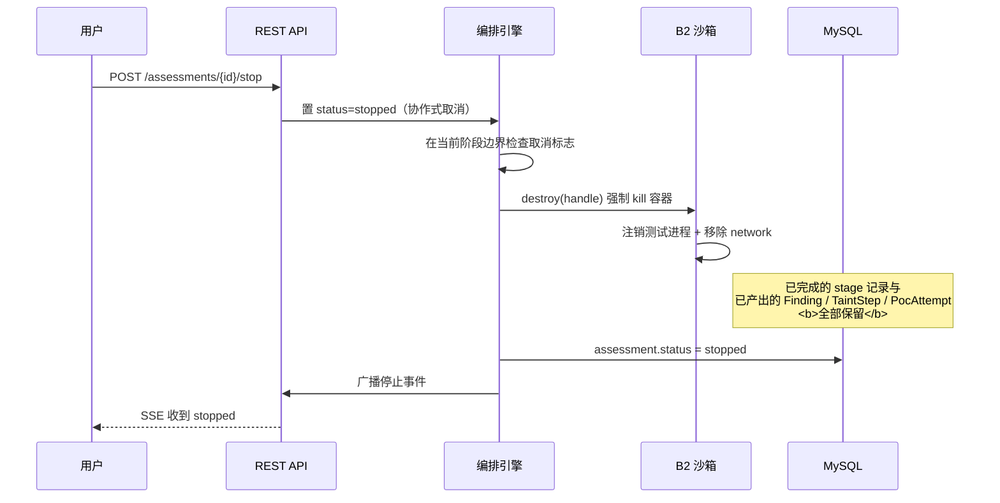

**设计要点**：取消是**协作式**的（检查标志位），不是 `asyncio.Task.cancel()` 硬中断。原因：硬中断会打断数据库事务，导致 Finding 与 TaintStep 出现孤儿记录。协作式取消保证「阶段边界原子性」——一个阶段要么完整完成，要么完全没开始。

### 4.3 断点续跑流程

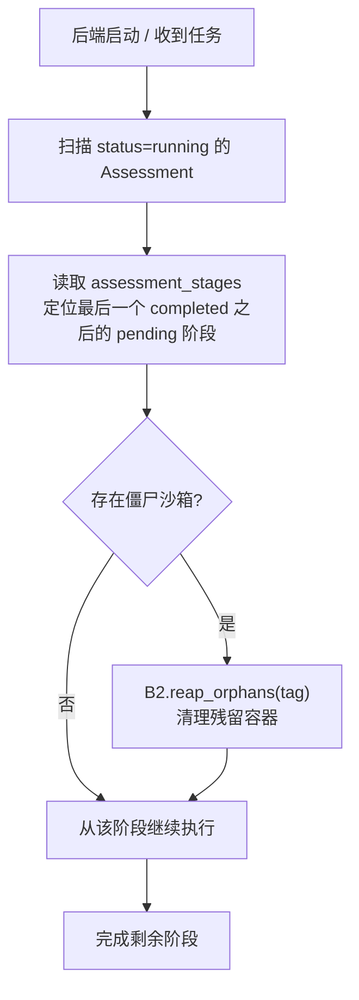

**设计要点**：阶段间通过 `AssessmentContext`（可序列化的 Pydantic 模型）传递数据，并写 `assessment_stages.result_ref`。因此恢复时**不需要重跑已完成的阶段**——直接反序列化 `result_ref` 即可拿到上游产出。

---

## 5. 状态机设计

### 5.1 项目/评估状态机

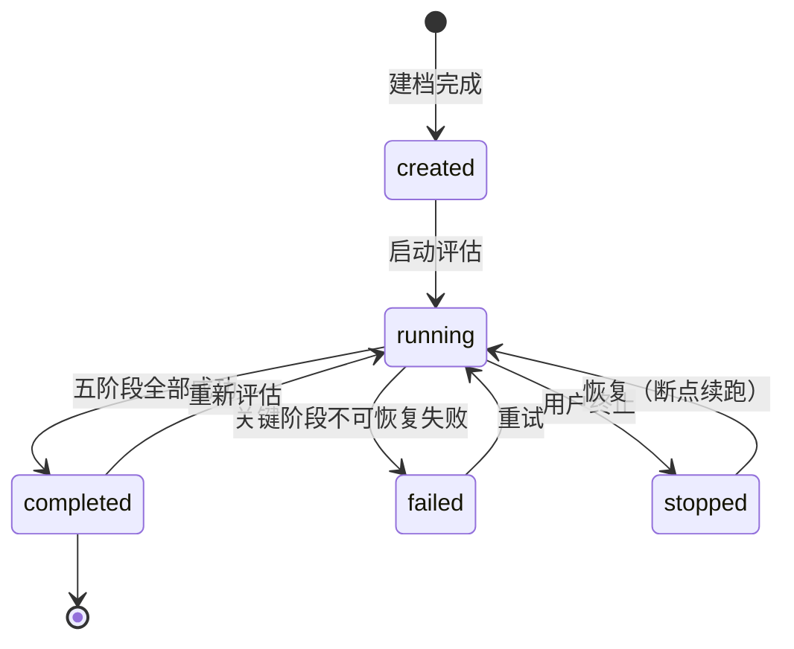

### 5.2 阶段推进状态机

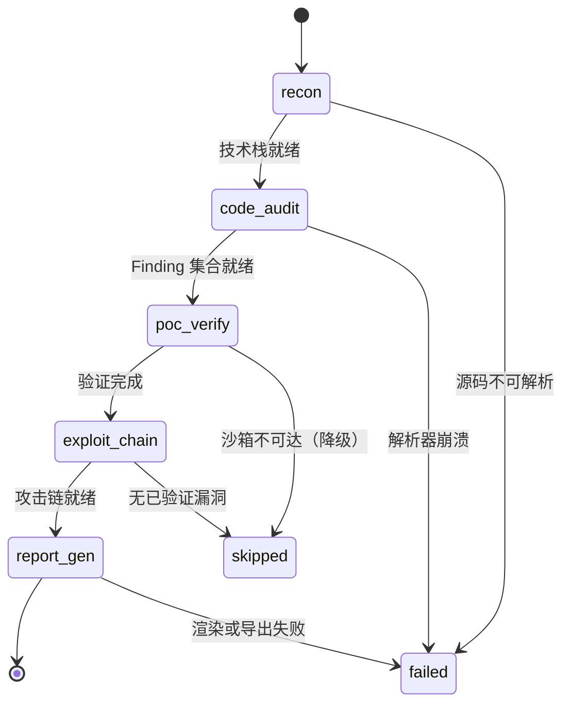

**阶段容错策略**：`recon` 与 `code_audit` 失败 → 整体 `failed`（无法继续）；`poc_verify` 沙箱不可达 → `skipped`，所有 Finding 退回 `potential`，**评估继续**；`exploit_chain` 无已验证漏洞 → `skipped`，**评估继续**；`report_gen` 失败 → 整体 `failed`，但**证据层完整保留**，可从数据库快照单独重生成报告（与 §10 的 D14 一致）。

这个分级是刻意的：基础设施问题不应该让已完成的静态分析成果作废。

### 5.3 漏洞状态机（对应需求 2.5.4 判定规则）

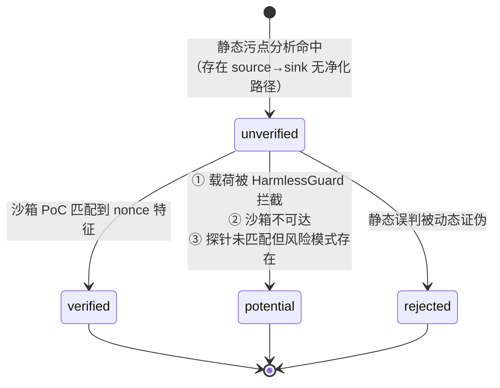

**判定规则的形式化**：

```
静态判定：∃ 路径 p: source →sink，且 p 上无 sanitizer
          ⇒ status = unverified

动态判定：sandbox_probe(payload) 的响应中匹配到 nonce
          ⇒ status = verified，CVSS 按验证结果上调
          ¬匹配 ∧ 载荷通过 HarmlessGuard ∧ 风险模式仍成立
          ⇒ status = potential（中低危隐患，防误报干扰）

降级判定：沙箱不可达 ∨ 载荷被闸门拦截
          ⇒ status = potential，并在 poc_attempts 记录未验证原因
```

---

## 6. 接口设计

### 6.1 模块间内部契约

**B4 污点追踪引擎**（纯函数接口，无副作用）：

```python
class TaintAnalyzer:
    def analyze_file(self, path: str, source: str) -> list[Finding]: ...
    def analyze_project(self, root: str) -> TaintReport: ...
    # 返回值必须完全由入参决定，不读数据库、不发网络请求
```

**B2 沙箱隔离模块**：

```python
class SandboxExecutor(ABC):
    # 注：原 expose() 已移除（§12.2 Q25）—— 探针在容器内 exec 执行，无需发布端口
    async def create(self, spec: SandboxSpec) -> SandboxHandle: ...
    async def exec(self, h: SandboxHandle, cmd: list[str], timeout: int) -> ExecResult: ...
    async def metrics(self, h: SandboxHandle) -> ResourceSample: ...
    async def destroy(self, h: SandboxHandle) -> None: ...
    async def reap_orphans(self, tag: str) -> int: ...
```

**B3 编排引擎 · Agent 抽象**：

```python
class BaseAgent(ABC, Generic[InT, OutT]):
    name: str
    stage: Stage
    async def run(self, ctx: AssessmentContext, inp: InT) -> OutT: ...
    async def emit(self, level: LogLevel, msg: str, **extra) -> None: ...
```

**阶段间数据载体**：

```python
class AssessmentContext(BaseModel):
    assessment_id: int
    project_id: int
    workspace: str                      # 控制面源码工作区（统一 POSIX 相对路径，见 §7.4）
    tech_stack: TechStack | None = None
    findings: list[Finding] = []
    chains: list[AttackChain] = []
    sandbox_config: SandboxConfig
    stage_outputs: dict[Stage, str] = {}          # 各阶段 result_ref 指针 —— 断点续跑的依据
    sandbox_handle: SandboxHandle | None = Field(default=None, exclude=True)
                                                  # 运行时态，序列化时排除
    # 每个阶段完成后整体序列化进 assessment_stages.result_ref
```

### 6.2 外部接口

| 接口 | 协议 | 说明 |
|---|---|---|
| 前端 ↔ 后端 | REST + SSE over HTTP | 端点清单见 PRD §9 |
| 后端 ↔ MySQL | SQLAlchemy 2.0 async | 独立 database `security_assessment` |
| 后端 ↔ Redis | Stream `task:queue`（任务队列，含消费确认）+ Stream `log:{assessment_id}`（日志流，含 `Last-Event-ID` 续读） | db=3 |
| 后端 ↔ 远程 Docker | Docker SDK over SSH | 密钥认证，3 次重试 |
| 后端 ↔ LLM | OpenAI 兼容 HTTP | DeepSeek，15s 超时，可降级 |
| 后端 ↔ Git 仓库 | git CLI / dulwich | 仅读操作 |

### 6.3 前端 ↔ 后端实时通道

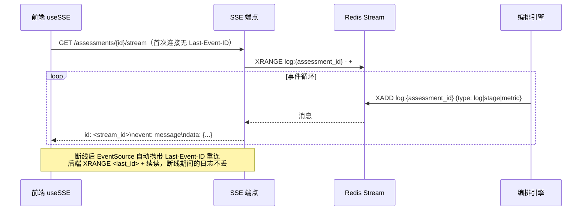

**设计要点**

1. **日志通道用 Stream 而非 Pub/Sub**。Pub/Sub 即发即弃、没有历史，SSE 断线那几秒里发布的日志会**永久丢失**。Stream 保留历史，配合浏览器 `EventSource` 重连时自动携带的 `Last-Event-ID` 头，后端 `XRANGE <last_id> +` 即可补齐。用 `XTRIM MAXLEN` 控制内存。
2. **SSE 只承载增量事件，状态快照一律走 REST**。这样重连逻辑极其简单——重连 → 拉一次快照 → 继续收增量，不会出现状态漂移。

---

## 7. 数据结构设计

### 7.1 核心实体关系

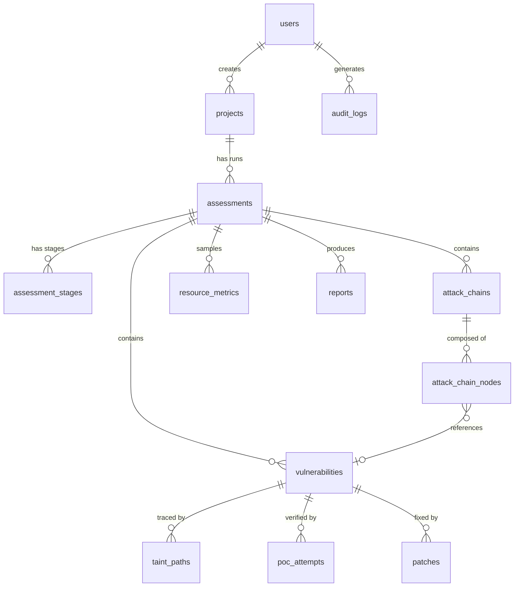

### 7.2 数据分层

| 层 | 表 | 生命周期 | 说明 |
|---|---|---|---|
| **配置层** | `users`、`sandbox_configs` | 长期 | 低频变更 |
| **主体层** | `projects`、`assessments`、`assessment_stages` | 随评估 | 状态机载体 |
| **证据层** | `vulnerabilities`、`taint_paths`、`poc_attempts`、`patches` | 随评估，**终止时保留** | 需求 2.5.4 明确要求 |
| **推演层** | `attack_chains`、`attack_chain_nodes` | 随评估 | 由证据层派生 |
| **产物层** | `reports` | 随评估 | 文件路径 + 摘要 |
| **观测层** | `resource_metrics`、`audit_logs` | 滚动清理 | 指标可设 TTL |

**设计要点**：证据层与推演层的分离是关键——`taint_paths` 和 `poc_attempts` 是**原始证据**（不可再生，必须保留），`attack_chains` 是**派生结论**（可由规则引擎重新推导）。终止任务时保留证据层、允许推演层不完整。

### 7.3 关键字段语义

| 表.字段 | 取值 | 语义 |
|---|---|---|
| `vulnerabilities.status` | `unverified` / `verified` / `potential` / `rejected` | 见 §5.3 状态机 |
| `vulnerabilities.confidence` | 0–1 float | §7.1 置信度公式产出，非概率，是启发式权重 |
| `vulnerabilities.detection_method` | `taint_intra` / `taint_inter` / `pattern` | 让报告能区分「函数内已确认」与「跨函数推断」 |
| `taint_paths.step_type` | `source` / `propagate` / `sanitize` / `sink` | `sanitize` 步骤的存在使前端能渲染「净化点」标记 |
| `poc_attempts.harmless_guard_passed` | bool | 载荷是否通过无害化闸门；false 时该条不可作为验证依据 |
| `assessment_stages.result_ref` | JSON | 阶段产出快照，断点续跑的基石 |

### 7.4 全局路径规范（跨三端统一）

系统运行在**三个路径空间**里，格式互不通用：

| 端 | 路径形态 | 示例 |
|---|---|---|
| 控制面（Windows） | 反斜杠绝对路径 | `D:\myself_complete_code\.asa\workspaces\7\` |
| 数据面（ECS 宿主） | POSIX 绝对路径 | `/srv/asa/tasks/7/src/` |
| 沙箱容器内 | POSIX 绝对路径 | `/workspace/` |

**统一规范（强制）**：所有**落库**的路径（`vulnerabilities.file_path`、`taint_paths.file_path`、`projects.storage_path` 的相对部分）一律使用**以工作区根为基准的 POSIX 相对路径**，例如 `app/api/order.py`。

三端各自的绝对根由配置解析，任何模块**不得**把绝对路径写进数据库或跨模块传递。这条规范解决三个具体问题：① 报告里的文件路径在任何机器上都可读；② Windows 与 ECS 的路径格式差异被挡在配置层；③ `GET /projects/{id}/source?path=` 的入参天然是相对路径，配合路径穿越校验（拒绝 `..`、绝对路径、符号链接）即可安全解析。

---

## 8. 横切机制设计

### 8.1 任务调度与并发控制

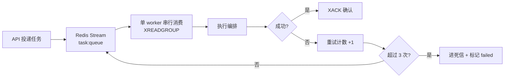

**并发度恒为 1 的设计理由与后果**：

- 理由：2 vCPU + Milvus 常驻，并发只会让所有任务都变慢，且撞 OOM。
- 后果：`poc_verify` 阶段对 N 个 Finding 串行验证，耗时随 Finding 数线性增长。设计上通过**探针数量上限（20/漏洞）**与**单探针超时（30s）**把最坏情况锁死在 10 分钟量级。
- 界面仍暴露「并发任务数」配置项（需求 2.5.3 要求），但默认值 1，并在报告中注明当前配额——把资源约束变成透明的事实而不是隐藏的瓶颈。

### 8.2 降级与容错矩阵

| 依赖 | 故障形态 | 降级行为 | 用户可见表现 |
|---|---|---|---|
| **LLM** | 无 key / 超时 / 限流 / **输出校验不过**（§8.5 L3） | 切模板生成 | 漏洞描述与补丁仍完整，标注「模板生成」 |
| **沙箱** | SSH 不可达 / 容器起不来 | `poc_verify` → skipped，Finding 退 `potential` | 工作台显示「动态验证未执行」黄色提示 |
| **规则引擎** | 无规则匹配 | 跳过 `exploit_chain` | 报告无攻击链章节，单点漏洞照常展示 |
| **Git 克隆** | 网络失败 / 认证失败 | 提示改用源码包上传 | 创建表单报错并给替代路径 |
| **MySQL** | 连接失败 | 启动即失败快速退出 | 明确的连接错误，不静默降级（数据不可丢） |
| **Redis** | 连接失败 | 队列不可用，拒绝新任务 | 「调度服务不可用」 |

**原则**：**计算类依赖可降级，存储类依赖不可降级**。LLM 挂了能用模板，数据库挂了绝不能假装能跑。

### 8.3 安全与权限设计

| 关注点 | 设计 |
|---|---|
| 认证 | JWT（HS256），secret 走环境变量 |
| 密码存储 | bcrypt 加盐哈希 |
| 授权 | 三角色 RBAC + 路由级依赖注入装饰器；4 个权限点：创建任务 / 查看报告 / 采纳补丁 / 管理沙箱配置 |
| 源码隔离 | 沙箱内只读挂载（`mode: ro`），容器无法回写源码 |
| 网络隔离 | 每任务独立 Docker network；探针目标硬白名单；禁止出站公网 |
| 载荷安全 | `HarmlessGuard` 四道闸门（见 PRD §7.3） |
| 审计 | `audit_logs` 记录「谁在何时扫了哪个项目」，管理员可查 |
| 公网暴露 | 默认不开放；若开放则强制登录 + 目标白名单 + 全局限流 |

### 8.4 可观测性设计

| 维度 | 手段 | 落点 |
|---|---|---|
| 阶段进度 | `assessment_stages` 状态 + `progress` 百分比 | 前端 Steps |
| 执行日志 | Agent `emit()` → Redis Stream → SSE（`Last-Event-ID` 续读） | 前端日志流 |
| 资源消耗 | `resource_metrics` 采样容器 CPU/内存 | 前端迷你折线图 |
| 操作审计 | `audit_logs` | 管理页表格 |
| 错误溯源 | 阶段级 `error_message` + 容器 ID | 详情页 |

### 8.5 LLM 可控性约束

> 项目定位是**可控多智能体**。多智能体最容易被质疑的三件事 —— 结论随模型抖动、编造不存在的事实、产出无法验证的补丁 —— 由本节四条铁律逐条封死。**完整论证见 PRD §7.6**，本节只固化架构级约束。

| 铁律 | 约束 | 架构落点 |
|---|---|---|
| **L1 不参与判定** | 漏洞有无 / 类型 / 严重度 / CVSS / 状态 / 攻击链节点与边 / 评分 / 整改顺序，**全部由确定性代码产出**；LLM 输出**永不进入控制流**（不决定阶段跳转、不决定是否继续、不决定重试） | B4 污点引擎、B5 规则引擎 R1–R8、B6 `scoring.py` 均不依赖 LLM（对应 §10 D7 / D13） |
| **L2 不引入事实** | LLM 不得输出输入中不存在的 file_path / 行号 / CVE / 函数名 / 漏洞编码；**结构化字段一律代码填充**，LLM 只填自由文本 | 各 Agent 的 DTO 组装：结构化字段由 B4 / B5 / B6 代码写入，LLM 只回填 `description` / `narrative` / `remediation_note` |
| **L3 输出必校验** | LLM 输出与外部输入同等对待：描述走**实体白名单**，叙事走**节点集合比对**，补丁走**四道校验**（格式 → ±20 行范围 → `git apply --check` → **污点引擎复验路径消失**） | 校验全部在**控制面**完成，不需要沙箱；失败即降级，重试不超过 1 次 |
| **L4 可降级不阻断** | 无 key / 超时 / 限流 / 校验不过均不中断流水线；`llm_model` 标注 `deepseek-chat` \| `template`，前端与报告**显式标注「模板生成」** | `llm/fallback.py`；对应 §8.2 的 L2 可降级行 |

**封闭用点集合**：① 漏洞描述 ② Diff 补丁 ③ 攻击链叙事 ④ 整改建议文案 —— 四个用点**全部位于表达层**。**新增用点必须在 PRD §7.6.3 登记并经评审，否则不允许引入。**

**判据（可直接写成测试）**：**拿掉 LLM，系统的结论必须一字不变，只有措辞会变。** 做不到，即说明 LLM 越界。

---

## 9. 出错处理设计

### 9.1 错误分级

| 级别 | 定义 | 处理 | 用户可见 |
|---|---|---|---|
| **L1 可忽略** | 单文件解析失败 | 记录并跳过该文件，继续扫描 | 日志 WARN |
| **L2 可降级** | LLM 超时、单探针失败 | 切降级路径，继续流程 | 结果标注降级来源 |
| **L3 可跳过** | 沙箱不可达、无匹配规则 | 阶段标 `skipped`，后续阶段继续 | 黄色提示条 |
| **L4 可重试** | SSH 抖动、Git 网络错误 | 指数退避重试 3 次 | 日志重试计数 |
| **L5 致命** | MySQL 不可达、源码不可读 | 评估标 `failed`，保留已产出数据 | 红色错误 + 失败原因 |

### 9.2 错误信息规范

每个错误必须携带四要素，缺一不可：

```json
{
  "stage": "poc_verify",
  "error_code": "SANDBOX_UNREACHABLE",
  "message": "无法连接远程 Docker daemon（ssh://root@...）",
  "remediation": "检查阿里云安全组 SSH 放行与密钥权限",
  "retryable": true,
  "occurred_at": "2026-10-16T10:00:00+08:00"
}
```

**`remediation` 字段是刻意的**——面试演示时最怕「报错了但不知道为什么」，而这个字段让每次失败都自带修复指引。

### 9.3 数据一致性保障

| 风险 | 保障机制 |
|---|---|
| 阶段部分成功导致孤儿数据 | 阶段内写入包在一个事务里；阶段边界才是提交点 |
| 硬中断打断事务 | 协作式取消，不用 `Task.cancel()` |
| 容器泄漏 | 每次启动 `reap_orphans(tag)`；容器打 `asa.task_id` 标签 |
| 续跑时重复处理 | `assessment_stages` 已 `completed` 的阶段直接反序列化 `result_ref`，不重跑 |
| 报告与数据不一致 | 报告从数据库快照生成，不读内存态 |

---

## 10. 关键设计权衡

| # | 决策点 | 选择 | 放弃的方案 | 理由 | 代价 |
|---|---|---|---|---|---|
| D1 | 模块化方式 | 分层单体 + 严格分层 | 微服务 | 2 vCPU 下多进程是纯负担 | 无法独立扩缩容 |
| D2 | 沙箱位置 | 远程 Docker over SSH | 本地进程沙箱 | 需真容器隔离语义 | 依赖网络，延迟高 |
| D3 | 沙箱抽象 | 定义 Executor 接口 | 直接写死 Docker 调用 | 可演进为独立服务，可降级 | 多一层间接 |
| D4 | 编排实现 | 自研 asyncio 状态机 | LangGraph | 流程是确定性 5 阶段线性 DAG | 无现成生态 |
| D5 | 静态分析 | tree-sitter 自研 | semgrep | 自研污点追踪是核心技术叙事 | 开发量大，需自己维护规则 |
| D6 | 跨函数深度 | 单层 | 全程序 | 覆盖多数真实形态 | 深层调用链漏报 |
| D7 | 判定规则位置 | 规则引擎（非 LLM） | LLM 推理攻击链 | 图正确性不依赖模型不确定性 | 规则需人工维护 |
| D8 | 实时通道 | SSE | WebSocket | 需求全是单向推送 | 无客户端上行 |
| D9 | 任务队列 | Redis Stream | Celery | 避免额外 worker 进程 | 需自己写消费确认 |
| D10 | PDF 生成 | Playwright 打印 | WeasyPrint | 避开 Windows GTK 依赖地狱 | 需装 Chromium（~150M×2） |
| D11 | 取消语义 | 协作式 | `Task.cancel()` | 避免打断数据库事务 | 长命令需等超时 |
| D12 | 并发度 | 恒为 1 | 可配置并发 | 资源硬约束 | 多漏洞时耗时长 |
| D13 | LLM 角色 | 只做描述/补丁/叙事（**表达层**，见 §8.5） | 参与判定 | demo 不因模型抖动而改变结论；**补丁有效性由污点引擎复验，不由模型自证** | LLM 价值被限制在表达层 |
| D14 | 报告数据源 | 数据库快照 | 内存态 | 报告可重生成、可复现 | 需多一次查询 |

---

## 11. 需求覆盖对照

| 需求条目 | 概要设计落点 |
|---|---|
| 2.5.1 五大能力 | §2.2 逻辑架构（B1–B6 + 5 Agent 全在此图） |
| 2.5.2 三角色权限 | §8.3 安全与权限设计 |
| 2.5.3 四个页面 | §3.2 前端模块（F1–F5 承载四页） |
| 2.5.4 状态流转 | §5.1 项目状态机 + §5.2 阶段状态机 |
| 2.5.4 终止保数据 | §4.2 中断时序 + §7.2 证据层/推演层分离 |
| 2.5.4 静态动态判定 | §5.3 漏洞状态机 + 形式化规则 |
| 2.5.4 攻击链推演 | §3.1 B5 + §4.1 阶段 4 |
| 2.5.5 五个前端模块 | §3.2 + §3.3 前端依赖矩阵 |
| 2.5.6 六个后端模块 | §3.1 + §3.3 后端依赖矩阵 |
| 2.5.7 核心业务流程 | §4.1 主流程时序图 |
| 2.5.8 报告格式 | §3.1 B6 + §9.3 报告一致性 |
| 2.5.9 业务场景 | §4.1 时序（两靶场共用同一流水线） |
| 2.5.10 验收标准 | 量化指标见 PRD §1.2；流程完整性见 §4.1 |

---

## 12. 未决问题与演进方向

### 12.1 待确认

| # | 问题 | 影响 | 待办 |
|---|---|---|---|
| 1 | 阿里云 MySQL/Redis 能否提供独立库与 db index | 阻塞 W1 数据层 | 需确认；若否则改为起独立容器（2 核资源需重算） |
| 2 | 是否部署公网 demo | 影响 §8.3 公网暴露条目 | 默认不开放 |
| 3 | 扫描语言是否需扩展到 Java/JS | 影响 B4 的 AST 规则设计 | 当前仅 Python，规则层已留扩展位 |
| 4 | 是否从 `SandboxExecutor` 移除 `expose()` | 影响 B2 / B5 接口面 | ✅ **已定案：移除**（见 §12.2） |

> 原 Q23（源码跨面同步）、Q24（攻击链环级验证状态）已定案，移入 §12.2。

### 12.2 已定案的设计决策

> 以下三项原为 `🔶 待决策`，现已全部定案。**各模块设计文档已按定案结果对齐**，后续实现不得再按备选方案。

#### Q23 — 源码跨面同步机制 → **定案：方案 A（tar 流推送）**

需求要求源码**只读挂载**进沙箱容器（`mode: ro`），但 **Docker 的 bind mount 路径由 daemon 所在主机解析**。daemon 在阿里云 ECS，而 B1 把源码克隆在 Windows 控制面 —— ECS 上不存在该路径，容器会挂载失败或挂到空目录。

因此源码必须在**两侧各有一份**：控制面供 B4 做纯 Python 静态分析，数据面供沙箱只读挂载。

**定案**：B1 打包 tar → SSH 流式传到 ECS `/srv/asa/tasks/{assessment_id}/src/` → 解包 → bind mount `ro`；销毁沙箱时删除该目录。同步作为 `poc_verify` 阶段的**前置步骤**执行，失败即该阶段降级为 `skipped`。

| 未采纳方案 | 否决理由 |
|---|---|
| B 按任务建 named volume + helper 容器灌入 | 多一个 helper 容器步骤，2 核机器上不划算 |
| C 在 ECS helper 容器内 git clone 再反向 tar 回控制面 | 动摇 B1 定位，源码权威副本跑到数据面 |
| D 后端整体搬上 ECS | 违背控制面/数据面分离架构 |

#### Q24 — 攻击链每环的验证状态 → **定案：方案 A（标注 `verified` / `inferred`）**

需求 2.5.9 演示的攻击链是 `SQL 注入 → 拿管理员凭证 → 上传 WebShell → 宿主机 RCE`。但无害化行为闸门（PRD §7.3）规定文件上传只传 `<nonce>.txt` 并读回、**不传 WebShell**，命令执行只用时间盲注、**不执行有副作用的命令**。

两者并不矛盾 —— 这是「**验证**」（证明前置条件可利用）与「**推演**」（推断假如真去打会怎样）的区别。但这意味着**链的最后一环是推演结论，不是实测结果**。

**定案**：`attack_chain_nodes.verification_status` 标注每环为 `verified` / `inferred`；F4 节点两色区分；B6 报告第 4 章写明「第 1–2 环已在沙箱中无害验证，第 3 环由已证实的前置条件推演得出，未实际执行」。

| 未采纳方案 | 否决理由 |
|---|---|
| B 改造靶场使整条链都能无害验证 | 技术上牵强，且仍无法无害证明「宿主机执行权」 |
| C 推演阶段真的执行 RCE | **违背无害化原则，不可接受** |

方案 A 在叙事上是**加分项**：它证明设计者清楚安全工具的边界 —— 扫描器可以推断「这里能打穿」，但绝不应该自己打穿。

#### Q25 — `SandboxExecutor.expose()` 的去留 → **定案：移除**

`expose()` 原设计用于「发布容器端口 + SSH 本地端口转发，供控制面直打探针」。探针改为**容器内 `exec` 执行**后（PRD §7.2），它**已无任何调用方** —— 容器在 `internal` network，控制面本就不该、也无法直连。

**定案：从 `SandboxExecutor` 抽象中移除 `expose()`。**

理由：抽象基类是**可替换实现的契约**，其方法应当都有调用方。保留一个无人调用的方法属于**臆测性通用化**，且会让后来者误以为「探针可以从外部打进来」—— 而那条路径正是被无害化设计否掉的。

设计演化记录（可直接用于面试叙事）：先设计 `expose()` → 发现端口发布与网络隔离目标冲突 → 探针移入容器 → `expose()` 失去存在理由 → 移除。

### 12.3 演进方向（不在本期范围）

| 方向 | 触发条件 | 设计预留 |
|---|---|---|
| 沙箱执行器独立为 `sandbox-runner` 服务 | 需要跨机器横向扩容 | `SandboxExecutor` 抽象已就位 |
| 跨函数分析扩展到 N 层 | 漏报率成为瓶颈 | `summary.py` 的摘要机制天然可递归 |
| 支持更多语言 | 有 Java/JS 工程要扫 | `analysis/parser.py` 按语言注册 parser |
| 多租户与配额 | 从作品集走向产品 | `users`/`projects` 已带归属字段 |
| 增量扫描（只扫改动文件） | 大工程扫描耗时不可接受 | `Finding.code` 与文件哈希可做去重锚点 |
