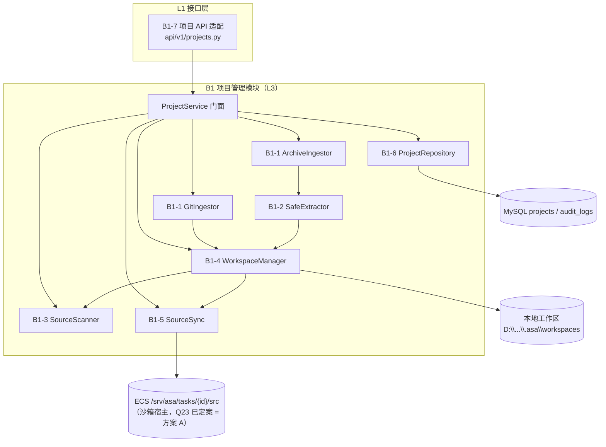
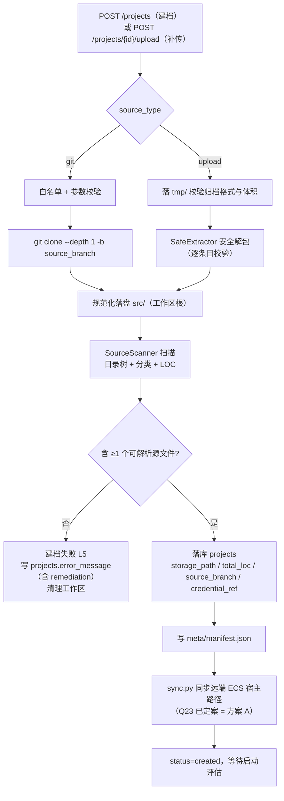
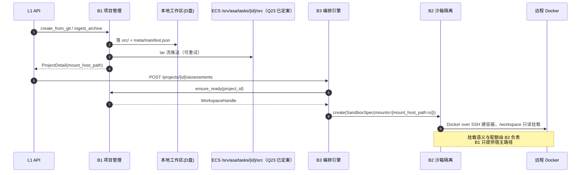
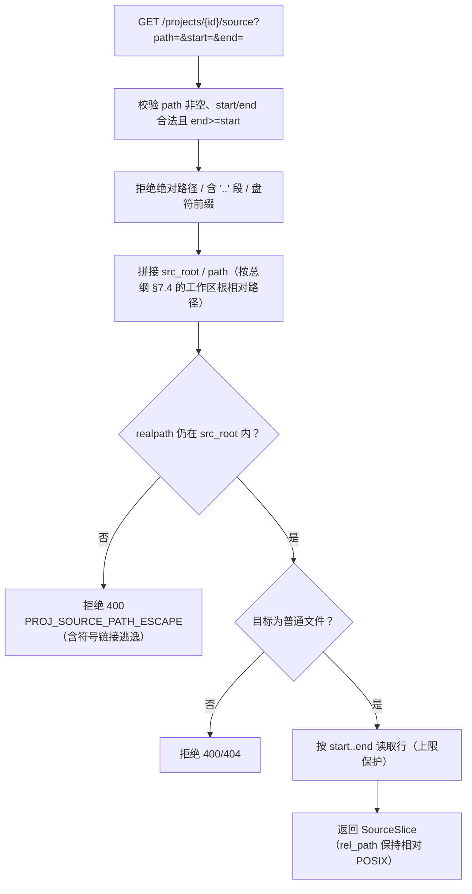

# 模块概要设计 — B1 项目管理模块

| 项 | 值 |
|---|---|
| 所属层 | L3 领域引擎层 |
| 上游文档 | [PRD.md](../PRD.md)、[概要设计总纲.md](../概要设计总纲.md) |
| 对应需求 | 需求.md 2.5.6 |
| 文档层级 | 概要设计 |

---

## 1. 模块定位

### 1.1 职责

与 [概要设计总纲 §3.1](../概要设计总纲.md) 的 B1 表述保持一致：**Git 克隆 / 压缩包解包 / 目录只读挂载准备 / 元数据解析 / 源码落盘**，产出 `Project` 实体 + 源码工作区。

展开为可交付的能力：

| # | 能力 | 说明 |
|---|---|---|
| 1 | 接入源适配 | 统一处理 Git 仓库与本地压缩包（zip / tar.gz）两种入口，见 PRD §8.1① |
| 2 | 安全解包 | 归档解压需防路径穿越（zip slip）、符号链接逃逸、压缩炸弹 |
| 3 | 源码落盘 | 在 D 盘建立项目工作区（`src/` + `meta/`），目录结构与命名规范化 |
| 4 | 结构元数据解析 | 目录树、文件分类、**代码行数统计（LOC）**、候选入口点定位、依赖清单文件**路径**定位 |
| 5 | 只读挂载准备 | 计算并同步沙箱宿主（ECS）侧的可绑定路径，供 B2 挂载时使用；B1 自身**不调用 Docker**。同步机制 **Q23 已定案 = 方案 A**（tar 流推送，总纲 §12.2） |
| 6 | 源码片段读取 | 承接 `GET /projects/{id}/source?path=&start=&end=`（PRD §9），为 F3 漏洞视窗的源码高亮按行返回片段；**路径穿越校验**（拒绝 `..`、绝对路径、符号链接）在本端点强制实施 |
| 7 | 项目 CRUD | `projects` 表读写、状态维护、删除时清理工作区、写 `audit_logs`（总纲 §8.3） |

### 1.2 明确不负责（边界）

| 不做 | 归属 |
|---|---|
| 技术栈识别（语言/框架/依赖清单内容解析） | ReconAgent（PRD §7.5） |
| 沙箱容器的创建、挂载、销毁 | B2 沙箱隔离模块（PRD §7.2） |
| AST 解析与污点分析 | B4 污点追踪引擎 |
| 评估任务的创建、阶段推进、队列消费 | B3 编排引擎（PRD §7.5） |
| 报告生成 | B6 报告汇编模块 |

**关键边界澄清**：`projects.tech_stack` 列（PRD §6）虽在 `projects` 表上，但 B1 **只建列不填值**，由 B3 在 `recon` 阶段回填（见 §7 与文末 ⚠️）。

**全局路径规范承接（总纲 §7.4）**：所有**落库**的路径一律为「以源码工作区根为基准的 POSIX 相对路径」（如 `app/api/order.py`），三端（Windows 反斜杠 / ECS POSIX / 容器内 `/workspace`）的绝对根由配置解析。B1 的 `workspace.py` 承接并强制这条规范：**B1 不得把任何绝对路径写入数据库或跨模块传递**。

**入口语义（PRD §9）**：`POST /projects` = **建档**（Git 或上传入口）；`POST /projects/{id}/upload` = **补传**源码包。两者边界见 §4.1。

### 1.3 上下游关系

- **上游（调用方）**：L1 接口层 `api/v1/projects.py`（建档 / 查询 / 删除 / 补传上传 / 源码片段读取，PRD §9）；B3 编排引擎（评估启动前取 `workspace` 与宿主挂载路径，总纲 §3.3 B3→B1）；F3 漏洞视窗经 L1 调用 `GET /projects/{id}/source` 拉取高亮片段。
- **下游（被依赖）**：L4 基础设施层——MySQL（SQLAlchemy async）、文件存储、配置与日志。
- **横向**：**B1 不调用任何其他 L3 模块**（依赖矩阵 §3.3 中 B1 行全空）；源码到沙箱的链路是 `B1 准备路径 → B3 组装 SandboxSpec → B2 执行挂载`。

---

## 2. 内部分解

| 编号 | 子模块 | 职责 | 关键依赖 |
|---|---|---|---|
| B1-1 | 接入源适配器 `ingestor/` | `GitIngestor`：白名单校验 + 浅克隆（可带分支）；`ArchiveIngestor`：接收 multipart 流落临时区 | git CLI / `subprocess` |
| B1-2 | 安全解包器 `extractor.py` | zip / tar.gz 逐条目校验后解包；拒绝绝对路径、`..`、符号链接；边解包边累计大小与条目数 | 标准库 `zipfile` / `tarfile` |
| B1-3 | 源码扫描器 `scanner.py` | 目录遍历（按规则排除）、文件分类、LOC 统计、候选入口点与依赖清单**路径**索引 | 标准库 `pathlib` |
| B1-4 | 工作区管理 `workspace.py` | 本地工作区布局与生命周期、**按总纲 §7.4 规范化「源码工作区根相对 POSIX 路径」**、源码片段安全读取（路径穿越校验）、LRU 清理 | 标准库 `pathlib` |
| B1-5 | 源码同步 `sync.py` | 源码 → ECS 同步：打包 tar 流推送、远端落盘校验、销毁时清理远端目录。**Q23 已定案 = 方案 A**（见总纲 §12.2、§7 与文末 ⚠️） | SSH / SFTP 通道、`tarfile` 流 |
| B1-6 | 项目仓储 `repository.py` | `projects` 表 CRUD、`total_loc` / `storage_path` / `error_message` 落库、`audit_logs` 写入 | SQLAlchemy 2.0 async |
| B1-7 | 项目 API 适配 `api/v1/projects.py` | 属 L1（总纲 §3.4），薄适配：鉴权、DTO 校验、调用 `ProjectService`、异常映射为 HTTP | FastAPI / Pydantic v2 |

> **落地文件命名以 PRD §5 为准**：B1 代码位于 `backend/app/projects/`，含 `service.py`（门面 = 上表 B1-7 背后的 `ProjectService`）、`fetcher.py`（接入与安全解包 = B1-1/B1-2/B1-3 的合并载体）、`workspace.py`（B1-4）、`sync.py`（B1-5）。上表的子模块划分是**逻辑分解**，不要求一一对应到文件。



数据流为单向下行：**接入 → 解包 → 落盘 → 扫描 → 落库 → 同步远端**。`ProjectService` 是唯一门面，任何子模块不互相反向调用。

---

## 3. 对外接口

### 3.1 暴露给上层的接口（Python 类型签名）

```python
class ProjectService:
    """B1 唯一对外门面，供 L1 API 与 B3 编排引擎调用。"""

    async def create_from_git(self, req: GitSource, *, created_by: int) -> ProjectDetail: ...
    async def create_from_upload(self, req: NewProject, *, created_by: int) -> ProjectDetail: ...
    async def ingest_archive(self, project_id: int, upload: ArchiveUpload) -> ProjectDetail: ...
    async def get(self, project_id: int) -> ProjectDetail: ...
    async def list(self, q: ProjectQuery) -> Page[ProjectSummary]: ...
    async def delete(self, project_id: int) -> None: ...

    # —— 服务 F3 源码高亮（PRD §9）——
    async def read_source(self, project_id: int, path: str, start: int, end: int) -> SourceSlice: ...
    # path 必须为「源码工作区根相对 POSIX 路径」；实现内部做路径穿越校验

    # —— 供 B3 编排引擎在启动评估前调用（不触发任何写操作）——
    def workspace_of(self, project_id: int) -> WorkspaceHandle: ...
    async def ensure_ready(self, project_id: int) -> WorkspaceHandle: ...  # 远端副本缺失时补同步


class WorkspaceHandle(BaseModel):
    project_id: int
    local_root: Path          # D 盘权威副本
    src_root: Path            # local_root / "src"
    mount_host_path: str      # ECS 宿主侧路径，交给 B2 做 ro bind mount（Q23 已定案 = 方案 A 的 /srv/asa/tasks/{id}/src）
    relative_path_base: str   # 入库 file_path 的基准＝**源码工作区根**（总纲 §7.4），见 §5
```

对外语义约定：`workspace_of()` 为**纯读**，不产生 I/O 副作用；`ensure_ready()` 是唯一的补同步入口，B3 在评估启动前调用它做前置检查（远端磁盘/副本存在性），失败即拦截评估。`read_source()` 只接受工作区根相对 POSIX 路径，任何 `..` / 绝对路径 / 指向符号链接的路径一律拒绝（见 §4.3）。

### 3.2 依赖的下层接口

| 依赖 | 接口 | 用途 |
|---|---|---|
| MySQL | `AsyncSession`（`db/session.py`） | `projects` / `audit_logs` 读写 |
| 配置 | `Settings`（`core/config.py`） | `WORKSPACE_ROOT`、`DATA_PLANE_WORKSPACE_ROOT`、Git 白名单、体积上限 |
| 日志 | `core/logging.py` | 结构化日志 |
| 外部进程 | `subprocess`（git CLI） | `git clone --depth 1` —— 失败原因需从 stderr 解析（见 §6） |
| 远端同步 | SSH / SFTP（复用 PRD §2.2 的密钥对） | `sync.py` 的 tar 流推送至 ECS —— **Q23 已定案 = 方案 A**（SSH 流式 tar 推送，总纲 §12.2） |

**约束**：B1 不 import `agents/`、不 import `sandbox/`、不 import `analysis/`（总纲 §3.4 禁止反向依赖）。

### 3.3 本模块定义的数据结构

| 结构 | 字段要点 | 说明 |
|---|---|---|
| `GitSource` | `url, branch, credential_ref` | `credential_ref` 是**引用**而非明文（见 §7） |
| `ArchiveUpload` | `filename, stream, size_bytes` | multipart 流式，不整体读入内存 |
| `NewProject` | `name, source_type` | 建档占位，等待后续 ingest |
| `ScanRules` | `exclude_dirs, source_exts, max_files, max_bytes, truncate` | 排除 `.venv`/`node_modules`/`.git` 等 |
| `FileEntry` | `rel_path, ext, loc, size_bytes, sha1` | `rel_path` 为 POSIX 相对路径 |
| `SourceManifest` | `total_files, total_loc, by_language, size_bytes, entries, entry_candidates, dependency_manifest_paths, truncated` | 落 `meta/manifest.json` |
| `SourceSlice` | `rel_path, start, end, total_lines, lines[]` | `read_source()` 的返回；`rel_path` 为工作区根相对 POSIX 路径 |
| `ProjectDetail` / `ProjectSummary` | 映射 `projects` 行 + 派生统计（供 PRD §8.1① 卡片） | 含 `source_branch` / `credential_ref` / `error_message`（仅引用，不含明文口令） |

---

## 4. 关键处理流程

### 4.1 项目建档（双入口）



### 4.2 从建档到沙箱只读挂载（与 B3 / B2 的协作）



**要点**：`mount_host_path` 必须解析在**远端 Docker 宿主**上（PRD §7.2 的 `host_src`），因此 B1 的同步步骤是链路前置条件，而非可选项（见文末 ⚠️ 1 与 Q23 已定案）。

### 4.3 源码片段读取（服务 F3 源码高亮）



**要点**：本端点的安全边界不是「文件存在即可读」，而是**先规范化再落界检查**——`path` 先做 `..`/绝对路径拒绝，再 `resolve()` 与 `src_root.resolve()` 做前缀比对，符号链接若指向界外一并拒绝（总纲 §7.4 明确要求）。返回的 `rel_path` 始终保持工作区根相对 POSIX 形态，便于 F3 与 `vulnerabilities.file_path` 对齐。

---

## 5. 数据设计

| 载体 | 名称 | 读写 | 说明 |
|---|---|---|---|
| MySQL | `projects` | R/W | `storage_path` / `total_loc` 由 B1 写入；`source_branch` / `credential_ref` 于建档时写入（`credential_ref` **仅存引用，不落明文口令**）；失败时写 `error_message`（含 remediation，PRD §6）；`tech_stack` 留空由 B3 回填 |
| MySQL | `audit_logs` | W | 建档 / 删除 / 上传动作（总纲 §8.3） |
| 本地文件 | `WORKSPACE_ROOT\{id}\src\` | W/R | **权威副本**，B4 静态分析读此处 |
| 本地文件 | `WORKSPACE_ROOT\{id}\meta\manifest.json` | W/R | `SourceManifest` 落盘，重评估免重扫 |
| 本地文件 | `WORKSPACE_ROOT\{id}\tmp\` | W | 上传归档临时区，建档结束即清 |
| 远端文件 | `/srv/asa/tasks/{assessment_id}/src/`（Q23 已定案 = 方案 A） | W | 沙箱宿主副本，仅用于只读挂载；销毁沙箱时删目录 |
| Redis | `asa:proj:{id}:ingest_lock` | W（SETNX, TTL 600s） | 防止同一项目并发 ingest |
| Redis | `asa:proj:{id}:manifest` | W/R（可选） | 扫描结果缓存，避免重复遍历 |

**路径规范（承接总纲 §7.4，全系统强制）**：所有**落库**的路径（`vulnerabilities.file_path`、`taint_paths.file_path`、`projects.storage_path` 的相对部分）一律为**以源码工作区根为基准的 POSIX 相对路径**（如 `app/api/order.py`）。三端绝对根由配置解析：控制面为 `WORKSPACE_ROOT\{id}\src\`（Windows 反斜杠）、数据面为 `/srv/asa/tasks/{id}/src/`（POSIX）、容器内为 `/workspace`（POSIX，即挂载点）。**任何模块不得把绝对路径写进数据库或跨模块传递**。前端展示时用「本地 `src_root` 前缀」拼接，报告用「容器内 `/workspace` 前缀」拼接。

**Windows 事实约束**：本地工作区根落在 D 盘（`WORKSPACE_ROOT=D:\myself_complete_code\.asa\workspaces`），与 PRD §2.1「四类缓存目录全部重定向到 D 盘」同源，**C 盘仅剩 24G，禁止在工作区写入任何内容**。

---

## 6. 出错处理

级别定义见 [概要设计总纲 §9.1](../概要设计总纲.md)（L1 可忽略 / L2 可降级 / L3 可跳过 / L4 可重试 / L5 致命）。

| # | 错误场景 | 级别 | 检测方式 | 处理策略 | 可恢复性 |
|---|---|---|---|---|---|
| 1 | Git 地址不在白名单（公网模式） | L5 | 建档前规则校验 | 拒绝创建，返回 400 + 原因；`audit_logs` 记录 | 改地址后重建档 |
| 2 | Git 网络不可达 / 克隆超时 | L4 | 退出码 + 超时计时器 | 指数退避重试 3 次 | 可重试；仍失败引导改用上传 |
| 3 | Git 认证失败 / 无权限 | L2 | stderr 匹配 `Authentication failed` | **不重试**（重试无意义），降级提示上传源码包 | 可降级 |
| 4 | 仓库体积 / 文件数超阈值 | L3 | 克隆前预检 + 扫描后统计 | 强制浅克隆；仍超限则收下并标 `truncated=true`，报告注明 | 可跳过（受限扫描） |
| 5 | 归档格式不支持 | L5 | 扩展名 + magic 校验 | 拒绝，返回支持格式清单 | 不可恢复 |
| 6 | 解包路径穿越 / 符号链接逃逸 | L5 | `SafeExtractor` 逐条目路径校验 | **中止解包** + 清 `tmp/` + 安全告警 | 不可恢复（安全拒绝） |
| 7 | 压缩炸弹（解压后超阈值） | L5 | 边解压边累计字节数与条目数 | 中止并清理 | 不可恢复 |
| 8 | 单文件读取失败 / 编码异常 | L1 | 读取异常捕获 | 跳过该文件，计 `unreadable`，扫描继续 | 可忽略 |
| 9 | 工作区 0 个可解析源文件 | L5 | 扫描后断言 | 建档失败，提示疑似非 Python 工程（PRD §15 假设 2） | 不可恢复 |
| 10 | D 盘可用空间不足 | L5 | 落盘前剩余空间预检 | 拒绝建档，返回清理指引 | 不可恢复（需人工） |
| 11 | 远端 ECS 同步失败 / 远端磁盘满 | L4 | 传输异常 + 远端剩余空间预检 | 重试 3 次；仍失败则标记未就绪，由 `ensure_ready()` 在评估启动时拦截 | 可重试 |
| 12 | 同一项目并发 ingest | L2 | Redis `ingest_lock` | 第二个请求 409 拒绝 | 稍后重试 |
| 13 | 删除时存在运行中的评估 | L5 | 查 `assessments.status=running` | 拒绝删除（409），提示先终止评估 | 不可恢复（先停评估） |
| 14 | 扫描总耗时超时（超大工程） | L3 | 全局计时器 | 截断到已扫部分，标 `truncated` | 可跳过 |
| 15 | `GET /source` 传入穿越路径（`..` / 绝对路径 / 逃逸符号链接） | L5 | `workspace.py` 规范化 + `realpath` 落界校验（§4.3） | 400 拒绝 + `PROJ_SOURCE_PATH_ESCAPE` + 安全告警；**不读取任何文件** | 不可恢复（安全拒绝） |

**错误信息规范**：所有对外错误必须按总纲 §9.2 携带 `stage / error_code / message / remediation / retryable / occurred_at` 六要素，`error_code` 采用 `PROJ_*` 前缀（如 `PROJ_ARCHIVE_ESCAPE`、`PROJ_REMOTE_SYNC_FAILED`）。**建档失败（L5）时，同一组要素（含 remediation 修复指引）需持久化进 `projects.error_message`**（PRD §6），使 `status=failed` 的项目在列表页即可看到失败原因与修复方向。

---

## 7. 设计约束与权衡

| # | 决策点 | 选择 | 放弃的方案 | 理由 | 代价 |
|---|---|---|---|---|---|
| 1 | 源码权威副本位置 | 本地 D 盘 + 远端副本 | 仅存远端 | C 盘仅剩 24G（PRD §2.1）；B4 静态分析需低延迟读本地源码 | 双份存储，需同步 |
| 2 | 控制面→数据面源码传递 | B1 主动推送 tar 流 —— **Q23 已定案 = 方案 A**（总纲 §12.2）：推送至 `/srv/asa/tasks/{assessment_id}/src/`，销毁沙箱时删目录 | 共享存储 / 容器内 git clone / named volume（备选 B/C/D 已在总纲 §12.2 否决） | 两侧无共享盘；远端 Docker 只能挂载**远端**路径 | 传输耗时，需重试机制 |
| 3 | 沙箱挂载语义 | 只读绑定挂载宿主路径（由 B2 执行） | `docker cp` 拷入容器 | 只读挂载从根上阻断源码回写（总纲 §8.3） | 必须先完成远端同步 |
| 4 | 路径入库规范 | 统一「源码工作区根相对 POSIX 路径」（总纲 §7.4） | 绝对路径 | Windows / Linux / 容器三端路径不可互通 | 展示层需按端拼前缀 |
| 5 | 建档执行时机 | 小仓库同步返回，超阈值转后台任务 | 全部走 Redis 队列 | 避免与评估队列争用 2 vCPU 单 worker（总纲 §8.1） | 接口两种时序，前端需轮询 |
| 6 | 归化解包 | 自研 `SafeExtractor` 白名单解包 | `tarfile.extractall` / `shutil.unpack_archive` | 上游未做 zip slip / 炸弹防护，而归档是**用户上传**的不信任输入 | 自研成本 |
| 7 | 元数据边界 | B1 仅产出结构元数据 + 依赖清单**路径** | B1 直接解析依赖得出技术栈 | 总纲 §3.1 明确技术栈识别属 ReconAgent | ReconAgent 需再读一次文件 |
| 8 | 远端副本生命周期 | 评估结束后 LRU 清理，保留最近 N 个 | 长期保留 | ECS 磁盘仅剩 19G（PRD §2.2） | 重跑需重新同步 |
| 9 | LOC 统计口径 | 非空行 + 按扩展名分语言 | 全行数（含空行/注释） | 报告中的"代码量"应贴近实际工作量 | 口径须在报告注明 |
| 10 | Git 凭证处理 | 仅存引用（`credential_ref`），运行时注入 | 明文写入 `projects` 表 | 凭证入库即使加密也属高风险资产（PRD §6 明确「不落明文口令」） | 需外部凭据源（见待定项 6） |
| 11 | 源码片段读取入口 | B1 提供 `GET /source`（先规范化再落界校验） | 前端直读本地文件 / 一次性返回整文件 | F3 只需 ±20 行高亮；前端不得接触文件系统，路径穿越必须在服务端拦截（总纲 §7.4） | 高亮需一次后端往返 |

---

## 8. 移交详细设计的待定项

| # | 待定项 | 影响 |
|---|---|---|
| 1 | `source_branch` / `credential_ref` / `error_message` 三字段已由 PRD §6 定案；剩余的 `ingest_status` / `archive_name` 是否另设列，或改由 `meta/manifest.json` 承载 | 阻塞 W1 首个 Alembic 迁移 |
| 2 | ~~B1 代码目录命名~~ 已由 PRD §5 定案为 `backend/app/projects/`（`service.py` / `fetcher.py` / `workspace.py` / `sync.py`） | 已闭环，无阻塞 |
| 3 | 本地工作区根路径常量与 `.env` 键名（建议 `WORKSPACE_ROOT`），与 §2.1 四个缓存变量风格对齐 | 影响一键启动脚本 |
| 4 | 远端 ECS 源码目录根路径、配额上限、清理策略（**Q23 已定案 = 方案 A**，目录已定为 `/srv/asa/tasks/{assessment_id}/src/`、销毁沙箱时删除；剩余为配额上限等参数） | 影响磁盘安全 |
| 5 | 源码同步通道的参数细化（SSH 连接复用 / 超时 / 重试阈值）—— **机制已定案（Q23＝方案 A：SSH 流式 tar 推送，总纲 §12.2）**；`SandboxSpec.mounts` 的字段契约需与 B2 联合定 | 跨模块契约 |
| 6 | Git 凭证来源（`.env` 注入 / OS 凭据管理器 / 一次性内存传递）—— 列已定为 `credential_ref`（PRD §6），**来源机制**仍未定，及与 PRD §8.1① 表单字段的映射 | 影响前端表单与安全性 |
| 7 | 大仓库阈值具体数值（文件数 / 总字节 / 克隆超时 / 扫描超时） | 影响 §4.1 分支判定 |
| 8 | `SourceManifest` 的持久化位置（`meta/manifest.json` vs 独立表 vs Redis） | 影响续跑与重扫策略 |
| 9 | 扫描排除规则是否可配置（`.venv`/`node_modules`/`tests`/`ranges` 等） | 影响 LOC 口径与漏报 |
| 10 | 项目删除时评估数据的级联策略（与需求 2.5.4「终止即保留数据」的关系） | 需与 B3/B6 对齐 |

---

## ⚠️ 与上游不一致

| # | 不一致点 | 上游出处 | 本设计的处理 |
|---|---|---|---|
| 1 | **宿主挂载路径的解析方**：PRD §7.2 用 `volumes={host_src: ...}` 绑定挂载，`host_src` 由**远端 Docker 宿主**解析；但 B1 的源码工作区在 Windows 控制面（总纲 §2.2 中 `B1 --> FS`） | PRD §7.2、总纲 §12.2 | ✅ **已由上游定案（总纲 §12.2）**。Q23 定案 = 方案 A：B1 打包 tar 流式推送至 ECS `/srv/asa/tasks/{assessment_id}/src/` → 解包 → bind mount `ro`，销毁沙箱时删除该目录；同步作为 `poc_verify` 阶段前置步骤，失败即该阶段降级 `skipped`。本设计以 B1-5 `sync.py` 承接该同步子流程，`mount_host_path` 指 ECS 侧路径，与定案一致 |
| 2 | **`projects` 表字段缺失**：前端要求 Git 可带「分支、凭证」（PRD §8.1①），总纲 §9.2 要求错误四要素而表无 `error_message` | PRD §6 | ✅ **已由上游修订解决（PRD §6）**：新增 `source_branch`、`credential_ref`（仅引用，不落明文口令）、`error_message`（建档失败原因含 remediation）。B1 建档/失败路径按此写入 |
| 3 | **B1 无独立代码目录**：PRD §5 原无 L3 实现目录，与总纲 §3.1 将 B1 列为 L3 领域引擎相矛盾 | PRD §5 | ✅ **已由上游修订解决（PRD §5）**：定为 `backend/app/projects/`（`service.py` / `fetcher.py` / `workspace.py` / `sync.py`） |
| 4 | **`projects.tech_stack` 归属**：该列在 `projects` 表上 | PRD §6 | ✅ **已由上游修订解决（PRD §6）**：明确「B1 只建列不填值，由 B3 在 recon 阶段回填」，与本设计一致 |
| 5 | **建档与上传入口重叠**：`POST /projects` 与 `POST /projects/{id}/upload` 边界未定义 | PRD §9 | ✅ **已由上游修订解决（PRD §9）**：`POST /projects` = 建档；`POST /projects/{id}/upload` = **补传**源码包 |
| 6 | **落库路径格式三端不统一** | 总纲 §7.4 | ✅ **已由上游修订解决（总纲 §7.4）**：新增强制规范——一律用「以工作区根为基准的 POSIX 相对路径」，绝对根由配置解析、不得入库或跨模块传递。B1 的 `workspace.py` 承接该规范（§5） |
| 7 | **源码片段读取端点缺位**：F3 需源码高亮，但此前无对应端点 | PRD §9 | ✅ **已由上游补充（PRD §9）**：新增 `GET /projects/{id}/source?path=&start=&end=`（含路径穿越校验），B1 承接并实现（§4.3） |
