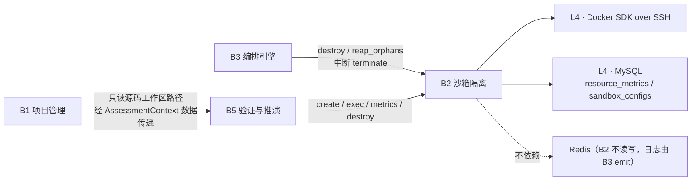
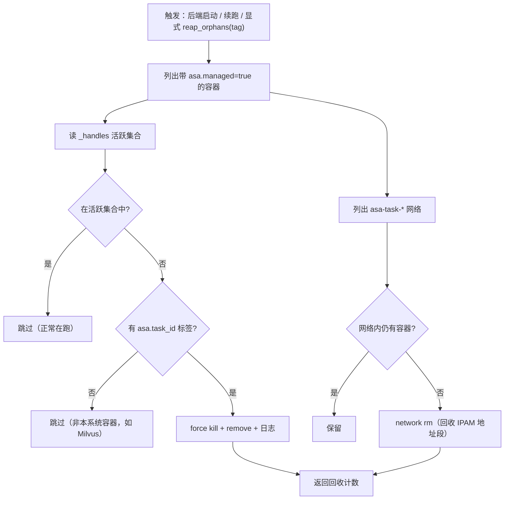
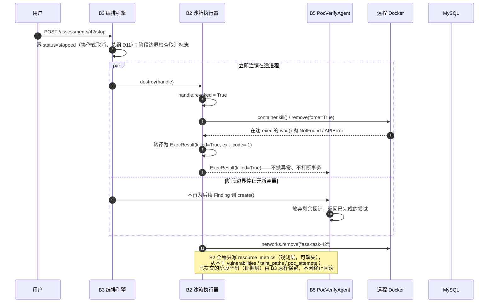

# 模块概要设计 — B2 沙箱隔离模块

| 项 | 值 |
|---|---|
| 所属层 | L3 领域引擎层 |
| 上游文档 | [PRD.md](../PRD.md)、[概要设计总纲.md](../概要设计总纲.md) |
| 对应需求 | 需求.md 2.5.6、2.5.4 |
| 文档层级 | 概要设计 |

---

## 1. 模块定位

### 1.1 职责

B2 是**唯一的不可信代码执行通道**：把「一段命令要在隔离环境里跑」变成「一次可观测、可配额约束、可强制终止的受控执行」。运行的**内容**它一概不问。

| 职责 | 说明 | 依据 |
|---|---|---|
| 沙箱生命周期 | 创建 / 保活 / 销毁；任务结束无残留容器与网络 | PRD §7.2 |
| 网络与文件系统隔离 | 每任务独立 docker network，默认 `internal`（无出站公网）；源码 `mode: ro` 只读挂载至 `/workspace`，容器无法回写 | PRD §7.3 闸门 1、总纲 §8.3 |
| 资源配额 | 硬限 `mem_limit=256m / nano_cpus=5e8 / pids_limit=128` | PRD §7.2、总纲 §2.4 |
| 命令执行 | 容器内执行命令并按超时回收（返回 stdout/stderr/exit_code）；这是**探针的唯一执行通道**（探针在容器内 `exec` 执行，不发布端口） | PRD §7.2 |
| 指标采集与僵尸清理 | 采样容器 CPU / 内存落 `resource_metrics`；按 `asa.task_id` 标签回收历史残留容器与网络 | PRD §7.5、§7.2、总纲 §9.3 |
| 连接韧性 | Docker over SSH 断连时指数退避重试 3 次 | PRD §12 风险 3 |

### 1.2 明确不负责（边界）

| 不做 | 归属 | 理由 |
|---|---|---|
| 载荷合法性判断（黑名单、反弹 shell、副作用命令） | **B5** | 见 §1.4 |
| 探针构造、nonce 生成、响应特征匹配、判定 `verified / potential`、CVSS 上调 | B5 | 业务语义 |
| 知道「什么是漏洞 / 这个镜像扫什么」 | 不属任何模块 | 总纲 §3.3 原则 3 |
| 写 `vulnerabilities` / `poc_attempts` / `taint_paths`；阶段推进、取消标志位、日志广播 | B4 / B5 / B3 | 证据层写入属业务模块；B2 不碰 Redis，不做编排决策 |
| 镜像构建与 `Dockerfile` 维护 | 部署 / admin 接口 | B2 只消费已存在的镜像 |
| 沙箱并发调度（排队、优先级） | B3 | B2 只提供「同一时刻 ≤1 容器」的硬闸门 |

> **「不感知业务」的判据**：B2 入参只有「镜像 + 挂载 + 配额 + 命令」四类。任何形如 `if vuln_type == 'sqli'` 的分支出现在 `sandbox/` 下即为架构违规。这是 B2 能被替换为本地进程沙箱（PRD §11 W3 降级方案）或独立 `sandbox-runner` 服务（总纲 §12.2）的前提。
>
> 与总纲 §8.5 L1 同源：B2 不感知业务，也不感知 LLM —— B2 不调用 LLM，也不接收任何 LLM 产出作为入参。

### 1.3 上下游关系



**契约**：B3 → B2 仅在中断时 `destroy(handle)`、在启动/续跑时 `reap_orphans(tag)`；B5 → B2 驱动全部五个操作（`expose()` 已移除）；**B2 → B5 无回调**（不 import `verify/`、不接收回调函数）；**B2 → B1 无调用**（源码路径由 B5 经 `AssessmentContext.workspace` 传入 spec，B2 不读 `projects` 表）。

### 1.4 `HarmlessGuard` 的归属说明（归 B5，不在本模块目录）

上游已正式定案：`HarmlessGuard`（无害化闸门 2）**归 B5**，文件**已从 `sandbox/protocol.py` 迁至 `verify/guard.py`**（PRD §5、总纲 §3.1 B5）。它**不再是 B2 目录下的构件**，B2 不 import 它。

| 问题 | 结论 |
|---|---|
| B2 调用它吗 | **不调用。** B2 **只提供「执行能力」与容器侧强制**（网络 / 只读挂载 / pids 上限），**不判断载荷合法性** |
| 归属与位置 | **逻辑归属 B5，物理位置 `verify/guard.py`**（PRD §5 目录已更新）。它是无副作用纯函数（`guard.check(payload) -> GuardResult`），不依赖 Docker、不依赖数据库 |
| 为何不由 B2 代劳 | 若 B2 判断载荷合法性，B2 就必须知道「什么是 SQL 注入载荷」，直接违反 §1.2；且 B5 需在**创建容器之前**拦截（省一次容器开销），那一刻 B2 尚未被调用 |
| 一句话切分 | **B5 决定「载荷能不能发」（闸门 2：`verify/guard.py`），B2 决定「发出去后跑在什么环境里、跑多久、怎么弄死它」（闸门 1 容器侧强制）** |

> 本模块与 `HarmlessGuard` 的唯一关系是**职责边界**：B2 提供环境强制，B5 在环境之外判定载荷。二者共同构成 PRD §7.3 的四道闸门，但通过目录与依赖彻底解耦。

---

## 2. 内部分解

### 2.1 子模块清单

| 子模块 | 文件 | 职责 | 关键内部结构 |
|---|---|---|---|
| **契约定义** | `sandbox/base.py` | ABC + 四个 DTO + 异常体系 | `SandboxExecutor` / `SandboxSpec` / `SandboxHandle` / `ExecResult` / `ResourceSample` |
| **远程 Docker 实现** | `sandbox/remote_docker.py` | 连接池与重试、network 生命周期、容器创建与配额、exec 抢占与探针执行、销毁（`expose()` 已移除，见 §3.1） | `RemoteDockerExecutor`、`_HandleRegistry`、`_ConcurrencyGate` |
| **僵尸回收** | 同 `remote_docker.py` 内 `_reaper` | 按标签列出残留容器/网络 → 与活跃 handle 求差集 → 强杀回收 | `OrphanReaper`（tag = task_id 维度） |
| **指标采集** | `sandbox/metrics.py` | 容器 stats 采样、单位归一化、落 `resource_metrics` | `ResourceSampler`（含 `cpu_percent` 差分计算） |

`HarmlessGuard` 已由上游正式定为 **B5** 的构件，文件**从 `sandbox/protocol.py` 迁至 `verify/guard.py`**（PRD §5），**不再位于本模块目录**，B2 不 import 它（§1.4）。因此 B2 目录下不再提供任何载荷合法性判断代码。

### 2.2 组件图

```mermaid
graph LR
    B5["B5 验证与推演"] -->|create / exec / metrics / destroy| ABS
    B3["B3 编排引擎"] -->|destroy / reap_orphans| ABS
    ABS["SandboxExecutor «ABC»<br/>sandbox/base.py"] --> RDE
    ABS -.->|降级实现·PRD W3| LPE["LocalProcessExecutor"]
    RDE["RemoteDockerExecutor<br/>sandbox/remote_docker.py"] --> REAP["OrphanReaper<br/>（僵尸回收）"]
    RDE --> RS["ResourceSampler<br/>sandbox/metrics.py"]
    RDE -->|容器/网络/exec/stats| DKR["Docker SDK over SSH"]
    RDE -->|INSERT| DB["resource_metrics"]
    HG["HarmlessGuard<br/>verify/guard.py<br/>«归 B5，B2 不依赖»"] -.-> B5
    RDE ..> DTO["SandboxSpec / SandboxHandle<br/>ExecResult / ResourceSample"]
```

---

## 3. 对外接口

### 3.1 暴露给上层的接口（Python 类型签名）

五个操作与 PRD §7.2 / 总纲 §6.1 完全一致（原 `expose()` 已按总纲 §12.2 Q25 定案移除），**签名不得增删**（替换实现的兼容性锚点）。

```python
class SandboxExecutor(ABC):
    # 注：原 expose() 已移除（总纲 §12.2 Q25）—— 探针在容器内 exec 执行，无需发布端口
    @abstractmethod
    async def create(self, spec: SandboxSpec) -> SandboxHandle: ...
    @abstractmethod
    async def exec(self, h: SandboxHandle, cmd: list[str], timeout: int) -> ExecResult: ...
    @abstractmethod
    async def metrics(self, h: SandboxHandle) -> ResourceSample: ...
    @abstractmethod
    async def destroy(self, h: SandboxHandle) -> None: ...
    @abstractmethod
    async def reap_orphans(self, tag: str) -> int:
        """返回被回收的容器数量。"""
```

**非抽象但必须遵守的语义契约**（进基类 docstring + 子类契约测试）：

| 契约 | 语义 |
|---|---|
| `destroy` 幂等 + 必释放闸门 | 对已销毁 / 从未存在的 handle 必须静默成功不抛异常；无论成功失败都释放并发信号量，否则并发度 1 会永久死锁（§6 E15） |
| `create` 幂等 | 相同 `spec.idempotency_key` 的未销毁 handle 已存在时**复用并返回**，不新建容器（PRD §12 风险 3） |
| `exec` 返回而非抛出 / 可被抢占 | 容器内非零退出、超时、被抢占一律用 `ExecResult` 表达，只有基础设施故障才抛异常；`destroy` 在另一协程调用时，在途 `exec` 必须尽快返回 `ExecResult(killed=True)`，而非挂死 |
| ~~`expose` 非关键路径~~ **已移除** | ✅ **定案移除（总纲 §12.2 Q25）**：探针在容器内 `exec` 执行（§4.1），不依赖端口发布或 SSH 隧道，`expose()` **已无任何调用方**，故从契约中删除。抽象基类是**可替换实现的契约**，不保留无人调用的方法——既属臆测性通用化，也会误导后来者以为「探针可以从外部打进来」 |
| `metrics` 尽力而为 | 采样失败不得影响调用方流程，可返回 `None` |

### 3.2 依赖的下层接口

| 依赖 | 位置（L4） | 用途 | 失败影响 |
|---|---|---|---|
| `DockerClient(base_url="ssh://root@<host>", use_ssh_client=True)` | `docker` SDK | 容器 / 网络 / exec / stats 全部操作 | L3 可跳过 |
| `SANDBOX_SSH_URL` / `_KEY` / `_IMAGE` / `_DEFAULT_TIMEOUT`、`SANDBOX_MEM_LIMIT_MB` / `_NANO_CPUS` / `_PIDS_LIMIT` | `core/config.py` | 连接目标、镜像名、超时与配额默认值 | 缺失则 L5 致命；值非法则 L2 降级 |
| ~~SSH 本地端口转发~~ | — | **已否决，并连同 `expose()` 一并移除**（总纲 §12.2 Q25）：探针改为容器内 `exec`（§4.1），不建立转发、不发布端口。该依赖**不再存在** | — |
| `get_session()` / `SandboxConfig`·`ResourceMetric` ORM | `db/session.py`、`models/` | 读配置、写指标 | L1 可忽略 |

> `SandboxConfig` 由 B3 在阶段开始时注入 `AssessmentContext.sandbox_config`（总纲 §6.1），B2 不主动查 `sandbox_configs`；仅 admin 改配置需即时生效时回落读库。

### 3.3 本模块定义的数据结构

```python
class NetworkPolicy(str, Enum):
    INTERNAL = "internal"   # 默认：无出站，仅同网络互通（闸门 1）
    BRIDGE = "bridge"       # 保留位，见 §7 T4 / §8 P4

class SandboxSpec(BaseModel):
    task_id: str                       # 评估任务标识 → 打标 asa.task_id，reap 的 tag
    idempotency_key: str               # 如 "42:VULN-2026-0007:2"
    image: str                         # 如 asa/sandbox-base:3.12
    mounts: list[Mount] = []           # Mount{source, target="/workspace", mode="ro"|"rw"}
    env: dict[str, str] = {}
    mem_limit_mb: int = 256
    nano_cpus: int = 500_000_000       # 0.5 核
    pids_limit: int = 128
    network_policy: NetworkPolicy = NetworkPolicy.INTERNAL
    labels: dict[str, str] = {}        # 业务侧附加标签，B2 不解释

class SandboxHandle(BaseModel):
    handle_id: str                     # 进程内唯一，_handles 的 key
    container_id: str
    task_id: str
    network_name: str                  # asa-task-<task_id>
    revoked: bool = False              # destroy 置位；exec 入口检查
    # 注：原 published_ports / local_tunnels 属端口发布与调试转发，随 expose() 一并移除（总纲 §12.2 Q25）
    created_at: datetime

class ExecResult(BaseModel):
    exit_code: int                     # 被抢占时 -1
    stdout: str
    stderr: str
    elapsed_ms: int
    timed_out: bool = False
    killed: bool = False               # 被 destroy / 中断抢占
    oom: bool = False                  # exit 137 且 stats 显示内存触顶

class ResourceSample(BaseModel):
    container_id: str
    cpu_percent: float                 # 单核归一化；0.5 核上限 → 峰值约 50.0
    memory_mb: float
    pids: int | None
    recorded_at: datetime
```

**异常体系**（供 §6 分级映射，均携带总纲 §9.2 四要素；`SandboxUnreachable`=SSH/daemon 不可达，`SandboxResourceExhausted`=磁盘满/配额拒绝，`SandboxHandleRevoked`=操作已销毁 handle，`SandboxExecTimeout`=仅内部信号，对外转 `ExecResult`）。

---

## 4. 关键处理流程

### 4.1 主流程：创建 → 部署环境 → 执行 → 指标 → 销毁

```mermaid
sequenceDiagram
    autonumber
    participant B3 as B3 编排引擎
    participant A3 as B5 PocVerifyAgent
    participant EX as B2 RemoteDockerExecutor
    participant DK as 远程 Docker daemon（阿里云）
    participant DB as MySQL

    Note over B3,EX: 任务开始 / 续跑：先收尸（详见 §4.2）
    B3->>EX: reap_orphans(tag="asa.task_id=42")  → 回收数量 N

    Note over A3,EX: 并发闸门 Semaphore(1)（总纲 D12）
    Note over A3,DK: 前置依赖：bind mount 路径由**远端 daemon** 解析<br/>挂载前源码必须已在 ECS 侧（依赖 B1 的同步机制，Q23 已定案=方案 A）
    A3->>EX: create(SandboxSpec)  ← 载荷已过 HarmlessGuard
    EX->>EX: acquire gate；查 idempotency_key（命中则复用返回）
    EX->>DK: ping() → 失败则指数退避重试 3 次（L4）
    EX->>DK: networks.create("asa-task-42", internal=True)
    EX->>DK: containers.create(image, mem_limit=256m,<br/>nano_cpus=5e8, pids_limit=128,<br/>volumes=/workspace:ro, labels)
    DK-->>EX: container_id
    EX->>DK: container.start()；注册 handle（revoked=False）
    EX-->>A3: SandboxHandle

    Note over A3,EX: 环境部署靠镜像预置，不做运行期 pip（§7 T3）
    A3->>EX: exec(h, ["python","-c","<起服务脚本>"], timeout=60)
    EX->>EX: 检查 h.revoked；exec_create + exec_start + wait(timeout)
    DK-->>EX: exit_code / stdout / stderr
    EX-->>A3: ExecResult(exit_code=0)

    Note over A3,DK: 探针不发布端口：容器在 internal network，控制面无法直连（PRD §7.2）
    A3->>EX: exec(h, ["python","-c","<探针脚本>"], timeout=30)
    Note right of EX: payload 经 base64 传入脚本<br/>脚本用标准库请求容器自身 localhost:&lt;port&gt;<br/>响应经 stdout 回传
    EX->>DK: exec_create + exec_start + wait(timeout)
    DK-->>EX: 响应原文（stdout）/ 时间差
    EX-->>A3: ExecResult(stdout=响应)
    A3->>A3: nonce 匹配判定（B5 职责）

    loop 探针循环内（每探针后 / 5s）
        A3->>EX: metrics(h)
        EX->>DK: container.stats(stream=False)
        EX->>DB: INSERT resource_metrics(...)
        EX-->>A3: ResourceSample
    end

    A3->>EX: destroy(h)
    EX->>EX: h.revoked = True
    EX->>DK: container.remove(force=True) + networks.remove("asa-task-42")
    EX->>EX: 释放 gate；注销 handle
```

**要点**：① **探针不发布端口**——容器在 `internal` network，Windows 控制面无法直连，探针改为**容器内 `exec` 执行**：payload 经 base64 传入脚本，脚本用 Python 标准库请求容器自身的 `localhost:<port>`，响应经 stdout 回传。**不需要端口转发、不需要 SSH 隧道、不需要 sidecar**；`expose()` 已按总纲 §12.2 Q25 定案**移除**（§3.1）。② 闸门作用域——`Semaphore(1)` 在 `create` 获取、`destroy` 释放；并发度恒为 1（总纲 §8.1）时阿里云上同时只有 1 个沙箱容器 + 1 个任务网络，内存锁死在 256M 量级，与 Milvus 的 2-4G 不撞车。③ 保活不做心跳探测（保活 = `restart_policy=no` + handle 存活即活跃），容器意外退出由下一次 `exec` 以 `exit_code != 0` 感知。

**只读挂载的前置条件（重要）**：`volumes={"/srv/asa/tasks/{assessment_id}/src": {"bind": "/workspace", "mode": "ro"}}` 中的 **bind mount 路径由远端 daemon（阿里云 ECS）解析**，而非控制面。因此**挂载前源码必须已存在于 ECS 侧**——这依赖 B1 的源码 → ECS 同步机制（**Q23 已定案 = 方案 A**：B1 打包 tar → SSH 流式传到 ECS `/srv/asa/tasks/{assessment_id}/src/` → 解包 → bind mount `ro`，销毁沙箱时删除该目录；总纲 §12.2），是 B2 挂载动作的**硬前置**：同步未完成则 `create` 必然挂到空目录或失败（§6 E3）。

### 4.2 僵尸清理流程



**要点**：`reap_orphans` **只删自己打的标签**（`asa.managed=true`）。这是与 Milvus（19530）、未知服务（8000）、MySQL、Redis 共存的硬性保护——绝不允许「顺手 prune 掉别人的容器」。`docker system prune` 的镜像瘦身由部署脚本在维护窗口执行，**不由 B2 自动执行**。

### 4.3 中断流程：终止即注销进程、保留数据（需求 2.5.4）



**B2 如何配合 B3 实现「注销进程但保留数据」**——三层保证：

| 层 | 机制 | 归属 |
|---|---|---|
| **数据解耦（根本保证）** | B2 的写集合**只有** `resource_metrics`（滚动清理的观测层）。证据层 `vulnerabilities` / `taint_paths` / `poc_attempts` 全部由 B4/B5 在**阶段边界事务**内提交，B2 无从触碰，因此杀容器在物理上不可能损坏已产出数据 | B2 的边界设计 |
| **杀进程不抛异常** | `destroy` 抢占在途 `exec` 时，B2 把并发异常（`NotFound` / `APIError`）**转译为 `ExecResult(killed=True)` 返回**，绝不向上抛。B5 的循环因此能干净退出，不会因异常穿透回滚未提交事务 | B2 |
| **提交点唯一** | 阶段边界是唯一提交点（总纲 §9.3）。B5 每验证完一个 Finding 写一次 `poc_attempts`，中断落在两个提交点之间时最多丢失「当前这一个 Finding 的尝试」 | B3 / B5 |

> B2 **不做**任何「数据保留」动作——它没有可回滚的业务状态。这正是「不感知业务」在中断场景下的价值：**B2 越无知，中断越安全**。

---

## 5. 数据设计

### 5.1 读写的表

| 表 | 读/写 | 涉及字段 | 说明 |
|---|---|---|---|
| `sandbox_configs` | **读**（低频） | `docker_image` / `network_policy` / `timeout_seconds` / `max_concurrency` / `cpu_limit` / `memory_limit_mb` / `is_default` | 由 B3 注入 `AssessmentContext.sandbox_config`；`max_concurrency` 无论配多少，部署策略强制钳制为 1（总纲 D12） |
| `resource_metrics` | **写**（追加） | `assessment_id` / `stage` / `container_id` / `cpu_percent` / `memory_mb` / `recorded_at` | 每次 `metrics()` 追加一行；属观测层，可设 TTL 滚动清理（总纲 §7.2） |
| `vulnerabilities` / `taint_paths` / `poc_attempts` / `assessments` / `assessment_stages` | **不读写** | — | 证据层属 B4/B5、状态机属 B3；B2 触碰任一即为架构违规 |

### 5.2 读写的文件与外部状态

| 对象 | 操作 | 说明 |
|---|---|---|
| 源码工作区（阿里云侧路径） | **只读挂载** (`mode: ro`) | 路径来自 `AssessmentContext.workspace`（B1 产出）；容器内 `/workspace` 不可写（总纲 §8.3）。**前置条件**：bind mount 路径由远端 daemon 解析，挂载前源码必须已在 ECS 侧（依赖 B1 同步机制，**Q23 已定案 = 方案 A**）。同区的 `sandbox/base/Dockerfile` 仅在构建期只读消费，产出 `asa/sandbox-base:3.12`，**运行期不再 pip**（§7 T3） |
| Docker 容器标签 / network 对象 | **写 / 读**、创建 / 删除 | 容器打标 `asa.managed=true`、`asa.task_id=<id>`、`asa.assessment_id`、`asa.stage`（写于 `create`，读于 `reap_orphans`）；网络 `asa-task-<task_id>` 带同名标签 |
| ~~SSH 本地端口转发~~ | **已否决并移除** | 探针改为容器内 `exec`（§4.1），不建立转发、不发布端口；该路径连同 `expose()` 一并移除（总纲 §12.2 Q25） |
| Redis | **不读写** | 总纲 §2.2 依赖图中 B2 无 → Redis 边，日志/事件由 B3 的 `emit()` 广播（见 ⚠️ C4） |

**关键标识约定**：`task_id`=`str(assessment_id)`，打标前缀与 `reap_orphans(tag)` 参数固定为 `asa.task_id=<task_id>`；`network_name`=`asa-task-<task_id>`，并发度 1 时同时只有一个活跃；`idempotency_key`=`<assessment_id>:<vuln_code>:<attempt_no>`，是 `create` 幂等锚点，重试不产生重复容器；`handle_id`=`uuid4().hex`，仅作进程内注册表 key，不进数据库。

---

## 6. 出错处理

级别定义见 [概要设计总纲 §9.1](../概要设计总纲.md)。所有异常必须携带总纲 §9.2 的四要素（`stage` / `error_code` / `message` / `remediation` / `retryable`）。

| # | 错误场景 | 级别 | 检测方式 | 处理策略 | 可恢复性 |
|---|---|---|---|---|---|
| E1 | SSH 抖动 / 连接超时 / daemon 短暂无响应 | **L4 可重试** | `ping()` 抛 `SSHException` / `DockerException` | 指数退避重试 3 次（1s→2s→4s），日志记重试计数；`error_code=SANDBOX_SSH_RETRY` | 可恢复，重试内自愈 |
| E2 | 重试耗尽，daemon 彻底不可达 | **L3 可跳过** | `SandboxUnreachable` | 抛给 B3 → `poc_verify` 标 `skipped`，全部 Finding 退 `potential`，**评估继续**（总纲 §5.2、§8.2） | 本阶段不可恢复，不影响静态成果 |
| E3 | ECS 侧源码工作区路径不存在 / 不可读（含「B1 尚未同步完成」） | **L5 致命** | `create` 前校验 `mounts[].source`（须为 **ECS 侧路径**，由远端 daemon 解析） | 评估标 `failed`，保留已产出数据；`remediation` 指向 B1 落盘 + **源码→ECS 同步（Q23 已定案 = 方案 A）** 环节 | 不可恢复（对应总纲 §9.1 L5 示例） |
| E4 | 配置缺失/非法（如 `timeout_seconds<=0`） | **L2 可降级** | Pydantic 校验 + 范围检查 | 用 `core/config.py` 默认值（30s / 256M / 0.5 核 / 128 pids），日志 WARN | 可恢复 |
| E5 | 容器创建失败：镜像不存在 | **L3 可跳过** | `ImageNotFound` | 提示执行 `docker build -f sandbox/base/Dockerfile`；本阶段 skip | 需人工构建镜像后重跑 |
| E6 | 容器创建失败：磁盘满（19G 被吃穿） | **L3 可跳过** | `APIError` 含 `no space left on device` | 报 `SANDBOX_DISK_FULL`，`remediation` 指向维护窗口 prune；**不自动 prune**（会误伤 Milvus 相关镜像） | 需人工干预 |
| E7 | 网络名冲突（异常退出残留同名 network） | **L4 可重试** | network 创建冲突异常 | 同名网络无容器则删后重建；有容器则复用并附警告 | 一次重试内完成 |
| E8 | `exec` 超时（单探针 > `timeout`，默认 30s） | **L2 可降级** | `wait(timeout=)` 超时 | 返回 `ExecResult(timed_out=True)`；**不销毁容器**，B5 记一次未匹配尝试后继续下一探针 | 可恢复，容器仍可用 |
| E9 | 容器资源硬限被触发：OOM（137 且内存触顶）/ pids 触顶（fork bomb） | **L2 可降级** | `exit_code==137` + `memory_mb` 接近 256；或 `exit_code != 0` 且 stderr 含 fork 失败 | OOM 置 `oom=True`（连续 3 次提示「配额不足」）；pids 由 `pids_limit=128` 在内核 cgroup 层拦停。该探针判失败，容器不销毁 | 可恢复（硬限本身即防护） |
| E10 | 容器内命令正常失败（非零退出） | **L2 可降级** | `exit_code != 0` 且非超时/OOM | **不是基础设施错误**，原样返回 `ExecResult` 给 B5 判定 | 正常业务路径 |
| E11 | 用户终止抢占在途 `exec`；对已销毁 handle 再调用；`destroy` 时容器已不存在 | **非错误 / L1** | `handle.revoked == True`，或 `wait()`/`remove()` 抛 `NotFound` | 转译 `ExecResult(killed=True, exit_code=-1)`，**不抛异常**（总纲 §9.3 避免打断事务）；`destroy` 静默成功且仍释放闸门 | 设计内路径 / 可忽略 |
| E12 | `metrics()` 采样失败 / `resource_metrics` 入库失败 | **L1 可忽略** | `APIError` / 空 stats / SQLAlchemy 异常 | 返回 `None`、吞掉并日志；**绝不影响执行流程**（观测数据可丢，评估不可停） | 可忽略 |
| E13 | ~~原 SSH 端口转发失败~~ **（错误场景已不存在）** | **不适用** | — | 探针已改为容器内 `exec`，**不依赖端口转发**；该路径连同 `expose()` 一并按总纲 §12.2 Q25 **移除**，端口发布/转发失败这一场景**不再出现** | 不适用 |
| E14 | `reap_orphans` 单个容器删除失败 | **L1 可忽略** | 逐容器 try/except | 跳过该容器继续，汇总成功计数，日志 WARN | 忽略，下次再收 |
| E15 | 并发闸门未释放导致死锁 | **L5 致命** | 看门狗：`gate` 持有时长 > 阶段超时 | `try/finally` 保证释放；看门狗超时强杀容器并重置信号量 | 需看门狗兜底 |

**分级原则**：**基础设施问题不摧毁已有成果**。沙箱不可达 → L3 跳过（E2），静态分析产出照常出报告；沙箱内的业务失败 → L2 降级（E8/E9/E10），是探针失败而非系统失败。只有「源码读不到」与「闸门死锁」才配 L5。

---

## 7. 设计约束与权衡

| # | 决策点 | 选择 | 放弃的方案 | 理由 | 代价 |
|---|---|---|---|---|---|
| **T1** | 沙箱位置 | 远程 Docker over SSH（本机无 Docker，总纲 D2） | 本地进程沙箱 | 需真容器隔离语义：只读挂载、cgroup 配额、独立网络，进程沙箱给不了 | 依赖网络，单次 `create` 有 SSH 往返延迟 |
| **T2** | 抽象层次 | 定义 `SandboxExecutor` ABC（总纲 D3） | 写死 Docker 调用 | 可降级为 `LocalProcessExecutor`（PRD W3），可演进为独立 `sandbox-runner`（总纲 §12.2） | 多一层间接，DTO 需维护 |
| **T3** | 沙箱内依赖获取 | **镜像预置**（`sandbox/base/Dockerfile` 构建期装好）—— ✅ **已由 PRD §7.3 采纳** | 运行期 `pip install` | `internal` 网络**无出站**，运行期 pip 必然失败；19G 磁盘下每次 pip 都是浪费。需求 2.5.7 的「部署临时最小化运行环境」落实为「**选预置镜像 + 注入源码 + 起服务**」 | 新增依赖需重建镜像；镜像体积增大（仍受 slim 基座约束） |
| **T4** | 网络策略 | 每任务独立 `internal` network | 共享 bridge / 公网可达 | 闸门 1 要求禁止出站公网（PRD §7.3）；每任务独立使跨任务串扰为零 | `network_policy` 的 `restricted/bridge` 语义待定（§8 P4） |
| **T5** | 挂载模式 | 一律 `mode: ro`，target `/workspace` | 可写挂载 | 容器无法回写源码（总纲 §8.3）；天然阻断「写 Shell 到靶场目录」类载荷 | 靶场若需运行时写文件（如 SQLite），须改写到 tmpfs / 容器内临时层 |
| **T6** | 并发度 | **恒为 1**（`Semaphore(1)` 硬闸门，总纲 D12） | 可配置并发 | 2 vCPU + Milvus 常驻 2-4G + 0 swap → 并发必撞 OOM | 多漏洞时 `poc_verify` 耗时线性增长；用「探针 ≤20/漏洞 + 单探针 30s」把最坏情况锁在 10 分钟量级（总纲 §8.1） |
| **T7** | 镜像基座与占用 | 只用 `python:3.12-slim` 派生 `asa/sandbox-base`（与 T3 同一「省磁盘」动机），辅以维护窗口 manual prune | alpine / full / 多语言镜像 | 磁盘仅剩 19G（PRD §12 风险 2）；slim 兼得体积与 glibc 兼容性 | 无 Java/Node 运行时，多语言扫描须换镜像 |
| **T8** | 探针可达性 | **容器内 `exec` 执行探针**：payload 经 base64 传入脚本，脚本用 Python 标准库请求容器自身 `localhost:<port>`，响应经 stdout 回传（PRD §7.2） | ① SSH 本地端口转发（**已被上游否决，并连同 `expose()` 一并移除**，总纲 §12.2 Q25）② 安全组放行容器端口 ③ sidecar 容器 | 容器在 `internal` network，控制面（Windows）**无法直连**；exec 方案**不暴露端口、不需要 SSH 隧道、不需要 sidecar**，且探针天然落在 internal 网络内部 | 探针依赖容器内已有 Python 与 HTTP 客户端（**标准库，已在镜像预置**）；脚本需处理 base64 转义 |
| **T9** | 销毁语义 | `remove(force=True)` 强杀，`destroy` 幂等 | 先 `stop(timeout=10)` 优雅停 | 需求 2.5.4 要求「立即注销」；优雅停的 10s 会拖慢 STOP 响应 | 容器内未 flush 的临时状态丢弃（不影响 MySQL 中的证据） |
| **T10** | 指标采集与回收触发 | 直读容器 `stats(stream=False)`；回收只在「后端启动 + 续跑 + 显式调用」时触发（不做后台定时线程） | 部署 cAdvisor / Prometheus；后台定时回收线程 | 不引额外常驻组件、不养常驻线程（2 vCPU 不允许）；需求只要 CPU/内存两条曲线 | 单点快照可能漏采瞬时峰值；长跑服务不自动收尸，需 B3 在阶段边界补调 |
| **T12** | `create` 幂等粒度 | `idempotency_key`（评估×漏洞×尝试序） | 按 `task_id` 幂等 / 不做幂等 | `task_id` 一任务多容器，按它幂等会错误复用；SSH 重试会触发重复创建（PRD §12 风险 3） | 需 B5 正确构造 key，属跨模块约定 |
| **T13** | 标签治理 | 只回收 `asa.managed=true` 的容器 | `docker container prune` 全量清理 | 同机共存 Milvus / MySQL / Redis / 未知 :8000，绝不可误伤 | 非本系统标签的沙箱容器收不掉 |

---

## 8. 移交详细设计的待定项

| # | 待定项 | 需要详细设计回答的问题 | 归属 |
|---|---|---|---|
| **P1** | ~~`HarmlessGuard` 物理归属~~ | ✅ **已由上游定案（PRD §5）**：归 B5，文件定在 `verify/guard.py`，不在 `sandbox/` 下。无待定项 | 已闭环 |
| **P2** | ~~SSH 隧道选型与生命周期~~ | ✅ **已由上游定案（PRD §7.2）**：探针改为容器内 `exec`，SSH 本地端口转发方案**已被否决**，退出关键路径。无待定项 | 已闭环 |
| **P3** | 探针发起位置 | ✅ **已由上游定案（PRD §7.2）**：**容器内 `exec` 发探针**（免隧道、天然在 internal 网络内）。`expose()` 已按总纲 §12.2 Q25 **定案移除**，不再保留调试用途 | 已闭环 |
| **P4** | `network_policy` 三值语义 | `none/restricted/bridge` 如何映射到「每任务 internal network」？是否本期只实现 `internal`，其余值读配置时降级并告警 | B2 + admin 接口 |
| **P5** | `exec` 输出与超时语义 | 现为 `wait` 后一次性返回；PRD §8.1 ② 的终端日志流是否要包含容器内 stdout，还是只含 Agent `emit` 日志；`sandbox_configs.timeout_seconds`（任务级）与 `exec(timeout=)`（单命令级，多探针取 30s）的嵌套与优先级，谁在超时后触发整体 `skip` | B2 + B3 |
| **P6** | 镜像版本固定 | `asa/sandbox-base:3.12` 是否按 digest 固定；admin 重建接口（PRD §9 `POST /admin/sandbox/image/rebuild`）如何触发与校验 | 部署 + B2 |
| **P7** | `LocalProcessExecutor` 降级实现 | 如何模拟 `network`（无网络命名空间时的白名单）、`mem_limit`（`resource.setrlimit`）；`expose()` 既已移除（总纲 §12.2 Q25），降级实现**无需**对应端口发布能力 | B2 |
| **P8** | 指标采样频率与保留期 | 采样间隔（每探针后 vs 固定 5s）、`resource_metrics` 的 TTL 具体值（总纲 §7.2 称「可设 TTL」但未给数值） | B2 + B6 |

---

## ⚠️ 与上游不一致

| # | 冲突点 | 上游原文 | 本设计的处理 |
|---|---|---|---|
| C1 | **运行期 `pip install` 与 `internal` 网络** | PRD §7.3：`env = sandbox.deploy_minimal_env(finding)`（原措辞含「沙箱内 pip install」）；但 PRD §7.2 与闸门 1 要求「容器在独立 internal network，禁止出站到公网」 | ✅ **已由上游修订解决（PRD §7.3）**：明确「**运行期禁止 `pip install`**」，依赖**全部预置进镜像**（`sandbox/base/Dockerfile`），需求 2.5.7 落实为「选预置镜像 + 注入源码 + 起服务」。与本设计 **T3** 一致，冲突消除 |
| C2 | **`deploy_minimal_env` / `http_probe` 命名不在五操作接口内** | PRD §7.3 仍写作 `sandbox.deploy_minimal_env()` / `sandbox.http_probe()`；但 PRD §7.2 与总纲 §6.1 的 `SandboxExecutor` 只有五个方法（`expose()` 已移除） | **部分收敛**：上游已在 §7.3 该行加注释（「选预置镜像 + 注入源码 + 起服务（运行期不 pip）」「容器内 exec 执行探针，不发布端口」），语义已对齐，但**函数命名仍非五操作口径**。本设计仍视为 §7.3 的**示意性伪代码**，按五操作实现：环境部署与探针均由 B5 用 `exec` 组合完成 |
| C3 | **`network_policy` 枚举与「每任务独立 internal network」** | PRD §6 `sandbox_configs.network_policy(enum: none\|restricted\|bridge)`、§8.1 ④ 同；但 §7.2 只说每任务独立 network，未给出三枚举值到实现的映射 | ✅ **已由上游修订解决（PRD §6）**：枚举已改为 `none\|internal\|bridge`，**默认 `internal`**（禁出站、仅可 localhost 探测），与 B2 的 T4 实现语义对齐。三值映射：`none`=无网络命名空间、`internal`=仅回环+任务内网、`bridge`=默认桥接（**沙箱不采用**） |
| C4 | **B2 是否写 Redis** | PRD §7.5 称「采集 `resource_metrics` 一并推送」；但总纲 §2.2 依赖图中 B2 无 → Redis 边 | ✅ **已裁定（不影响设计）**：取总纲口径 —— **B2 只写 `resource_metrics` 表**，SSE 推送由 B3 的 `emit()` 承担。与 PRD §7.5 不冲突（§7.5 主语是编排引擎/Agent，不是 B2） |
| C5 | **`expose()` 返回值的「主机」指哪台主机** | PRD §7.2 原注释「返回可访问的主机端口」，未说明控制面在 Windows、容器在阿里云这一跨机事实 | ✅ **已定案移除（总纲 §12.2 Q25）**：探针改为容器内 `exec` 执行、不发布端口，`expose()` **已从 `SandboxExecutor` 抽象中删除**；原「SSH 本地端口转发」方案被否决，跨机歧义随之消解 |
| C6 | **`HarmlessGuard` 的物理位置** | 本文档 §1.4 此前表述为「物理在 `sandbox/protocol.py`」，与总纲 §3.1 将其归 B5 存在目录/归属错位 | ✅ **已由上游修订解决（PRD §5、总纲 §3.1）**：归属正式定为 **B5**，文件移到 `verify/guard.py`，不再位于 `sandbox/` 下。B2 只提供执行能力与容器侧强制，**不判断载荷合法性** |
| C7 | **只读挂载的前置条件未显式声明** | PRD §7.2 `volumes={host_src: ...}` 未写明 bind mount 路径由远端 daemon 解析、源码须先在 ECS 侧 | ✅ **已由上游补充（PRD §7.2、总纲 §12.2）**：总纲 §12.2 **Q23（已定案 = 方案 A）** 明确了同步机制；本设计在 §4.1 / §5.2 显式写明该硬前置依赖（不再标注为待决策） |
| C8 | **`expose()` 的去留** | 本文档此前表述为「`expose()` 保留在接口中，仅退出关键路径、标注调试用途」；总纲 §6.1 的 `SandboxExecutor` 已删除 `expose()` | ✅ **已定案移除（总纲 §12.2 Q25）**：`expose()` 已无任何调用方（探针在容器内 `exec` 执行），保留无人调用的方法属臆测性通用化。本设计已同步删除该接口、DTO 端口字段、mermaid 节点与依赖箭头 |
