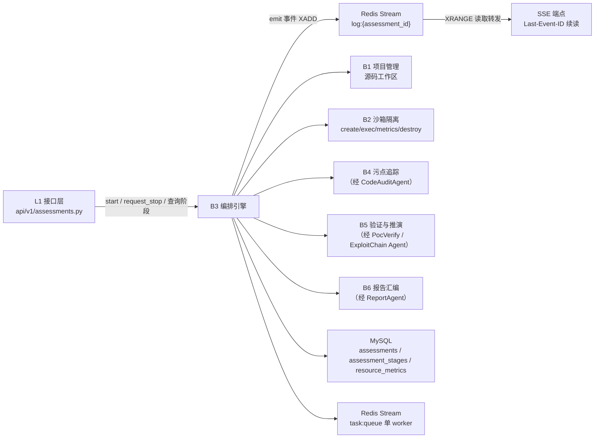
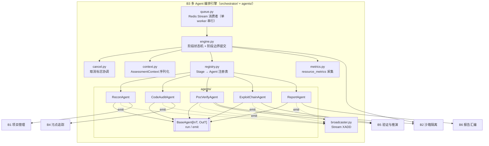
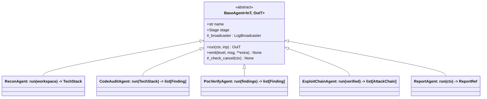
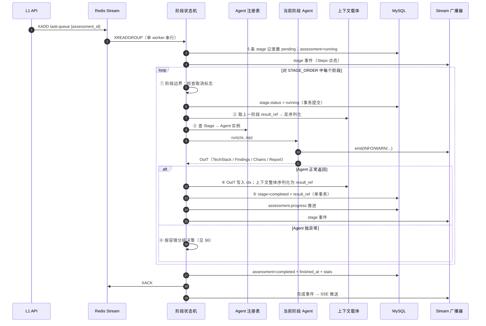
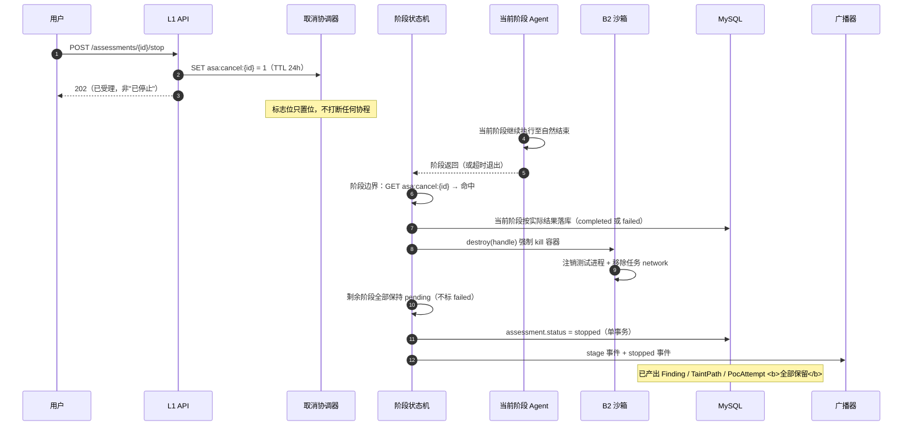
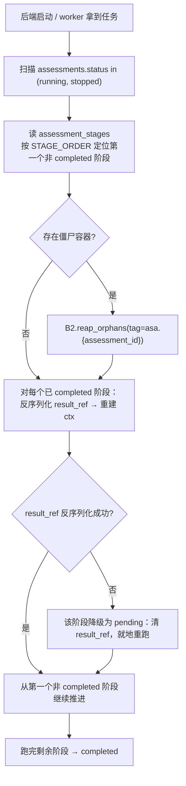

# 模块概要设计 — B3 多 Agent 编排引擎

| 项 | 值 |
|---|---|
| 所属层 | L2 编排层 |
| 上游文档 | [PRD.md](../PRD.md)、[概要设计总纲.md](../概要设计总纲.md) |
| 对应需求 | 需求.md 2.5.6、2.5.4、2.5.7 |
| 文档层级 | 概要设计 |

## 1. 模块定位

### 1.1 职责

B3 是系统的**唯一协调者**（[概要设计总纲 §3.3](../概要设计总纲.md) 架构原则 2）。它把 PRD §7.5 描述的五阶段流水线（`recon → code_audit → poc_verify → exploit_chain → report_gen`）变成可持久化、可中断、可恢复的确定性状态机。

| 职责 | 说明 | 对应上游 |
|---|---|---|
| 五阶段状态推进 | 按固定顺序驱动 5 个 Agent；阶段间数据经 `AssessmentContext` 传递 | PRD §7.5、总纲 §4.1 |
| 阶段持久化 | 每个阶段边界写 `assessment_stages`，含状态、`result_ref` 快照、耗时、`log_excerpt` | PRD §6、总纲 §7.3 |
| 断点续跑 | 启动 / 收到任务时扫描未完成评估，跳过已 `completed` 阶段，反序列化 `result_ref` | 总纲 §4.3 |
| 协作式取消 | 在阶段边界检查取消标志，非 `asyncio.Task.cancel()` | 总纲 §4.2、§10 D11 |
| 队列消费 | Redis Stream 单 worker 串行消费（`XREADGROUP` + `XACK`），失败重试与死信 | 总纲 §8.1 |
| Agent 调度 | 通过 `BaseAgent` 抽象调度 5 个 Agent；新增 Agent 不需改编排引擎 | PRD §7.5「可插拔」 |
| 日志广播 | Agent `emit()` → Redis **Stream** `log:{assessment_id}`（`XADD`，`XTRIM MAXLEN` 限长）→ SSE `XRANGE` 转发 | PRD §7.5、总纲 §6.3 |
| 资源指标采集 | 阶段运行期调用 B2 采样容器 CPU/内存，落 `resource_metrics` 并推送 | PRD §5 `sandbox/metrics.py`、总纲 §8.4 |
| LLM 可控性落地 | Agent 层组织 prompt（只给已确定事实 + 要求改写为中文）/ 调用校验 / 降级与来源标注；**B3 编排器本身不感知 LLM** | PRD §7.6、总纲 §8.5（见 §4.5） |

### 1.2 明确不负责（边界）

| 不负责 | 归属 | 边界依据 |
|---|---|---|
| 任何领域算法（污点传播、载荷构造、规则匹配、报告排版） | B4 / B5 / B6 | 总纲 §3.1「B3 不负责：任何领域算法」 |
| 沙箱生命周期、命令执行、配额 | B2 | B3 只调用 `SandboxExecutor` 抽象，不感知 Docker |
| Git 克隆 / 解包 / 元数据解析 | B1 | B3 只消费 `workspace` 路径与 `Project` 元数据 |
| 技术栈识别 | `ReconAgent`（B3 内但独立类） | 总纲 §3.1 B1「不负责技术栈识别（属 ReconAgent）」 |
| SSE 连接管理、事件序列化给浏览器、`Last-Event-ID` 续读 | L1 接口层 | B3 只负责 `XADD` 写入 `log:{assessment_id}`，不持有 SSE 连接、不处理重连 |
| 认证 / 授权 / RBAC | L1 + L4 | `POST /stop` 的权限校验在 API 层完成后再调 `request_stop` |

### 1.3 上下游关系



**调用方向单向**：B1/B2/B4/B5/B6 中没有任何一个反向调用 B3，也不互相调用（B5 对 B4 仅是数据依赖）。这保证了新增引擎不会引发依赖爆炸。

## 2. 内部分解

| 子模块 | 文件 | 职责 | 关键点 |
|---|---|---|---|
| **队列消费者** | `orchestrator/queue.py` | Redis Stream `XREADGROUP` 单 worker 串行消费；成功 `XACK`；失败重试计数，超 3 次进死信 | 消费组 `asa-workers`，消费者名 `worker-1`；串行保证并发度恒为 1 |
| **阶段状态机** | `orchestrator/engine.py` | `STAGE_ORDER` 顺序推进；阶段边界事务提交；容错分级决策；进度折算 | 唯一写入 `assessment_stages` 的地方 |
| **上下文载体** | `orchestrator/context.py` | `AssessmentContext` 定义、序列化 / 反序列化、`result_ref` 编解码 | Pydantic v2；排除运行时不可序列化字段 |
| **取消协调器** | `orchestrator/cancel.py` | 取消标志写入 / 读取（Redis `asa:cancel:{id}`）；阶段边界轮询 | 协作式取消的唯一实现点 |
| **日志广播器** | `orchestrator/broadcaster.py` | `emit()` 落地：组装 `LogEvent` → `XADD log:{assessment_id}`；`XTRIM MAXLEN ~` 控内存；同时维护 `log_excerpt` 环形缓冲 | Stream 保留历史，SSE 断线可凭 `Last-Event-ID` 续读补齐 |
| **指标采集器** | `orchestrator/metrics.py` | 阶段运行期按间隔调 `SandboxExecutor.metrics()` → 写 `resource_metrics` → 推送 metric 事件 | 采样是旁路任务，失败不影响阶段 |
| **Agent 注册表** | `orchestrator/registry.py` | `Stage → BaseAgent` 映射；阶段枚举与 Agent 一一绑定 | 可插拔的唯一入口 |
| **Agent 抽象** | `agents/base.py` | `BaseAgent[InT, OutT]`；统一 `emit()`、取消检查、异常包装 | 5 个 Agent 的共同父类 |
| **五个 Agent** | `agents/{recon,code_audit,poc_verify,exploit_chain,report}.py` | 各自的领域逻辑 | 领域算法在各 Agent 内委托给 B4/B5/B6；`CodeAuditAgent` 额外承担 LLM 描述 / 补丁的**校验与降级**（见 §4.5） |





**可插拔契约**：新增第 6 个 Agent = ① 实现 `BaseAgent` ② 在 `Stage` 枚举注册 ③ 在 `registry.py` 绑定。`engine.py` 只遍历 `STAGE_ORDER`，不含任何 `if agent is X` 分支（PRD §7.5 第 3 点）。

## 3. 对外接口

### 3.1 暴露给上层的接口（Python 类型签名）

```python
class OrchestrationEngine:
    async def start(self, assessment_id: int) -> None: ...
    async def request_stop(self, assessment_id: int) -> None: ...
    async def resume(self, assessment_id: int) -> ResumeOutcome: ...
    async def recover_on_boot(self) -> int: ...          # 返回被恢复的评估数
    async def get_progress(self, assessment_id: int) -> ProgressView: ...

class StageReader:                                        # L1 查询阶段列表用
    async def list_stages(self, assessment_id: int) -> list[StageRecord]: ...

class LogBroadcaster:
    async def emit(self, assessment_id: int, ev: LogEvent) -> None: ...
```

`ProgressView` 与 `StageRecord` 是给 `GET /api/v1/assessments/{id}` 直接序列化的 DTO（PRD §9「状态 + 阶段列表 + 进度」）。**B3 不提供 SSE 端点**，只负责把事件 `XADD` 进 Redis Stream `log:{assessment_id}`；SSE 端点（L1）用 `XRANGE` 读取并转发，并在重连时凭浏览器自动携带的 `Last-Event-ID` 头续读补齐断线期间的日志（总纲 §6.3）。

### 3.2 依赖的下层接口

| 被依赖 | 使用方式 | 说明 |
|---|---|---|
| B1 项目管理 | 读 `Project.storage_path` 作为 `ctx.workspace`；同步 `Project.status` | 只读源码工作区，不做克隆/解包 |
| B2 沙箱隔离 | `create` / `exec` / `metrics` / `destroy` / `reap_orphans` | 全部经 `SandboxExecutor` 抽象（总纲 §6.1），B3 不出现 `docker` 字样 |
| B4 污点追踪 | `TaintAnalyzer.analyze_project(root)` | 由 `CodeAuditAgent` 在阶段内调用，B3 不直接调 |
| B5 验证与推演 | 探针验证 + 规则匹配入口 | 由 `PocVerifyAgent` / `ExploitChainAgent` 调用 |
| B6 报告汇编 | 渲染 HTML/MD/PDF | 由 `ReportAgent` 调用 |
| LLM 客户端 | **仅各 Agent 内部使用**：组织 prompt、调用输出校验、降级与来源标注（见 §4.5） | **B3 编排器本身不感知 LLM**；降级由 L4 `llm/fallback.py` 兜底（PRD §7.6、总纲 §8.5） |
| Redis | Stream 消费（`task:queue`）/ Stream 广播（`log:{id}`）/ 取消标志 | db=3 |
| MySQL | `assessments` / `assessment_stages` / `resource_metrics` | SQLAlchemy 2.0 async |

### 3.3 本模块定义的数据结构

```python
class Stage(str, Enum):
    recon = "recon"; code_audit = "code_audit"; poc_verify = "poc_verify"
    exploit_chain = "exploit_chain"; report_gen = "report_gen"

STAGE_ORDER: tuple[Stage, ...] = (recon, code_audit, poc_verify, exploit_chain, report_gen)

class StageStatus(str, Enum):
    pending = "pending"; running = "running"; completed = "completed"
    failed = "failed"; skipped = "skipped"

class AssessmentStatus(str, Enum):
    created = "created"; running = "running"; completed = "completed"
    failed = "failed"; stopped = "stopped"

class AssessmentContext(BaseModel):
    assessment_id: int
    project_id: int
    workspace: str
    tech_stack: TechStack | None = None
    findings: list[Finding] = []
    chains: list[AttackChain] = []
    sandbox_config: SandboxConfig
    stage_outputs: dict[Stage, str] = {}      # 各阶段 result_ref 指针（总纲 §6.1）—— 断点续跑依据
    sandbox_handle: SandboxHandle | None = Field(default=None, exclude=True)  # 运行时态，序列化时排除

class LogEvent(BaseModel):
    type: Literal["log", "stage", "metric"]
    assessment_id: int
    stage: Stage
    level: LogLevel | None = None             # log 事件：DEBUG/INFO/WARN/ERROR
    message: str | None = None
    snapshot: StageRecord | None = None       # stage 事件：阶段状态变更快照
    metric: ResourceSample | None = None      # metric 事件：CPU/内存采样
    ts: datetime
```

`AssessmentContext` 全部 9 个字段与总纲 §6.1 完全一致；其中 `stage_outputs`（断点续跑指针）与 `sandbox_handle`（运行时态，`exclude=True`）由本文档设计并**已被上游采纳**（总纲 §6.1）。`workspace` 为工作区根；按总纲 §7.4，跨模块传递与落库的路径一律用「以工作区根为基准的 POSIX 相对路径」。

`BaseAgent` 签名与 PRD §7.5 / 总纲 §6.1 一致：

```python
class BaseAgent(ABC, Generic[InT, OutT]):
    name: str
    stage: Stage
    async def run(self, ctx: AssessmentContext, inp: InT) -> OutT: ...
    async def emit(self, level: LogLevel, msg: str, **extra) -> None: ...
```

## 4. 关键处理流程

### 4.1 主流程：五阶段推进



**步骤说明**：①②③④⑤ 是一个阶段的固定骨架。关键约束是**阶段边界才是提交点**（总纲 §9.3）：步骤 ⑤ 的 `stage.status` 与 `result_ref` 写在同一个事务里，因此不存在「阶段标了 completed 但快照没写」的中间态。步骤 ⑥ 的容错决策只依赖阶段名（`recon`/`code_audit` 失败即 `failed`；`poc_verify`/`exploit_chain` 可 `skipped` 继续），**不由异常类型决定**。

### 4.2 中断流程：协作式取消



**设计要点**：取消是**协作式**的——标志位写入 Redis 后不打断任何正在执行的协程，而是在**下一个阶段边界**生效（总纲 §4.2、§10 D11）。理由：`asyncio.Task.cancel()` 会在任意 `await` 点抛出 `CancelledError`，恰好落在数据库事务中间的后果是 `Finding` 提交了而 `TaintPath` 没有，产生孤儿记录。协作式保证「阶段边界原子性」——**一个阶段要么完整完成，要么完全没开始**。

**代价**（明确接受）：若取消请求落在 `poc_verify` 中一个正在等待的探针上，必须等该探针超时（单探针 30s 上限，总纲 §8.1）才生效。因此 API 对 stop 请求返回 `202 Accepted` 而非 `200 OK`，前端提示「正在停止」而非「已停止」。

**取消标志存 Redis 而非进程内存**：`POST /stop` 由 API 进程处理，而编排执行在消费 worker 中，两者不是同一个进程（甚至可能不是同一时刻的运行实例）。Redis 是唯一共享的、带 TTL 自动过期的位置。

### 4.3 断点续跑流程



**步骤说明**：

1. **不重跑已完成阶段**——`recon`/`code_audit`/`poc_verify` 的产出（技术栈、Finding 集合、验证状态）直接从 `result_ref` 反序列化回 `AssessmentContext`，避免了重复扫描整个工程的开销（总纲 §9.3「续跑时重复处理」）。
2. **僵尸容器先清**——上次崩溃可能留下 `poc_verify` 的容器。`reap_orphans` 按 `asa.task_id` 标签清理，防容器泄漏（总纲 §9.3）。
3. **`result_ref` 反序列化失败是可降级的**（schema 漂移、快照被截断）：该阶段退回 `pending` 就地重跑，而不是让整个评估失败。因为阶段是幂等的（重跑 `code_audit` 只会覆盖同一批 Finding），代价可控。
4. **续跑的输入侧是 `AssessmentContext`，输出侧是 `assessment_stages.result_ref`**——两者互为镜像，是断点续跑的完整基石（总纲 §7.3「断点续跑的基石」）。

### 4.4 `poc_verify` 阶段准备：源码跨面同步（Q23 已定案 = 方案 A）

进入 `poc_verify` 前，B3 必须先确保源码在**数据面（ECS）**存在一份：沙箱只读挂载（`mode: ro`）的 bind mount 路径由**远端 daemon**（阿里云 ECS）解析，而源码权威副本在控制面（Windows）工作区，ECS 上并不存在该路径（总纲 §12.2）。

- **同步是前置步骤，不是可选项**：阶段开始前调用 B1 的同步入口（`projects/sync.py`），把当前工作区打包 tar 流式推送到 ECS `/srv/asa/tasks/{assessment_id}/src/` → 解包；随后才交给 `PocVerifyAgent` 调 `SandboxExecutor.create` 做只读 bind mount。沙箱 `destroy()` 时随任务一并删除该目录。
- **失败即降级**：该前置步骤失败（SSH 不可达 / 传输中断 / 远端磁盘满）则整个 `poc_verify` 阶段按 §6 的 L3 标 `skipped` 并**继续**后续阶段——这与「沙箱不可达」是同一档容错，**不再是「方案未定所以 skipped」**。
- **Q23 已定案 = 方案 A**（总纲 §12.2）：上游已在 A/B/C/D 四案中定案方案 A（tar 流推送），并否决备选 B/C/D。机制不再待决；剩余待细化的只是重试次数与超时阈值等参数（见 §8 待定项 12）。

### 4.5 Agent 层对 LLM 的约束（可控性四铁律落地）

上游把「**可控多智能体 · 避免大模型天马行空**」升为第一性原则，写在 PRD §7.6 与总纲 §8.5。B3 是这四条铁律在架构上的落点，本节说明 Agent 层如何在工程上兑现。

| 铁律 | 在 B3 / Agent 层的落地 |
|---|---|
| **L1 不参与判定** | 阶段跳转、容错分级、状态置位**全部由 `engine.py` 的确定性代码决定**（§4.1 步骤 ⑥「只依赖阶段名」）；LLM 输出**永不进入控制流**，只回填自由文本字段 |
| **L2 不引入事实** | 各 Agent 组装 DTO 时，**结构化字段（`file_path` / 行号 / `vuln.code` / `severity` / `cvss` / `status`）一律由 B4/B5/B6 的代码填充**；LLM 只允许填 `description` / `narrative` / `remediation_note`。Agent 组织 prompt 时**只给已确定的事实 + 要求改写为中文**，绝不派发「请分析这段代码有什么问题」这类开放任务 |
| **L3 输出必校验** | Agent 负责在**收下 LLM 输出后立即校验**（详见下）：描述走**实体白名单**、叙事走**节点集合比对**、补丁走**四道校验**。校验全部在**控制面**完成，不需要沙箱；失败即降级，**重试不超过 1 次** |
| **L4 可降级不阻断** | 无 key / 15s 超时 / 限流 / **校验不过**都不中断流水线；Agent 切 `llm/fallback.py` 模板并**标注来源**（`llm_model` = `deepseek-chat` \| `template`），前端与报告显式标注「模板生成」 |

**`CodeAuditAgent` 的具体约束**（B3 内唯一产出补丁的 Agent）：

- **漏洞描述**：污点追踪引擎已产出 `file_path` / 行号 / 污点路径等**事实**，`CodeAuditAgent` 只把它们交给 LLM 改写成中文 `description`；回来必须过**实体白名单**——文内出现的 file_path / 行号 / CVE / 漏洞编码必须**在输入里存在**，否则拒收改用类型模板。
- **Diff 补丁**：LLM 只生成 unified diff 草案，必须过**四道校验**——① 合法 unified diff；② 只改触发行 ±20 行窗口内的行；③ `git apply --check` 干跑通过；④ **把打完补丁的源码重跑污点引擎，确认该条污点路径消失**。第 ④ 条是核心主张：**补丁不是「LLM 说修好了」，而是「打上之后污点引擎不再报这一条」**。任何一道不过 → 拒收，降级为通用修复建议。四道校验都在控制面执行（源码工作区本就在控制面），毫秒级，不占用沙箱。

**边界（现有表述保留）**：**B3 编排器本身不感知 LLM**——`engine.py` / `queue.py` / `registry.py` 不含任何 LLM 调用；prompt 组织、校验调用、降级与来源标注**都在各 Agent 内部**（`agents/*.py`）完成。LLM 客户端与降级模板属 L4（`llm/`），见总纲 §8.5。

**封闭用点**：LLM 用点集合封闭为 ① 漏洞描述 ② Diff 补丁 ③ 攻击链叙事 ④ 整改建议文案，全部在表达层；**新增用点必须在 PRD §7.6.3 登记并经评审，否则不许引入**。

**判据（可直接写成测试）**：**拿掉 LLM，B3 编排的结论（阶段状态、Finding 状态、攻击链结构、评分）必须一字不变，只有措辞会变。**

## 5. 数据设计

### 5.1 MySQL 表读写

| 表 | 操作 | 字段 | 说明 |
|---|---|---|---|
| `assessments` | 读 | `project_id`、`status`、`current_stage` | 恢复入口 |
| `assessments` | 写 | `status`（枚举 `created\|running\|completed\|failed\|stopped`）、`current_stage`、`progress`、`started_at`、`finished_at`、`error_message`、`stats` | 阶段边界更新；`stats` 存各阶段耗时与计数。**`security_score` / `security_grade` 由 B6 在 `report_gen` 阶段写回，B3 不写**（PRD §6） |
| `assessment_stages` | 写 | `stage`、`status`、`started_at`、`finished_at`、`result_ref`、`log_excerpt`、`error_message` | 每个阶段边界一次事务提交 |
| `assessment_stages` | 读 | 全字段 | 断点续跑定位 + L1 阶段列表查询 |
| `projects` | 读 / 写 | 读 `storage_path`、`source_type`；**在 `recon` 阶段写 `tech_stack`**；写 `status` | `tech_stack` 由 B3（`ReconAgent`）在 `recon` 阶段回填，B1 只建列不填值（PRD §6）；与评估状态同步 |
| `resource_metrics` | 写 | `assessment_id`、`stage`、`container_id`、`cpu_percent`、`memory_mb`、`recorded_at` | 采样写入，不阻塞阶段 |
| `vulnerabilities` / `attack_chains` / `reports` | 只读 | — | B3 不直接写，由对应 Agent 经 B4/B5/B6 写入 |

**路径规范**（总纲 §7.4）：落库路径一律为「以工作区根为基准的 POSIX 相对路径」。`ctx.workspace` 是工作区根（由配置解析），B3 不把 Windows 绝对路径写进 `result_ref` 或任何表；`vulnerabilities.file_path` / `taint_paths.file_path` 的相对路径由 B4 产出、B3 落库时原样保留。

### 5.2 Redis 键

| Key / Channel | 类型 | 用途 | 规范 |
|---|---|---|---|
| `task:queue` | Stream | 任务队列 | 消费组 `asa-workers`，消费者 `worker-1`；`XACK` 成功确认 |
| `task:queue:dead` | Stream | 死信 | 重试 > 3 次后 `XADD` 转入并标记 `failed`（总纲 §8.1） |
| `log:{assessment_id}` | Stream | 日志 / 阶段 / 指标事件广播 | `XADD` 写入，消息体为 `LogEvent.model_dump_json()`；SSE 端点用 `XRANGE` 读取，重连凭 `Last-Event-ID` 续读；`XTRIM MAXLEN ~ N` 控内存 |
| `asa:cancel:{assessment_id}` | String | 协作式取消标志 | `SET ... EX 86400`；阶段边界 `GET` |
| `asa:retry:{assessment_id}` | String | 重试计数 | 消费失败 `INCR` |
| `llm:cache:{vuln_type}:{code_hash}` | String | LLM 结果缓存 | 由 L4 `llm/` 使用，B3 不直接读写（PRD §7.6） |

**日志走 Stream 而非 Pub/Sub**：Pub/Sub 即发即弃、没有历史，SSE 断线那几秒里发布的日志会**永久丢失**；Stream 保留历史，配合浏览器 `EventSource` 重连自动携带的 `Last-Event-ID`，后端 `XRANGE <last_id> +` 即可补齐（总纲 §6.3）。内存由 `XTRIM MAXLEN ~` 约束。

**日志不落全量表**：`emit()` 的事件只进 Stream（前端实时消费 + 短时断线续读窗口），仅在阶段结束时把最近 N 行摘要写入 `assessment_stages.log_excerpt`。Stream 只承担「实时 + 续读」，不做长期归档——这是刻意的，因为 2 vCPU / 19G 磁盘下全量日志持久化是纯负担，而需求只要求「实时终端日志流」（PRD §8.1 ②）。

## 6. 出错处理

错误分级沿用总纲 §9.1 的 L1–L5 定义。每条错误按总纲 §9.2 携带 `stage` / `error_code` / `message` / `remediation` / `retryable` / `occurred_at` 六要素。

| 错误场景 | 级别 | 检测方式 | 处理策略 | 可恢复性 |
|---|---|---|---|---|
| 单个源码文件解析失败 | L1 可忽略 | B4 返回含 `skipped_files` 的报告 | `CodeAuditAgent` 记 WARN 日志继续；不影响阶段结论 | 不影响流程，该文件漏洞漏报 |
| LLM 调用超时（15s）/ 无 key / **输出校验不过** | L2 可降级 | 客户端超时 / 空 key 检查；**实体白名单、节点集合比对、补丁四道校验（含污点引擎复验，§4.5 L3）** | 阶段内切 `llm/fallback.py` 模板；结果标注「模板生成」（`llm_model=template`）；**重试不超过 1 次**（PRD §7.6 L3/L4） | 完全可恢复，描述质量下降 |
| `result_ref` 反序列化失败 | L2 可降级 | 续跑时 Pydantic 校验异常 | 该阶段退回 `pending` 就地重跑，清空失效快照 | 可恢复，代价是重跑一个阶段 |
| 沙箱不可达（SSH / 容器起不来） | L3 可跳过 | `SandboxExecutor.create` 抛连接异常 | `poc_verify` 标 `skipped`，全部 Finding 退回 `potential`；**评估继续** | 可恢复：修好沙箱后重跑该阶段 |
| `exploit_chain` 无规则匹配 | L3 可跳过 | B5 返回空 `chains` | 阶段标 `skipped`，报告无攻击链章节；**评估继续** | 可恢复（新增规则后重跑） |
| 远程 Docker 抖动 | L4 可重试 | 连接异常 | B2 内部指数退避重试 3 次；B3 只在最终失败时才进入 L3 分支 | 绝大多数抖动自愈 |
| Redis Stream 消费失败（阶段异常） | L4 可重试 | 阶段 `run` 抛未预期异常 | `redis.retry` +1，未超 3 次则重新投递；非首次时跳过已 `completed` 阶段 | 可恢复（幂等续跑） |
| 消费重试超 3 次 | L5 致命 | retry 计数 > 3 | 任务进 `task:queue:dead`；评估标 `failed` | 人工排查后手动 `resume` |
| `recon` 阶段失败（源码不可读 / 目录不存在） | L5 致命 | `FileNotFoundError` / 路径校验 | 整体 `failed`，`error_message` 携带 remediation | 修好源码后可重新评估 |
| `code_audit` 阶段失败（解析器崩溃） | L5 致命 | Agent 抛非降级异常 | 整体 `failed`；**已完成的 `recon` 结果保留** | 修复后可 `resume` 续跑 |
| `report_gen` 阶段失败 | L5 致命 | B6 渲染 / Playwright 异常 | 评估标 `failed`，但证据层与推演层数据完整保留；报告可从数据库快照单独重生成 | 可从 DB 快照重跑，不需重扫 |
| MySQL 不可达 | L5 致命 | 连接异常 | **不静默降级**，快速失败退出（总纲 §8.2） | 存储类依赖不可降级 |
| Redis 不可达 | L5 致命 | 连接异常 | 队列不可用 → 拒绝新任务，提示「调度服务不可用」 | 恢复后重新投递 |
| 阶段内写库失败 | L5 致命 | 事务提交异常 | 该阶段标 `failed`；`recon`/`code_audit` 失败连带上报整体 `failed` | 续跑会重跑该阶段（无部分提交残留） |
| 用户主动终止 | 非错误 | 取消标志命中 | 剩余阶段保持 `pending`，状态置 `stopped` | 可 `resume` 断点续跑（总纲 §5.1） |
| 僵尸容器残留 | L1 可忽略 | 启动 / 续跑时 `reap_orphans` 返回 > 0 | 按 `asa.task_id` 标签清理，仅记日志 | 自愈 |

## 7. 设计约束与权衡

| # | 决策点 | 选择 | 放弃的方案 | 理由 | 代价 |
|---|---|---|---|---|---|
| T1 | 编排实现 | 自研 asyncio 状态机 | LangGraph（沿用总纲 D4） | 流程是确定性 5 阶段线性 DAG，不需要图引擎 | 无现成生态，检查点需自写 |
| T2 | 取消语义 | 协作式（阶段边界检查标志） | `asyncio.Task.cancel()`（沿用 D11） | 硬中断会打断事务，产生 `Finding` 与 `TaintPath` 的孤儿记录 | 长命令需等超时，stop 非即时 |
| T3 | 并发度 | 恒为 1，单 worker 串行 | 可配置并发（沿用 D12） | 2 vCPU + Milvus 常驻，并发只会撞 OOM | `poc_verify` 耗时随 Finding 数线性增长 |
| T4 | 持久化粒度 | **阶段边界**（非文件级 / 非 Finding 级） | 阶段内逐条提交 | 阶段边界是唯一的原子提交点，杜绝孤儿记录（总纲 §9.3） | 阶段内崩溃需整阶段重跑 |
| T5 | Agent 通信 | 全部经 `AssessmentContext` + 引擎中转，Agent 之间不互调 | Agent 直接持有下一个 Agent 引用 | B3 是唯一协调者；新增 Agent 不需改编排引擎 | `ctx` 随阶段膨胀，需控制序列化体积 |
| T6 | 取消标志位置 | Redis `asa:cancel:{id}`（带 TTL） | 进程内 `asyncio.Event` / MySQL 列 | API 进程与消费 worker 不同进程；TTL 免清理 | 每个阶段边界多一次 Redis 读 |
| T7 | 队列选型 | Redis Stream 单 worker（沿用 D9） | Celery | 多进程在 2 核上是纯负担；Stream 天然带消费确认可续跑 | 需自己写重试与死信逻辑 |
| T8 | 容错分级依据 | 按**阶段名**硬编码决策 | 按异常类型决策 | 语义清晰：基础设施问题（沙箱）不该让已完成的静态分析作废（总纲 §5.2） | 新增 Agent 需同时决定其容错档位 |
| T9 | Agent 可插拔方式 | 静态枚举注册（`Stage` 枚举 + `registry` 映射） | 插件系统 / 入口点发现 | 作品集规模下静态注册足够，且类型可检查 | 新增 Agent 需改枚举（但**不改引擎逻辑**） |
| T10 | 日志留存 | `log:{id}` Stream（`XTRIM MAXLEN ~` 限长）+ 阶段 `log_excerpt` 摘要 | 全量日志落表 / Pub/Sub 广播 | 磁盘紧（19G）、需求只要实时流；Pub/Sub 无历史、断线即丢 | 超出 `MAXLEN` 的历史日志不可回溯 |
| T11 | SSE 职责 | B3 只 `XADD`，不持有连接；`XRANGE` 读取与 `Last-Event-ID` 续读在 L1 SSE 端点 | B3 直接管理 SSE 连接 | 方便 worker 与 API 分离部署；SSE 只承载增量（总纲 §6.3） | 多一跳 Redis |
| T12 | 上下文体量控制 | `sandbox_handle` 等运行时态从序列化中排除；Finding 只存摘要 + `vulnerability_id` 指针 | 全量 Finding 内联进快照 | `result_ref` 是 JSON 列，内联全量会撑爆行 | 恢复时需按指针回表补齐 |
| T13 | LLM 边界（四铁律） | LLM 只做**表达层**（描述 / 补丁 / 叙事 / 建议文案），输出必校验、失败即降级；补丁有效性由**污点引擎复验**而非模型自证（沿用总纲 D13） | LLM 参与判定 / 自证补丁有效 | PRD §7.6：结论若随模型抖动则工具不可信；把不可复现的环节挡在控制流之外 | LLM 价值被限制在表达层，需自建校验链（§4.5） |

## 8. 移交详细设计的待定项

| # | 待定项 | 影响 | 建议倾向 |
|---|---|---|---|
| 1 | 阶段边界取消检查的确切粒度：阶段开始前 / 结束后 / 阶段内探针之间是否也检查 | 决定停止的响应延迟 | 仅在阶段开始前 + 结束后检查；阶段内不检查（保原子性） |
| 2 | `poc_verify` 中 in-flight 探针的等待上限与 `destroy()` 时机 | 决定 stop 的最坏延迟 | 等单探针 30s 超时后统一 destroy |
| 3 | `AssessmentContext` 序列化体积上限与超限外置策略 | `result_ref` 是 JSON 列，可能撑爆 | 超 256KB 时改存文件路径引用（复用 FS 层） |
| 4 | `progress` 百分比在 `skipped` 阶段如何折算 | 影响前端 Steps 显示 | `skipped` 按满权重计入（阶段已终结） |
| 5 | 重试与死信的具体参数（退避基数、`XADD` 到 dead 的字段） | 影响自动化程度 | 指数退避 1s/2s/4s，dead 保留原 payload |
| 6 | `log_excerpt` 截断长度与保留条数 | 影响失败排查体验 | 保留最近 100 行 / 8KB |
| 7 | `resource_metrics` 采样间隔与 TTL | 影响观测精度与磁盘 | 5s 采样；30 天后滚动清理 |
| 8 | 崩溃恢复的触发时机：启动即自动续跑 vs 人工确认 | 影响「后端重启」语义 | 启动即自动续跑（`recover_on_boot`），避免半死状态 |
| 9 | `emit()` 的背压策略：Stream 写入速率超过 SSE 读取速率时的处理 | 影响日志完整性与阻塞风险 | `XADD` 不阻塞且保留历史；`XTRIM MAXLEN ~` 兜底上限，读取侧落后即丢最旧 |
| 10 | `report_gen` 失败后的重跑入口是否复用 `POST /report/export` | 影响 API 面 | 复用导出端点触发生成，`report_gen` 阶段据此单独重跑 |
| 11 | 消费组 `asa-workers` 的消费者命名与多实例语义（当前恒为 1） | 未来扩容需重设计 | 保留 `consumer_name` 形参，本期固定 `worker-1` |
| 12 | `poc_verify` 前源码跨面同步的**参数细化**（机制已定案：Q23＝方案 A；同步为前置步骤，失败即 L3 降级 `skipped`）—— 剩余为 tar 流推送的重试次数、SSH 超时阈值、远端磁盘预检水位等 | 影响同步鲁棒性与耗时 | 重试沿用总纲 §9.1 L4 的 3 次指数退避；超时阈值与预检水位待定（见 §4.4） |

---

## ⚠️ 与上游一致性核对

> 上游 PRD / 总纲本次大修订后，本文档此前登记的不一致项**已全部由上游修订解决**（下表标注 ✅）。仍余上游文档内部少量残留不一致，继续登记以备核对。

| # | 位置 | 问题 | 状态 / 本文档处理 |
|---|---|---|---|
| 1 | PRD §3 架构总览图 vs PRD §7.5 / 总纲 §6.3 | 通道名 `log:{task_id}` vs `log:{assessment_id}` | ✅ 已由上游修订解决（PRD §3 现为 `Stream(log:{assessment_id})`）；本文档采用 `log:{assessment_id}`（一次评估一个通道） |
| 2 | 总纲 §2.2 逻辑架构图 | L3 子图节点 ID 与模块编号错位（节点 `B3` 标注为「B4 污点追踪」等） | ✅ 已由上游修订解决（总纲 §2.2）：节点 id 现为 `B4`「B4 污点追踪」、`B5`「B5 验证与推演」、`B6`「B6 报告汇编」，与 §3.1 编号一致 |
| 3 | 总纲 §5.2 阶段状态机 | 只定义了 `recon`/`code_audit` → `failed` 与 `poc_verify`/`exploit_chain` → `skipped`，未定义 `report_gen` 失败的去向 | ✅ 已由上游修订解决（总纲 §5.2）：`report_gen` 失败 → 整体 `failed`，但**证据层完整保留**，可从数据库快照单独重生成报告（与总纲 D14 一致） |
| 4 | PRD §6 vs 总纲 §5.1 | PRD 的 `assessments.status` 未给出枚举 | ✅ 已由上游修订解决（PRD §6）：明确为 `created\|running\|completed\|failed\|stopped`；本文档按该枚举定义 `AssessmentStatus` |
| 5 | 总纲 §6.2 / §2.2 vs 总纲 §6.3、§8.4、PRD §4 | 日志通道已改为 Redis Stream，但总纲 §6.2 外部接口表仍写「PubSub（日志广播）」、§2.2 L4 节点仍标「Redis Stream + PubSub」 | ✅ **已由上游修订解决**：总纲 §6.2 已改为「Stream `task:queue` + Stream `log:{assessment_id}`（含 `Last-Event-ID` 续读）」，§2.2 L4 节点已改为「Redis Stream（队列 + 日志）」；另修正了 §4.1 / §6.3 两张时序图的 participant 标签。本文档一律按 Stream 实现 |
| 6 | PRD §5 `core/events.py` vs PRD §4 / §7.5 | 文件注释仍写「Redis PubSub 封装」，与日志通道改用 Stream 矛盾 | ✅ **已由上游修订解决**：PRD §5 该行注释已改为「Redis Stream 封装（任务队列 + 日志流）」，§7.5 `BaseAgent.emit` 的行内注释同步改为「写 Redis Stream → SSE」。本文档按 Stream 实现（`orchestrator/broadcaster.py`） |
| 7 | 总纲 §12.2 Q23 | 源码从控制面同步到数据面的机制 | ✅ **已由上游定案（总纲 §12.2）**：Q23 定案 = 方案 A（B1 打包 tar 流式推送至 ECS `/srv/asa/tasks/{assessment_id}/src/` → 解包 → bind mount `ro`；销毁沙箱时删目录），作为 `poc_verify` **前置步骤**，失败即该阶段降级 `skipped`。本文档 §4.4 已按定案改写 |
