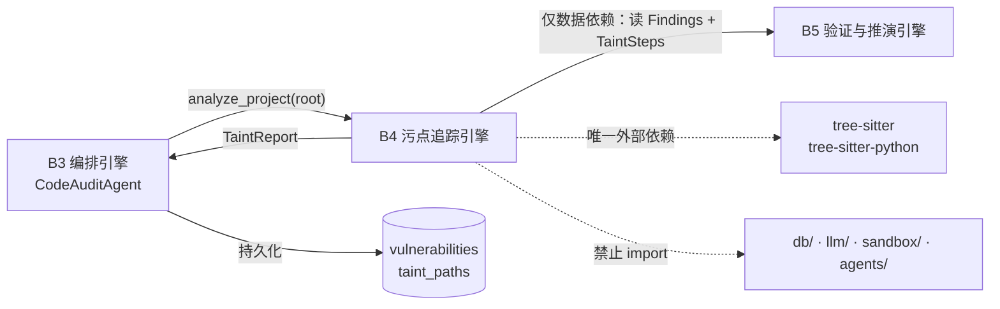
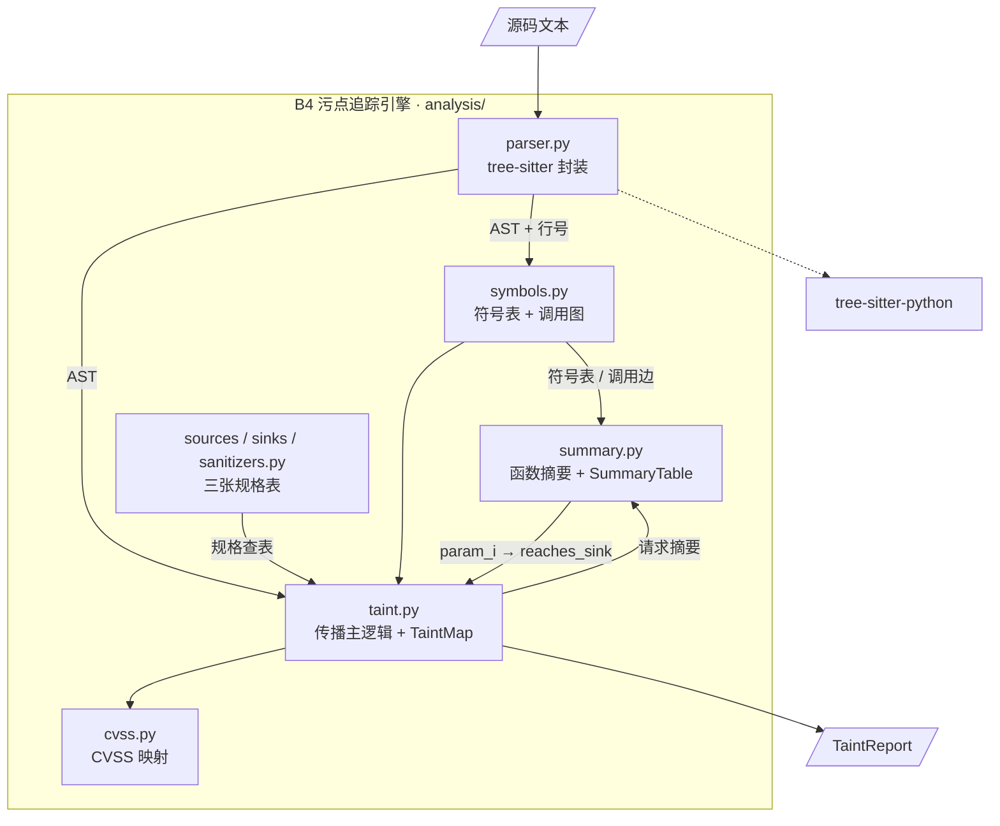
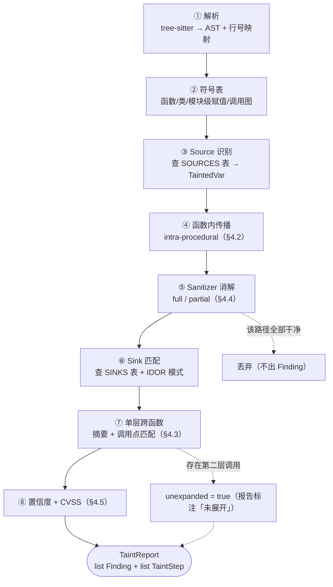
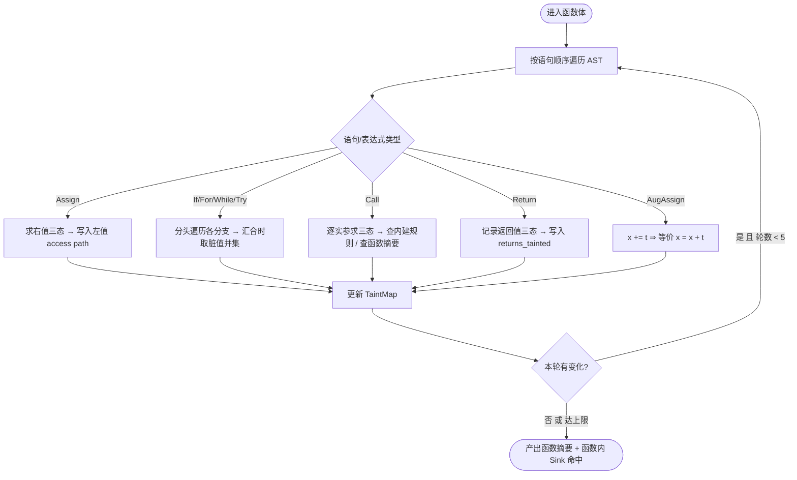
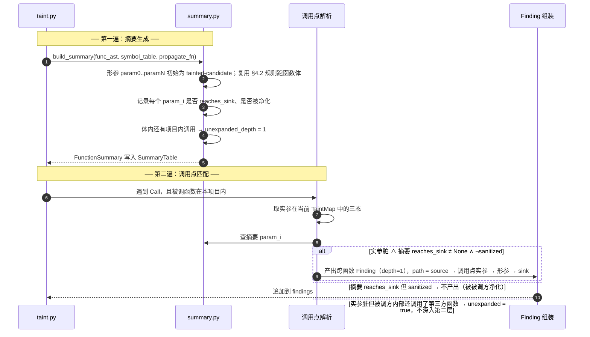
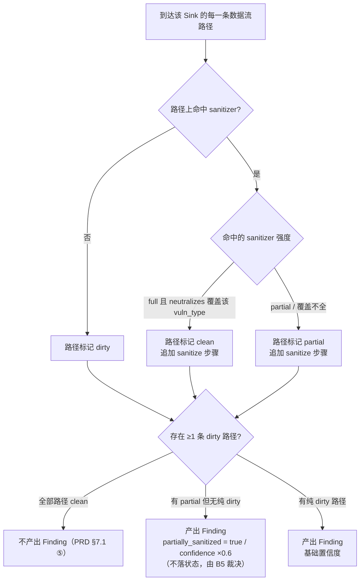
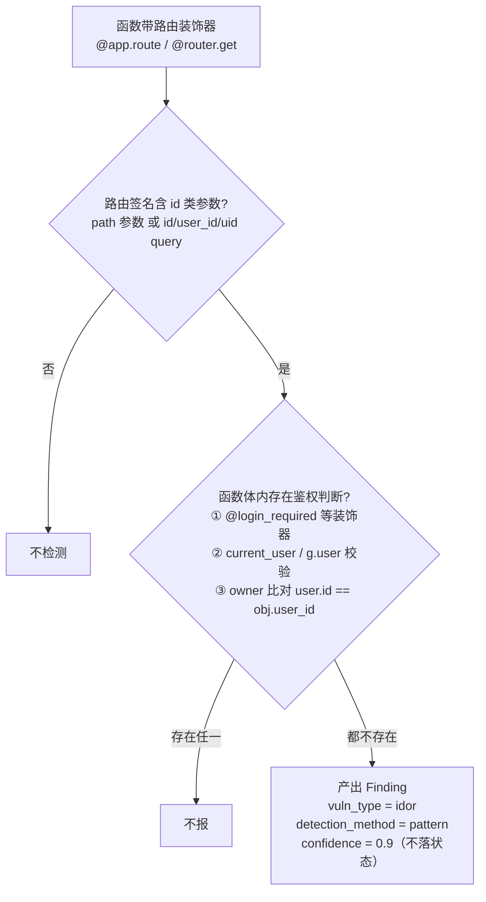

# 模块概要设计 — B4 污点追踪引擎

| 项 | 值 |
|---|---|
| 所属层 | L3 领域引擎层（零依赖，不 import 任何上层或 db） |
| 上游文档 | [PRD.md](../PRD.md)、[概要设计总纲.md](../概要设计总纲.md) |
| 对应需求 | 需求.md 2.5.6、2.5.4 |
| 文档层级 | 概要设计 |
| 代码位置 | `backend/app/analysis/` |
| 算法定义出处 | PRD §7.1（本文档是其模块化展开，不复制原文） |

---

## 1. 模块定位

### 1.1 职责

B4 是系统的技术核心（PRD §7.1）：把「一堆 `.py` 源码文本」变成「一组带完整 Source-to-Sink 轨迹的疑似漏洞记录」。`analyze_project(root)` 输入源码目录，输出 `TaintReport`。

| # | 职责 | 上游依据 |
|---|---|---|
| ①② | AST 解析（tree-sitter，产出 AST + 行列号映射，容错解析）；符号表与调用图（函数名/形参/默认值/装饰器、类、模块级赋值、项目内调用边） | PRD §7.1 ①② |
| ③④ | Source 识别（按框架规格表产出 `TaintedVar`）；函数内污点传播（赋值/拼接/容器/属性/分支会合/下标） | PRD §7.1 ③④ |
| ⑤⑥ | Sanitizer 识别与消解（判定「完全净化」与「部分净化」，决定报不报与置信度折扣）；Sink 匹配（按漏洞类型，含 IDOR 特殊模式） | PRD §7.1 ⑤⑥ |
| ⑦⑧ | 单层跨函数传播（函数摘要 + 调用点匹配，depth=1）；置信度与 CVSS 3.1 基础分映射 | PRD §7.1 ⑦⑧ |

### 1.2 明确不负责（边界）

| 不做 | 原因 | 归属 |
|---|---|---|
| 全程序指针分析 / 别名分析 / 堆建模 | 成本极高、收益边际；真实漏洞绝大多数在单层内可捕获（总纲 D6） | 不实现 |
| 沙箱执行、动态验证；任何网络请求（含 LLM 调用） | B4 连 `sandbox/` 都不 import；漏洞描述由 CodeAuditAgent 走 LLM 生成。**这正是 PRD §7.6 L1「LLM 不参与判定」的最强形式**——零依赖让「结论不由 LLM 产出」从约定升级为**结构上不可能**（总纲 §8.5 L1） | B2 + B5 / L4 `llm/` + B3 |
| 读写数据库 | 纯函数，产出对象交 B3 持久化（总纲 §3.3） | B3 |
| 攻击链组装 / 补丁生成 | 只看单点，只给定位与轨迹 | B5 / B3 |
| 产出**任何**漏洞状态字段（`unverified` / `verified` / `potential` / `rejected`） | 状态是生命周期概念：`unverified` 仅静态阶段产出，其余三态仅动态阶段产出；不应漏进纯函数库 | B5 裁决 + L2 Agent 落库（B3 编排器自身不写表，总纲 §3.4） |

**边界的目的是可测试性**：B4 零依赖意味着 `tests/test_taint.py` 可直接 `TaintAnalyzer().analyze_project("ranges/ecommerce")` 并对 `GROUND_TRUTH.yaml` 断言——不需要起 DB、不需要连阿里云、不需要 Docker（总纲 §3.3 原则 1）。

### 1.3 上下游关系



传达方式：上游 B3（经 `CodeAuditAgent`）传源码工作区路径，走**直接函数调用**；下游回传 `TaintReport` 由 B3 落库；B5 从 DB 读 `taint_paths` 构造探针，是**仅数据依赖**（总纲 §3.3 △）。

> 另有**第二个调用场景**：`CodeAuditAgent` 生成 Diff 补丁后，把**打过补丁的源码文本**再次交给 B4 复验「该条污点路径是否消失」（PRD §7.6 L3 第 ④ 道校验）。契约不变、**不新增接口**，详见 §3.4。

---

## 2. 内部分解

拆为 8 个子模块，对应 `analysis/` 下 8 个文件（PRD §5）。**设计原则：规格与算法分离**——`sources/sinks/sanitizers` 是**纯数据表**；`taint/summary` 是**纯算法**，通过查表驱动。新增漏洞类型只需改表，不改代码。

| 子模块 | 文件 | 职责 | 关键方法 / 数据 |
|---|---|---|---|
| parser | `parser.py` | 语言注册、文件遍历、tree-sitter 解析、行列号映射、容错降级 | `parse_file()` `iter_py_files()` `node_line()` |
| symbols | `symbols.py` | 符号表（函数/类/模块级赋值）、装饰器、项目内调用边 | `build_symbol_table()` `resolve_call()` `iter_calls()` |
| sources | `sources.py` | Source 规格表（框架 × 输入通道） | `SOURCES: list[SourceSpec]` `match_source()` |
| sinks | `sinks.py` | Sink 规格表（漏洞类型 × 危险参数位） | `SINKS: list[SinkSpec]` `match_sink()` |
| sanitizers | `sanitizers.py` | 净化函数规格表 + 净化强度判定 | `SANITIZERS` `match_sanitizer()` `is_parametric_sql()` `is_whitelist_guard()` |
| taint | `taint.py` | 函数内传播主逻辑、`TaintMap`、Finding 组装、IDOR 模式 | `TaintAnalyzer` `TaintMap` `_merge_branches()` |
| summary | `summary.py` | 函数摘要生成与调用点匹配（跨函数） | `build_summary()` `match_call_site()` `SummaryTable` |
| cvss | `cvss.py` | CVSS 3.1 基础分规则映射（类型 × 认证 × 远程） | `base_score()` `vector_for()` `severity_of()` |

### 2.1 组件图


（`T -.-> EXT` 省略未画：`taint.py` 同样直接用 tree-sitter 节点 API。）**无环性**：`taint.py` 调用 `summary.py`，`summary.py` 反过来**复用** `taint.py` 的函数内传播规则（以「形参初始 tainted」为入口跑一遍）。该复用通过**依赖注入**实现——`build_summary()` 接收传播规则回调，而非 `import taint`，避免模块级循环 import。

---

## 3. 对外接口

### 3.1 暴露给上层的接口

签名与总纲 §6.1 约定一致，仅增加带默认值的可选参数（向后兼容）。

```python
# analysis/taint.py —— 纯函数式分析器：同一输入必然产出同一输出，无状态副作用
class TaintAnalyzer:
    def __init__(self, langs: tuple[str, ...] = ("python",)) -> None: ...

    def analyze_file(self, path: str, source: str) -> list[Finding]:
        """单文件分析。path 仅用于元信息与相对路径标注，不读磁盘。"""

    def analyze_project(
        self, root: str, *,
        include: list[str] | None = None,        # 默认 ["**/*.py"]，按 ReconAgent 顺序裁剪
        max_file_bytes: int = 2 * 1024 * 1024,   # 超大文件降级阈值
        max_functions_for_summary: int = 5000,   # 摘要表规模上限
    ) -> TaintReport:
        """项目级分析：两遍遍历（摘要 + 传播）。"""
```

**契约三条（写进 docstring 并被测试断言）**：① **确定性**——返回值完全由入参决定，不含时间戳/随机 ID；所有 `file_path` 一律为**以工作区根为基准的 POSIX 相对路径**（如 `app/api/order.py`），**不得带 Windows 绝对路径或盘符**（总纲 §7.4）；② **无副作用**——不写磁盘、不读 DB、不发网络、不改全局状态；③ **不抛异常兜底**——单文件失败一律转成 `TaintReport.skipped_files`，只有「tree-sitter 不可用」「root 不可读」才抛（§6）。

### 3.2 依赖的下层接口

唯一反向下层依赖是 **`tree_sitter` + `tree_sitter_python`**（版本锁在 `pyproject.toml`，ABI 不匹配视为 L5）；其余仅 Python 标准库（`os` / `pathlib` / `dataclasses` / `typing`）。

**明确禁止的 import**（可写成架构测试）：`app.db`、`app.models`、`app.llm`、`app.sandbox`、`app.agents`、`app.orchestrator`。任一条被 import，即构成 L3→L2 反向依赖，违反总纲 §3.4。

### 3.3 本模块定义的数据结构

**（1）规格表三件套**（纯数据，可配置）：

```python
class SourceSpec(BaseModel):
    symbol: str          # 如 "request.args.get"
    framework: Literal["flask", "fastapi", "generic"]
    channel: Literal["http_param","http_body","cookie","header","env","argv","stdin","db_read"]
    tainted_by_default: bool

class SinkSpec(BaseModel):
    symbol: str          # 如 "cursor.execute" / "os.system"
    vuln_type: str       # sql_injection / command_injection / ...
    dangerous_args: list[int]   # 危险参数位（-1 表示「任一实参」）
    requires_shell: bool        # subprocess.* 需 shell=True 才算
    rce_class: bool             # 置信度 ×1.1 的标志位；severity_hint: str
class SanitizerSpec(BaseModel):
    symbol: str          # 如 "werkzeug.utils.secure_filename"
    category: Literal["int","filename","shell","sql_param","whitelist","escape","orm"]
    neutralizes: list[str]      # 能中和的 vuln_type 列表
    strength: Literal["full", "partial"]
```

**（2）中间态**：`TaintState{tainted, partially_sanitized, sanitizers, origin}`、`TaintedVar{symbol, file_path, line, origin, channel}`。

**（3）产出**：

```python
class TaintStep(BaseModel):
    step_index: int
    step_type: Literal["source", "propagate", "sanitize", "sink"]
    file_path: str          # 工作区根相对 POSIX 路径（总纲 §7.4）
    line: int; symbol: str; code_snippet: str
    note: str | None        # 如 "跨函数未展开" / "whitelist guard"

class ParamFlow(BaseModel):
    reaches_sink: str | None    # vuln_type；None 表示不达
    sink_line: int | None; sanitized: bool; path: list[TaintStep]

class FunctionSummary(BaseModel):
    qualname: str; file_path: str; params: list[str]
    param_flows: dict[str, ParamFlow]   # 键 "param0" / "param1"
    returns_tainted: bool
    unexpanded_depth: int               # 函数体内还有更深调用 → 1；is_public_entry: bool（IDOR 用）
class Finding(BaseModel):
    vuln_type: str; title: str
    file_path: str                      # 工作区根相对 POSIX 路径（总纲 §7.4）
    line_start: int; line_end: int
    code_snippet: str                   # 触发行 ±20 行（供 LLM 与前端）
    source: TaintStep; sink: TaintStep
    path: list[TaintStep]               # 完整 Source→Sink 轨迹
    inter_procedural: bool; partially_sanitized: bool; unexpanded: bool
    detection_method: Literal["taint_intra", "taint_inter", "pattern"]
    confidence: float; cvss_score: float; cvss_vector: str
    severity: Literal["critical", "high", "medium", "low"]   # 漏洞严重度，非项目综合等级
    # 注意：B4 不产出任何 status 字段（见下方说明）

class TaintReport(BaseModel):
    findings: list[Finding]; summaries: dict[str, FunctionSummary]
    files_scanned: int; files_skipped: list[SkipRecord]   # (path, reason, level)
    unexpanded_calls: int; elapsed_ms: int
```

> **B4 不产出任何状态字段。** 漏洞状态是四态（`unverified` / `verified` / `potential` / `rejected`）：`unverified` **仅由 `code_audit` 阶段产出**，其余三态**仅由 `poc_verify` 阶段产出**（PRD §6 关键设计说明 1、总纲 §5.3）。`potential` 是**动态验证阶段**的产物，静态阶段不产出该状态；状态是生命周期概念，不应漏进纯函数库（与「B4 零依赖」原则一致）。此前设计的 `Finding.suggested_status` 提示字段**已被上游否决，本版已删除**。
>
> **「部分路径净化」的信号改由置信度承载**：路径部分净化时**仍报该 Finding**，但 `confidence ×0.6`，状态保持 `unverified`（PRD §7.1 ⑤）。
>
> **术语**（PRD §6）：本模块产出的 `severity` 是**漏洞严重度**（`critical`/`high`/`medium`/`low`）；`assessments.security_grade` 是**项目综合等级**（`critical`/`high`/`medium`/`safe`），由 B6 计算，二者不可混用。

### 3.4 补丁复验调用场景（LLM L3 校验第 ④ 环）

PRD §7.6 L3 规定：LLM 生成的 Diff 补丁要过四道校验，其中第 ④ 条是「**把打完补丁的源码重跑污点引擎，确认该条污点路径消失**」。这一步的「污点引擎」就是 B4，因此 B4 多了一个**由控制面驱动的复验调用场景**（总纲 §8.5 L3：校验全部在控制面完成，**不需要沙箱**，代价是毫秒级）。

| 项 | 说明 |
|---|---|
| 调用方 | `CodeAuditAgent`（B3，控制面），在拿到 LLM 补丁后、决定是否采纳前调用 |
| 输入 | **打好补丁的源码文本**（单文件）+ 该文件的相对路径；不传补丁本身、不传 LLM 输出 |
| 输出 | 该文件重新分析后的 `list[Finding]`；调用方据此判定「目标污点路径是否还在」 |
| 归属 | B4 只回答「这条污点路径是否还存在」，**不判断补丁好坏、不改补丁、不决定是否采纳**（补丁采纳权在人工，PRD §12 风险 12） |

**是否需要新增接口：不需要。** 现有 `analyze_file(path, source)`（§3.1）已是**纯函数**——`path` 仅作元信息、不读磁盘，`source` 即待分析的源码文本。复验时直接 `analyze_file(path, patched_source)` 即可，**传入打过补丁的源码文本**，无需新增方法、也无需改动 `analyze_project`。这正体现 §3.1 契约三条的价值：无状态、无副作用，可被同一进程以不同源码反复调用。

**复验比对约定**：补丁会改变行号，因此**不得用裸行号比对**；调用方应以 `(file_path, vuln_type, sink.symbol)` 或污点路径特征（source 符号 + sink 符号 + `step_type` 序列）作为「同一条污点路径」的身份锚，比对复验前后该锚是否消失。B4 侧只需保证 `Finding` 的 `vuln_type` / `source` / `sink` / `path` 稳定可复现（§3.1 确定性契约），**比对逻辑属调用方（B3）**。

**边界澄清**：复验**不引入任何新依赖**——B4 仍不 import `llm/`、不 import `patches` 相关模型、不落库、不感知「补丁」这一概念，它只是被喂了一份源码文本；输入输出契约与 §3.1 完全一致。

---

## 4. 关键处理流程

### 4.1 八步流水线总览

对应 PRD §7.1 ①②③④⑤⑥⑦⑧。第 ① 步与 ②–⑦ 步之间是**两遍遍历**结构（见 §4.3）。



各步的失败处理见 §6：①②的两类失败最典型——解析失败为 L1（跳过单文件），符号冲突为 L2（不建摘要、跨函数降级为未展开）。

### 4.2 函数内传播算法

**TaintMap 的键是访问路径（access path）**而非裸变量名：`uid`、`user.name`、`rows[0]`、`data["k"]`。值域为三态 `{clean, partial, tainted}`，用**格（lattice）运算**：分支汇合取「最脏」（对应 PRD §7.1 ④ 分支会合规则）。



**为什么要不动点迭代**：`acc = ""` 后循环里 `acc += param` 这类累积赋值，单遍顺序遍历会漏掉循环回边。迭代到不动点（上限 5 轮）以极低成本覆盖循环携带的污点，上限保证终止性。

#### 传播规则表（PRD §7.1 ④ 的六条）

| # | 语法形态 | 规则 | 备注 |
|---|---|---|---|
| 1 | `x = t` | 右值脏 ⇒ `x` 与右值同态 | 基础 |
| 2a | f-string `f"{t}..."` | `JoinedStr` 任一 `FormattedValue` 脏 ⇒ 结果脏 | 逐插值位求值 |
| 2b | `"%s" % t` | 右操作数脏 ⇒ 结果脏 | `BinOp(Mod)` |
| 2c | `t + "..."` | 任一侧脏 ⇒ 结果脏 | 仅 `BinOp(Add)` 传播，其余运算符不传播 |
| 2d | `"...".format(t)` | `format` 的实参脏 ⇒ 结果脏 | 含 `{0}` 位置与 `{k}` 关键字 |
| 3 | `[t]` / `{"k": t}` / `t.append(x)` | 容器内任一元素脏 ⇒ 容器脏 | `append/extend/update/insert/setdefault` 视为容器污染 |
| 4 | `t.attr` | 属性访问**保守传播**：基对象脏 ⇒ 结果脏 | 见 §7 权衡 3 |
| 5 | `if/else` 分支会合 | 任一分支脏 ⇒ 汇合后脏（并集） | `try/except` 与循环体同规则 |
| 6 | `t[0]` / `t[k]` | 基对象脏 ⇒ 结果脏 | 反向不成立（避免污染整个容器） |

**刻意不传播的形态**（减少误报）：`len(t)`、`bool(t)`、算术 `t * 2`、`t == "x"` 的布尔结果、`t.sort()` 等不改变字符串语义的调用。把这些标脏会把大量无害代码变成误报。

### 4.3 单层跨函数传播（depth = 1）

**两遍遍历**：第一遍为项目内每个函数生成摘要（形参视为「候选污点」跑一遍函数内传播）；第二遍逐函数扫描调用点，用实参的实际污点性查被调函数摘要。



**摘要的数据形态**（落实 PRD §7.1 ⑦a 的示例）：`def query_order(uid): cursor.execute("SELECT ... WHERE id=%s" + uid)` ⇒ `FunctionSummary(qualname="app.query_order", params=["uid"], param_flows={"param0": ParamFlow(reaches_sink="sql_injection", sink_line=42, sanitized=False, path=[...])}, unexpanded_depth=0, is_public_entry=True)`。

| 规则 | 设计 |
|---|---|
| 展开深度 | **只展开一层**（总纲 D6）。第二层调用记 `unexpanded_depth=1`，Finding 标 `unexpanded=true`，报告显示「调用链更深，未展开」 |
| 为什么敢停在第一层 | 真实漏洞绝大多数是「路由 → 工具函数 → sink」；再深一层的边际召回远低于引入的虚假精确 |
| 递归函数 | 摘要生成有迭代上限与 visited set；`f` 调 `f` 时以「形参候选脏」参与，不无限展开 |
| 摘要不可用时 | 被调函数无摘要（外部库 / 符号冲突）→ 调用点**不产出**跨函数 Finding，只记 WARN |
| 关键字实参 | `f(x=t)` 按形参名映射；`*args` / `**kwargs` 的映射策略移交详细设计 |
| 去重 | 同一 `(source_line, sink_line, vuln_type)` 只保留置信度最高的一条 |

### 4.4 Sanitizer 消解与判定

#### Sanitizer 清单（PRD §7.1 ⑤）

| 类别 | 符号 / 形态 | 可中和的 vuln_type | 强度 | 判定要点 |
|---|---|---|---|---|
| 整型化 | `int()` | sql_injection, command_injection, path_traversal | **full** | 转换成功即不可能携带注入载荷 |
| 文件名 | `werkzeug.utils.secure_filename` | path_traversal, file_upload | **full** | |
| 命令 | `shlex.quote` / `shlex.split` 后列表传参 | command_injection | **full** | `shlex.split` 结合 `shell=False` 视为净化 |
| SQL 参数化 | `execute(sql, params)` 且 `sql` 为**常量字面量**、`params` 独立传参 | sql_injection | **full** | 需同时满足：SQL 是常量 + 参数走第二实参 |
| 白名单 | 与常量集合 `in` / `==` 比较后取常量分支 | sql_injection, command_injection, path_traversal, idor | **full** | `if x not in ALLOWED: return` 反向守卫也计入 |
| 转义 | `html.escape` / `markupsafe.escape` | xss | **full** | |
| ORM | SQLAlchemy `filter_by(col=val)` / `filter(Model.col == val)` 且列名来自常量 | sql_injection | **full** | 列名含变量 → 不净化 |
| 类转换（弱） | `str()` / `json.dumps()` / `.strip()` | — | **partial** | 只改表示形态，不消除语义 |

#### 「完全净化」vs「部分净化」判定

判定发生在 **Sink 匹配阶段**（不是传播阶段），因为「全路径净化」是相对于**具体一条 source→sink 路径**而言的。



| 情形 | 判定 | 产出 |
|---|---|---|
| 全部路径都命中 full sanitizer | **完全净化** | 不报（PRD §7.1 ⑤） |
| 存在 partial（如只 `str()` 过） | **部分净化** | **仍报**该 Finding，`partially_sanitized=true` 且置信度 ×0.6；**不落状态**（PRD §7.1 ⑤） |
| 存在至少一条完全未净化路径 | **未净化** | 报该 Finding，正常置信度（需求 2.5.4） |
| 净化在**被调函数内部**完成（跨函数） | 摘要 `sanitized=true` | 调用点不报（PRD §7.1 ⑦a） |

**误报控制的关键就是这张表**：`is_parametric_sql()` 与 `is_whitelist_guard()` 两个判定函数直接决定靶场误报数（PRD §12 风险 9 的缓解手段）。

### 4.5 置信度与 CVSS 计算

#### 置信度公式（PRD §7.1 ⑧）

```
confidence = 0.9
           × 0.9   若 inter_procedural        # 间接性折扣
           × 0.6   若 partially_sanitized     # 「部分路径净化」信号（PRD §7.1 ⑤）
           × 1.1   若 sink.rce_class          # RCE 类升高
confidence = min(confidence, 1.0)              # 封顶
confidence = round(confidence, 3)
```

| 场景 | 计算 | 结果 |
|---|---|---|
| 函数内 + 普通 sink / 函数内 + RCE | `0.9` / `0.9 × 1.1` | **0.9** / **0.99** |
| 跨函数 + 普通 / 跨函数 + RCE | `0.9 × 0.9` / `× 1.1` | **0.81** / **0.891** |
| 部分净化 + 普通 / 部分净化 + 跨函数 | `0.9 × 0.6` / `× 0.9` | **0.54** / **0.486** |

语义澄清（与总纲 §7.3 一致）：**`confidence` 不是概率**，是启发式权重，用于排序与前端展示，不参与「报不报」的判定。其中 `×0.6` 这一档**专门承载「部分路径净化」的信号**——它既不改变「报不报」（部分净化仍产出 Finding），也不落任何状态，只降低排序权重并提示人工复核（PRD §7.1 ⑤）。`unexpanded=true` 不额外乘系数，改在报告侧以文字标注——用显式事实替代伪装成精确度的数字。

#### CVSS 3.1 基础分映射

`cvss.py` 按「漏洞类型 × 是否需要认证 × 是否可远程触发」查表，直接给出向量串与基础分。

| 漏洞类型 | PR | CVSS 3.1 向量 | Base | 严重度 |
|---|---|---|---|---|
| command_injection / deserialization（RCE 类） | N | `AV:N/AC:L/PR:N/UI:N/S:U/C:H/I:H/A:H` | 9.8 | critical |
| sql_injection | N | `AV:N/AC:L/PR:N/UI:N/S:U/C:H/I:H/A:N` | 9.1 | critical |
| file_upload（getshell） | L | `AV:N/AC:L/PR:L/UI:N/S:U/C:H/I:H/A:H` | 8.8 | high |
| path_traversal / info_disclosure / unauthorized_access | N | `AV:N/AC:L/PR:N/UI:N/S:U/C:H/I:N/A:N` | 7.5 | high |
| idor（PR:L）/ weak_auth（PR:N） | L / N | `AV:N/AC:L/PR:L/UI:N/S:U/C:H/I:N/A:N` / `AV:N/AC:L/PR:N/UI:N/S:U/C:L/I:L/A:N` | 6.5 | medium |

严重度分档（CVSS 3.1 定性等级）：critical 9.0–10.0 / high 7.0–8.9 / medium 4.0–6.9 / low 0.1–3.9。

**归属边界**：B4 只给**静态基础分**。`poc_verify` 通过后的上调（如 `7.5 → 9.8`）属 B5 职责（PRD §7.1 ⑧ 末句、总纲 §5.3）。B4 的 `cvss_score` 在报告中标注为「基线分」。

#### IDOR 特殊检测模式（非数据流）

IDOR 不属于污点流，属**模式匹配**（`detection_method = "pattern"`）：



该模式对应 `ranges/usercenter` 的 V5（`/api/user/<id>/profile` 无 owner 校验）与 V6（`/api/user/list` 无鉴权装饰器），即 PRD §10.2 的两条主漏洞。

---

## 5. 数据设计

### 5.1 落库映射

B4 **不写数据库**。`TaintReport` 先进入 `AssessmentContext`，由 B3（`CodeAuditAgent` 收尾）转换为 ORM 对象并持久化（总纲 §3.3 矩阵：B4 行对 db 列无标记）。

| B4 对象 | 目标表 | 字段映射 |
|---|---|---|
| `Finding` | `vulnerabilities` | `vuln_type → category`、`title`、`file_path`（相对 POSIX 路径）、`line_start`、`line_end`、`code_snippet`、`confidence`、`cvss_score`、`cvss_vector`、`severity`、`detection_method`；`code`（`VULN-YYYY-NNNN`）由 B3 生成；`description` 由 LLM/降级模板生成；**`status` 不由 B4 产出**——静态阶段固定为 `unverified`，最终态由 B5 裁决（PRD §6） |
| `Finding.path`（`list[TaintStep]`） | `taint_paths` | `step_index`、`step_type`、`file_path`（相对 POSIX 路径）、`line`、`symbol`、`code_snippet`、`note` |
| `TaintReport.files_skipped` | `assessment_stages.log_excerpt` | 拼成 WARN 汇总行 |
| `TaintReport.summaries` | 不落库 | 仅进程内使用；断点续跑时复用 `result_ref` 中已存的 findings，不重建 |

**路径规范**（总纲 §7.4）：`vulnerabilities.file_path` 与 `taint_paths.file_path` 落库时一律为**以工作区根为基准的 POSIX 相对路径**（如 `app/api/order.py`）。B4 产出的 `Finding` / `TaintStep` 不得带 Windows 绝对路径或盘符；三端绝对根由配置解析，B4 只认工作区根。

### 5.2 `taint_paths` 的三点设计意图

① `step_type` 含 `sanitize`——前端「污点传播步进标记」靠它渲染净化点（总纲 §7.3）；② 步骤**有序**（`step_index`）——步进条可逐点播放 Source → …sanitize… → Sink；③ `note` 承载「未展开」——报告与详情页能如实告知「调用链更深，静态未展开」，不假装完整覆盖。①②受益方为 F3，③为 B6 / F3。

**证据不可再生**（总纲 §7.2）：`vulnerabilities` 与 `taint_paths` 属证据层，任务被终止时保留。

---

## 6. 出错处理

错误级别采用总纲 §9.1 的 L1–L5 定义。**B4 的错误几乎全部是 L1/L2**——这是「纯函数、无外部依赖」的结构性优势：没有网络、没有沙箱、没有 DB，就没有 L4/L5 的来源，除了解析器本身不可用。

| # | 错误场景 | 级别 | 检测方式 | 处理策略 | 可恢复性 |
|---|---|---|---|---|---|
| 1 | 单文件语法错误（`ERROR` 节点） | L1 | 根节点 `has_error` | 记 `SkipRecord(syntax_error)`；**文件内可解析的片段仍尝试匹配 Source/Sink**；其余文件不受影响 | 可恢复 |
| 2 | 单文件编码异常（非 UTF-8 / BOM / GBK） | L1 | `UnicodeDecodeError` | 依次退 `utf-8-sig` → `gbk` → `latin-1`；全失败则跳过 | 可恢复 |
| 3 | 超大文件（> `max_file_bytes`，默认 2MB）/ 单文件解析超时（> 5s） | L2 | 文件大小预检 / 软计时器 | 超大：只跑 `pattern` 类检测（IDOR / 硬编码密钥），不做数据流；超时：丢弃该文件结果。均记 `SkipRecord` 并继续 | 可恢复 |
| 5 | AST 遍历递归过深（嵌套 > 500） / 不动点不收敛（轮数 > 5） | L1 | 深度计数、迭代轮数 | 达上限即停止深入或强制收敛，用当前结果并记 WARN | 可恢复 |
| 6 | 符号表冲突（同名函数 / 动态定义） | L2 | 摘要表插入冲突检测 | 冲突函数**不建摘要**，其调用点降级为「未展开」 | 可恢复 |
| 7 | 摘要表规模超限 | L2 | 计数 > `max_functions_for_summary` | 只对调用图入度最高的前 N 个函数建摘要 | 可恢复 |
| 8 | 递归/循环调用导致摘要生成不终止 | L2 | 摘要生成的 visited set | 遇正在生成中的摘要返回「保守未知」，不产出跨函数 Finding | 可恢复 |
| 9 | 单文件 Finding 数超阈值 | L2 | 计数 | 截断并记 WARN，报告标注「该文件结果被截断」 | 可恢复 |
| 10 | 项目内无任何 `.py` 文件 | L1 | 文件枚举为空 | 返回空 `TaintReport`，`code_audit` 正常完成但零产出 | 可恢复 |
| 11 | `tree-sitter` 未安装 / ABI 不匹配 | **L5** | 首次 import 与 parser 构建时捕获 | 抛 `TaintEngineUnavailable`，B3 将 `code_audit` 标 `failed`（总纲 §5.2「解析器崩溃 → failed」） | 不可恢复（需修环境） |
| 12 | 源码 `root` 不可读 / 权限拒绝 | **L5** | `os.access` / `PermissionError` | 抛 `SourceUnreadable`，整体 `failed`（与总纲 §9.1 L5 一致） | 不可恢复 |

**错误信息规范**：所有 `SkipRecord` 与抛出异常都携带总纲 §9.2 的四要素，例如 `{"stage": "code_audit", "error_code": "TAINT_PARSE_SKIPPED", "message": "ranges/ecommerce/broken.py 存在语法错误，已跳过数据流分析", "remediation": "修复该文件语法后重新评估；或确认该文件为遗弃代码", "retryable": false}`。

**一条硬约束**：B4 绝不因单个文件的问题让整个 `code_audit` 失败。L1/L2 全部是「跳过 + 记录」——静态分析的产出是**统计量**（召回率/误报数），少一个文件只是少一点覆盖，不该让整次评估作废。

---

## 7. 设计约束与权衡

### 7.1 可测试性与测试策略

零依赖的直接收益是测试极其简单。`tests/test_taint.py` 的形态：

```python
def test_ecommerce_ground_truth():
    report = TaintAnalyzer().analyze_project("ranges/ecommerce")
    truth = load_ground_truth("ranges/ecommerce/GROUND_TRUTH.yaml")
    hit = match_by_line(report.findings, truth)             # 按 (file, line) 匹配
    assert hit.recall >= 7                                  # ≥7/8（PRD §1.2）
    assert len(report.findings) - hit.true_positives <= 3   # 误报 ≤3
```

| 测试层 | 内容 | 断言 |
|---|---|---|
| 单元 | §4.2 传播规则 1–6 逐条一例；§4.4 每个 sanitizer 逐条一例 | 变量三态符合预期；clean / partial 判定正确 |
| 单元 | 摘要生成 + 调用点匹配 | `param0.reaches_sink` 正确、depth 停在 1 |
| 集成 | 对 `ranges/ecommerce`（V1–V4）与 `ranges/usercenter`（V5–V8）跑 `GROUND_TRUTH.yaml` | **召回 ≥ 7/8，误报 ≤ 3** |
| 回归 | 全部靶场文件的 `Finding` 快照对比 | 改动规则不得让已检出漏洞消失 |
| 架构 | `analysis/` 的 import 白名单扫描 | 不得出现 `db`/`llm`/`sandbox`/`agents` |

### 7.2 取舍表

| # | 决策点 | 选择 | 放弃的方案 | 理由 | 代价 |
|---|---|---|---|---|---|
| 1 | 跨函数深度 | 单层（depth=1）+ 摘要 | 全程序 / N 层递归 | 覆盖多数真实形态且可完整讲清；摘要机制天然可递归，留演进位 | 深层调用链漏报（总纲 D6） |
| 2 | 解析后端 | tree-sitter | semgrep / 内置 `ast` | 自研是核心叙事（D5）；tree-sitter **容错解析**，内置 `ast` 遇错即抛，直接违背 §6 场景 1 的 L1 策略 | 规则表需自己维护 |
| 3 | 属性访问 `t.attr` | 保守传播 | 精确字段敏感分析 | 与 PRD §7.1 ④ 明示一致；精确分析需类型推断，成本远超收益 | 可能高估污点范围，靠 sanitizer 与置信度兜底 |
| 4 | LLM 是否参与判定 | **不参与** | 让 LLM 判断 sink 危不危险 | demo 结论不能因模型抖动改变（D13）；引入 LLM 就破了零依赖 | LLM 价值限于描述与补丁 |
| 5 | Sanitizer 判定方式 | 白名单规格表 + 少量结构性判定 | 类型推断 / 数据流验证 | 白名单可控、可测、误报可量化；靶场回归直接驱动规则增补（风险 9） | 未列出的净化方式漏判 → 误报 |
| 6 | 传播精度 | 控制流不敏感 + 分支并集 + 不动点迭代 | 控制流敏感 / 路径敏感 | 实现量约为后者 1/5，召回差距在靶场上很小 | 「先污染后覆盖」场景可能误报 |
| 7 | 状态管理 | 纯函数、无缓存 | 进程内 AST / 摘要缓存 | 零依赖 + 可重入，测试与并发都简单；性能靠 `include` 裁剪而非缓存 | 大工程重复解析（当前规模不构成瓶颈） |
| 8 | 未展开的第二层 | 显式标注 `unexpanded=true` | 静默丢弃 | 「如实告知不完整」比「假装精确」更有说服力（PRD §7.1 ⑦c） | 报告多一栏说明 |
| 9 | 是否产出状态字段 | **不产出**（B4 零状态） | 由 B4 给出 `suggested_status` 建议值 | `potential` 是动态验证阶段的产物，静态阶段不产出；状态是生命周期概念，不应漏进纯函数库（与「B4 零依赖」原则一致）；「部分净化」信号改由 `confidence ×0.6` 承载（PRD §6 / §7.1 ⑤） | 「部分净化」只能靠置信度与 `partially_sanitized` 标记间接表达 |
| 10 | 语言支持 | 仅 Python（`tree-sitter-python`） | 同时支持 Java/JS | PRD §15 遗留假设 2 明确仅 Python；`parser.py` 按语言注册 parser、三张规格表按语言分组，扩展位已留（总纲 §12.2） | 非 Python 工程不可扫 |

### 7.3 与 LLM 可控性四铁律的关系（PRD §7.6 / 总纲 §8.5）

上游把「可控多智能体 · 避免大模型天马行空」升为第一性原则，用四条铁律约束 LLM（PRD §7.6 整节、总纲 §8.5）。B4 的零依赖设计与之**完全同向**，逐条对应如下：

| 铁律 | B4 的落点 |
|---|---|
| **L1 不参与判定** | B4 是 L1 的**最强形式**：不只是「不用 LLM 判定」，而是**结构上不可能用**——`analysis/` 连 `llm/` 都不 import（§3.2 的架构测试项）。漏洞有无、类型、`severity`、`cvss_score` / `cvss_vector`、污点路径、攻击链节点与边的**输入事实**全部由确定性代码产出；LLM 输出永不进入 B4，更不进入控制流 |
| **L2 不引入事实** | B4 不接收任何 LLM 输出。相反，`Finding` 的**结构化字段（`file_path` / 行号 / `vuln_type` / `cvss_*` / `severity` / `detection_method`）全部由 B4 代码填充**，是下游 LLM 文案的**事实来源**；LLM 只被允许回填自由文本 `description`（由 `CodeAuditAgent` 负责），B4 不参与该环节 |
| **L3 输出必校验** | 补丁四道校验的第 ④ 条「**污点引擎复验**」的执行体就是 B4（§3.4）；B4 提供确定性的 `analyze_file` 入口，让「补丁是否真修好」由污点引擎复算，而非由模型自证 |
| **L4 可降级不阻断** | B4 对 LLM 零依赖，因此**任何 LLM 故障（无 key / 超时 / 限流 / 校验不过）都不影响 B4**；B4 自身也不因单文件问题中断整体（§6 的 L1/L2 全为「跳过 + 记录」） |

**冲突核查结论**：B4 现有设计**不存在与 L1–L4 冲突的表述**——§1.2「明确不负责」已排除 LLM 与状态产出，§3.2 已把 `llm/` 列为禁止 import，§7.2 取舍 4「LLM 不参与判定」已确立立场。本次仅补上对 PRD §7.6 / 总纲 §8.5 的引用，并据 L3 第 ④ 条新增 §3.4 复验调用场景，未改动任何既有算法设计。

---

## 8. 移交详细设计的待定项

| # | 待定项 | 为什么概要层定不了 | 影响 |
|---|---|---|---|
| 1 | `TaintMap` access path 的**规范化与匹配规则**（精确 vs 前缀匹配，`a.b` 是否覆盖 `a.b.c`） | 属数据结构细节 | 传播精度与性能 |
| 2 | f-string `JoinedStr` 的逐 `FormattedValue` 求值（嵌套 f-string、说明符 `{x:>10}`）；`%` 与 `.format()` 模板解析（位置索引乱序、`{k}` 与实参映射） | 属算法细节 | 字符串拼接类漏报 |
| 3 | 摘要匹配时关键字实参 / `*args` / `**kwargs` / 默认值的形参映射策略 | 需实测靶场后定 | 跨函数召回的边界 |
| 4 | 白名单守卫的**精确语法模式集**（`if x not in W: abort()`、`match` 语句、`assert`） | 需实测靶场后定 | 直接决定误报数 |
| 5 | IDOR 的「鉴权判断」词法特征集合（装饰器名清单、`current_user` / `g.user` / `owner` 比对的识别形态） | 需实测靶场后定 | 靶场 V5/V6 检出 |
| 6 | 参数化 SQL 判定边界（`text()` 包装、SQLAlchemy 2.0 `execute(text(...), {...})`） | 需对齐 SQLAlchemy 用法 | 误报数 |
| 7 | 不动点迭代的收敛判据与轮数上限（暂定 5 轮） | 需性能实测 | 性能与精度 |
| 8 | 「需要认证但目标函数是公开路由」时 CVSS 映射的修正规则 | 需与 B5 对齐 | 评分一致性 |
| 9 | 大工程性能目标与并行策略（是否 `multiprocessing` 按文件分片） | 与 B3 并发模型耦合（当前并发度=1） | 单靶场耗时预算 |
| 10 | 非 Python 语言的注册接口形态（`parser.py` + 三张规格表的扩展点签名） | 本期不实现 | 未来扩展 |

---

## ⚠️ 与上游一致性核对

> 上游 PRD（§7.6 整节重写为「四条铁律」、§6 数据模型、§13 覆盖表）与总纲（新增 §8.5、§12.2 已定案）本次修订后，本文档此前登记的三处不一致**均已由上游解决**（下表 ✅）。本次新增的 LLM 可控性四铁律，B4 已逐条核对**无冲突**（见 §7.3），并据 L3 第 ④ 条新增 §3.4「补丁复验」调用场景。

| # | 位置 | 不一致内容 | 状态 / 本文档的处理 |
|---|---|---|---|
| 1 | 概要设计总纲 §2.2 逻辑架构图 | Mermaid 节点标签整体错位：节点 id `B3` 标为「B4 污点追踪」、`B4` 标为「B5 验证与推演」、`B5` 标为「B6 报告汇编」，与 §3.1 的编号定义矛盾 | ✅ 已由上游修订解决（总纲 §2.2）：节点 id 现为 `B4`「B4 污点追踪（纯函数，不落库）」、`B5`「B5 验证与推演」、`B6`「B6 报告汇编」；本文档以 §3.1 编号为准（**B4 = 污点追踪引擎**） |
| 2 | PRD §7.1 ⑤ vs 概要设计总纲 §5.3 | PRD 原规定「部分净化则降级为 `potential`」，即**静态阶段**即可产出 `potential`，与 §5.3 状态机冲突 | ✅ 已由上游修订解决（PRD §6 关键设计说明 1 / §7.1 ⑤）：改为「**仍报但置信度 ×0.6，状态保持 `unverified`**」。本文档已**删除 `Finding.suggested_status`**，B4 不产出任何状态字段 |
| 3 | PRD §13 覆盖表 vs PRD §6 | §13 原写「`§6 vulns.status` 三态」，而 §6 已明确四态（`unverified` 仅 `code_audit` 产出；`verified`/`potential`/`rejected` 仅 `poc_verify` 产出） | ✅ **已由上游修订解决**：PRD §13 覆盖表已改为「§6 vulns.status 四态」，与 §6 一致 |
| 4 | PRD §7.6（整节重写）四铁律 L1–L4 / 总纲 §8.5 | B4 的零依赖设计是否与之冲突 | ✅ **无冲突，且为 L1 的最强形式**：逐条核对见 §7.3。本次仅补引用，并据 L3 第 ④ 条新增 §3.4「补丁复验」调用场景（复用 `analyze_file`，**未新增接口**、未改动既有算法） |
