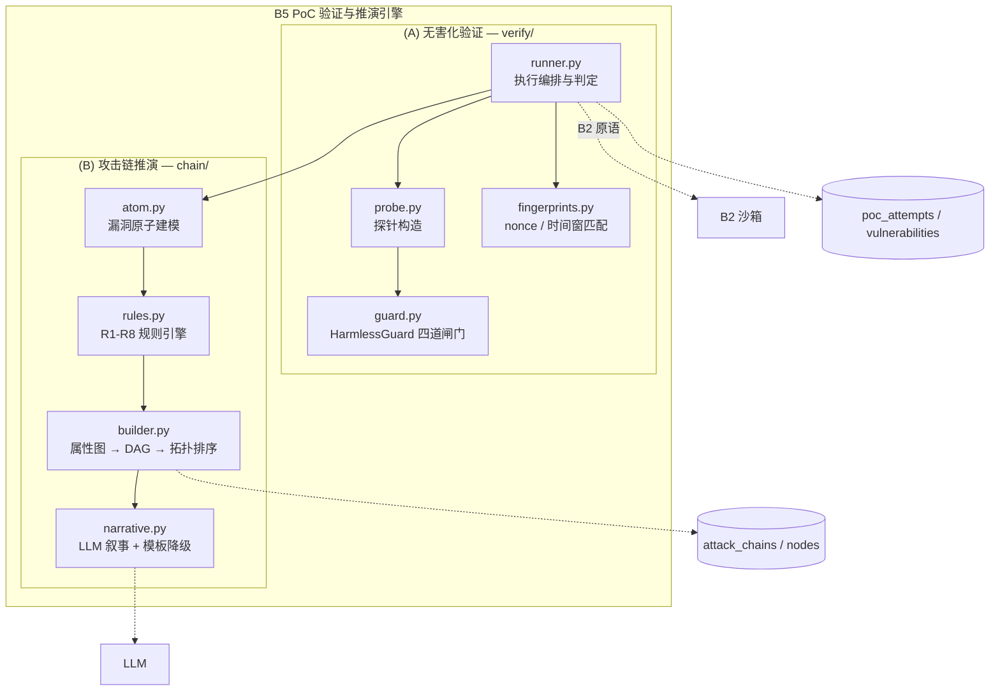
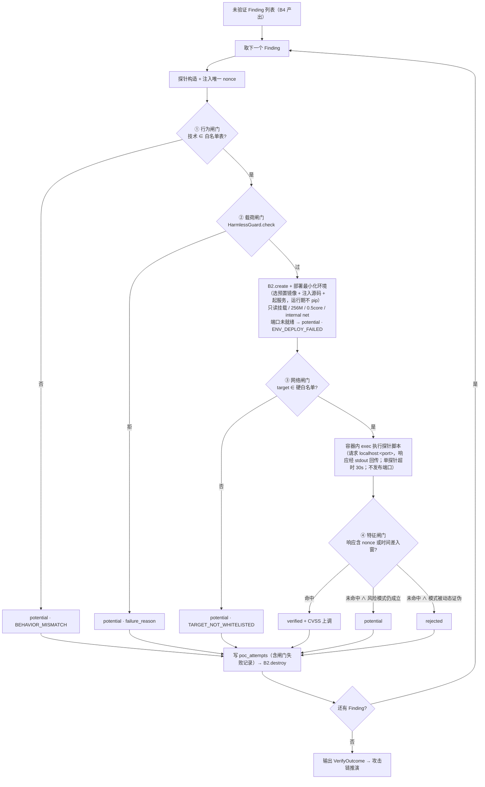
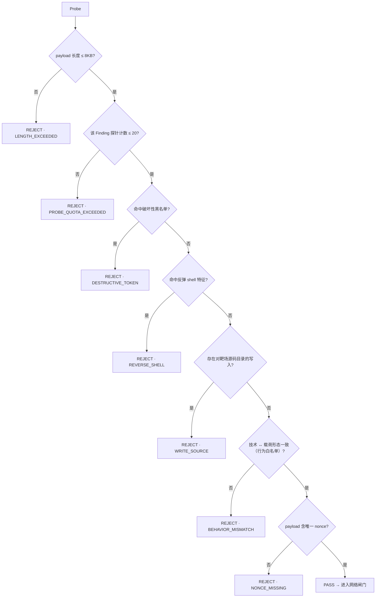
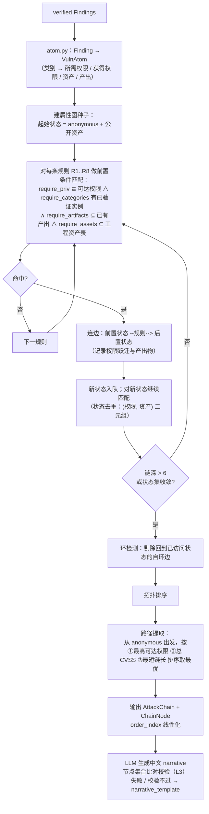

# 模块概要设计 — B5 PoC 验证与推演引擎

| 项 | 值 |
|---|---|
| 所属层 | L3 领域引擎层 |
| 上游文档 | [PRD.md](../PRD.md)、[概要设计总纲.md](../概要设计总纲.md) |
| 对应需求 | 需求.md 2.5.6、2.5.4 |
| 文档层级 | 概要设计 |

## 1. 模块定位

### 1.1 职责（验证 + 推演两半）

B5 是「从静态怀疑到动态事实，再从事实到攻击路径」的引擎。**(A) 无害化 PoC 验证半区**（`verify/`）与 **(B) 攻击链推演半区**（`chain/`）的职责分解如下：

| 半区 | 职责 | 说明 |
|---|---|---|
| (A) 验证 | 探针构造 | 按漏洞类型选择探测技术并生成载荷（`PRD §7.3` 行为闸门的技术白名单） |
| (A) 验证 | 无害化四道闸门 | 网络 / 载荷 / 行为 / 特征闸门，逐层短路，任一不过即不触碰目标 |
| (A) 验证 | 最小化运行环境部署 | 在 B2 容器内准备靶场服务（**选预置镜像** + 注入源码 + 起服务 + 端口就绪探活；**运行期不安装依赖**） |
| (A) 验证 | 容器内探针执行 | 经 B2 `exec` 把探针脚本（payload 经 base64 编码）投进容器，脚本在容器内请求自身 `localhost:<port>`，响应经 stdout 回传后解析（**不发布端口**） |
| (A) 验证 | 响应特征匹配 | nonce 命中（或时间差落入预期窗口）才判定成功 |
| (A) 验证 | 漏洞状态更新（唯一裁决者） | 写入 `vulnerabilities.status`：`unverified → verified / potential / rejected`。**B5 是状态的唯一裁决者**，静态阶段不产出 `potential`（见 §1.2） |
| (A) 验证 | CVSS 上调 + 证据留存 | 验证通过后上调 base score（如 7.5 → 9.8，见 `PRD §7.1`）；报文与判定原因落 `poc_attempts` |
| (B) 推演 | 漏洞原子建模 | 已验证漏洞抽象为 `(所需权限, 获得权限, 可利用资产, 产出)`，见 `PRD §7.4` |
| (B) 推演 | 规则引擎匹配 | 对 R1–R8 逐条做前置条件匹配（**规则引擎，不是 if-else 硬编码**） |
| (B) 推演 | 属性图构建 | 以「权限 × 资产」为状态结点、以规则命中为跃迁边建属性图 |
| (B) 推演 | DAG 生成 + 拓扑排序 | 提取「从 anonymous 出发、能到达最高权限出口」的最优路径 |
| (B) 推演 | 攻击叙事生成 | LLM 只写中文 `narrative`；超时 / 无 key / **校验不过**（L3 节点集合比对，见 §4.8）一律回落规则 `narrative_template` |
| (B) 推演 | 环级验证状态标注 | **Q24 已定案 = 方案 A**：每环标注 `verified` / `inferred`，区分「沙箱实测环」与「推演环」（见 §4.7） |
| (B) 推演 | 结果落库 | 输出 `attack_chains` + `attack_chain_nodes`（含自引用 `parent_node_id`，DAG 的边由此派生），供前端 React Flow 渲染 |

### 1.2 明确不负责（边界）

| 不负责的事 | 归属 | 理由 |
|---|---|---|
| 创建 / 销毁容器、网络隔离、资源配额、指标采集 | **B2 沙箱隔离模块** | B2 不感知业务；B5 只消费 `SandboxHandle` / `ExecResult` |
| 产生 Finding、判定 source→sink 是否被净化、CVSS base 初评 | **B4 污点追踪引擎** | B4 是纯函数库，B5 只读它的产出 |
| 决定阶段推进 / 断点续跑 / 广播日志 | **B3 编排引擎** | B5 是被调用的引擎，不是协调者 |
| 报告排版、PDF 导出 | **B6 报告汇编模块** | B5 只提供结构化数据 |
| 修复补丁生成 | LLM 用点（`PRD §7.6`），由 B3/B6 侧组织 | 不属本模块半区 |

**关键边界**：B5 与 B4 **只是数据依赖**，不是调用依赖（`概要设计总纲 §3.3` 依赖矩阵中标注为 △）。B5 通过 `AssessmentContext.findings` 或数据库读取 Finding，不 import B4 的业务逻辑；CVSS 上调所需的上调增量表由 B5 自带，仅引用 B4 已算出的 base score 数值。**CVSS 的职责边界同样明确：B4 只给基线分（base score），验证通过后的上调是 B5 的职责**（与 B4 文档一致）。

**关键边界 · `HarmlessGuard` 归属（上游已定案）**：无害化闸门 `HarmlessGuard` **归 B5**，落地文件为 `verify/guard.py`（`PRD §5` 目录结构）。此前放在 `sandbox/protocol.py`（B2 目录）的归属**已废弃**。原则是：**B2 只提供「执行能力」，不判断载荷合法性**——若闸门下沉到 B2，B2 就必须知道「什么是 SQL 注入载荷」「什么形态算反弹 shell」，这违反 `概要设计总纲 §3.3` 的「B2 不感知业务」原则。一句话：**B2 负责「能执行什么」，B5 负责「允许执行什么」，二者不可倒置**。

**关键边界 · 状态裁决**：`vulnerabilities.status` 的四态（`unverified` / `verified` / `potential` / `rejected`）**只有 B5 裁决并落库**。静态阶段（B4）只产出 `unverified`，且**不产出 `potential`**——静态阶段「部分路径被净化」这个信号由 `confidence ×0.6` 承载（`PRD §7.1` ⑤⑧），不落状态字段；`potential` 仅由 `poc_verify` 产出（未通过动态验证但风险模式成立）；`rejected` 表示静态误判被动态证伪。

### 1.3 上下游关系

```mermaid
graph LR
    B3["B3 编排引擎<br/>PocVerifyAgent / ExploitChainAgent"] -->|verify_findings| B5A["B5-A 无害化验证"]
    B3 -->|build_chains| B5B["B5-B 攻击链推演"]
    B4["B4 污点追踪（仅数据 △）"] -.->|Finding + TaintStep| B5A
    B2["B2 沙箱隔离"] <-->|create/exec/destroy（探针经 exec 入容器，不再 expose）| B5A
    B5A -->|verified Findings| B5B
    B5A -.->|status / cvss / poc_attempts| DB[("MySQL")]
    B5B -.->|attack_chains / nodes| DB
    LLM["LLM（可降级）"] -.-> B5B
    B5B -->|list[AttackChain]| B6["B6 报告汇编"]
```

## 2. 内部分解

| 子模块 | 文件 | 职责 | 依赖方向 |
|---|---|---|---|
| **probe** 探针构造 | `verify/probe.py` | 按漏洞类型选择技术、生成载荷、注入 nonce、给出期望特征 | → fingerprints |
| **guard** 无害化闸门 | `verify/guard.py` | `HarmlessGuard`：长度/配额/黑名单/反弹 shell/越权写/行为白名单/nonce 完备性。**归属 B5（非 B2）**，见 §1.2 | 纯函数，无外部依赖 |
| **fingerprints** 特征库 | `verify/fingerprints.py` | nonce 匹配器、时间盲注窗口判定、按漏洞类型的特征模板 | 纯函数 |
| **runner** 执行与判定 | `verify/runner.py` | 编排单 Finding 的完整验证闭环：构造→闸门→部署（选预置镜像 + 注入源码 + 起服务）→**容器内 exec 探针**→匹配→判状态→落库 | → guard / probe / fingerprints / B2 |
| **atom** 漏洞原子建模 | `chain/atom.py` | Finding → `VulnAtom`（权限/资产/产出映射） | → B4 数据结构（只读） |
| **rules** 攻击链规则 | `chain/rules.py` | R1–R8 规则表 + `match()` 前置条件匹配器 | 纯函数 |
| **builder** DAG 构建 | `chain/builder.py` | 属性图 → 连边 → 环检测 → 拓扑排序 → 最优路径提取 → `AttackChain` | → rules / atom |
| **narrative** 叙事 | `chain/narrative.py` | LLM 生成中文叙事；超时 / 无 key / **校验不过**（L3 节点集合比对，见 §4.8）时回落 `narrative_template` | → L4 LLM |



**设计要点**：`guard` 与 `fingerprints` 是两个**零依赖纯函数模块**——它们不做 IO、不碰容器，因此可以像 B4 一样被单元测试直接驱动（`tests/test_chain.py`、闸门单测）。这是「怎么保证 PoC 无害」这句话能被验证的前提：闸门逻辑本身是可测试的确定性代码，而不是散落在 runner 里的 if 语句。

## 3. 对外接口

### 3.1 暴露给上层的接口

B5 对外只暴露两个门面类，与 `PRD §7.5` 的两个 Agent 一一对应。

```python
# verify/runner.py
class PocVerifier:
    def __init__(self, sandbox: SandboxExecutor, cfg: SandboxConfig) -> None: ...

    async def verify_findings(
        self,
        findings: list[Finding],          # 来自 B4（数据依赖）
        ctx: AssessmentContext,
        on_progress: Callable[[VerificationResult], Awaitable[None]] | None = None,
    ) -> VerifyOutcome:
        """串行验证（并发度恒为 1，见 概要设计总纲 §8.1）：逐 Finding 走
        四道闸门 → 部署环境 → 执行探针 → 判定状态 → 写 poc_attempts。
        单点失败不抛出到调用方，就地降级为该 Finding 的 potential；仅 MySQL 写入失败抛 L5。"""

class VerifyOutcome(BaseModel):
    results: list[VerificationResult]
    sandbox_reachable: bool            # False ⇒ 上层将阶段标 skipped
    probe_count: int; verified_count: int
    potential_count: int; rejected_count: int
    elapsed_ms: int

# chain/builder.py
class ChainBuilder:
    def __init__(self, llm: LLMClient | None = None) -> None: ...

    def build_chains(self, verified: list[Finding], ctx: AssessmentContext) -> ChainOutcome:
        """纯计算 + 可选 LLM 叙事。无规则命中时返回空列表，不硬造链（PRD §12 风险 10）。"""

class ChainOutcome(BaseModel):
    chains: list[AttackChain]
    matched_rule_ids: list[str]
    unmatched_vuln_ids: list[int]      # 未参与任何链的漏洞，供报告单点展示
    narrative_source: Literal["llm", "template", "mixed"]
```

### 3.2 依赖的下层接口

| 依赖 | 接口 | 用途 | 备注 |
|---|---|---|---|
| B2 沙箱 | `create / exec / metrics / destroy / reap_orphans` | 环境生命周期与命令执行（**探针走 `exec`，不再用 `expose`**） | 签名见 `概要设计总纲 §6.1`；**`expose()` 已从抽象中移除（总纲 §12.2 Q25）**（见 §7 B5-D12） |
| B2 沙箱 | `unreachable → L3` | 沙箱不可达时上报阶段降级 | 由 runner 捕获异常判定 |
| B4 数据 | `Finding` / `TaintStep`（只读） | 探针构造的输入（sink 类型、文件、行号、参数形态） | 数据依赖，非调用依赖 |
| L4 LLM | `LLMClient.complete(prompt, timeout=15)` | 生成 `narrative` | 可失败，失败即降级 |
| L4 DB | `poc_attempts` / `vulnerabilities` / `attack_chains` / `attack_chain_nodes` | 唯一持久化出口 | 阶段边界事务提交 |
| L4 Redis | 无直接依赖 | 日志经 `on_progress` 回调交 B3 广播 | 保持 B5 不直接碰事件通道 |

**关于「部署最小化环境」与「HTTP 探针」**：`PRD §7.3` 流程中出现 `sandbox.deploy_minimal_env(finding)` 与 `sandbox.http_probe(env, payload)`，但 `PRD §7.2` / `概要设计总纲 §6.1` 抽象的 `SandboxExecutor` 并未定义这两个方法。本设计把它们定位为 **B5 侧基于 B2 原语的组合封装**，不要求 B2 改接口：

```python
# verify/runner.py 内部（非对外契约）
async def _deploy_minimal_env(self, finding) -> SandboxHandle:
    # 预置镜像 + 注入源码 + 起服务：运行期不 pip install（PRD §7.2/§7.3 网络闸门推论）
    h = await self.sandbox.create(SandboxSpec(image=self.cfg.preset_image,   # 依赖已预置进镜像
                                              mounts={src: "ro"}, mem="256m", cpus=0.5))
    await self.sandbox.exec(h, ["python", "app.py"], timeout=5)   # 后台起服务（不再运行期安装）
    await self._wait_port_ready(h)                                # 容器内端口就绪探活
    return h

async def _http_probe(self, h, probe: Probe) -> ProbeResponse:
    assert probe.target in h.allowed_targets, "TARGET_NOT_WHITELISTED"   # 网络闸门
    script = render_probe_script(probe)          # payload 经 base64 编码注入，规避 shell 转义
    r = await self.sandbox.exec(h, ["python", "-c", script], timeout=probe.timeout_s)
    return self._parse_probe_stdout(r)           # 容器内请求自身 localhost:<port>，响应经 stdout 回传
```

**为什么用 `exec` 而非 `expose()`（`expose()` 已移除，总纲 §12.2 Q25）**：容器处在 `--internal` 网络内，控制面无法直连；把探针脚本经 `exec` 推进容器、由脚本请求容器自身的 `localhost:<port>`、响应再从 stdout 捞回解析——这**不暴露端口、不需要 SSH 隧道、不需要 sidecar 容器**，网络隔离名副其实。附带收益：`elapsed_ms` 由容器内脚本自测，不含 Docker-over-SSH 往返与控制面→数据面的网络抖动，时间盲注的计时更准（见 §4.2 / §8-7）。

### 3.3 本模块定义的数据结构

```python
# ── (A) 无害化验证 ────────────────────────────────────────
class Probe(BaseModel):                # 一个探针 = 一次无害化探测的最小单元
    probe_id: str; vuln_id: int        # probe_id 贯穿 poc_attempts
    technique: str                     # boolean_blind|union_version|time_blind|echo_nonce|
                                       # upload_marker|idor_simulated|unauth_probe|
                                       # read_config|deser_marker
    method: Literal["GET", "POST", "PUT"]; url_path: str
    headers: dict[str, str] = {}; body: str | None = None
    nonce: str                         # 唯一标记，特征闸门的判定依据
    expected_kind: Literal["content_nonce", "time_window", "status_code", "error_echo"]
    expected_pattern: str              # 正则或数值窗口表达式
    target: tuple[str, int]            # 容器内 (host, port)，通常 ("127.0.0.1", 5000)，须在沙箱硬白名单内
    timeout_s: int = 30
    side_effect_free: bool = True      # 行为闸门自证：构造期置 False 的探针不生成

class GateName(str, Enum):             # 四道闸门
    BEHAVIOR = "behavior"; PAYLOAD = "payload"
    NETWORK = "network";   FEATURE = "feature"

class GuardVerdict(BaseModel):
    passed: bool; failed_gate: GateName | None
    reason_code: str | None            # DESTRUCTIVE_TOKEN|REVERSE_SHELL|WRITE_SOURCE|LENGTH_EXCEEDED|
                                       # PROBE_QUOTA_EXCEEDED|BEHAVIOR_MISMATCH|NONCE_MISSING|
                                       # TARGET_NOT_WHITELISTED
    reason: str                        # 中文，直接进 poc_attempts 与前端提示
    matched_token: str | None          # 命中的黑名单词，便于解释

class PocAttempt(BaseModel):           # ↔ poc_attempts 表
    vulnerability_id: int; probe_id: str
    payload: str; technique: str
    request_raw: str; response_raw: str        # 完整报文原文（前端直接渲染）
    expected_pattern: str; matched: bool
    elapsed_ms: int; http_status: int | None
    harmless_guard_passed: bool
    failure_reason: str | None                 # ↔ poc_attempts.failure_reason（PRD §6 已补列）：
                                               #   被闸门拦截的原因 / 未通过验证的原因（中文）
    created_at: datetime

class VerificationResult(BaseModel):
    vuln_id: int
    verdict: Literal["verified", "potential", "rejected"]
    matched_probe_id: str | None
    attempts: list[PocAttempt]
    cvss_before: float; cvss_after: float
    unverified_reason: str | None

# ── (B) 攻击链推演 ────────────────────────────────────────
class Priv(str, Enum):                 # 权限三轴偏序集合（见 §4.5）
    ANONYMOUS = "anonymous"; USER = "user"; ADMIN = "admin"
    DB = "db"; KEYS = "keys"; HOST = "host"

class VulnAtom(BaseModel):
    vuln_id: int; category: str        # sqli|cmdi|file_upload|idor|...
    requires: set[Priv]                # 所需权限
    gains: set[Priv]                   # 获得权限
    assets: set[str]                   # 可利用资产（表名 / 接口 / 配置路径）
    produces: set[str]                 # credential|session|db_access|source_code|secret
    cvss: float; verified: bool

class ChainRule(BaseModel):            # R1..R8，声明式数据而非代码分支
    rule_id: str; name: str
    require_priv: set[Priv]; require_categories: set[str]   # 命中所需漏洞类别
    require_artifacts: set[str]                             # 所需的上一步产出物
    require_assets: set[str]                                # 需存在的资产（users 表 / 后台登录接口）
    gain_priv: set[Priv]; exit_artifact: str; severity: Severity
    narrative_template: str            # 中文模板，LLM 不可用时的降级产出

class ChainNode(BaseModel):            # ↔ attack_chain_nodes
    node_type: Literal["vuln", "asset", "goal"]
    vuln_id: int | None
    parent_node_id: int | None         # 自引用 fk（PRD §6 已补列）：指向父节点，DAG 的边由此派生
    order_index: int; stage_name: str
    precondition: str; postcondition: str; label: str
    # Q24 已定案 = 方案 A：环级标注「沙箱已验证」或「推演推断」（PRD §6 已补列）
    verification_status: Literal["verified", "inferred"]

class AttackChain(BaseModel):          # ↔ attack_chains
    chain_id: str; name: str; description: str; severity: Severity
    entry_point: str; target_asset: str; confidence: float
    narrative: str; nodes: list[ChainNode]
```

## 4. 关键处理流程

### 4.1 无害化验证流程（四道闸门的位置与短路顺序）

四道闸门按「**由廉到贵、由外到内**」排列，任一不过即**短路**，绝不进入下一门：

| 序 | 闸门 | 生效时刻 | 成本 | 短路后状态 |
|---|---|---|---|---|
| ① | **行为闸门** | 探针**构造期** | 零（不发包不建容器） | potential + `BEHAVIOR_MISMATCH` |
| ② | **载荷闸门** | 探针**执行前**（纯文本检查） | 零（无 IO） | potential + 具体 reason_code |
| ③ | **网络闸门** | 环境**就绪后、发包前** | 已付容器成本 | potential + 全局不可达则阶段 skipped |
| ④ | **特征闸门** | 响应**回收后** | 已付全部成本 | potential 或 rejected |

顺序的理由：把纯文本与纯逻辑的检查放在最前，让**大概率被拒的探针在付出容器成本之前就被拦掉**——阿里云只有 2 vCPU，一个容器的代价远高于一次正则匹配。



**短路语义的三条硬规则**：

1. **失败记录必须落库**。被闸门拦掉的探针同样写 `poc_attempts`，`harmless_guard_passed=false`——闸门拦截不是「没发生」，而是「发生了并被安全终止」，这份记录本身就是无害化能力的证据。
2. **闸门失败 ≠ 验证失败**。`potential` 与 `rejected` 的语义不同：前者是「风险模式存在但未证实」（`概要设计总纲 §5.3`），后者是「动态证伪了静态判断」。只有走到 ④ 门且判定为伪时才能 `rejected`。
3. **沙箱不可达是阶段级事件**。单个 Finding 的环境部署失败只影响该 Finding（L2）；`create()` 在 3 次重试后仍失败说明 daemon 不可达（L3），runner 立即停止剩余 Finding，把 `sandbox_reachable=false` 交回 B3，等 B3 将阶段标 `skipped`、全部 Finding 退 `potential`。

### 4.2 探针构造策略（按漏洞类型）

| 漏洞类型 | 探测技术 | 载荷样例（`<N>` = nonce） | 期望特征 | 副作用约束（行为闸门） |
|---|---|---|---|---|
| SQL 注入 | 布尔盲注 | `?id=1 AND 1=1` vs `?id=1 AND 1=2` 对照 | 两次响应体差异率 > 阈值且对照组稳定 | 只读 SELECT，无写语句 |
| SQL 注入 | 只读 UNION | `?id=0 UNION SELECT '<N>',version()` | 响应含 `<N>` | 只读，仅取版本号 |
| 命令注入 | 时间盲注 | `?cmd=; sleep 3` | 耗时落在 `3s ± 容差` 窗口 | 只 sleep，不落任何文件 |
| 命令注入 | 回显匹配 | `?cmd=; echo <N>` | 响应含 `<N>` | 只用 `echo`，无重定向 |
| 文件上传 | 标记文件回读 | 上传 `<N>.txt` → 请求 `/uploads/<N>.txt` | 回读内容含 `<N>` | **不传 WebShell**，不传可执行后缀 |
| 路径穿越 / 任意文件读取 | 只读标志文件 | `?file=../../etc/hostname` 或读靶场只读目录下的 `<N>.txt` | 响应含宿主机名或 `<N>` | 只读，不写不删 |
| 越权（IDOR） | 自造数据横向遍历 | 用账号 A 的会话请求账号 B（**均为本任务自建的模拟数据**）的 `/api/user/<id>/profile` | 返回他人数据特征 | **不碰真实数据**，只遍历自造数据 |
| 未授权访问 | 无凭证直取 | 不带 Token 请求 `/api/user/list` | 返回 200 + 业务字段 | 只读接口 |
| 敏感信息泄露 | 配置探测 | 请求 `/debug/config`、`/.env` | 响应含 `SECRET_KEY`/口令模式 | 只读 |
| 反序列化 | 无副作用标记对象 | 构造仅含 `<N>` 的空操作对象序列化后投递 | 错误回显或栈信息含 `<N>` | `__reduce__` 指向无副作用调用 |

**构造期约束**：每个 Finding 最多生成 20 个探针（多技术、多参数位、多注入点的笛卡尔积经**去重与优先级裁剪**后截断）；同一 nonce 不复用；`side_effect_free=False` 的技术（如写文件验证上传落地）一律不进候选集，宁可判 `potential` 也不执行有副作用的载荷。

**容器内执行带来的额外收益**：探针在靶场容器内部发起请求，`elapsed_ms` 由容器内脚本自行测量，不含 Docker-over-SSH 往返与控制面→数据面的网络抖动，因此时间盲注（如 `sleep 3`）的判定窗口可显著收窄，误判率下降（容差仍待实测标定，见 §8-7）。

### 4.3 HarmlessGuard 判定逻辑

`HarmlessGuard.check(probe) -> GuardVerdict` 是一个**确定性纯函数**：同样的 Probe 永远得到同样的判定，因此可被穷举单测。



| 检查项 | 命中内容 | reason_code | 判定依据 |
|---|---|---|---|
| 破坏性 SQL / 系统命令 | `DROP` `DELETE` `UPDATE` `INSERT` `TRUNCATE` `ALTER` `GRANT` `SHUTDOWN` | `DESTRUCTIVE_TOKEN` | 大小写归一后子串匹配（`PRD §7.3`） |
| 破坏性 shell | `rm -rf` `mkfs` `dd if=` `:(){`（fork 炸弹） | `DESTRUCTIVE_TOKEN` | 同上 |
| 反弹 shell | `nc -e` `/dev/tcp/` `bash -i` | `REVERSE_SHELL` | 单独的规则表，便于扩展编码变体 |
| 写靶场源码 | 出现在载荷中的源码目录绝对路径 + 写操作符 | `WRITE_SOURCE` | 与 B2 的 `mode: ro` 只读挂载构成**双保险** |
| 长度 / 配额 | > 8KB；> 20 探针/Finding | `LENGTH_EXCEEDED` / `PROBE_QUOTA_EXCEEDED` | 资源与时间上限的硬闸门 |
| 行为一致性 | 技术声明为布尔盲注但载荷含写语句 | `BEHAVIOR_MISMATCH` | 技术白名单表反查载荷形态 |
| nonce 完备性 | 载荷无唯一标记 | `NONCE_MISSING` | 无 nonce 则特征闸门不可判，直接拒 |

**为什么黑名单之外还要有行为白名单**：黑名单永远可以绕过（`DR/**/OP`、十六进制编码、大小写混写）。行为闸门是**白名单式**的——不是「黑名单没命中就放行」，而是「载荷形态必须与声明的无害技术模板匹配」。这是把不可枚举的对抗问题转成可枚举的正向约束，也是面试时「黑名单绕过了怎么办」的正面答案。

### 4.4 攻击链规则匹配算法



**终止与去重的三条保障**：

1. **状态去重**：队列元素是 `(权限集合, 资产集合)` 二元组，而不是「图的路径」。同一状态无论从哪条路到达都只扩展一次，使搜索空间与规则数无关、只与可达状态数相关（远小于路径数）。
2. **深度上限**：链深上限 6，防状态爆炸；超出时剪枝并记 WARN 日志。
3. **环检测**：属性图允许中间出现回边（真实的攻击链可能重入同一权限），但输出前对 DAG 做环剔除，保证前端 dagre 布局与拓扑排序可用。

### 4.5 权限跃迁建模（漏洞原子 → 权限图）

漏洞原子到权限图的转换由 **`atom.py` 的静态映射表**完成，不经 LLM：

| 漏洞类别 | requires（所需权限） | gains（获得权限） | assets（可利用资产） | produces（产出物） |
|---|---|---|---|---|
| `sqli` | `anonymous` | `db` | 可达的用户表 / 配置表 | `credential` / `db_access` |
| `cmdi` | 视入口而定 | `host` | 系统命令通道 | `rce` |
| `file_upload` | `admin`（或 `anonymous` 变体） | `host` | 上传目录 | `rce` |
| `idor` | `user` | `user`（横向至全量数据） | 用户数据接口 | `pii_bulk` |
| `unauth_access` | `anonymous` | `user` | 无鉴权接口 | `data_read` |
| `info_disclosure` | `anonymous` | `keys` / `db` | 调试接口 / 配置 | `secret` / `db_access` |
| `file_read` | `anonymous` | `keys` | 文件读取入口 | `source_code` / `secret` |
| `deserialization` | 视入口而定 | `host` | 反序列化入口 | `rce` |

**权限偏序集**（非标量等级）：`匿名 < 用户 < 管理员` 是身份轴；`self < all_users < db` 是数据轴；`host` 是主机轴。三条轴用集合表示而非单一数字——因为「拥有管理员会话」与「拥有数据库口令」不可比，硬压成一维等级会在 R2 与 R5 的匹配上出错。

### 4.6 规则表 R1–R8

| # | 规则名 | 前置条件（可机器判定的形式） | 权限跃迁 | 出口（产出物） | 严重度 |
|---|---|---|---|---|---|
| **R1** | SQLi → 凭证泄露 | 存在已验证 `sqli` ∧ 其资产含 `users` 表 | `anonymous` → `user` | `credential` | 高 |
| **R2** | 凭证泄露 → 后台登录 | 已有 `credential` ∧ 工程资产表含后台登录接口 | `user` → `admin` | `session`（管理员会话） | 高 |
| **R3** | 管理员 + 文件上传 → RCE | 已有 `session`（admin）∧ 存在已验证 `file_upload` | `admin` → `host` | `rce` | 严重 |
| **R4** | IDOR → 敏感数据泄露 | 存在已验证 `idor` ∨ `unauth_access` | `user` → 全量用户数据 | `pii_bulk` | 高 |
| **R5** | 敏感信息泄露 → 数据库直连 | 存在已验证 `info_disclosure` ∧ 泄露内容含 DB 口令模式 | `anonymous` → `db` | `db_access` | 高 |
| **R6** | 命令注入 → RCE | 存在已验证 `cmdi` | 任意 → `host` | `rce` | 严重 |
| **R7** | 未授权访问 + 文件上传 → RCE | 存在已验证 `unauth_access` ∧ 存在已验证 `file_upload`（R3 的无 admin 变体） | `anonymous` → `host` | `rce` | 严重 |
| **R8** | 任意文件读取 → 源码/密钥泄露 | 存在已验证 `file_read` ∧ 读得到配置类文件 | `anonymous` → `keys` | `secret` / `source_code` | 中 |

每条规则在 `rules.py` 中是**声明式数据**（`ChainRule` 实例），不是代码分支。新增规则只需追加一条数据，匹配器与构建器不改动——这与 `PRD §7.4`「规则引擎，不是 if-else 硬编码」是同一件事的两种表述。

### 4.7 Q24 已定案：验证与推演的边界

需求 2.5.9 演示的攻击链是 `SQL 注入 → 拿管理员凭证 → 上传 WebShell → 宿主机 RCE`。但无害化行为闸门（`PRD §7.3`）规定：**文件上传只传 `<nonce>.txt` 并读回、不传 WebShell**；**命令执行只用时间盲注、不执行有副作用的命令**。两者并不矛盾，但结论是硬的——

> **链的最后一环是「推演结论」，不是「实测结果」。**

这正是「**验证**」（证明某前置条件在沙箱中真实可利用）与「**推演**」（在已证实的前置条件上，按攻击者视角推断下一步会怎样）的分野。以本靶场演示链为例：

| 环 | 动作 | 是否实测 | 依据 |
|---|---|---|---|
| 1 | SQL 注入读出管理员凭证 | ✅ 已验证 | 布尔 / UNION 只读探针命中 nonce（`R1`） |
| 2 | 用凭证登录后台 | ✅ 已验证 | 登录接口探针获得管理员会话特征（`R2`） |
| 3 | 上传 WebShell | ❌ 推演 | 行为闸门禁止上传可执行文件；实测只上传 `<nonce>.txt`，证明「上传点可达且无后缀白名单」这一 `R3` 前置 |
| 4 | 宿主机 RCE | ❌ 推演 | 行为闸门禁止执行有副作用命令；由「可控上传点 + 缺后缀校验」推得（`R3` / `R7` 出口） |

**Q24 已定案 = 方案 A（`概要设计总纲 §12.2`）**：`attack_chain_nodes` 新增 `verification_status`(enum: `verified` | `inferred`)，**每环独立标注**；F4 节点两色区分（如已验证实线 / 推演虚线）；B6 报告第 4 章写明「第 1–2 环已在沙箱中无害验证，第 3 环由已证实的前置条件推演得出，未实际执行」。

**已定案为方案 A，下述设计即为最终设计**：§3.3 `ChainNode.verification_status`、§5.3 节点表、§7 B5-D14，以及 B6 报告第 4 章的呈现口径，均已按方案 A 落地，不再有悬置。上游同时否决了另两个方案（理由见 §7 B5-D14「放弃的方案」列）：**B 改造靶场让整条链都能无害验证**——技术上牵强，且仍无法无害证明「宿主机执行权」；**C 推演阶段真的执行 RCE**——违背无害化原则，**不可接受**。

**面试口径（本节核心论点）**：安全扫描器**可以推断「这里能打穿」，但绝不应该自己去打穿**。把「已验证」与「已推演」在数据模型与 UI 上显式分开，恰恰证明设计者清楚工具的能力边界——这是加分项，不是缺陷。这一「验证 vs 推演」的分野与 `概要设计总纲 §8.5` 的 L1 铁律同源：**链的节点与边由规则引擎 R1–R8 确定性产出，LLM 只写叙事**——这正是「拿掉 LLM，结论一字不变」的体现（详见 §4.8）。

### 4.8 攻击链叙事的 LLM 校验（L3 节点集合比对）

叙事是 B5 **唯一的 LLM 用点**（`PRD §7.6.3` 用点 ③），也是本模块唯一不由代码直接产出的自由文本。它同样受 `概要设计总纲 §8.5` 四条铁律约束，其中 **L3「输出必校验」在 B5 的落点即「节点集合比对」**：

- **输入侧约束（L2）**：prompt 只喂「已由规则引擎 R1–R8 确定的事实」——该链的节点集合、命中的规则编号、权限跃迁；**不把原始源码交给 LLM 让它自行分析**。结构化字段（`ChainNode` 全部字段）一律代码填充，LLM 只回填 `narrative`。
- **输出侧校验（L3）**：叙事生成后，提取文中出现的**漏洞编码集合**（如 `VULN-2026-0001`），断言其 **⊆ 该链的实际节点编码集合**；集合外出现任一编码即**拒收**，回落 `narrative_template`，`narrative_source="template"`。
- **校验位置**：与 `PRD §7.6` 的补丁四道校验一致，**全部在控制面完成、不需要沙箱**，代价毫秒级。

**为何只比「节点集合」而不做全文本事实校验**：叙事中的其余内容（「攻击者借此登录后台」）是描述性文字，无法用确定性规则穷举其真伪；而**漏洞编码是叙事中唯一能被结构化锚定的实体**，也是 LLM 最容易张冠李戴的对象（把别的链的漏洞编码写进本条链）。把校验收缩到这个**可精确判定**的维度，既挡住了最有危害的幻觉（编造不存在的漏洞），又避免了不可判定的文本检查。

**触发条件（补齐 L4 的降级入口）**：`narrative.py` 的降级触发有三类——无 key、15s 超时、**校验不过**。前两类是「LLM 没给出结果」，第三类是「LLM 给了结果但不可信」——三者一律不中断流水线，统一回落模板并标注来源（见 §6 出错处理表）。

> **与 L1 的呼应**：链的节点与边完全由 R1–R8 规则引擎产出，LLM 的叙事甚至不参与图的构建——因此**拿掉 LLM，本模块的链、节点、边与环级验证状态一字不变，只有叙事措辞会变**。判据见 `概要设计总纲 §8.5`。

## 5. 数据设计

### 5.1 `vulnerabilities` 的状态与评分更新

| 字段 | 写入时机 | 取值来源 |
|---|---|---|
| `status` | 每个 Finding 验证闭环结束时（事务内） | 四态：`unverified → verified / potential / rejected`，语义见 `概要设计总纲 §5.3` |
| `cvss_score` | 仅 `verified` 时上调 | 上调增量表（B5 自带）：如 SQLi 无认证可远程 `7.5 → 9.8`，参考 `PRD §7.1` ⑧ |
| `cvss_vector` | 同上 | 按「是否需认证 / 是否可远程触发」修正 AV/PR 分量 |

**更新约束**：`unverified` 是 B4 的产出，B5 **只单向推进**，不回退；`potential` 与 `rejected` 都保留原 `cvss_score`（不评分为已验证漏洞口径），避免误报抬高整体评分。

### 5.2 `poc_attempts`（逐探针证据表）

| 字段 | 来源 | 说明 |
|---|---|---|
| `vulnerability_id` / `payload` / `technique` | Finding / Probe | 关联对象 + 载荷原文与技术名 |
| `request_raw` / `response_raw` | ProbeResponse | **完整报文**，前端「漏洞详情与修复区」直接渲染（`PRD §7.3` 证据留存） |
| `expected_pattern` / `matched` | Probe / 特征闸门 | 期望特征表达式（nonce 或时间窗）与是否命中 |
| `elapsed_ms` / `http_status` | ProbeResponse | 时间盲注的判定依赖 `elapsed_ms` |
| `harmless_guard_passed` | 载荷闸门 | `false` 时该条**不可作为验证依据**（`概要设计总纲 §7.3`） |
| `failure_reason` | 载荷闸门 / 特征闸门 | 文本列（`PRD §6` 已补 `text` 列）：被闸门拦截的原因，或未通过动态验证（未匹配 nonce / 环境部署失败等）的原因 |

**写入策略**：每个 Finding 的全部探针记录在其验证闭环结束**前**一次批量写入，与 `vulnerabilities` 的状态更新同处一个事务——防止出现「状态已 verified 但无对应证据」的孤儿状态。

### 5.3 `attack_chains` / `attack_chain_nodes`（推演层）

| 表 | 关键字段 | 写入内容 |
|---|---|---|
| `attack_chains` | `name` / `description` / `severity` / `entry_point` / `target_asset` / `confidence` / `narrative` | 每轮推演对**每条最优路径**写一行；`entry_point` 取路径起始资产，`target_asset` 取出口 |
| `attack_chain_nodes` | `node_type` / `vuln_id` / `parent_node_id` / `order_index` / `stage_name` / `precondition` / `postcondition` / `label` / `verification_status` | 路径由 `parent_node_id` 自引用组织为 DAG（**上游已补自引用 fk，DAG 的边由此派生，不建边表**）；`node_type` 三值 `vuln / asset / goal`，`vuln` 类节点回填 `vuln_id` 供前端联动；`verification_status` 环级标注 `verified` / `inferred`（**Q24 已定案 = 方案 A**，见 §4.7） |

**链的表示取舍**：`PRD §9` 要求 `/chains` 返回「nodes + edges」。上游已按本模块的建议定案：**不新增边表**，而是在 `attack_chain_nodes` 上加**自引用外键 `parent_node_id`(fk self, nullable)**——每个节点的 `parent_node_id` 指向其前驱节点，**DAG 的边由该自引用关系派生**，`/chains` 的 nodes + edges 直接由节点集与 `parent_node_id` 组装，无需额外边表（`PRD §6` 已补列）。`order_index` 仍作为同层渲染顺序与线性化冗余保留。若要表达真分叉 DAG，同一 `parent_node_id` 可被多个子节点引用——这本就是一个树 / 森林结构，不必引入通用图模型。**生命周期**上，推演层是**派生结论**，可随时由证据层重推（`概要设计总纲 §7.2`），故终止评估时允许它不完整；证据层的 `poc_attempts` 则必须完整保留。

## 6. 出错处理

| 错误场景 | 级别 | 检测方式 | 处理策略 | 可恢复性 |
|---|---|---|---|---|
| 载荷命中破坏性黑名单 / 反弹 shell | **L2 可降级** | `guard.check` 返回 `passed=false` | 该 Finding 判 `potential`，经 `harmless_guard_passed=false` 落 `poc_attempts`，带理由 | 可恢复（重跑或改探针） |
| 行为白名单不匹配 / 探针含外源写操作 | **L2 可降级** | 构造期技术表反查失败 | 不生成该探针；若某 Finding 全部技术被拒 → `potential` | 可恢复 |
| 探针长度 / 数量超限；探针脚本 stdout 解析失败；链深剪枝（> 6） | **L1 可忽略** | 构造期计数、stdout 解码异常、搜索深度计数 | 截断至 8KB / 20 条（记 WARN）；`http_status=null` 并保留原始 stdout；剪枝并记 WARN | 可忽略 |
| 沙箱 daemon 不可达 | **L3 可跳过** | `create()` 3 次重试后仍抛 `SANDBOX_UNREACHABLE` | 停止剩余 Finding → `sandbox_reachable=false`，B3 标阶段 `skipped`，全部 Finding 退 `potential` | 可恢复（重跑） |
| 容器起不来 / OOM / 超配额 | **L3 可跳过** | `create`/`exec` 失败或 `metrics` 越限 | 记 `poc_attempt`，跳过该 Finding 继续下一个；连续 3 个失败视为 daemon 级问题升级为 L3 全局跳过 | 可恢复 |
| 最小化环境部署失败（含镜像缺依赖——运行期不 pip，缺依赖即镜像问题） | **L2 可降级** | `exec` 返回码非 0 或端口探活超时 | 该 Finding 判 `potential`，`failure_reason=ENV_DEPLOY_FAILED` | 可恢复 |
| 单探针请求超时 | **L2 可降级** | 单探针 30s 超时 | `matched=false`，记录 `elapsed_ms`，进入下一探针 | 可恢复 |
| 目标不在硬白名单 | **L2 可降级** | 执行前断言 | 拒绝发包，`TARGET_NOT_WHITELISTED`，判 `potential` | 可恢复（属构造缺陷） |
| 无规则匹配（0 条链） | **L3 可跳过** | `ChainOutcome.chains == []` | `exploit_chain` 阶段 `skipped`，单点漏洞照常展示，**不硬造链**（`PRD §12` 风险 10） | 可恢复 |
| 属性图检出环 / 拓扑排序异常 | **L3 可跳过** | 环检测钩子 | 剔除回边降级为线性最长路径，记 WARN，输出可用链 | 可恢复 |
| LLM 叙事超时 / 无 key / **校验不过** | **L2 可降级** | 15s 超时或调用异常 / 节点集合比对失败（L3，见 §4.8） | 拒收该叙事，回落规则 `narrative_template`，`narrative_source="template"` | 可恢复 |
| `poc_attempts` / `attack_chains` 写入失败 | **L5 致命** | 事务提交异常 | 阶段标 `failed`，保留已提交数据（B5 不回滚上游），上报含 `remediation` 的错误对象（`概要设计总纲 §9.2`） | 不可恢复 |

**分级原则**：凡是「**某个 Finding 运气不好**」的问题一律 L1–L2（就地降级）；凡是「**基础设施整体不可用**」的问题一律 L3（阶段跳过，静态成果不作废）；只有「**证据写不进去**」才是 L5——因为那意味着结论丢失，而结论是不可再生的证据层数据。

## 7. 设计约束与权衡

| # | 决策点 | 选择 | 放弃的方案 | 理由 | 代价 |
|---|---|---|---|---|---|
| B5-D1 | 攻击链构建 | 规则引擎（R1–R8 声明式数据） | LLM 推理建图 | 图的正确性**不依赖模型不确定性**：同样的 Finding 永远得到同样的链，demo 不因模型抖动改变结论（对应 `概要设计总纲` D7/D13） | 规则需人工维护，覆盖不到的组合直接不输出链 |
| B5-D2 | LLM 的角色 | 只写中文 `narrative`（且须过 L3 节点集合比对，见 §4.8） | 参与权限跃迁判定 | 同上；链的节点与边由 R1–R8 确定性产出，LLM 只写叙事（呼应 `概要设计总纲 §8.5` L1）；LLM 挂了链照常产出，只是叙事变模板 | LLM 价值被限制在最外层的表达 |
| B5-D3 | 验证失败的处置 | 判 `potential` 而非直接判误报 | 一律 `rejected` | `potential` 是「风险模式存在但未证实」（`概要设计总纲 §5.3`）；无害化探针天然有覆盖盲区（只读探测可能触发不了写才触发的漏洞），一律证伪会制造新的假阴性 | 需人工复核的 `potential` 变多 |
| B5-D4 | 探针能力边界 | 只读 / 时间盲注 / 标记文件 | 真利用载荷（WebShell、写文件） | 无害化是项目的**卖点约束**而非附加项（`PRD §7.3`） | 部分漏洞只能停在 `potential`，`verified` 率下降 |
| B5-D5 | 闸门顺序 | 行为 → 载荷 → 网络 → 特征 | 全部集中在执行前一次校验 | 由廉到贵短路，避免为必然被拒的探针付出容器成本（2 vCPU 下容器远比正则贵） | 闸门逻辑分散在构造期与执行期两处，需在文档中写明（本文 §4.1 已固定短路顺序） |
| B5-D6 | 验证并发 | 串行，并发度恒为 1 | 并发展开（README 有并发） | 资源硬约束（`概要设计总纲` D12）；串行使证据写库无竞态 | 耗时随 Finding 数线性增长 |
| B5-D7 | 耗时上限控制 | 20 探针/漏洞 × 30s 超时 + 环境部署 ≤ 60s/组（**预置镜像后部署不再含 pip 安装**） | 不设上限 | 把最坏情况**锁死在 10 分钟量级**：`20 × 30s = 600s`。8 分钟端到端指标（`PRD §1.2`）下，poc_verify 阶段必须可预测 | 探针多技术枚举被裁剪，个别漏洞少测几种注入点 |
| B5-D8 | 权限模型 | 三轴偏序集合（身份/数据/主机） | 单一数字等级 | 管理员会话与数据库口令不可比，压成一维会在 R2/R5 匹配上出错 | 匹配器实现更复杂 |
| B5-D9 | 链的持久化形态 | `parent_node_id` 自引用组织 DAG，边由此派生（**上游已定案**，`PRD §6`） | 新增 `attack_chain_edges` 边表 | 不扩表即可满足 `/chains` 的 nodes + edges 契约，且天然支持分叉 | 树 / 森林结构无法表达跨链交叉引用（本期不需要） |
| B5-D10 | 安全数据造数 | 越权探针只遍历**本任务自建**的模拟数据 | 直接打靶场种子数据 | 行为闸门要求「不碰真实数据」；自造数据使副作用完全可控 | 需额外的造数步骤与清理逻辑 |
| B5-D11 | CVSS 上调归属 | B5 自带上调增量表 | 调用 B4 的 CVSS 模块 | 维持「B5 对 B4 仅数据依赖」的架构原则（`概要设计总纲 §3.3` △） | 评分口径分两处（B4 初评 / B5 上调），需在报告中注明 |
| B5-D12 | 探针执行位置 | **容器内 `exec` 执行**：payload base64 交给脚本，脚本请求容器自身 `localhost:<port>`，响应经 stdout 回传 | 「`expose()` 发布端口 + SSH 本地端口转发，控制面直打」——**该路径连同 `expose()` 一并移除**（`概要设计总纲 §12.2` Q25） | 不暴露端口、不需要隧道、不需要 sidecar，网络隔离名副其实；时间盲注的计时在容器内测更准 | 探针脚本需与靶场同镜像（依赖预置），stdout 需结构化回传与解析 |
| B5-D13 | 依赖获取方式 | 依赖**预置进镜像**，运行期只做「选镜像 + 注入源码 + 起服务」 | 运行期 `pip install -r requirements.txt` | 容器在 internal network **禁止出站**，pip 需联网，二者互斥（`PRD §7.2` / `§7.3` 网络闸门推论）；预置还让环境部署耗时可控 | 依赖变更须重建镜像，镜像体积增大（阿里云磁盘剩 19G，`PRD §12` 风险 2） |
| B5-D14 | 攻击链环级状态 | 每环标注 `verified` / `inferred`（**Q24 已定案 = 方案 A**，见 §4.7） | ① 不区分，统一称「攻击链」；② 方案 B 改造靶场使整条链都可无害验证；③ 方案 C 推演阶段真执行 RCE | 无害化闸门注定链的最后几环只能推演；如实标注是安全工具边界的诚实表达。**B 技术牵强**（仍无法无害证明「宿主机执行权」）；**C 违背无害化原则，不可接受** | 需 UI 两色区分与报告口径统一（与 F4、B6 协同） |

**关于耗时的完整账**（面试可展开的量化论证）：单 Finding 最坏 `20 探针 × 30s = 600s`，但这是「全部探针都超时」的病态上界；正常情况下每个 Finding 的环境部署一次（依赖预置进镜像，部署 = 注入源码 + 起服务，通常 ≤ 30s）后探针快速往返（百毫秒级）。因此在 8 个漏洞的靶场上，poc_verify 阶段的期望耗时在 1–2 分钟，最坏受限于「Finding 数 × 10 分钟」的上界公式——这个公式就是阶段超时看门狗（由 B3 持有）的配置依据。

## 8. 移交详细设计的待定项

| # | 待定项 | 影响面 | 建议归属 |
|---|---|---|---|
| 1 | `poc_attempts.failure_reason` **已由上游补列**（✅ `PRD §6`）；仍需确认是否追加 `probe_id` 以贯穿单条探针证据 | 建表迁移 + 前端证据区展示 | 详细设计（Alembic 迁移） |
| 2 | ~~是否引入 `attack_chain_edges` 表以支持真分叉 DAG~~ **已由上游定案**：改用 `attack_chain_nodes.parent_node_id` 自引用派生边（✅ `PRD §6`），无需边表 | 数据模型 + F4 渲染 | — |
| 3 | 探针模板库的存放形式：YAML 规则文件 vs Python 常量表 | `probe.py` 实现与可维护性 | 详细设计 |
| 4 | 指纹匹配器的表达 DSL：纯正则 vs 结构化 matcher（内容/时间/状态码三类判定器） | `fingerprints.py` 接口 | 详细设计 |
| 5 | ~~最小化运行环境的准备方式：预置镜像分层 vs 运行时 `pip install`~~ **已由上游定案**：依赖预置进镜像、运行期不 `pip install`（✅ `PRD §7.2` / `§7.3`）；待细化的是**镜像分层与体积控制**（阿里云磁盘剩 19G） | 部署耗时与磁盘占用 | 详细设计与 B2 协同 |
| 6 | nonce 注入点优先级（query / body / header / cookie）与冲突处理 | 探针成功率 | 详细设计 |
| 7 | 时间盲注的容差阈值：探针改为**容器内计时**后不再含跨面往返抖动，判定窗口需重新标定取值 | 误判率 | 详细设计 + 实测标定 |
| 8 | 权限偏序集是否需要持久化（入 DB 供人工校正 vs 仅内存常量） | 数据模型 | 详细设计 |
| 9 | 多链输出的排序键与 `confidence` 计算公式 | `builder.py` 输出顺序 | 详细设计 |
| 10 | 沙箱复用策略：每 Finding 重建容器 vs 同一环境跑多 Finding | 总耗时（与 B5-D7 直接相关） | 详细设计 |
| 11 | `atoms` 映射表与靶场 `GROUND_TRUTH.yaml` 的交叉校验机制 | 回归测试可信度 | 详细设计 + `tests/test_chain.py` |
| 12 | 未来并发度 > 1 时 `poc_attempts` 的写入竞态与幂等键设计 | 写库正确性 | 详细设计（前瞻预留） |

## ⚠️ 与上游不一致

| # | 不一致点 | 上游出处 | 本文处理 |
|---|---|---|---|
| 1 | **`vulnerabilities.status` 枚举只有三态**（`unverified`/`verified`/`potential`），但验证流程与状态机均出现第四态 `rejected` | `PRD §6` 数据模型 | ✅ **已由上游修订解决**（`PRD §6`）：枚举已确认为四态 `unverified`/`verified`/`potential`/`rejected`。本文设计与之对齐 |
| 2 | **`HarmlessGuard` 的文件归属**：此前 PRD 放在 `sandbox/protocol.py`（B2 目录） | `PRD §5` 目录结构 | ✅ **已由上游修订解决**（`PRD §5`）：`verify/guard.py # ★ HarmlessGuard 无害化闸门（归 B5，非 B2）`。归属论证见本文 §1.2。<br>备注：`PRD §7.3` 正文括注仍残留 `sandbox/protocol.py` 字样，建议回填为 `verify/guard.py` |
| 3 | **两个方法未在沙箱抽象接口中定义**：`PRD §7.3` 流程使用 `sandbox.deploy_minimal_env` 与 `sandbox.http_probe`，但 `PRD §7.2` / `概要设计总纲 §6.1` 的 `SandboxExecutor` 未定义这两个方法 | `PRD §7.2` vs `PRD §7.3` | ✅ **已由上游修订解决（PRD §7.3）**：流程框图已改为 `b5.deploy_minimal_env(ctx.sandbox, finding)` / `b5.http_probe(env, payload)`，并加注「二者是 **B5 基于 B2 原语（create/exec/destroy）的组合封装**，不是 `SandboxExecutor` 的方法」。本文 §3.2 的定位一致，B2 接口不变 |
| 4 | **`/chains` 返回 edges，但数据模型无边表** | `PRD §9`（「DAG（nodes + edges）」）vs `PRD §6` | ✅ **已由上游修订解决**（`PRD §6`）：`attack_chain_nodes` 新增自引用 `parent_node_id`(fk self, nullable)，**DAG 的边由此派生、不建边表**。本文 §5.3 已按此实现 |
| 5 | **「记录未验证原因」无字段承载** | `概要设计总纲 §5.3` vs `PRD §6` | ✅ **已由上游修订解决**（`PRD §6`）：`poc_attempts` 新增 `failure_reason`(text)。本文 §3.3 / §5.2 已按 `failure_reason` 对齐 |
| 6 | **靶场演示链的措辞与实际探针冲突**：`PRD §10.1` 写「上传 `.py` WebShell → 宿主机 RCE」，但 `PRD §7.3` 行为闸门明确「不传 WebShell」 | `PRD §10.1` vs `PRD §7.3` + `概要设计总纲 §12.2` | ✅ **已由上游修订解决（PRD §6 / 总纲 §12.2）**：Q24 已定案 = **方案 A**，`attack_chain_nodes.verification_status`（`verified` / `inferred`）已入 `PRD §6`。本文 §4.7 已按定案把「验证 vs 推演」的边界论证写清并强化，即为最终设计，不再有悬置 |
| 7 | **`SandboxExecutor` 曾保留 `expose()`**（生成可知的返回主机端口） | `PRD §7.2` / `概要设计总纲 §6.1` | ✅ **已由上游修订解决（总纲 §12.2 Q25）**：探针改为**容器内 `exec`**后 `expose()` 已无任何调用方，**上游已将其从 `SandboxExecutor` 抽象中移除**。本文 §3.1 / §3.2 / §7 B5-D12 已按「已移除」对齐 |
