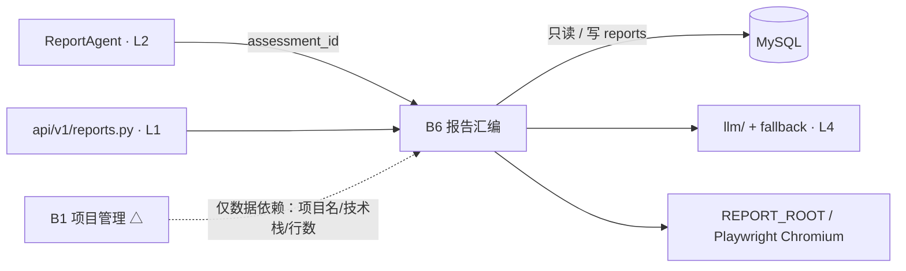
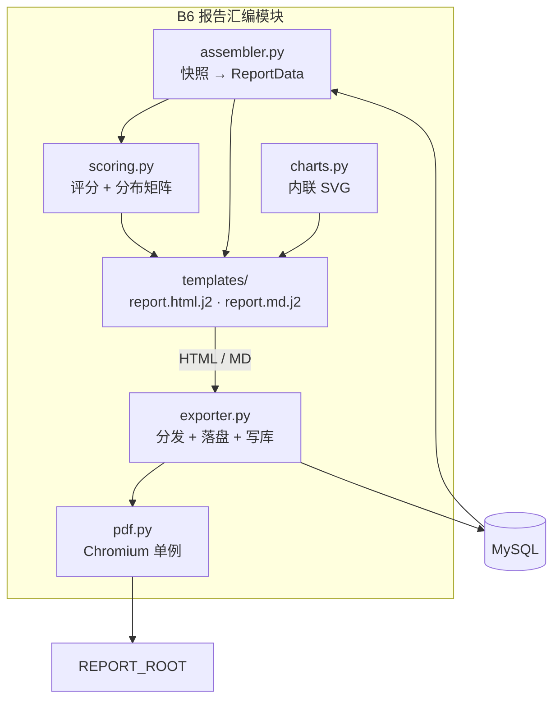
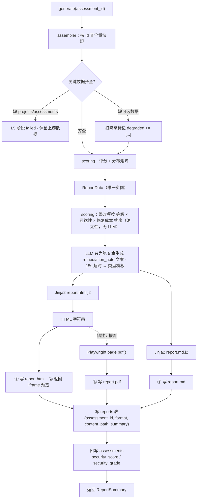
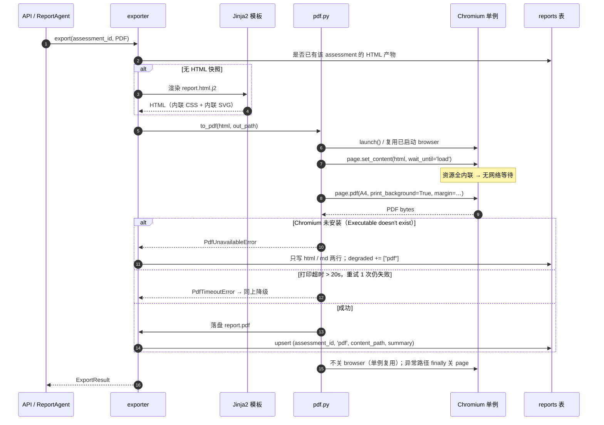

# 模块概要设计 — B6 报告汇编模块

| 项 | 值 |
|---|---|
| 所属层 | L3 领域引擎层 |
| 上游文档 | [PRD.md](../PRD.md)、[概要设计总纲.md](../概要设计总纲.md) |
| 对应需求 | 需求.md 2.5.6、2.5.8 |
| 文档层级 | 概要设计 |

---

## 1. 模块定位

### 1.1 职责

B6 是评估流水线的**最后一跳**：把上游五个阶段散落在数据库里的证据与结论，收敛成一份**可交付、可复现、可换格式**的安全评估报告。

| 职责 | 说明 | 上游依据 |
|---|---|---|
| 数据汇总 | 按 `assessment_id` 从数据库快照聚合为单一 `ReportData` | PRD §6、总纲 §9.3 |
| 项目综合评分 | 由 CVSS 分布与漏洞状态推导**项目综合等级**（`critical`/`high`/`medium`/`safe`）与 `security_score`(0–100)，并在 `report_gen` 阶段**回写 `assessments`** | PRD §6（`assessments.security_score` / `security_grade`）、§4.3 |
| 一套数据三种格式 | Jinja2 同源渲染 HTML / Markdown；HTML 经 Playwright 打印 PDF（**PDF 惰性生成**，§7.4） | PRD §4、§9、需求 2.5.8 |
| 报告持久化与在线预览 | 文件落盘 + 写 `reports` 表（含 `summary` JSON，表带 `uk(assessment_id, format)`）；按 `?format=html|md` 在线预览 | PRD §6、PRD §9 |

报告固定 5 章（§4.4），对应 PRD §8.1 ③「安全报告中心页」与需求 2.5.8。

### 1.2 明确不负责（边界）

- **不产生漏洞数据、不决定漏洞状态**：不解析源码、不跑污点分析、不下发探针；`unverified / verified / potential / rejected` 四态是 B5 的判定结果，B6 只按状态分组展示。
- **不做攻击链推理**：`attack_chains` 由 B5 规则引擎产出，B6 只排版。规则没匹配上就整章省略，不硬造。
- **不写证据表**：对 `vulnerabilities` / `taint_paths` / `poc_attempts` / `patches` / `attack_chains` **全部只读**；本模块只写两张表——`reports`（报告产物）与 `assessments` 的 `security_score` / `security_grade` 两列（`report_gen` 阶段回写，供大盘页 F1 聚合）。
- **不做交互式图表、不感知沙箱与网络**：大盘页（F1）的 ECharts 交互图不归本模块（报告内图表是静态的，§7.3）；不 import `sandbox/`，不发任何出网请求。
- **不把 LLM 用于任何判定**（[PRD §7.6](../PRD.md) L1 / [总纲 §8.5](../概要设计总纲.md) L1）：**项目综合评分与等级由 `scoring.py` 纯函数产出，第 5 章整改项的排序同样由 `scoring.py` 的确定性公式（等级 × 可达性 × 修复成本）产出**；LLM 在本模块只写第 5 章的 `remediation_note` 文案，**既不打分、也不排序、也不决定章节取舍**，其输出永不进入控制流。

### 1.3 上下游关系

| 方向 | 对方 | 契约 |
|---|---|---|
| 被调用 | `ReportAgent`（L2，阶段 `report_gen`） | 传入 `assessment_id`，取回 `ReportSummary` |
| 被调用 | `api/v1/reports.py`（L1） | 在线预览 / 导出 / 下载三个端点，见 §3.1 |
| 只读依赖 | MySQL：`projects`、`assessments`、`assessment_stages`、证据与推演层各表 | 快照查询，不改写 |
| 写入 | MySQL：`reports` 表 + `assessments.security_score` / `security_grade` 两列 + `REPORT_ROOT` 下的报告文件 | 每格式一行/一文件；评分列在 `report_gen` 阶段回写 |
| 调用 | `llm/client.py` + `llm/fallback.py`（L4） | 第 5 章整改建议**文案**（`remediation_note` 自由文本），15s 超时可降级；**排序不在此**——顺序由 `scoring.py` 事先确定性产出（§4.4） |
| 调用 | Playwright / Chromium | HTML → PDF，惰性触发 |

与 [总纲 §3.3](../概要设计总纲.md) 一致：B6 对 B1 是**仅数据依赖**（读 `projects` 表，不调 B1 接口）；B6 属 L3，只依赖 L4，**不得 import `agents/`**。



## 2. 内部分解

| 子模块 | 文件 | 职责 | 主要产出 |
|---|---|---|---|
| **assembler** 数据汇总 | `report/assembler.py` | 按 `assessment_id` 从快照聚合；缺失字段打降级标记 | `ReportData` |
| **scoring** 项目综合评分 | `report/scoring.py` | 纯函数：漏洞集合 → `security_score`(0–100) 与**项目综合等级**（`security_grade`）、CVSS 分布矩阵、类型占比切片；**第 5 章整改项的排序（等级 × 可达性 × 修复成本）亦在此产出**，LLM 不参与排序 | `SecurityScore` + 已排序的 `list[Recommendation]` |
| **templates** 模板集 | `report/templates/` | `report.html.j2`、`report.md.j2` + `partials/*.j2` + `assets/report.css`；同一数据两套排版 | HTML / MD 字符串 |
| **exporter** 格式导出 | `report/exporter.py` | 格式分发、落盘、写 `reports` 表、回写 `assessments` 评分列、`summary` 生成 | 文件 + `ReportSummary` |

> 内部辅助（不对外暴露）：`report/charts.py`（纯 Python 拼内联 SVG，以 Jinja2 全局函数注入模板）；`report/pdf.py`（Chromium 单例与分页参数，被 exporter 调用）。



## 3. 对外接口

### 3.1 暴露给上层的接口

```python
class ReportService:                      # 报告生成的唯一门面，上层只依赖这个类
    async def generate(self, session, assessment_id: int,
                       formats: Sequence[ExportFormat] = (HTML, MD)) -> ReportSummary:
        """汇总 → 渲染 → 落盘 → 写 reports 表 → 回写 assessments.security_score/security_grade。
        幂等：重复调用覆盖同一文件与同一行（reports 表 uk(assessment_id, format) 兜底）。"""
    async def preview(self, session, assessment_id: int, fmt: Literal["html", "md"]) -> str:
        """在线预览：html 返回可整段塞进 iframe 的 HTML（内联 CSS/SVG，零外部资源）；
        md 返回原始 Markdown 文本，供前端 react-markdown 渲染。"""
    async def export(self, session, assessment_id: int, fmt: ExportFormat) -> ExportResult:
        """按需导出单格式；PDF 走惰性路径（§7.4），首次导出时补写 reports 行。"""
```

给 L1 API 的映射（端点清单见 [PRD §9](../PRD.md)，本模块只实现内核）：

| 端点 | 映射 | 说明 |
|---|---|---|
| `GET /assessments/{id}/report?format=html\|md` | `preview` | **上游已统一读取端点**：报告中心页在线预览（html 走 iframe，md 直出文本） |
| `POST /assessments/{id}/report/export?format=pdf\|md\|html` | `export` | 按需生成并落盘（PDF 惰性生成） |
| `GET /assessments/{id}/report/download/{fmt}` | 读 `reports.content_path` | 直接回文件流 |

### 3.2 依赖的下层接口

| 依赖 | 接口 | 用法 | 失败行为 |
|---|---|---|---|
| 数据库 | `db/session.py` + `models/` ORM | 只读快照 SELECT；对 `reports` 写入 + 回写 `assessments.security_score` / `security_grade` | **L5 致命**（存储类不可降级，总纲 §8.2） |
| LLM | `llm/client.py` `complete()`、`llm/fallback.py` | 第 5 章整改建议**文案**（PRD §7.6.3 用点④，字段 `remediation_note`）；**仅文案、不排序**——顺序由 `scoring.py` 事先定好 | **L2 降级**：切**类型模板文案**；**排序恒定**（本就不依赖 LLM） |
| 文件存储 | `pathlib`/`aiofiles`，根目录取配置 `REPORT_ROOT` | 写 `report.{html,md,pdf}` | **L5 致命**（产物无法交付） |
| HTML→PDF | Playwright `async_api` | `launch()` → `set_content()` → `page.pdf()` | **L3 跳过**：仅丢 PDF |

### 3.3 本模块定义的数据结构

```python
class ExportFormat(str, Enum):
    HTML = "html"; MD = "md"; PDF = "pdf"        # 对齐 reports.format 枚举
class SecurityGrade(str, Enum):                  # ← 对齐 assessments.security_grade（PRD §6）
    CRITICAL = "critical"; HIGH = "high"; MEDIUM = "medium"; SAFE = "safe"
# 中文展示名仅为呈现层映射；报告中项目级一律称「项目综合等级」（PRD §6 术语规范）
GRADE_LABEL = {SecurityGrade.CRITICAL: "极高危", SecurityGrade.HIGH: "高危",
               SecurityGrade.MEDIUM: "中危", SecurityGrade.SAFE: "安全"}

class SecurityScore(BaseModel):
    score: float                      # 0–100，越高越安全；↔ assessments.security_score
    grade: SecurityGrade              # ↔ assessments.security_grade
    veto: bool                        # 是否触发「一票否决」
    breakdown: dict[str, float]       # 各级别罚分明细，用于解释评分来源

class ReportData(BaseModel):
    """渲染的唯一输入。三种格式全部由它派生，模板禁止各自查库。"""
    meta: ReportMeta                  # §4.4 第 1 章
    score: SecurityScore              # 第 2 章
    severity_matrix: dict[tuple[str, str], int]   # (severity, status) → 计数
    type_distribution: list[TypeSlice]            # (category, count, ratio)
    vulnerabilities: list[VulnEntry]              # 第 3 章
    chains: list[ChainEntry]                      # 第 4 章
    recommendations: list[Recommendation]         # 第 5 章
    degraded: list[str]               # 如 ["pdf", "llm", "chain"]

class ReportSummary(BaseModel):       # 写入 reports.summary；大盘页聚合改由 assessments.security_score/security_grade 承担
    assessment_id: int; project_name: str; generated_at: datetime
    score: float; grade: SecurityGrade; total: int
    by_status: dict[str, int]; by_severity: dict[str, int]
    chain_count: int; formats: list[ExportFormat]; degraded: list[str]
```

`VulnEntry` 是第 3 章的单元，聚合四张表：`vulnerabilities`（编码/名称/等级/CVSS/位置/描述）+ `taint_paths`（污点步进）+ `poc_attempts`（报文与 nonce 匹配证据）+ `patches`（Diff、`llm_model`、`rationale`）。

## 4. 关键处理流程

### 4.1 一套数据三种格式的渲染管线



**两条不可违背**：① `ReportData` 只构建一次，三格式共享同一对象——避免三次查询导致同一份报告内数字不一致；② 模板**只做呈现**，任何聚合都在 `scoring` / `assembler` 完成（Jinja2 里不写统计逻辑）。

### 4.2 PDF 生成流程



**设计要点**：用 `set_content()` 而非起本地 HTTP 服务——报告 HTML 的资源已全部内联，不需要同源加载，省掉一个临时服务与端口占用（阿里云端口紧张，PRD §2.2）。

### 4.3 综合安全评分算法

目标：把「一堆 CVSS 分数」压成一个**面试能讲清、不黑盒**的**项目综合等级**。

```
① 单漏洞罚分  penalty(v) = cvss_score(v) × status_factor(v)
              status_factor: verified=1.0  potential=0.4  unverified=0.1
② 综合评分    score = max(0, 100 - Σ penalty(v))
```

**③ 项目综合等级映射（自上而下首个命中；括号内为 `assessments.security_grade` 枚举值）**：

| 条件 | 项目综合等级（`security_grade`） |
|---|---|
| 存在任一 `verified` 且 `severity=critical` | **极高危**（`critical`，一票否决，无视 score） |
| `score < 40` | **极高危**（`critical`） |
| `score < 70` 或 存在任一 `verified` 且 `severity=high` | **高危**（`high`） |
| `score < 90` | **中危**（`medium`） |
| 其余（无 verified 高危及以上） | **安全**（`safe`） |

**写回**：`scoring.py` 的产物由 `generate()` 在 `report_gen` 阶段事务内**回写 `assessments.security_score` 与 `assessments.security_grade`**（`PRD §6`），使大盘页（F1）无需解析报告文件即可聚合「平均安全评分」。

**术语规范（不可混用，`PRD §6` 关键设计说明 2）**：`assessments.security_grade` 是**项目综合等级**（`critical`/`high`/`medium`/`safe`，中文展示为 极高危/高危/中危/安全），对应需求 2.5.8；`vulnerabilities.severity` 是**单漏洞严重度**（`critical`/`high`/`medium`/`low`）。二者都是「四级」但语义不同——报告中**项目级一律写「项目综合等级」，漏洞级一律写「漏洞严重度」**，不得互相套用。

**为什么需要一票否决**：若靶场只有 1 个 CVSS 9.8 的已验证 RCE，`score = 90.2` 会被判成「中危」——与事实严重背离。一票否决保证**高危事实不被数量稀释**，同时保留 `score` 作为趋势指标供大盘页横向比较。

**边界处理**：`unverified` 只计 0.1（防夸大）；`potential` / `unverified` **不参与一票否决**；`cvss_score` 为 NULL 时按 `severity` 中位值代入并在报告标注「评分不完整」。

### 4.4 报告章节结构与数据映射

| # | 章节 | 数据来源 | 关键内容 | 可降级 | 降级形态 |
|---|---|---|---|---|---|
| 1 | 项目概况与执行信息 | `projects`、`assessments`、`assessment_stages` | 项目名、技术栈版本、扫描总代码行数、评估起止时间、五 Agent 执行摘要表 | **否** | 数据缺失即 L5 |
| 2 | 安全评分与风险大盘 | `scoring` 输出 + `vulnerabilities` 聚合 | **项目综合等级**（`security_grade`）与安全评分、CVSS 分布矩阵、漏洞类型占比饼图 | 是（L2） | 无漏洞时显「未发现漏洞」空态，不画图 |
| 3 | 已验证漏洞清单 | `vulnerabilities` + `taint_paths` + `poc_attempts` + `patches` | 唯一编码、名称、**漏洞严重度**、CVSS、源码触发位置（相对路径 + 行号）、污点输入与流动路径、PoC 报文与 nonce 匹配证据、Diff 修复 Patch | 是（L2） | 无 verified 时改列 unverified/potential 并显著标注「未通过动态验证」 |
| 4 | 多步攻击路径推演 | `attack_chains` + `attack_chain_nodes` | 攻击阶段顺序、涉及漏洞节点组合、攻陷目标与潜在业务危害、`narrative`；**每环标注「已验证 / 已推演」**（读取 `verification_status`，**Q24 已定案 = 方案 A**，呈现口径见 §4.5） | 是（L3） | `exploit_chain` skipped 时整章输出占位说明（总纲 §8.2） |
| 5 | 安全整改建议 | `patches` + `scoring.py` 排序 + LLM 文案（`fallback.py` 兜底） | 按修复优先级排序的整改项（**优先级 = `scoring.py` 按 等级 × 可达性 × 修复成本 确定性计算**）；LLM 只为每项生成 `remediation_note` 文案 | 是（L2） | LLM 失败 → 切**类型模板文案**；**排序恒定**（排序本就不靠 LLM） |

**排序规则（全部由代码产出，不含 LLM —— PRD §7.6 L1）**：

- **第 3 章**固定按 `severity` 降序 → `cvss_score` 降序 → `code` 升序；
- **第 5 章**整改项由 `scoring.py` 按**优先级 = 等级 × 可达性 × 修复成本**排序（并列时按 `code` 升序兜底），LLM 只写文案、**不参与排序**。

两条排序均为纯函数确定性产出，保证同一份数据两次生成的报告**逐字节一致**（可复现要求），且**拿掉 LLM 结论一字不变**（PRD §7.6.2 判据）。

### 4.5 第 4 章「已验证环 / 已推演环」的呈现口径（Q24 已定案 = 方案 A）

**依据**：`attack_chain_nodes.verification_status`（`verified` / `inferred`）由 B5 在推演阶段写入；B6 第 4 章按此字段做**视觉区分**，与 [总纲 §12.2 Q24](../概要设计总纲.md) 定案、F4 拓扑图的两色口径一致。

**呈现口径（第 4 章固定执行）**：

1. **两色区分**（HTML / PDF）：

   | `verification_status` | 报告内表述 | 视觉 |
   |---|---|---|
   | `verified` | **已验证环** | 实线描边 + 主色填充（如蓝/绿），与「已在沙箱无害验证」语义一致 |
   | `inferred` | **已推演环** | 虚线描边 + 淡色（灰/浅色），示意「推演得出，未实际执行」 |

2. **图例**：章节内固定给出图例——「**已验证环**：已在沙箱中无害验证 ／ **已推演环**：由已证实的前置条件推演，未实际执行」。

3. **脚注声明**（逐链按实际环数动态生成，不得写死）：以 PRD §10.1 的演示链为例，脚注为「**第 1–2 环已在沙箱中无害验证，第 3 环由已证实的前置条件推演得出，未实际执行**」；环数变化时按同一模板改写为「第 X 环未实际执行」。

4. **无颜色格式（Markdown / 纯文本）**：用文字前缀 `[已验证]` / `[已推演]` 替代配色，脚注照常保留——保证三格式口径一致（一套数据原则，§7.2）。

**措辞约束**：第 4 章用「**验证 / 推演**」二分，**不得**与 `vulnerabilities.status` 的 `verified` / `unverified` 混用，也不得使用「未验证漏洞」之类会造成歧义的表述（术语规范见 §4.3）。

## 5. 数据设计

### 5.1 读取的表（全部只读）

| 表 | 用途 | 关联与过滤 |
|---|---|---|
| `projects` / `assessments` / `assessment_stages` | 第 1 章：项目名、技术栈、总行数、起止时间、五 Agent 执行摘要；第 2 章读出 `assessments.security_score` / `security_grade` | `assessments.project_id → projects.id`；按 `assessment_id` |
| `vulnerabilities` | 第 2/3 章主体 | 按 `assessment_id` |
| `taint_paths` / `poc_attempts` / `patches` | 第 3 章证据与补丁 | 按 `vulnerability_id`；`poc_attempts` 仅取 `harmless_guard_passed=true`（总纲 §7.3）；`patches` 取 `status != rejected` 的最新一条 |
| `attack_chains` / `attack_chain_nodes` | 第 4 章 | 按 `parent_node_id` 还原 DAG 边、按 `order_index` 排序；**读 `verification_status`（`verified` / `inferred`）区分「已验证环」与「已推演环」**（**Q24 已定案 = 方案 A**，呈现口径见 §4.5，与 F4 两色区分口径一致） |

### 5.2 写入的表与文件落盘

`reports`：每个已交付格式一行（`assessment_id`、`format`、`content_path`、`summary` JSON、`generated_at`）。上游已在表上定义**唯一约束 `uk(assessment_id, format)`**（`PRD §6`），本模块的**幂等策略**与之对齐：按 `(assessment_id, format)` 覆盖——已存在则 UPDATE 并复用同一路径，不产生重复行（唯一约束是该策略的数据库层兜底）。

`assessments`：**只回写两列** `security_score`(float 0–100) 与 `security_grade`(enum: `critical`/`high`/`medium`/`safe`)，在 `report_gen` 阶段事务内写入（`PRD §6`）。除此之外 `assessments` 行对 B6 **只读**。回写的动机是**大盘页聚合**——F1 的「平均安全评分」由该列直接 `AVG()` 得出，无需读报告文件。

```
{REPORT_ROOT}/reports/{assessment_id}/
├── report.html     # 在线预览与 HTML 交付（内联 CSS/SVG）
├── report.md       # Markdown 交付
└── report.pdf      # PDF 交付（惰性生成）
```

目录名用 `assessment_id` 而非项目名——规避中文/特殊字符路径问题且天然唯一；`content_path` 存**相对 `REPORT_ROOT` 的路径**，便于 D 盘 → 阿里云整体迁移；`REPORT_ROOT` 由 `core/config.py` 读取，**开发机必须指向 D 盘**（C 盘仅剩 24G，PRD §2.1）。

## 6. 出错处理

级别定义见 [总纲 §9.1](../概要设计总纲.md)；错误结构遵循 [总纲 §9.2](../概要设计总纲.md) 四要素，`stage` 恒为 `report_gen`，`error_code` 例：`PDF_CHROMIUM_MISSING`、`PDF_RENDER_TIMEOUT`、`REPORT_WRITE_FAILED`、`REPORT_SNAPSHOT_FAILED`。

| 错误场景 | 级别 | 检测方式 | 处理策略 | 可恢复性 |
|---|---|---|---|---|
| Playwright 未安装 Chromium | **L3** | `launch()` 抛 `Executable doesn't exist`；启动时预检 | 跳过 PDF，正常交付 HTML+MD；`degraded += ["pdf"]`；`remediation` 提示 `playwright install chromium` 与 `PLAYWRIGHT_BROWSERS_PATH` | 可恢复（装完重导） |
| PDF 打印超时 / 进程泄漏 | **L4 / L1** | `page.pdf()` 包 `asyncio.wait_for(20s)`；渲染前后统计子进程数 | 超时关 page 后重试 1 次，仍失败降级为 L3 跳过 PDF；泄漏走 `finally` 关 page + 复用单例 browser，记 WARN | 可恢复 / 自愈 |
| LLM 整改文案超时 / 无 key / 实体白名单校验不过 | **L2** | `llm/client.py` 15s 超时异常；或输出未过 L3 实体白名单（§7.5） | 切**类型模板文案**（`fallback.py`），第 5 章标注「模板生成」；**排序恒定、不受影响**（排序由 `scoring.py` 独立产出） | 自愈 |
| 第 4 章无攻击链（阶段 skipped） | **L3** | `attack_chains` 查询为空 | 整章输出占位说明，其余章节照常 | 自愈 |
| 无 verified 漏洞 | **L2** | 状态聚合结果 | 第 3 章改列 unverified/potential 并标注；评分按 §4.3 折算 | 自愈 |
| 单条漏洞字段损坏（CVSS 为 NULL / 无 taint_paths） | **L1** | Pydantic 校验 + 空集合判断 | 渲染为「未知 / 未记录」，不阻断整表；计数为「数据不完整」 | 自愈 |
| Jinja2 渲染异常 | **L2** | 渲染抛 `UndefinedError` | 单格式失败只丢该格式；**两格式都失败 → 升 L5**（模板缺陷） | 修复后重跑 |
| 数据库快照查询失败 | **L5** | 连接异常 / 查询超时 | `report_gen` 阶段 failed，上游数据全部保留；不静默产出残缺报告 | 可重试整阶段 |
| 报告落盘失败（磁盘满 / 权限） | **L5** | `OSError` / `PermissionError` | 阶段 failed；`remediation` 提示检查 `REPORT_ROOT` 所在盘剩余空间 | 可重试 |
| 回写 `assessments` 评分列失败 | **L5** | `UPDATE` 异常 | 评分回写与 `reports` 写入同处一个事务，整体回滚；`report_gen` 阶段 failed，不留下「报告已生成但评分未落库」的半成品 | 可重试整阶段 |

> 重复调用 `generate()` 不算错误：按 §5.2 幂等策略覆盖写，不产生重复行。

## 7. 设计约束与权衡

### 7.1 为什么用 Playwright 而不是 WeasyPrint

对应 [总纲 §10 D10](../概要设计总纲.md)。核心是**跨两个平台的安装成本不对称**：

| 方案 | Windows 11 开发机 | Ubuntu 22.04 阿里云 | 综合 |
|---|---|---|---|
| WeasyPrint | 需 GTK 运行库（MSYS2 装 pango/cairo/gdk-pixbuf，手工配 PATH） | 需 `libpango-1.0-0`、`libcairo2`、`libgdk-pixbuf-2.0-0` 等系统包 | **两套痛苦** |
| **Playwright/Chromium** | `pip install playwright && playwright install chromium` | 同一条命令 | **一套命令** |

代价是 Chromium 约 150MB，**Windows 与阿里云各装一次**；开发机须设 `PLAYWRIGHT_BROWSERS_PATH=D:\myself_complete_code\.cache\ms-playwright`，阿里云侧落在 `/root/.cache/ms-playwright`（40G 盘，配合 `docker system prune` 节奏，PRD §12 风险 2），容器内以 root 跑 Chromium 需追加 `--no-sandbox`。附带收益：Chromium 是前端同款内核，**报告 HTML 在浏览器里的样子与 PDF 一致**，不必为 PDF 单独维护一套 CSS。

### 7.2 数据库快照作数据源 + 一套数据三格式

对应 [总纲 §10 D14](../概要设计总纲.md) 与 [总纲 §9.3](../概要设计总纲.md)「报告与数据不一致」条目。快照方案（选）的收益：任意时刻可重跑得到同一份报告、内容 = 数据库事实（面试可现场复算）、`report_gen` 阶段可单独重跑；内存态 `AssessmentContext`（弃）虽零查询，但进程重启即丢失、必须重跑全流程、内容取决于那一刻的状态。代价只是多一轮查询（约 8 次 SELECT），而一次评估只生成一两份报告，成本可忽略。**推论**：B6 不接受调用方传入漏洞列表，只接受 `assessment_id`。

同源的另一层含义是**一套数据三格式**：单一 `ReportData` 保证报告内数字天生一致，且只有一套测试；代价是模板需处理表达力差异——约定 HTML 模板为主模板，MD 复用同一套 `partials` 的语义结构（同章节顺序、同字段），只替换呈现语法，格式特有内容（如 MD 目录锚点）在模板层解决，**不新增数据字段**。

### 7.3 图表在 PDF 里的呈现：内联 SVG vs ECharts 截图

| 维度 | 方案 A：Jinja2 内联 SVG（**选**） | 方案 B：ECharts 渲染后截图 |
|---|---|---|
| 依赖与离线 | 纯 Python 拼字符串，零外部依赖，无网络请求 | 需引入 echarts.js 并执行 JS；CDN 失败即图表空白 |
| PDF 打印确定性 | 矢量、可缩放、清晰，直接进 PDF；毫秒级 | canvas 位图，缩放模糊，需等 JS 加载与动画结束 |
| 三格式复用 | 同一份 SVG 嵌 HTML；MD 里降级为**表格 + 数据行** | 截图无法进 Markdown |
| 交互性 | 静态 | hover / tooltip（报告不需要） |

**选 A**，理由按优先级：① 报告必须**离线可成**（PRD §1.2「一键启动」，不应依赖外网）；② 三格式同源——SVG 是唯一能同时服务 HTML 与 PDF 的表达，MD 天然降级为表格；③ 打印确定性高，直接保 `≤30s` 报告生成指标（PRD §1.2）；④ 图表只有三种（CVSS 分布柱状图、漏洞类型占比饼图、评分环形），手写 SVG 的量可控。交互式图表的需求由大盘页（F1，ECharts）承担，与报告是**两个职责**，不合并实现。

### 7.4 PDF 惰性生成 vs 阶段内预生成

`report_gen` 阶段默认**同步生成 HTML + Markdown**（成本 < 2s）；PDF 在首次导出/下载时生成并补写 `reports` 行。惰性（选）的最短阶段耗时稳定满足 ≤30s，且把 Chromium **变成可选依赖**（没装只影响 PDF）；预生成的代价是多 8–15s Chromium 启动与打印，并让未装 Chromium 直接导致阶段降级。理由：报告中心页打开时看的是 HTML，PDF 只有点「导出」才需要——把最重、最易失败的步骤从阶段关键路径摘下来，符合 [总纲 §5.2](../概要设计总纲.md)「基础设施问题不应让已完成的成果作废」的分级思路。**该决策已被上游确认采纳**（`PRD §9` 导出端点明确标注「PDF 惰性生成」），因此 Chromium 成为**可选依赖**，同时保住 `PRD §1.2` 的「报告生成 ≤ 30s」指标。

### 7.5 LLM 用点的铁律落点（PRD §7.6 / 总纲 §8.5）

B6 在本系统**只有一个 LLM 用点**——用点④「整改建议文案」（`remediation_note`），它落在**表达层**，逐条对应四铁律：

| 铁律 | B6 的落点 |
|---|---|
| **L1 不参与判定** | 项目综合评分 / 等级由 `scoring.py` 产出，**整改顺序由 `scoring.py` 的确定性公式（等级 × 可达性 × 修复成本）产出**，章节取舍由数据有无决定；LLM 输出**永不进入控制流**（不决定排序、不决定章节、不决定重试） |
| **L2 不引入事实** | `remediation_note` 是**唯一**交给 LLM 的自由文本字段；**整改项的结构化字段——等级、优先级、关联漏洞编码（`code`）、涉及 `file_path` / 行号——一律由 `scoring.py` / `assembler.py` 代码填充**。Prompt 只给「已确定的事实 + 要求改写为中文」，不给开放性分析任务 |
| **L3 输出必校验** | 文案走**实体白名单**：文中出现的 `file_path` / 行号 / CVE / 漏洞编码必须**在输入里存在**，否则拒收；**顺序不校验——因为顺序不由 LLM 决定**（PRD §7.6.3 用点④校验规则）。校验在控制面完成，不经过沙箱 |
| **L4 可降级不阻断** | 无 key / 15s 超时 / 限流 / **校验不过**均降级为**类型模板文案**；`llm_model` 标 `template`，**报告与前端显式标注「模板生成」**；**排序不受任何影响**（与 §6 出错处理表一致） |

**边界**：本模块**不得**新增 LLM 用点；如需新增，必须先在 [PRD §7.6.3](../PRD.md) 的封闭用点清单登记并经评审。判据（可直接写成测试）：**拿掉 LLM，报告的数字与排序必须一字不变，只有文案措辞会变**（PRD §7.6.2）。

## 8. 移交详细设计的待定项

| # | 待定项 | 建议方向 |
|---|---|---|
| 1 | 评分阈值标定（§4.3 的 40 / 70 / 90 与 `status_factor` 取值） | 用 `ranges/` 两靶场的 GROUND_TRUTH 做回归标定，写入 `tests/` |
| 2 | 内联 SVG 的生成方式 | 手写 SVG / matplotlib SVG 后端 / pygal，需评估体积与可控性 |
| 3 | ~~`reports` 是否加 `(assessment_id, format)` 唯一索引~~ **已由上游采纳**（✅ `PRD §6`），本模块按 §5.2 覆盖策略对齐 | — |
| 4 | 模板组件与宏的划分（漏洞卡片 / 证据块 / 表格 / 代码块） | 以「章节 = 宏组合」组织，HTML 与 MD 共享宏命名 |
| 5 | PDF 分页与页眉页脚（A4 版心、漏洞卡片 `page-break-inside: avoid`、页码） | 在 `assets/report.css` 用 `@page` + 打印媒体查询实现 |
| 6 | Chromium 生命周期与并发导出互斥；报告文件保留与清理 | 常驻单例 + `asyncio.Lock`（避免 2 vCPU 上并发起多实例）；随评估删除级联清理 `{REPORT_ROOT}/reports/{id}/` |
| 7 | 在线预览的缓存失效（重新生成后 iframe 如何刷新） | 响应用 `ETag` / 查询串带 `generated_at` |
| 9 | Markdown 图表表达（表格 vs base64 内联 PNG）；第 1 章执行摘要粒度；~~是否阶段内预热 PDF~~（**已确认惰性，不再预热**，✅ `PRD §9`） | 图表优先表格；摘要需确认 `assessments.stats` 键约定 |
| 10 | ~~攻击链环级状态的报告口径~~ **已定案（Q24 = 方案 A）** | 见 §4.5：第 4 章按 `verification_status` **两色区分**（`verified` 实线主色 / `inferred` 虚线淡化）+ **图例** + **脚注**「第 1–2 环已在沙箱中无害验证，第 3 环由已证实的前置条件推演得出，未实际执行」（逐链按未执行环数动态生成「第 X 环未实际执行」）；MD 等无颜色格式用 `[已验证]`/`[已推演]` 文字标注替代配色。与 B5 §4.7、F4 两色口径一致 |

## ⚠️ 与上游不一致

| # | 上游位置 | 差异 | 建议 |
|---|---|---|---|
| 1 | [PRD §5](../PRD.md) 目录仅列 `report/{assembler.py, templates/, exporter.py}` | 本设计另有 `scoring.py`、`charts.py`、`pdf.py` | ✅ **已由上游修订解决**：`PRD §5` 目录树已补列 `scoring.py`（评分纯函数）、`charts.py`（内联 SVG）、`pdf.py`（Chromium 单例，惰性调用），并给 `assembler.py` / `exporter.py` 补了职责注释 |
| 2 | [PRD §8.1](../PRD.md) ①「平均安全评分」、需求 2.5.6 报告等级 | 评分与等级的**数据落点**及算法 | ✅ **已由上游修订解决**（`PRD §6`）：`assessments` 新增 `security_score`(float 0–100) 与 `security_grade`(enum)，并注明由 B6 `scoring.py` 在 `report_gen` 阶段写回。算法细节仍由本模块 §4.3 定义 |
| 3 | [PRD §7.6](../PRD.md) LLM 用点④ | 原为「整改建议**排序**」且未指明归属模块 | ✅ **已由上游修订解决**（`PRD §7.6.3`）：用点④更名为「**整改建议文案**」、字段 `remediation_note`、归属标注为 `B6`，并明确「**整改顺序由代码按 等级 × 可达性 × 修复成本 确定，LLM 只写文案、不排序**」。本模块已按此对齐（原「LLM 排序」表述全部改由 `scoring.py` 承担，见 §2 / §4.1 / §4.4） |
| 4 | 需求侧「极高危/高危/中危/安全」与 [PRD §6](../PRD.md) `vulnerabilities.severity`（critical/high/medium/low） | 两个都是「四级」，语义不同 | ✅ **已由上游修订解决**（`PRD §6` 关键设计说明 2）：明确**项目综合等级**（`assessments.security_grade`：critical/high/medium/safe）与**单漏洞严重度**（`vulnerabilities.severity`：critical/high/medium/low）不可混用。本模块 §4.3 / §4.4 已统一用词 |
| 5 | [PRD §6](../PRD.md) `reports` 表 | 未定义 `(assessment_id, format)` 唯一约束 | ✅ **已由上游修订解决**（`PRD §6`）：表上已加 `uk(assessment_id, format)`。本模块 §5.2 已按此对齐 |
| 6 | [PRD §9](../PRD.md) 报告端点 | 此前只有 `POST .../report/export` 与 `GET .../report/download/{fmt}`，**缺 Markdown 在线预览端点** | ✅ **已由上游修订解决**（`PRD §9`）：读取端点统一为 `GET /assessments/{id}/report?format=html|md`。本模块 §3.1 已按此对齐（`preview(fmt)`） |
| 7 | [PRD §7.6](../PRD.md) L1「LLM 不参与判定」（总纲 §8.5） | 本模块原设计把「**整改建议排序**」交给 LLM，**直接违反 L1** | ✅ **已修正对齐**：整改顺序改由 `scoring.py` 确定性公式产出，LLM 仅生成 `remediation_note` 文案；降级路径改为「切**类型模板文案**、**排序恒定**」，出错处理表与流程图同步更新。详见 §2 / §4.1 / §4.4 / §6 / §7.5 |
| 8 | [PRD §7.6](../PRD.md) L3 补丁四道校验第 ④ 条（总纲 §8.5） | 由哪个模块执行「重跑污点引擎确认路径消失」未指明 | ✅ **已澄清归属**：由 B4 承载（B4 §3.4 已补「补丁复验」调用场景，复用 `analyze_file`、不新增接口）；B6 不涉及 |
