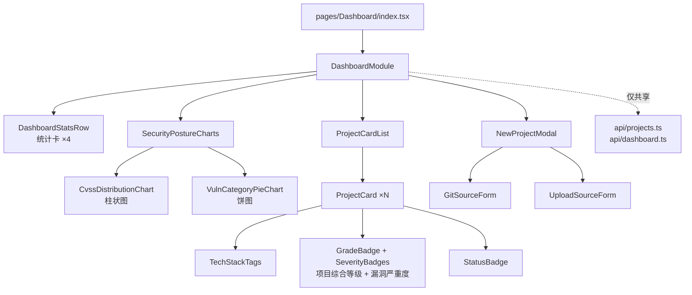
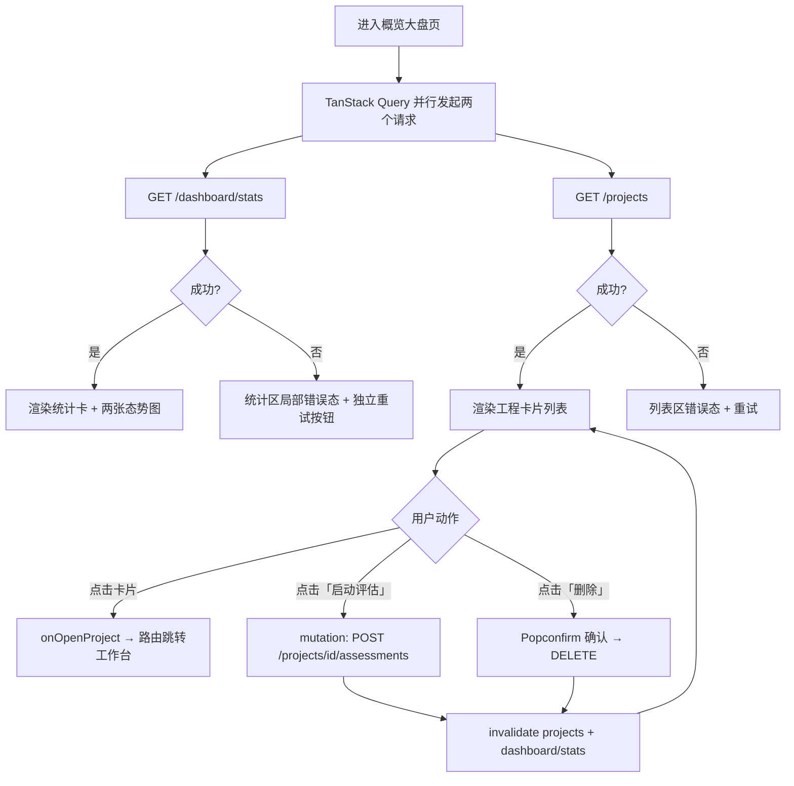
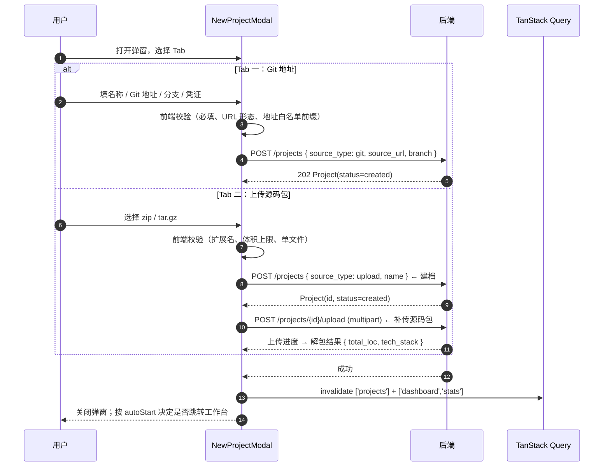

# 模块概要设计 — F1 概览大盘模块

| 项 | 值 |
|---|---|
| 所属层 | 前端展示层 |
| 承载页面 | 项目概览大盘页（`pages/Dashboard`，PRD §5、PRD §8.1 ①） |
| 上游文档 | [PRD.md](../PRD.md)、[概要设计总纲.md](../概要设计总纲.md) |
| 对应需求 | 需求.md 2.5.5 |
| 文档层级 | 概要设计 |

## 1. 模块定位

### 1.1 职责

F1 是**系统入口页**，承担三件事（PRD §8.1 ①、概要设计总纲 §3.2）：

1. **全局态势呈现**：把「所有项目的所有评估」聚合为顶部四张统计卡与两张态势图，让用户在进入任何具体工程前先看到风险总量。其中「平均安全评分」由 `assessments.security_score`（B6 `scoring.py` 在 `report_gen` 阶段写回）聚合而来，聚合端点唯一为 `GET /dashboard/stats`（PRD §6、§9）。
2. **工程清单与入口**：以卡片列表呈现每个工程的身份信息（名称、技术栈、最新评估时间、高中低危计数、运行状态），并提供「进入工作台 / 启动评估 / 删除」三个动作，是通往 F2–F5 的唯一入口。
3. **工程建档**：通过「新建评估项目」弹窗完成两种接入方式（Git 地址克隆、上传源码包），对应需求 2.5.1「项目接入」的前端侧。

> **术语规范（不可混用，PRD §6 关键设计说明 2）**：大盘统计卡与工程卡片上的**项目综合等级**取自 `assessments.security_grade`（`critical` / `high` / `medium` / `safe`，含高危一票否决）；工程卡片上的**高·中·低危计数**是**单漏洞严重度**（`vulnerabilities.severity`：`critical` / `high` / `medium` / `low`）。二者是两套四级术语，前端不得互相推导或换算。

### 1.2 明确不负责（边界）

| 不负责 | 归属 |
|---|---|
| 技术栈识别（展示的标签来自后端，不由前端推断） | B1 项目管理 / ReconAgent（总纲 §3.1） |
| 源码克隆、解包、落盘 | B1 项目管理模块 |
| 评估进度与日志的实时展示 | F2 流水线监控模块 |
| 漏洞明细、污点路径、攻击链 | F3 漏洞视窗 / F4 拓扑图谱 |
| 评估结果的合规排版与导出 | F5 报告导出模块 |
| 沙箱镜像与网络策略配置 | 沙箱与环境配置页（PRD §8.1 ④，admin 限定） |
| 登录与 RBAC 校验 | 共享 `api/` 拦截器 + 后端（总纲 §8.3） |

**依赖矩阵约束**：F1 与 F2–F5 **无横向依赖**（总纲 §3.3），只共享 `api/` 与 `store/`。因此 F1 不得 import `modules/pipeline` 等任何兄弟模块；卡片「进入」动作通过 props 回调上抛给页面路由层。

### 1.3 与后端接口的对应关系

| 界面元素 | 后端端点（PRD §9） | 说明 |
|---|---|---|
| 顶部统计卡（4 张） | `GET /api/v1/dashboard/stats` | 全局聚合（含平均安全评分，源自 `assessments.security_score`），**唯一聚合端点**，与项目列表解耦 |
| 全局安全态势图（柱状 + 饼图） | `GET /api/v1/dashboard/stats` | 需在同一响应内携带聚合分布，见 §8 待定项 |
| 工程卡片列表 | `GET /api/v1/projects` | 只返回工程维度数据 |
| 新建（Tab 一：Git 地址） | `POST /api/v1/projects` | **建档**，body 含 `source_type=git` |
| 新建（Tab 二：上传源码包） | `POST /api/v1/projects` + `POST /api/v1/projects/{id}/upload` | `POST /projects` **建档**（骨架）→ `POST /projects/{id}/upload` **补传源码包**，语义已由 PRD §9 澄清（见 §7） |
| 卡片「启动/重新评估」 | `POST /api/v1/projects/{id}/assessments` | 对齐总纲 §5.1 状态机（created→running、completed→running） |
| 卡片「删除」 | `DELETE /api/v1/projects/{id}` | 危险操作，Popconfirm |

## 2. 组件分解

| 组件名 | 职责 | 关键 props | 依赖库 |
|---|---|---|---|
| `DashboardModule` | 模块根，组装四个区块，持有全部 Query | `onOpenProject` | TanStack Query |
| `DashboardStatsRow` | 四张统计卡（项目总数 / 高危漏洞总数 / 评估中任务数 / 平均安全评分） | `stats` `isLoading` `isError` `onRetry` | AntD `Statistic` `Card` `Skeleton` |
| `SecurityPostureCharts` | 态势图容器，负责懒加载与两图并排布局 | `cvssDistribution` `categoryDistribution` | AntD `Card` `Grid` `Empty` |
| `CvssDistributionChart` | CVSS 分布柱状图（区间分桶） | `data: CvssBucket[]` | `@ant-design/charts`（懒加载） |
| `VulnCategoryPieChart` | 漏洞类型占比饼图 | `data: CategorySlice[]` | `@ant-design/charts`（懒加载） |
| `ProjectCardList` | 卡片列表容器：筛选、排序、空态、骨架屏 | `projects` `filter` `onFilterChange` `onOpen` `onStartAssessment` `onDelete` | AntD `List` `Segmented` |
| `ProjectCard` | 单个工程卡片：名称 / 技术栈标签 / 最新评估时间 / **项目综合等级徽标**（`securityGrade`）/ **漏洞严重度计数**（高·中·低危）/ 状态徽标 / 动作区 | `project` + 三个动作回调 | AntD `Card` `Tag` `Badge` `Tooltip` |
| `NewProjectModal` | 新建弹窗，Tab 切换两种来源，校验与提交 | `open` `onCancel` `onCreated` | AntD `Modal` `Tabs` `Form` `Upload` |
| `GitSourceForm` | Git 地址 / 分支 / 凭证表单与地址白名单前置校验 | `onSubmit` | AntD `Form` |
| `UploadSourceForm` | 源码包选择 / 体积校验 / 上传进度 | `projectId` `onUploaded` | AntD `Upload` |



## 3. 对外接口

### 3.1 模块导出的组件与 props 契约

```ts
// modules/dashboard/index.ts
export interface DashboardModuleProps {
  /** 卡片点击后交由页面路由跳转；模块自身不依赖 react-router */
  onOpenProject: (projectId: number, assessmentId?: number) => void;
}

export const DashboardModule: React.FC<DashboardModuleProps>;

export interface DashboardStatsRowProps {
  stats?: DashboardStats;
  isLoading: boolean;
  isError: boolean;
  onRetry: () => void;
}

export interface SecurityPostureChartsProps {
  cvssDistribution: CvssBucket[];
  categoryDistribution: CategorySlice[];
  isLoading: boolean;
}

export interface ProjectCardListProps {
  projects: ProjectSummary[];
  isLoading: boolean;
  filter: ProjectFilter;
  onFilterChange: (next: ProjectFilter) => void;
  onOpen: (project: ProjectSummary) => void;
  onStartAssessment: (projectId: number) => void;
  onDelete: (projectId: number) => void;
}

export interface NewProjectModalProps {
  open: boolean;
  onCancel: () => void;
  /** 创建成功（Git）或上传完成（upload）后回调，由根组件决定是否跳转工作台 */
  onCreated: (project: ProjectSummary, autoStart: boolean) => void;
}
```

### 3.2 依赖的后端 API

- `GET /api/v1/dashboard/stats` — 统计卡 + 态势图数据源（Query key `['dashboard','stats']`）
- `GET /api/v1/projects` — 卡片列表（Query key `['projects']`）
- `POST /api/v1/projects` — 建档（Git / upload 骨架）
- `POST /api/v1/projects/{id}/upload` — 源码包上传（`multipart/form-data`）
- `POST /api/v1/projects/{id}/assessments` — 启动评估
- `DELETE /api/v1/projects/{id}` — 删除工程

失效策略：`POST` 成功后统一 `invalidateQueries(['projects'])` + `(['dashboard','stats'])`，保持卡片与统计卡同源一致。

### 3.3 本模块定义的数据结构

```ts
export type ProjectStatus = 'created' | 'running' | 'completed' | 'failed' | 'stopped';
export type AssessmentStatus = ProjectStatus; // 共用同一状态机，见总纲 §5.1
export type Severity = 'critical' | 'high' | 'medium' | 'low';        // 单漏洞严重度
export type SecurityGrade = 'critical' | 'high' | 'medium' | 'safe';   // 项目综合等级

export interface ProjectSummary {
  id: number;
  name: string;
  sourceType: 'git' | 'upload';
  sourceUrl: string | null;
  techStack: string[];
  totalLoc: number;
  status: ProjectStatus;
  updatedAt: string;
  latestAssessment: {
    id: number;
    status: AssessmentStatus;
    progress: number;
    finishedAt: string | null;
    securityScore: number | null;       // 0-100，B6 scoring.py 在 report_gen 写回
    securityGrade: SecurityGrade | null; // ★ 项目综合等级（大盘展示的等级口径）
  } | null;
  severityCounts: Record<Severity, number>; // ★ 高/中/低危计数 = 单漏洞严重度，非项目等级
}

export interface DashboardStats {
  projectTotal: number;
  highRiskTotal: number;             // 高危漏洞总数（按 vulnerabilities.severity 统计）
  runningAssessmentCount: number;    // 评估中任务数
  averageSecurityScore: number | null; // ✅ 聚合 assessments.security_score；无已完成评估时为 null
  gradeDistribution?: Record<SecurityGrade, number>; // 项目综合等级分布（可选）
  cvssDistribution: CvssBucket[];
  categoryDistribution: CategorySlice[];
}

export interface CvssBucket { label: string; count: number }   // 如 '0.1-3.9' / '4.0-6.9' / '7.0-8.9' / '9.0-10.0'
export interface CategorySlice { category: string; count: number }

export interface ProjectFilter {
  keyword: string;
  status: ProjectStatus | 'all';
}
```

> 前端**不重算**任何统计口径（如平均安全评分、CVSS 分桶边界），一律消费后端返回值。理由：同一数字可能同时出现在报告（B6）中，两处口径必须唯一。

> **`SecurityGrade` 与 `Severity` 是两个独立类型**：`securityGrade` 只由后端 B6 写回，前端不推导；卡片上的 `severityCounts` 是漏洞严重度计数。二者不得共用同一套色板映射函数。

## 4. 关键处理流程

### 4.1 首屏加载与卡片动作



**设计要点**：统计区与列表区**互相隔离失败**——`dashboard/stats` 挂掉不能导致看不到工程卡片（反之亦然）。这是刻意的：大盘页是导航入口，导航能力必须比统计可视化更可靠。

### 4.2 新建评估项目（两段式上传）



**设计要点**：建档（`POST /projects`）与补传源码包（`POST /projects/{id}/upload`）是**两个独立动作**——前者只落 `projects` 记录，后者单独提交二进制包；这也让「上传中断后重传」无需重建项目。错误一律**留在弹窗内**呈现（`Alert` 展示后端 `message` + `remediation`，对齐总纲 §9.2 的四要素错误规范），并给出替代路径按钮——Git 克隆失败时提示「改用上传源码包」，直接落实总纲 §8.2 的降级行。

## 5. 状态管理

| 状态 | 归属 | 理由 |
|---|---|---|
| 统计卡 + 态势图数据 | TanStack Query `['dashboard','stats']` | 纯服务端状态，需重试/失效/缓存 |
| 工程卡片列表 | TanStack Query `['projects']` | 同上；新建/删除后由 invalidate 驱动刷新 |
| 启动评估 / 删除的提交态 | TanStack Query `useMutation` | 与列表同源，成功后自动失效 |
| 列表筛选（关键字、状态） | 组件本地 `useState`（根组件持有） | 纯 UI 视图态，刷新即重置；量级小无需持久化 |
| 弹窗开关、当前 Tab、表单字段 | 组件本地 `useState` + AntD `Form` 实例 | 生命周期短，随弹窗卸载销毁 |
| 上传进度百分比 | AntD `Upload` 的 `onProgress` 回调态（本地） | 单次交互瞬态，不需要跨组件共享 |
| 当前用户与角色（决定是否显示删除） | 共享 `store/`（`useAuthStore`） | 由登录态注入，跨模块复用 |
| 图表库是否已加载 | 本地 lazy 组件状态 | 仅影响渲染时机 |

**不引入额外 Zustand slice**：F1 的全部状态都具备「服务端状态」或「短生命周期 UI 态」的清晰归属，硬塞进全局 store 只会引入同步负担。

## 6. 出错处理

| 错误场景 | 用户可见表现 | 处理策略 |
|---|---|---|
| `dashboard/stats` 请求失败 | 统计卡显示 `--` + 区块内 `Alert` 与「重试」按钮 | Query `retry: 2` 指数退避；**不阻塞**卡片列表渲染 |
| `GET /projects` 请求失败 | 列表区错误态 + 重试 | 同上；大盘页整体不进入白屏 |
| Git 克隆失败（网络 / 认证 / 白名单拒绝） | 弹窗内红色 `Alert`：后端 `message` + `remediation`，附「改用上传源码包」按钮 | 对齐总纲 §8.2「Git 克隆失败 → 提示改用源码包上传」 |
| 上传包格式或体积非法 | 表单域下方即时校验提示 | 前端前置拦截，不发请求 |
| 上传中途网络中断 | 上传进度条转为「已中断，请重试」 | 允许重传；已建骨架项目保留，可后续继续上传 |
| Redis 不可用导致启动评估失败 | `message.error('调度服务不可用，请稍后重试')` | 对齐总纲 §8.2；按钮恢复可点，不做乐观更新 |
| 删除有运行中评估的项目 | 确认框内提示「该项目存在运行中的评估」 | 后端返回冲突态时前端给出「先在工作台终止任务」指引 |
| 重复点击启动 / 删除 | 按钮进入 `loading` 且禁用 | mutation 的 `isPending` 驱动，天然防重 |
| 401 未认证 / token 过期 | 跳转登录页 | 共享 `api/` 拦截器统一处理 |
| 统计与列表数据暂时不一致（如刚删除项目） | 卡片动画消失，统计卡在 1 次请求内追平 | invalidate 两个 key，允许短暂不一致，不做前端重算 |

## 7. 设计约束与权衡

| 决策点 | 选择 | 放弃的方案 | 理由 | 代价 |
|---|---|---|---|---|
| 图表库 | `@ant-design/charts`，**按需懒加载** | ECharts 直用 | 与 AntD 5 主题 token 一致、声明式、无手写主题适配 | 包体积较大，故用 `React.lazy` + 骨架屏 |
| 上传为何两段式 | `POST /projects`（**建档**）→ `POST /projects/{id}/upload`（**补传源码包**，multipart） | 单请求带 JSON + 文件 | ✅ 语义已由 PRD §9 澄清：建档与补传是两个动作，后者亦可作失败重传；创建响应的 `id` 是上传路径参数，表单元数据与二进制混传会让校验与重试都变复杂 | 失败时可能残留 `created` 状态的空项目，需允许删除或重传 |
| 筛选/排序位置 | 前端内存筛选 | 后端查询参数 | `GET /projects` 未定义分页与筛选参数，工程数量在作品集量级（数十个） | 工程数上千后需改后端 |
| 统计口径 | 全部来自 `dashboard/stats`（唯一聚合端点），前端零计算 | 前端由列表聚合 | 保证与报告（B6）口径唯一；平均安全评分源自 `assessments.security_score` | 依赖后端提供分布字段 |
| 运行中项目的进度刷新 | 列表接口 `refetchInterval: 15s`（仅当存在 `running` 项目时启用） | 大盘页开 SSE 长连接 | 大盘是总览页，为 N 个项目各开一条 SSE 不可接受；秒级精度留给工作台 | 大盘进度最多滞后 15s |
| 统计区与列表区错误隔离 | 两个独立 Query + 两个错误边界 | 一个页面级 Suspense/ErrorBoundary | 导航可靠性优先于统计可视化 | 代码略多 |
| 卡片动作的权限控制 | 由共享 `useAuthStore` 的角色决定渲染 | 模块内再查接口 | 权限点已由后端 RBAC 定义（总纲 §8.3），前端只做展示裁剪 | 前端裁剪不可作为安全边界 |

## 8. 移交详细设计的待定项

| # | 待定项 | 影响 | 建议 |
|---|---|---|---|
| 1 | `GET /dashboard/stats` 的确切响应体（是否含 `cvssDistribution` / `categoryDistribution` / `gradeDistribution`） | 决定态势图能否一请求取全 | ✅ PRD §9 已定该端点为**唯一聚合端点**；仍建议在同一响应内承载分布字段，避免新增聚合端点 |
| 2 | ~~「平均安全评分」的计算口径与落点~~ | — | ✅ 已由上游修订解决（PRD §6 / §9）：`assessments.security_score`(0-100) 与 `security_grade` 由 B6 `scoring.py` 在 `report_gen` 阶段写回，`dashboard/stats` 聚合；权重属 B6 职责，前端零计算 |
| 3 | `GET /projects` 是否分页、是否支持 `status`/`keyword` 过滤 | 决定筛选放前端还是后端 | 建议先前端筛选，保留参数位 |
| 4 | 源码包体积上限与允许的压缩格式 | 前端前置校验阈值 | PRD §5 仅提及 zip/tar.gz，需明确 MB 上限 |
| 5 | 卡片「最新评估时间」的取值 | 展示语义 | 建议取 `max(finished_at, started_at)`，由后端统一定义 |
| 6 | 新建成功后是否自动启动评估 | 交互流程分支 | 建议弹窗底部提供「创建后立即开始评估」勾选（默认勾选），对应本模块的 `autoStart` |
| 7 | 卡片「进入工作台」的目标 | 路由契约 | 若 `latestAssessment` 为空则进入工作台的「未开始」态页面 |
| 8 | 空态文案与图表空数据表现 | 观感 | 建议统一 `Empty` 描述「暂无评估数据，先创建一个评估项目」 |

## ⚠️ 与上游不一致

1. ✅ **已由上游修订解决（PRD §9）**：`POST /projects` 与 `POST /projects/{id}/upload` 的语义重复已澄清——前者是**建档**，后者是**补传源码包**。本设计的两段式流程（§4.2、§7）正按此语义落地。
2. ✅ **已由上游修订解决（PRD §6 / §9）**：`assessments` 新增 `security_score`(float 0-100) 与 `security_grade`(enum `critical|high|medium|safe`)，由 B6 的 `scoring.py` 在 `report_gen` 阶段写回；「平均安全评分」的落点由此确定，`GET /dashboard/stats` 为唯一聚合端点。
3. ✅ **已由上游修订解决（PRD §9）**：`GET /dashboard/stats` 与 `GET /projects` 的统计职责已划清——列表端点只返回工程维度数据，全局统计（含平均安全评分）一律走 `dashboard/stats`，与本设计的裁决一致。
4. **术语风险（新增，需实现时守住）**：`security_grade`（项目综合等级）与 `severity`（漏洞严重度）同用四色时极易被实现者混用；PRD §6 已明确二者是两套术语，本设计已在 §1.1、§2、§3.3 强制区分类型（`SecurityGrade` vs `Severity`）。
