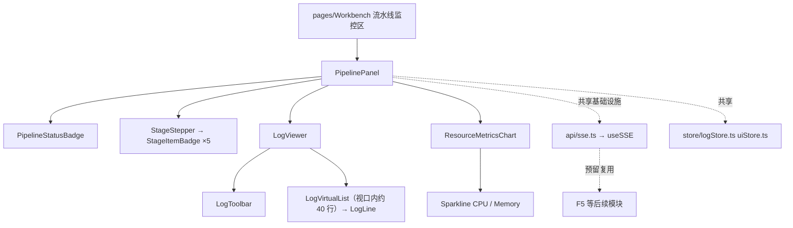
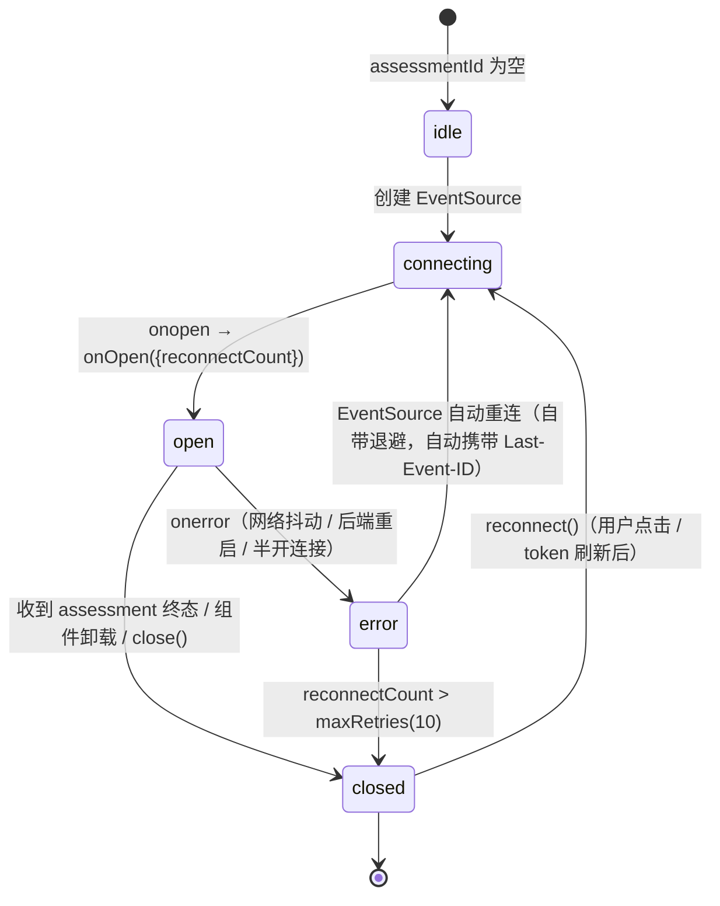
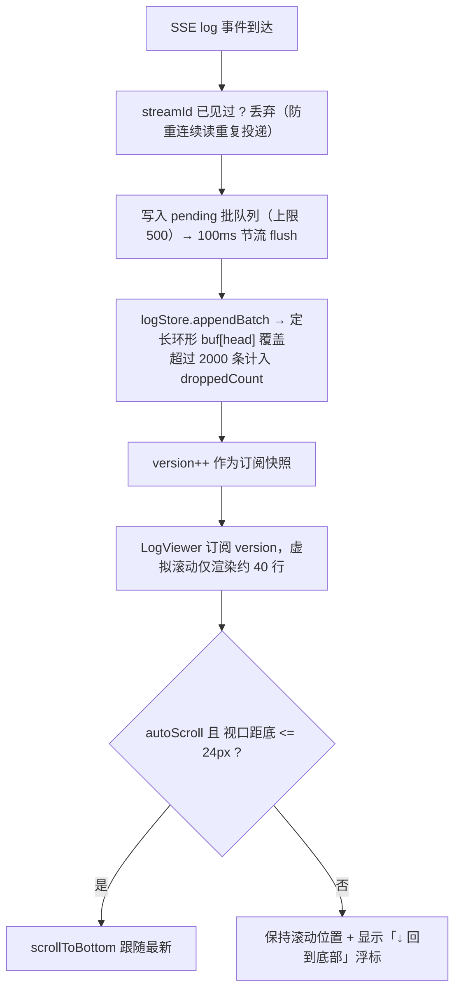
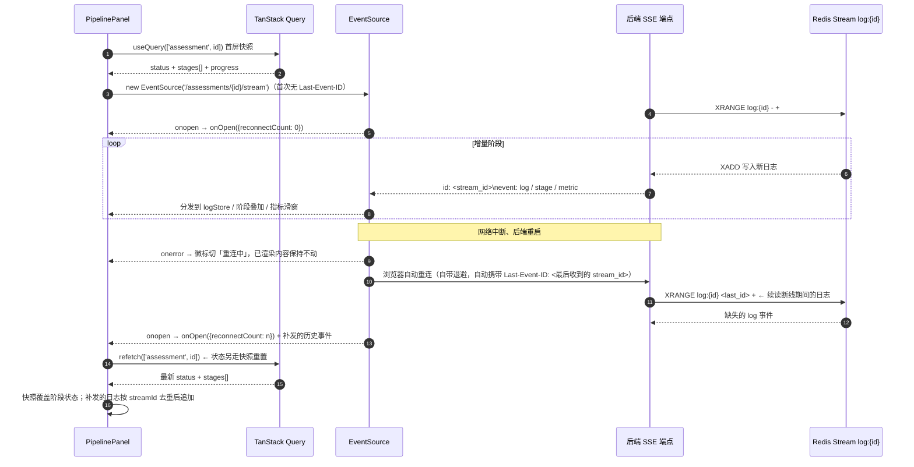

# 模块概要设计 — F2 流水线监控模块

| 项 | 值 |
|---|---|
| 所属层 | 前端展示层 |
| 承载页面 | 工作台·流水线监控区（`pages/Workbench` 第一区，PRD §8.1 ②） |
| 上游文档 | [PRD.md](../PRD.md)、[概要设计总纲.md](../概要设计总纲.md) |
| 对应需求 | 需求.md 2.5.5 |
| 文档层级 | 概要设计 |

## 1. 模块定位

### 1.1 职责

F2 是评估任务运行期的**唯一观测窗口**，把后端五阶段流水线翻译成四组可读信息（PRD §8.1 ②、总纲 §3.2、§8.4）：

1. **五阶段步进器**：`recon → code_audit → poc_verify → exploit_chain → report_gen` 的推进 / 失败 / 跳过（总纲 §5.2）。
2. **实时日志滚动视窗**：消费 SSE 增量日志，等宽字体逐行渲染，支持自动滚底、级别筛选、关键字过滤。
3. **运行状态徽标**：评估级状态（`created/running/completed/failed/stopped`，总纲 §5.1）+ 进度百分比 + 终止按钮。
4. **资源消耗指标**：`resource_metrics` 采样驱动的 CPU / 内存迷你折线图（总纲 §8.4）。

本模块还对外提供并维护共享 hook `useSSE`（`api/sse.ts`）——全前端唯一的 SSE 客户端抽象。总纲 §3.3 目前只有 F2 依赖它，但它必须零业务耦合，供后续模块（如 F5 报告生成进度）直接接入。

### 1.2 明确不负责（边界）

| 不负责 | 归属 |
|---|---|
| 阶段内部算法与任何编排决策 | B3 多 Agent 编排引擎 |
| 漏洞列表 / 污点路径 / 补丁 | F3 漏洞视窗模块 |
| 攻击链 DAG | F4 拓扑图谱模块 |
| 阶段产物的排版与导出 | F5 报告导出模块 |
| 日志历史的持久化与查询 | 后端（Redis Stream `log:{assessment_id}` 保留历史，SSE 端点按 `Last-Event-ID` 续读；`assessment_stages.log_excerpt` 仅作阶段级摘要） |
| 资源指标的服务端聚合与 TTL 清理 | B2 沙箱隔离模块 + 观测层 |
| 工作台三区布局与拖拽分栏 | `pages/Workbench` 页面层 |

**依赖矩阵约束**：F2 与 F1/F3/F4/F5 无横向依赖，只共享 `api/` 与 `store/`（总纲 §3.3）。F2 通过 `assessmentId` 入参接入，不关心工作台如何选中该评估。

### 1.3 与后端接口的对应关系

| 界面元素 | 后端端点（PRD §9） | 承载内容 |
|---|---|---|
| 状态徽标 + 步进器 + 进度 | `GET /api/v1/assessments/{id}` | 状态快照：`status` / `current_stage` / `progress` / 阶段列表（含 `log_excerpt`） |
| 日志、阶段推进、指标（增量） | `GET /api/v1/assessments/{id}/stream` | SSE 事件 `log` / `stage` / `metric`（总纲 §6.3） |
| 「终止任务」按钮 | `POST /api/v1/assessments/{id}/stop` | 协作式取消（总纲 §4.2、D11） |
| 资源采样来源 | 后端聚合 `resource_metrics`（PRD §6） | `cpu_percent` / `memory_mb` / `recorded_at` |

**核心契约（总纲 §6.3）**：**SSE 只承载增量事件，状态快照一律走 REST**。日志通道为 **Redis Stream**（`log:{assessment_id}`），而非 Pub/Sub——Stream 保留历史，SSE 端点用 `XRANGE` 读取并下发 `id: <stream_id>`，浏览器 `EventSource` 重连时自动携带 `Last-Event-ID` 头，后端据此**续读补齐断线期间的日志**（PRD §7.5）。因此 F2 的阶段状态、状态徽标与**日志流**都有确定性来源，重连后不存在状态漂移，也不丢日志。

## 2. 组件分解

| 组件名 | 职责 | 关键 props | 依赖库 |
|---|---|---|---|
| `PipelinePanel` | 模块根：建立快照 Query + SSE 连接，组装四块 | `assessmentId` `onStopped` | TanStack Query + `useSSE` |
| `PipelineStatusBadge` | 评估级状态徽标 + 进度条 + 终止按钮 | `status` `progress` `errorMessage` `onStop` | AntD `Badge` `Progress` `Popconfirm` |
| `StageStepper` | 五阶段步进器，把阶段状态映射为 AntD `Steps` | `stages` `currentStage` `progress` | AntD `Steps` |
| `StageItemBadge` | 单阶段状态徽标与耗时 / 错误提示 | `item` | AntD `Tag` `Tooltip` |
| `LogViewer` | 日志视窗：订阅缓冲、虚拟滚动、自动滚底；子组件 `LogLine` 负责单行渲染（时间戳 / 级别 / 阶段 / 文本） | `store` `height` | `rc-virtual-list`（AntD 内置） |
| `LogToolbar` | 清空 / 自动滚底开关 / 级别筛选 / 关键字 / 丢弃计数 | `autoScroll` `levelFilter` | AntD `Switch` `Segmented` `Input` |
| `ResourceMetricsChart` | 双指标迷你折线图与空态 | `samples` `windowSize` | `@ant-design/charts`（懒加载） |
| `useSSE` | 共享基础设施：SSE 连接生命周期与事件分发 | 见 §3.1 | `EventSource`（原生） |



## 3. 对外接口

### 3.1 模块导出的组件与 props 契约

```ts
// modules/pipeline/index.ts
export interface PipelinePanelProps {
  assessmentId: number | null;      // null 时渲染「未开始评估」空态，不建立连接
  onStopped?: (assessmentId: number) => void;
}
export const PipelinePanel: React.FC<PipelinePanelProps>;
export interface PipelineStatusBadgeProps {
  status: AssessmentStatus; progress: number; stage: StageName | null;
  errorMessage?: string | null; onStop?: () => void;
}
export interface StageStepperProps {
  stages: AssessmentStageItem[]; currentStage: StageName | null;
  progress: number; compact?: boolean;   // 分栏收窄时切换横向/纵向布局
}
export interface LogViewerProps {
  store: LogStore;      // 由 createLogStore(assessmentId) 产出，测试时可注入
  height?: number;      // 默认由父容器 ResizeObserver 注入
}
export interface ResourceMetricsChartProps {
  samples: ResourceSample[]; windowSize?: number;   // 默认 60 个采样点
}
// api/sse.ts —— 共享基础设施，零业务耦合
export type SSEStatus = 'idle' | 'connecting' | 'open' | 'error' | 'closed';
export interface UseSSEOptions<E extends { type: string }> {
  enabled: boolean;
  handlers?: Partial<Record<E['type'], (evt: E) => void>>;
  onMessage?: (evt: E) => void;
  onOpen?: (ctx: { reconnectCount: number }) => void;   // 每次建连后触发（含首次与自动重连）
  onError?: (ctx: { reconnectCount: number }) => void;
  maxRetries?: number;          // 默认 10，超限停止自动重连并置 closed
  withCredentials?: boolean;
}
export interface UseSSEResult {
  status: SSEStatus; reconnectCount: number; lastEventId: string | null;
  reconnect: () => void;        // 401 换 token 后 / 超限后由用户点击
  close: () => void;
}
export function useSSE<E extends { type: string }>(
  url: string | null,           // null 时不连接，便于条件挂载
  opts: UseSSEOptions<E>,
): UseSSEResult;
```

**复用性约束**（`useSSE` 的职责是连接，不是业务）：

- **泛型化事件**：事件包络由调用方定义，hook 只做 `type → handler` 分发。
- **不持有业务数据**：日志 / 指标 / 阶段状态全部落在调用方，hook 内部只有连接态。
- **不依赖任何 store**：纯 React hook，F5 接入时无需引入 F2 的任何东西。
- **统一的重连语义**：`onOpen` 在**每次**建连后触发，调用方只需实现一次「拉快照」的重连逻辑。
- **`Last-Event-ID` 由浏览器托管**：`EventSource` 自动记住最后收到的 `id:` 值，重连时自动写入请求头，hook 不手动拼 URL 参数；`lastEventId` 仅用于诊断展示。

### 3.2 依赖的后端 API

- `GET /api/v1/assessments/{id}` — 状态快照（Query key `['assessment', id]`）
- `GET /api/v1/assessments/{id}/stream` — SSE 增量流（不进 Query 缓存）
- `POST /api/v1/assessments/{id}/stop` — 终止（mutation）

### 3.3 本模块定义的数据结构

```ts
export type StageName = 'recon' | 'code_audit' | 'poc_verify' | 'exploit_chain' | 'report_gen';
export type StageStatus = 'pending' | 'running' | 'completed' | 'failed' | 'skipped';
export type AssessmentStatus = 'created' | 'running' | 'completed' | 'failed' | 'stopped';
export type LogLevel = 'DEBUG' | 'INFO' | 'WARN' | 'ERROR';
export interface AssessmentStageItem {
  stage: StageName; status: StageStatus;
  startedAt: string | null; finishedAt: string | null;
  logExcerpt: string | null;      // 对应 assessment_stages.log_excerpt（PRD §6）
  errorMessage: string | null;    // 含 error_code / remediation，见总纲 §9.2
}
export interface AssessmentSnapshot {
  id: number; projectId: number; status: AssessmentStatus;
  currentStage: StageName | null; progress: number;   // 0-100
  startedAt: string | null; finishedAt: string | null; errorMessage: string | null;
  stages: AssessmentStageItem[];
}
export interface LogLine {
  streamId: string;     // ★ Redis Stream 消息 ID（形如 1700000000000-0），兼作稳定 key、去重依据与 Last-Event-ID
  ts: string; level: LogLevel; stage: StageName | null; message: string;
}
export interface ResourceSample { ts: number; cpuPercent: number; memoryMb: number }
/** 事件包络：log / stage / metric 三类对齐总纲 §6.3，后两类为建议扩展（见 §8） */
export type PipelineSSEEvent =
  | { type: 'log'; streamId: string; ts: string; level: LogLevel; stage: StageName | null; message: string }
  | { type: 'stage'; ts: string; stage: StageName; status: StageStatus; progress: number }
  | { type: 'metric'; ts: string; stage: StageName; cpu_percent: number; memory_mb: number }
  | { type: 'assessment'; ts: string; status: AssessmentStatus; progress: number; error?: string }
  | { type: 'heartbeat'; ts: string };
```

## 4. 关键处理流程

### 4.1 SSE 连接生命周期



| 规则 | 说明 |
|---|---|
| 断线不清屏 | `error` 时**不清空**已渲染的日志与阶段状态，仅把连接徽标切为「重连中」 |
| ✓ 断线日志可补齐 | 重连时浏览器自动带 `Last-Event-ID`，后端从该 ID 之后 `XRANGE` 续读，**断线期间写入 Stream 的日志不丢**（PRD §7.5、总纲 §6.3） |
| 每次 `open` 都拉快照 | `onOpen` 是唯一入口，首次与重连走同一条代码路径（总纲 §6.3 的设计要点） |
| 终态与卸载即收线 | 收到 `completed / failed / stopped` 或 `useEffect` cleanup 时主动 `close()`，不空耗连接、不泄漏 |

### 4.2 日志环形缓冲与自动滚底



| 环节 | 方案与参数 |
|---|---|
| 缓冲容量 | 定长环形数组，覆盖最旧，`MAX_LINES = 2000`；单行超 2KB 截断并标注 |
| 写入节流 | 100ms 合并一批（单批上限 500 条），避免逐条 `setState` |
| 订阅粒度 | Zustand vanilla store + 选择器订阅 `version`，只有 `LogViewer` 重渲染 |
| DOM 规模 | `rc-virtual-list` 虚拟滚动，常驻 DOM 约 40 行，与 2000 条无关 |
| 自动滚底判定 | `scrollTop + clientHeight >= scrollHeight - 24` 视为在底部；用户上滚立即置 `autoScroll = false` 并显示浮标（偏好写入 `uiStore` 持久化）；程序化滚动用标志位抑制抖动 |
| 数据丢弃可见性 | 工具栏常显「仅保留最近 2000 条，已省略 N 条」；⚠️ 上游已改为 Redis Stream，`XTRIM` 之前的历史仍可从后端 `XRANGE` 续读，故环形缓冲的**唯一目的是限制 DOM 节点数**，不再代表「丢失不可恢复」 |

### 4.3 断线重连（`Last-Event-ID` 续读 + 快照补齐）



**为什么重连能补齐日志**：日志通道是 Redis Stream（不是 Pub/Sub）。后端用 `XADD log:{assessment_id}` 持久化每条日志并保留下标；SSE 端点下发时带 `id: <stream_id>`，浏览器 `EventSource` 自动记住最后收到的 `id`，重连时自动写入请求头 `Last-Event-ID`，后端据此从该 ID 之后 `XRANGE` **续读补齐断线期间的日志**（PRD §7.5、总纲 §6.3）。状态维度仍由「重连后 refetch 一次快照」保证——SSE 只送增量、快照只走 REST。两条路径各司其职：**日志靠 Stream 续读、状态靠快照重置**，因此既不错位也不丢日志。前端仅需按 `streamId` 去重（后端可能重发边界内的一条），无需任何「日志可能不完整」的兜底文案。

## 5. 状态管理

| 状态 | 归属 | 理由 |
|---|---|---|
| 评估快照（status / currentStage / progress / stages[]）及其 SSE 增量叠加 | TanStack Query `['assessment', id]`，增量用 `queryClient.setQueryData` 就地补丁 | 服务端状态；`onOpen` 时用 `refetch` 统一复用缓存与重试；阶段推进是快照的子集更新，无需另开 store |
| 日志行缓冲（2000 条环形）及其丢弃计数 / 最新 streamId | Zustand **vanilla** `createStore`（`store/logStore.ts`），按 `assessmentId` 实例化 | 高频追加、非请求生命周期、需按选择器订阅以隔离重渲染 |
| 资源指标滑窗（60 点） | `store/metricsStore.ts`（同环形方案） | 高频、需滑窗；不进 Query |
| `autoScroll` 开关（持久化）+ 日志级别筛选 / 关键字（会话级） | Zustand `uiStore` | 被工具栏与视窗共享；开关还需跨会话记住用户偏好 |
| SSE 连接状态与重连计数 | `useSSE` 内部 `useState`，并镜像到 `uiStore` | 连接态是 hook 的职责；镜像给全局顶部提示条复用 |
| 终止按钮提交态 | TanStack Query `useMutation` | 与快照同源，成功后 invalidate |
| 面板高度 / 分栏比例 | 页面层传入 | 属布局职责，不归 F2 |
| 单行是否展开全文 | 组件本地 `useState` | 只有该行关心 |

**关键取舍**：日志用 `createStore` + `useStore(store, selector)` 而非 hook 版 `useLogStore()`——后者订阅整个 store，日志的任何追加都会让所有订阅组件重渲染，而选择器订阅让 `StageStepper`、`PipelineStatusBadge` 完全不参与日志更新。日志也**不放进 TanStack Query**：其缓存语义围绕「请求 → 响应」设计，无限追加快照会立刻遭遇 `staleTime` / GC 语义不匹配与 `setQueryData` 的结构化克隆开销。

## 6. 出错处理

| 错误场景 | 用户可见表现 | 处理策略 |
|---|---|---|
| 建连返回非 2xx：401（token 过期）/ 404（评估已删除） | 401 → 徽标红「会话已过期」「重新登录」；404 → 面板空态「评估不存在」 | `EventSource` 对非 2xx 会直接 `CLOSED` 且**不自动重连**（与网络错误不同）；401 刷新 token 后 `reconnect()`，404 直接 `close()` 停止重试 |
| 反复断线超 `maxRetries = 10`，或半开连接（> 30s 无事件且仍 running） | 徽标「实时连接已断开」+ 「重新连接」按钮 | 停止自动重连；`EventSource` 不感知半开，须主动 `close()` + `reconnect()`；快照仍可手动刷新，不静默假活 |
| 单条事件 JSON 解析失败 | 无感；工具栏计数 +N | 捕获后丢弃该条（总纲 §9.1 的 L1 可忽略级），不中断连接 |
| 阶段 `failed` / `skipped`（沙箱不可达、无匹配规则） | failed → 该步变红并展示 `error_message` 与 `remediation`；skipped → 该步灰色 + 黄色提示条 | 对齐总纲 §9.2 四要素规范与 §8.2 降级矩阵（如「动态验证未执行，漏洞退回 potential」） |
| 评估 `stopped` | 状态徽标灰「已终止」，步进器冻结在当前阶段 | 保留全部已渲染日志与阶段结果（总纲 §4.2、§7.2） |
| 日志量超限（> 2000 条） | 工具栏提示「已省略 N 条」，视窗仍流畅 | 环形覆盖 + 虚拟滚动，不阻塞主线程；被省略的历史仍可从后端 Stream 续读，非永久丢失 |
| 指标事件断档（无容器阶段） | 迷你折线图留缺口或空态 | 按时间戳留空而非插值，避免伪造采样 |

## 7. 设计约束与权衡

| 决策点 | 选择 | 放弃的方案 | 理由 | 代价 |
|---|---|---|---|---|
| 实时通道与同步模型 | SSE（原生 `EventSource`）；**快照走 REST + 增量走 SSE** | WebSocket；全靠事件流重建状态 | 对齐总纲 D8（需求全是单向推送且自带重连）；重连逻辑极简、永不错位（总纲 §6.3） | 无客户端上行；认证需绕开 header 限制；重连瞬间多一次快照请求 |
| 日志缓冲与渲染 | 定长环形 2000 + `rc-virtual-list` 虚拟滚动 | 无限累积数组；全量 DOM | 长任务日志可达上万条，无限累积必然卡顿甚至 OOM；2000 行 DOM 会让滚动帧率崩掉。环形上限**只约束 DOM 节点数**，不构成数据丢失——历史仍在 Redis Stream 中可续读（§4.3） | 视窗内不保留超过 2000 条（需回看更早日志时由后端补齐）；失去浏览器原生 Ctrl+F，需自建关键字过滤 |
| 订阅粒度 | Zustand vanilla + 选择器 | hook 版整店订阅 | 避免日志追加引发整面板重渲染 | 样板代码略多 |
| 写入节流与保序 | 100ms 批量合并 + 依赖 Redis Stream 消息 ID 去重 | 逐条 `setState`；按时间戳去重 | 逐条写入会打爆 React 调度；重连续读与批量补齐可能重发边界内一条，且时间戳可能相同 | 日志最多滞后 100ms；需后端保证 `id:` 与 Stream ID 一致 |
| 滚底判定 | 24px 阈值 + 程序化滚动抑制标志 | 只看开关 | 兼顾「一直跟随」与「用户上滚即停」两种直觉 | 需处理程序化滚动触发的 scroll 抖动 |
| `useSSE` 归属 | 放 `api/sse.ts`（PRD §5 约定），零业务耦合 | 放 `modules/pipeline/hooks` | 它是共享基础设施，未来模块要复用（总纲 §3.3 已为它单列一列） | 需额外维护泛型契约 |
| 指标采样与窗口 | 后端 ≤ 1 点/秒；前端保留 60 点 | 前端保留全量 | 迷你折线图只需趋势，60 点覆盖最近一分钟 | 无法回溯长曲线（回溯走报告页） |
| SSE 认证方式 | 待定：`?token=` query 或 HttpOnly Cookie（§8） | 自定义 header | **`EventSource` 不支持自定义请求头**，是技术硬约束 | query 方式会把 token 写入访问日志，有泄漏面 |

## 8. 移交详细设计的待定项

| # | 待定项 | 影响 | 建议 |
|---|---|---|---|
| 1 | ~~断线期间历史日志的补偿策略~~ | — | ✅ 已由上游修订解决（PRD §7.5、总纲 §6.3）：日志通道改用 Redis Stream，SSE 端点按 `Last-Event-ID` 用 `XRANGE` 续读，断线日志可补齐（见 §4.3） |
| 2 | SSE 事件类型是否扩展 `assessment` 与 `heartbeat` | 终态收敛与半开连接探测 | 总纲 §6.3 只列 `log / stage / metric`；建议补充两类，否则前端只能靠「30s 无事件」猜终态 |
| 3 | SSE 的认证方式 | `useSSE` 建连实现与安全面 | 建议 HttpOnly Cookie（避免 token 进 URL 与访问日志）；若保持 query token，需约定短时效一次性凭证 |
| 4 | `metric` 事件推送频率与字段 | 滑窗参数与带宽 | 建议 ≤ 1 点/秒，字段对齐 `resource_metrics`（`cpu_percent` / `memory_mb` / `recorded_at`） |
| 5 | 日志筛选落点、常量是否可配、标签页隐藏时是否暂停渲染 | 调优空间与长任务挂后台的性能 | 筛选当前在客户端（对 2000 条内存过滤可忽略），常量先集中定义，`visibilitychange` 时降级为「只入缓冲不渲染，恢复时一次性追平」 |

## ⚠️ 与上游不一致

1. ✅ **已由上游修订解决（PRD §7.5、总纲 §6.3）**：日志通道从 Redis Pub/Sub 改为 **Redis Stream**——Pub/Sub 即发即弃、无历史，SSE 断线期间的日志会永久丢失；新方案后端 `XADD log:{assessment_id}` 持久化，SSE 端点用 `XRANGE` 读取并下发 `id: <stream_id>`，浏览器 `EventSource` 重连自动携带 `Last-Event-ID`，后端据此续读补齐。**断线期间日志不可补齐的缺口已关闭**（本设计 §4.3 已按此重写）。
2. ✅ **已由上游修订解决（PRD §8.1 ②）**：PRD 已澄清「xterm 风格滚动视窗」是**样式描述**（等宽字体 + 深底 + 自动滚底），**不是 xterm.js 库**，依赖清单无需也不引入 xterm.js。本设计采取的「等宽字体 + 虚拟滚动 + 级别配色 + 自动滚底」与上游一致，依赖冲突消除。
