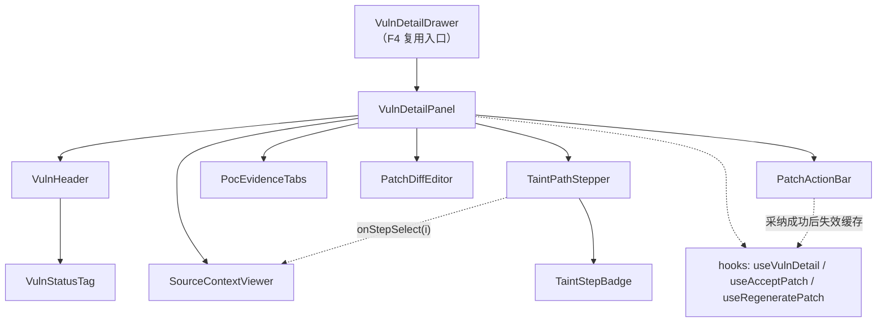
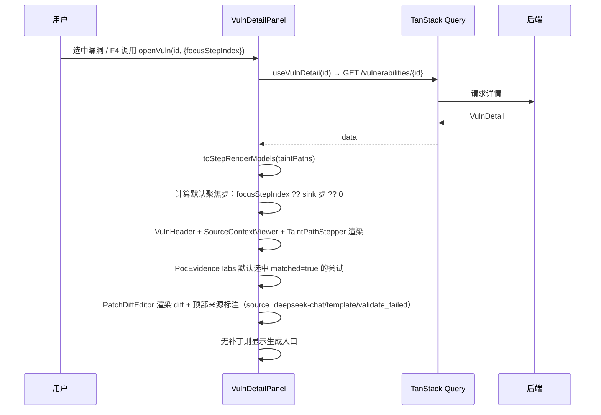
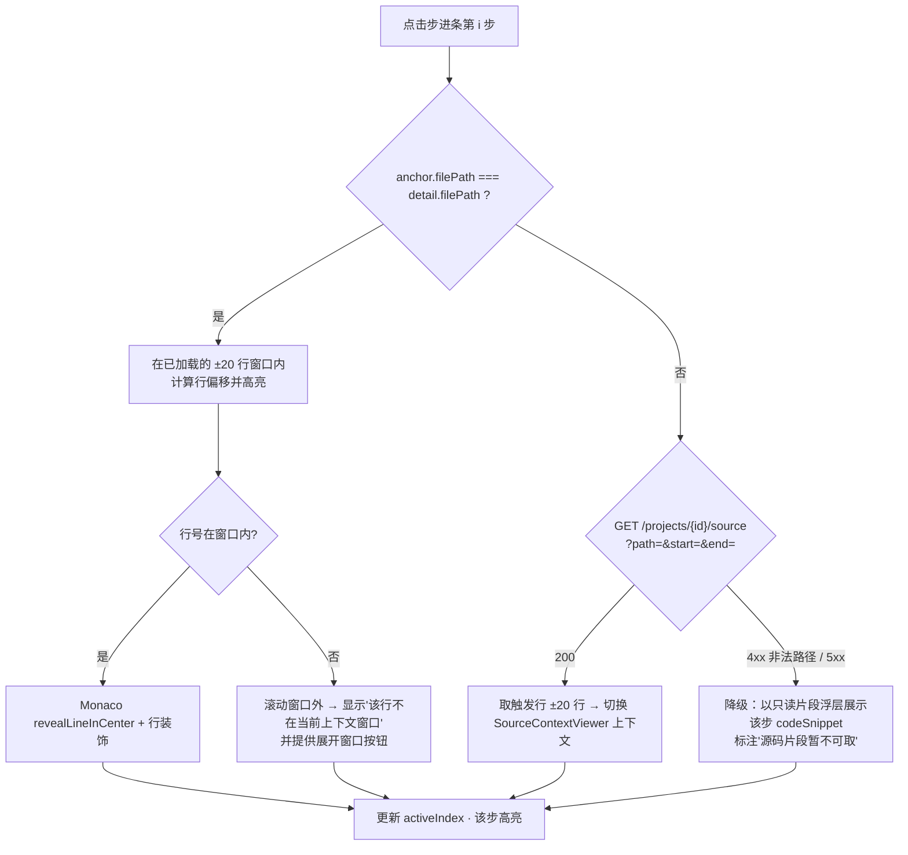
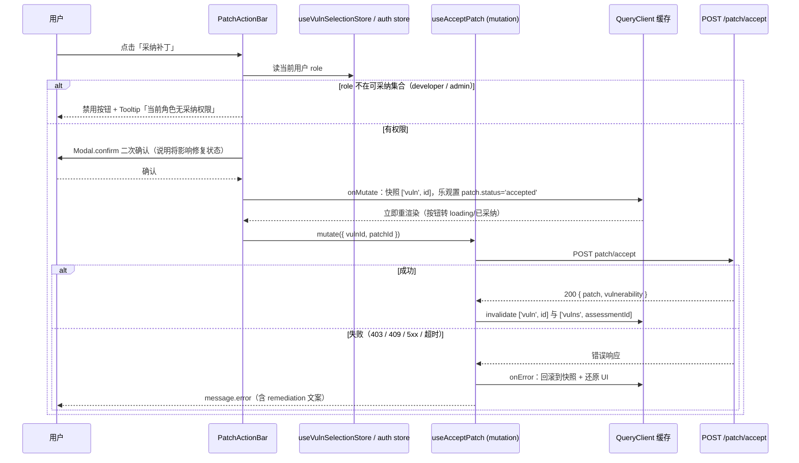

# 模块概要设计 — F3 漏洞视窗模块

| 项 | 值 |
|---|---|
| 所属层 | 前端展示层 |
| 承载位置 | 安全评估工作台 · 漏洞详情与修复区（第三区）；同时以侧滑抽屉形式被 F4 复用 |
| 上游文档 | [PRD.md](../PRD.md)、[概要设计总纲.md](../概要设计总纲.md) |
| 对应需求 | 需求.md 2.5.5 |
| 文档层级 | 概要设计 |

---

## 1. 模块定位

### 1.1 职责

| # | 职责 | 说明 |
|---|---|---|
| R1 | 源码上下文展示与高亮 | 渲染触发行 ±20 行（与 PRD §7.6 送 LLM 的代码窗口同口径），标记触发行、污点行与当前聚焦行 |
| R2 | 污点传播步进标记 | 把 `taint_paths` 的 `source / propagate / sanitize / sink` 序列渲染为可点击步进条，点击某步跳转并高亮对应代码行（PRD §6、总纲 §7.3） |
| R3 | 漏洞状态三态展示 | `unverified / verified / potential` 徽标，与 CVSS 评分、`confidence`、`detection_method` 联动展示（总纲 §5.3） |
| R4 | PoC 证据呈现 | `poc_attempts` 的 `request_raw / response_raw` 以 AntD Tabs 展示，标注 `matched` 与 `harmless_guard_passed`（PRD §7.3） |
| R5 | **建议补丁**渲染与处置 | Monaco DiffEditor 渲染 `patches.diff_content`；提供「一键复制」与「采纳导出」（写操作）。**补丁是「待人工确认的建议」，系统绝不自动应用**——需求 2.5.2 明确由研发人员核对后采纳（见 §1.2、§4.3） |
| R6 | 对外提供详情与选择契约 | 导出 `VulnDetailPanel` / `VulnDetailDrawer` / `useVulnSelectionStore`，供 F4 侧滑联动复用（总纲 §3.3「F4 依赖 F3」的唯一依赖面） |
| R7 | 补丁来源标注与降级原因区分 | Diff 区顶部**显式标注来源**：`deepseek-chat`（模型产出）/ `template`（模板降级）/ `validate_failed`（校验不过降级）；并区分「超时降级」与「校验不过降级」两种原因，给出差异化文案（PRD §7.6 L3 / L4，总纲 §8.5） |

### 1.2 明确不负责（边界）

- **不产生污点数据**：`taint_paths` 由 B4 污点追踪引擎产出（总纲 §3.1），本模块只读。
- **不改变判定结果**：`unverified → verified/potential` 的流转由 B5 与后端状态机负责（总纲 §5.3），前端只展示不做本地推断。
- **不自动应用补丁、不判定补丁有效性**：补丁是**「待人工确认的建议」**，系统绝不自动应用，采纳由研发人员核对后人工触发（需求 2.5.2）。补丁是否通过**四道校验**（格式 / ±20 行窗口 / `git apply --check` / **污点引擎复验路径消失**）由**控制面确定性代码**在生成阶段完成（PRD §7.6 L3），前端只展示校验结论，既不重复校验也不自行推断有效性。
- **不渲染攻击链 DAG、不做图布局**：属 F4。
- **不排版报告、不导出报告**：属 F5。
- **不直读工作区文件系统**：所有数据来自 REST 接口；跨文件源码片段经 `GET /projects/{id}/source` 获取（由后端做路径穿越校验），本模块不做任何平台相关的路径拼接。
- **不做漏洞清单的筛选与分页**：工作台第二区漏洞表格的归属见 §8 T6。

### 1.3 与后端接口的对应关系

| 本模块能力 | 后端接口（PRD §9） | 读写 | 备注 |
|---|---|---|---|
| 详情加载（含 taint_paths / poc_attempts / patch） | `GET /api/v1/vulnerabilities/{id}` | 读 | 单一接口承载四块数据，避免瀑布请求 |
| 当前评估的漏洞清单（选中来源） | `GET /api/v1/assessments/{id}/vulnerabilities` | 读 | 支持 `status` / `severity` 筛选 |
| 重新生成补丁 | `POST /api/v1/vulnerabilities/{id}/patch/generate` | 写 | 失败即降级，两类来源：无 key / 15s 超时 / 限流 → `template`；**四道校验不过** → `validate_failed`（PRD §7.6 L3 / L4，总纲 §8.5） |
| 采纳补丁 | `POST /api/v1/vulnerabilities/{id}/patch/accept` | 写 | 由研发人员人工触发（**系统绝不自动应用**，需求 2.5.2）；对应权限点「采纳补丁」（总纲 §8.3） |
| 跨文件源码定位 | `GET /api/v1/projects/{id}/source?path=&start=&end=` | 读 | ✅ 上游已补该端点（含路径穿越校验），返回触发行 ±20 行上下文；`path` 为工作区根的 POSIX 相对路径 |

---

## 2. 组件分解

| 组件 | 职责 | 关键 props | 依赖 |
|---|---|---|---|
| `VulnDetailDrawer` | 侧滑容器（F4 复用入口），控制开合与宽度 | `open` / `vulnId` / `origin` / `onClose` | AntD `Drawer` |
| `VulnDetailPanel` | 详情编排容器，组织四个子区、派发数据请求 | `vulnId` / `origin` | TanStack Query |
| `VulnHeader` | 编号、标题、分类、严重度色条、状态徽标、CVSS 数值 | `detail` | AntD `Tag` / `Statistic` |
| `VulnStatusTag` | 三态徽标的唯一实现（含 CVSS 联动色与 tooltip 说明） | `status` / `cvssScore` / `detectionMethod` | AntD `Tag` / `Tooltip` |
| `SourceContextViewer` | 渲染 ±20 行上下文，按行号区间高亮 | `filePath` / `codeSnippet` / `startLine` / `highlightLines` / `activeLine` | Monaco Editor（readOnly, 无 minimap） |
| `TaintPathStepper` | 步进条渲染与点击派发，维护激活步 | `steps` / `activeIndex` / `onStepSelect` / `jumpable` | AntD `Steps`（自定义 `items`） |
| `TaintStepBadge` | 单步视觉标记：`sanitize` 使用差异化图标与色（总纲 §7.3） | `stepType` / `symbol` / `note` | AntD `Tag` / `Popover` |
| `PocEvidenceTabs` | request/response 报文 Tabs，标注匹配与闸门结果 | `attempts` | AntD `Tabs` + `<pre>` |
| `PatchDiffEditor` | Monaco DiffEditor 渲染 `diff_content`，**顶部显式标注补丁来源**（`deepseek-chat` / `template` / `validate_failed`） | `original` / `modified` / `language` / `source` | Monaco **DiffEditor** |
| `PatchActionBar` | 复制 / 采纳导出 / 重新生成，含权限与状态判定（补丁为**建议**，采纳才会被采用） | `patch` / `canAccept` / `onAccept` / `onRegenerate` | AntD `Button` / `Dropdown` |
| `useVulnSelectionStore` | 跨 F3/F4 的选择契约（见 §3.1） | — | Zustand |



---

## 3. 对外接口

### 3.1 模块导出的组件与 props 契约（TypeScript 类型签名）

```ts
/** F4 与工作台第二区共用的选择来源标记 */
export type VulnOrigin = 'table' | 'topology' | 'report';

export interface VulnDetailPanelProps {
  vulnId: number;
  origin?: VulnOrigin;              // 默认 'table'，用于埋点与默认聚焦策略
  /** 由 F4 指定：打开后直接聚焦到某条污点步骤（点击 DAG 节点时通常传 sink 步）*/
  focusStepIndex?: number | null;
}

export interface VulnDetailDrawerProps {
  open: boolean;
  vulnId: number | null;
  origin?: VulnOrigin;
  onClose: () => void;
}

export declare function VulnDetailPanel(p: VulnDetailPanelProps): JSX.Element;
export declare function VulnDetailDrawer(p: VulnDetailDrawerProps): JSX.Element;

export declare function VulnStatusTag(p: {
  status: VulnStatus;
  cvssScore: number | null;
  detectionMethod: DetectionMethod;
}): JSX.Element;

export interface TaintPathStepperProps {
  steps: TaintStepRenderModel[];
  activeIndex: number | null;
  onStepSelect: (index: number) => void;
}

/** ★ F4 → F3 联动契约：由 F3 定义并持有（F3 是漏洞实体的前端 owner）*/
export interface VulnSelectionState {
  selectedVulnId: number | null;
  origin: VulnOrigin | null;
  focusStepIndex: number | null;    // F4 点击节点时可指定聚焦步
  openVuln: (vulnId: number, opts?: { origin?: VulnOrigin; focusStepIndex?: number }) => void;
  closeDetail: () => void;
}
export declare function useVulnSelectionStore(): VulnSelectionState;
```

**联动契约的读写约定**：F4 只调用 `openVuln()`；`selectedVulnId` 除 F4 用于高亮当前节点外不得在别处派生业务结论；关闭动作统一走 `closeDetail()`，防止两个区域各自维护「谁打开的」。

### 3.2 依赖的后端 API

| 接口 | 方法 | 用途 | 调用时机 | 幂等 |
|---|---|---|---|---|
| `/api/v1/vulnerabilities/{id}` | GET | 详情 + taint_paths + poc_attempts + patch | 选中漏洞时；采纳成功后失效重拉 | 是 |
| `/api/v1/assessments/{id}/vulnerabilities` | GET | 漏洞清单（表格选中源） | 进入工作台；`status`/`severity` 变化 | 是 |
| `/api/v1/vulnerabilities/{id}/patch/generate` | POST | 重新生成补丁（响应携带 `source` 与降级原因，见 §3.4） | 点击「重新生成」 | 否（每次调 LLM；重试不超过 1 次） |
| `/api/v1/vulnerabilities/{id}/patch/accept` | POST | 采纳补丁（写） | 点击「采纳」并二次确认后 | 是（重复采纳应返回 409 或幂等成功） |
| `/api/v1/projects/{id}/source?path=&start=&end=` | GET | 读取源码片段（触发行 ±20 行），跨文件污点步跳转用 | 点击跨文件步时 | 是（后端含路径穿越校验：拒绝 `..`、绝对路径、符号链接） |

### 3.3 本模块定义的数据结构（TypeScript interface）

```ts
export type VulnStatus = 'unverified' | 'verified' | 'potential';   // rejected 不进入前端模型
export type Severity = 'critical' | 'high' | 'medium' | 'low';
export type DetectionMethod = 'taint_intra' | 'taint_inter' | 'pattern';
export type StepKind = 'source' | 'propagate' | 'sanitize' | 'sink';

/** 与 taint_paths 表一一对应（PRD §6）*/
export interface TaintStep {
  id: number;
  stepIndex: number;          // step_index
  stepType: StepKind;
  filePath: string;           // ★ 工作区根为基准的 POSIX 相对路径（如 app/api/order.py），前端原样使用
  line: number;
  symbol: string;
  codeSnippet: string;        // 该步所在行的代码
  note: string | null;
}

/** ★ TaintStep 渲染模型：由 toStepRenderModels() 从 TaintStep[] 纯函数派生 */
export interface TaintStepRenderModel {
  key: string;                       // `${stepIndex}-${filePath}:${line}`
  index: number;
  kind: StepKind;
  title: string;                     // 如 `request.args.get` / `cursor.execute`
  subtitle: string;                  // `file.py:128`
  visual: 'origin' | 'normal' | 'sanitized' | 'terminal';
  iconKey: 'source' | 'propagate' | 'sanitize' | 'sink';
  hasNote: boolean;
  anchor: { filePath: string; line: number; snippet: string };
  jumpable: boolean;                 // 同文件可跳；跨文件且无源码端点时为 false
}

export interface PocAttempt {
  id: number;
  payload: string;
  technique: string;                 // 如 boolean_blind
  requestRaw: string;
  responseRaw: string;
  expectedPattern: string;
  matched: boolean;
  elapsedMs: number;
  httpStatus: number;
  harmlessGuardPassed: boolean;      // false 时该条不可作为验证依据
}

/** ★ 补丁来源：决定 Diff 区顶部的来源标注文案（PRD §7.6 L3 / L4，总纲 §8.5）*/
export type PatchSource =
  | 'deepseek-chat'      // 正常产出：模型生成且通过四道校验
  | 'template'           // 降级：无 key / 15s 超时 / 限流（L4）
  | 'validate_failed';   // 降级：四道校验未通过（L3 ②）

/** 校验失败细分：仅 source='validate_failed' 时非空，对应四道校验（PRD §7.6 L3 ②）*/
export type PatchValidationFailure =
  | 'invalid_diff'       // ① 非法 unified diff，无法解析
  | 'out_of_window'      // ② 改动超出触发行 ±20 行窗口
  | 'apply_failed'       // ③ git apply --check 干跑失败
  | 'taint_persists';    // ④ 污点引擎复验：该条污点路径**仍然存在**（补丁没修好这个漏洞）

export interface PatchInfo {
  id: number;
  diffContent: string;
  status: 'suggested' | 'accepted' | 'rejected';   // 建议补丁，未采纳前恒为 suggested
  source: PatchSource;               // ★ 来源标注，Diff 区顶部显式展示
  llmModel: string | null;           // 原始模型标识；source='template' 时为 null 或 'template'
  validationFailure: PatchValidationFailure | null;  // ★ 四道校验失败细分
  rationale: string | null;
  createdAt: string;
}

export interface VulnDetail {
  id: number;
  code: string;                      // VULN-2026-0001
  title: string;
  category: string;
  severity: Severity;
  cvssScore: number | null;
  cvssVector: string | null;
  status: VulnStatus;
  confidence: number;
  detectionMethod: DetectionMethod;
  filePath: string;                  // ★ 工作区根为基准的 POSIX 相对路径，前端不做平台相关路径处理
  lineStart: number;
  lineEnd: number;
  codeSnippet: string;               // 触发行 ±20 行
  description: string;
  taintPaths: TaintStep[];
  pocAttempts: PocAttempt[];
  patch: PatchInfo | null;
}

export declare function toStepRenderModels(steps: TaintStep[]): TaintStepRenderModel[];
```

**渲染模型的派生规则**：`source → origin`、`propagate → normal`、`sanitize → sanitized`（差异化图标 + 警示色 + 强制 `hasNote` 提示）、`sink → terminal`（终止色）。映射是纯函数，可单测；**步进条不直接消费后端 DTO**，避免表结构变更穿透到 UI。

### 3.4 补丁来源标注与降级文案（PRD §7.6 L3 / L4）

补丁有**三个来源**，UI 必须能区分并显式标注。按 PRD §7.6 L1，补丁**永不进入控制流**——它只是一份「建议」；L3 / L4 要求来源可见、降级不阻断。

| `source` | 含义 | Diff 区顶部标注 | 后续动作 |
|---|---|---|---|
| `deepseek-chat` | 模型正常产出，且**四道校验全部通过** | 「AI 生成建议补丁」（中性信息色） | 可采纳导出 |
| `template` | **L4 服务性降级**：无 key / 15s 超时 / 限流 | 「模板生成（LLM 不可用）」黄色提示 | 可采纳导出，但提示质量弱于模型产出 |
| `validate_failed` | **L3 校验性降级**：四道校验之一未过 → 回落为**通用修复建议** | 「校验未通过，已降级为通用修复建议」（橙色/警示色） | 可复制参考；不保证修好漏洞 |

**`validate_failed` 的四种子原因**（`validationFailure`）文案必须区分，尤其第 ④ 种含义与前三者**完全不同**：

| `validationFailure` | 失败点 | 用户可见文案 |
|---|---|---|
| `invalid_diff` | ① 非法 unified diff | 「补丁格式不合法，无法应用」 |
| `out_of_window` | ② 改动超出触发行 ±20 行窗口 | 「补丁改动超出漏洞上下文范围（±20 行），已拒绝」 |
| `apply_failed` | ③ `git apply --check` 干跑失败 | 「补丁无法应用（`git apply --check` 未通过）」 |
| `taint_persists` | ④ **污点引擎复验：该条污点路径仍然存在** | **「该补丁未使该条污点路径消失，不代表漏洞已修复」**（红字，最高优先级） |

> **第 ④ 种必须明确告知用户**：它意味着「**这个补丁没修好这个漏洞**」。前三者是补丁「不合规」，第 ④ 种是补丁「无效」——绝不能让用户误以为补丁有效而直接采纳。校验在**控制面**完成、无需沙箱（PRD §7.6 L3），前端只渲染结论。

**定位重申**：补丁一律表述为「**建议补丁**」——「待人工确认」，系统绝不自动应用（§1.2、§4.3）。`patch.status` 未采纳前恒为 `suggested`。

---

## 4. 关键处理流程

### 4.1 详情加载与首屏聚焦



**要点**：默认聚焦 `sink` 步而不是 `source` 步——面试演示时「漏洞点在哪」是第一信息需求；`source` 由步进条第一步天然可见。

### 4.2 污点步进联动（点击某步 → 跳转并高亮）



**要点**：`activeIndex` 是本模块唯一的「联动枢纽」——步进条、源码高亮、PoC 报文过滤（若有该步对应的 attempt）三处都从它派生，避免多点状态同步。跨文件跳转走 `GET /projects/{id}/source`（后端带路径穿越校验：拒绝 `..`、绝对路径、符号链接），入参 `path` 直接用落库的 POSIX 相对路径；异常时仍有片段浮层兜底。

### 4.3 采纳补丁（写操作：乐观更新与失败回滚）



**要点**：
1. **乐观更新**只作用于 `patch.status` 与按钮态，不动 `vulnerability.status`——漏洞状态是后端判定结论（总纲 §5.3），前端无权乐观篡改。
2. **回滚**用 `onMutate` 返回的缓存快照，而非「反向调用一次接口」；`onSettled` 一律 `invalidate`，让服务端成为唯一真相（对应总纲 §9.3「报告/状态从数据库快照生成」的一致性思路）。
3. **权限**：按钮的可用性由角色推导（可采纳集合见 §8 T3），后端仍需二次校验；前端禁用只是体验优化，不是安全边界（总纲 §8.3）。
4. **补丁只是「建议」，系统绝不自动应用**：本节写操作是**人工采纳动作**，`patch.status` 从 `suggested → accepted` 只由用户点击触发（需求 2.5.2 由研发人员核对后采纳）。生成阶段是否通过四道校验**只影响来源标注**（§3.4），不改变补丁是否落库、也不影响流水线——LLM 输出永不进入控制流（PRD §7.6 L1）。

---

## 5. 状态管理

| 状态 | 归属 | Key / 载体 | 理由 |
|---|---|---|---|
| 漏洞详情（含 taint_paths / poc_attempts / patch） | **TanStack Query** | `['vuln', vulnId]`，`staleTime: 30s` | 服务端状态，需要缓存、失效与乐观更新钩子 |
| 漏洞清单 | **TanStack Query** | `['vulns', assessmentId, filters]` | 同评估内复用；筛选变化即换 key |
| 采纳 / 重新生成补丁 | **TanStack Query mutation** | `useAcceptPatch` / `useRegeneratePatch` | 写操作天然属于 mutation，配套 onMutate/onError |
| 当前选中漏洞（跨 F3/F4） | **Zustand** | `useVulnSelectionStore` | 两个区域是兄弟组件，props 需经 Workbench 逐层转发；store 提供一个窄契约（§3.1） |
| 当前激活的污点步 `activeIndex` | **组件本地 `useState`** | `VulnDetailPanel` | 纯 UI 瞬态，作用域不超过本模块；放全局会让「打开另一个漏洞」需要额外的重置逻辑 |
| PoC Tabs 选中键、Monaco 视图态、复制成功提示 | **组件本地 state** | 各自组件 | 与业务无关，刷新即丢无副作用 |
| 用户角色（用于权限判定） | **Zustand** | 认证 store（F1/全局） | 登录后长期有效，全应用读取 |
| 详情数据本体 | **不放 Zustand** | — | 避免「Query 缓存 + Store」两份真相导致状态漂移 |

---

## 6. 出错处理

| 错误场景 | 用户可见表现 | 处理策略 |
|---|---|---|
| `GET /vulnerabilities/{id}` 返回 404 | 面板内空态：「该漏洞不存在或已被移除」+ 关闭按钮 | 不弹全局错误；同时 `invalidate` 漏洞清单；清空 `selectedVulnId` |
| 详情接口 5xx / 网络失败 | 骨架屏转错误态 + 「重试」按钮（TanStack Query `retry: 1`） | 重试走同一 key；连续失败提示检查后端 8010 连通性 |
| `taintPaths` 为空（`detection_method='pattern'`） | 步进条区域隐藏，显示「本漏洞为模式匹配检出，无污点轨迹」 | 依 `detectionMethod` 分支渲染，不伪造步骤 |
| `pocAttempts` 为空（沙箱不可达 → 阶段 skipped，总纲 §5.2） | Tabs 显示黄色提示条「动态验证未执行」 | 对应总纲 §8.2 的沙箱降级表现；不显示空的 Tabs |
| 补丁为 `null` | Diff 区显示「尚未生成补丁」+「生成补丁」按钮 | 触发 `patch/generate`，期间按钮 loading |
| 补丁生成服务性降级（无 key / 15s 超时 / 限流）→ `source='template'` | Diff 正常渲染，顶部黄色标注「模板生成（LLM 不可用）」 | 依 `source` 判定，不阻断展示（PRD §7.6 L4） |
| 补丁**校验不过**（四道校验之一未过）→ `source='validate_failed'` | Diff 顶部橙色标注「校验未通过，已降级为通用修复建议」+ 按 `validationFailure` 细分文案（§3.4） | 依 `source` / `validationFailure` 判定，不阻断（PRD §7.6 L3） |
| 校验第 ④ 项失败（`taint_persists`：污点复验路径仍在） | **红字：「该补丁未使该条污点路径消失，不代表漏洞已修复」**，置于 Diff 区顶部最高优先级 | 必须显式告知用户补丁**无效**，避免误采纳（§3.4） |
| 补丁生成失败（5xx / 网络） | 保留上一次补丁或显示「生成失败，可重试」 | 降级不阻断；重试不超过 1 次（PRD §7.6 L4） |
| 采纳返回 403 | 「当前角色无采纳权限」 | 回滚乐观更新；提示可采纳角色 |
| 采纳返回 409（已被他人采纳） | 「补丁已被采纳」提示 + 刷新详情 | 回滚并 `invalidate ['vuln', id]` |
| 采纳返回 5xx / 超时 | 「采纳失败，请重试」 | 回滚快照；不自动重试（写操作，避免重复采纳） |
| Monaco 资源加载失败 | 降级为 `<pre>` 展示 unified diff 与源码片段 | 组件级 ErrorBoundary，两处（源码、Diff）各自降级 |
| 跨文件跳转失败（source 端点 4xx/5xx） | 只读片段浮层 + 说明文案 | 端点已由上游补齐；4xx 多为非法路径（穿越校验拒绝），5xx 走片段兜底 |
| 复制到剪贴板失败（非安全上下文） | 「复制失败，请手动选择文本」 | `navigator.clipboard` 失败回退隐藏 textarea + `execCommand` |

---

## 7. 设计约束与权衡

| # | 取舍点 | 选择 | 放弃方案 | 理由 | 代价 |
|---|---|---|---|---|---|
| D1 | 源码渲染组件 | Monaco Editor（readOnly） | `highlight.js` + 自定义行高亮 | PRD §4 已决策；与 DiffEditor 同一套语言/主题，视觉一致 | 打包体积大，需配 worker（§8 T5） |
| D2 | 上下文窗口 | 固定 ±20 行 | 整个文件 / 可无限展开 | 与 PRD §7.6 送 LLM 的窗口同口径，前端与后端证据一致；避免大文件卡顿 | 触发点多于 20 行外时需二次请求或提示 |
| D3 | 步进条实现 | AntD `Steps` 的 `items` API + 自定义 `icon` | 完全自研横向条 | 复用键盘可达性与布局；`sanitize` 的差异化只需换 icon/色 | 极端长的污点路径需横向滚动适配 |
| D4 | 状态徽标与 CVSS 联动方式 | 底色由 `status` 决定，数值由 `cvssScore` 决定；二者不一致时以 status 为准并 tooltip 解释 | 用一个综合色（取 CVSS 分档） | 三态是判定结论（总纲 §5.3），CVSS 是评分；混用会掩盖「potential 但评分高」的信息 | 用户需要读 tooltip 才理解差异 |
| D5 | 采纳写操作的落点 | 只在 F3 的 `PatchActionBar` 提供 | F3 与 F4 侧滑各实现一套 | 侧滑复用 F3 组件，天然只有一个写入口，避免双份逻辑与双份错误处理 | 无 |
| D6 | 详情呈现形式 | 内嵌面板与 Drawer 共用 `VulnDetailPanel` | 两套独立组件 | 内嵌=工作台第三区，Drawer=F4 侧滑，数据与交互完全一致 | Panel 需自适应两种宽度（细节交详细设计） |
| D7 | 乐观更新范围 | 仅补丁状态与按钮态 | 同时乐观改漏洞 status | 漏洞 status 是后端判定结论，前端不可篡改 | 用户需等刷新才见 status 联动变化 |
| D8 | 数据获取粒度 | 一个详情接口返回四块数据 | taint_paths / poc_attempts / patch 分接口 | PRD §9 已按此设计；减少瀑布与 loading 抖动 | 单次响应体较大（PoC 报文可能很长） |
| D9 | 补丁的呈现口径与校验落点 | 一律表述为「**建议补丁**」+ Diff 区顶部**显式标注来源**（`deepseek-chat` / `template` / `validate_failed`）；系统**绝不自动应用** | 把补丁当作可直接生效的修复、或不标注来源 | PRD §7.6 L1（LLM 输出不进控制流）/ L4（来源必标注）、需求 2.5.2（人工采纳）；校验由控制面确定性代码完成，前端不重复校验 | 用户需人工核对后手动采纳（这正是合规要求） |

---

## 8. 移交详细设计的待定项

| # | 待定项 | 影响 | 建议 |
|---|---|---|---|
| T1 | ~~跨文件源码读取端点缺失~~ | — | ✅ 已由上游修订解决（PRD §9）：新增 `GET /api/v1/projects/{id}/source?path=&start=&end=`（含路径穿越校验），返回触发行 ±20 行；详见 §3.2、§4.2 |
| T2 | Monaco 集成方式 | 构建产物体积与首屏 | 评估 vite 插件与 CDN 两条路径，并确定 Python worker 按需加载 |
| T3 | 可采纳补丁的角色白名单 | 按钮可用性判定 | 需求只划分三角色（PRD §6），建议 `developer` + `admin`；需与后端权限点对齐后写死为单一常量表 |
| T4 | 「一键复制 / 采纳导出」中「导出」的确切语义 | PatchActionBar 的按钮数量 | 候选：① 复制 unified diff 文本 ② 下载 `.diff` 文件 ③ 跳转 F5 报告。当前按 ①+② 设计，③ 需与 F5 确认 |
| T5 | `patches` 一对多 vs 详情接口单条 `patch` | 是否需补丁历史视图 | PRD §6 表为多行，§9 详情返回单数；建议详情返回「最新一条 + status」，历史列表另接口 |
| T6 | ~~工作台第二区漏洞表格的模块归属未定义~~ **已由上游裁定** | ✅ 归 **F4**（区域归属即模块归属，`PRD §8.1` ②）；F3 只提供 `VulnStatusTag` 组件与选中契约（`openVuln()` / `closeDetail()`） | 组件落 `modules/topology/`，**F3 不实现该表格** |
| T7 | `rejected` 的过滤位置 | 前端模型是否需要第四态 | ✅ 与上游一致：PRD §6 明确状态四态，UI 只展示前三态、`rejected` 不展示（或折叠在「已排除」筛选项）；建议后端默认过滤，前端类型保持三态（§3.3） |
| T8 | 详情接口的 `patch` 与 `pocAttempts` 体积上限 | 首屏性能 | 大报文（8KB 载荷 × 20 探针）是否分页/截断，交详细设计 |
| T9 | `validate_failed` 四种 `validationFailure` 的最终文案、图标与色值 | Diff 区顶部来源标注的呈现细节 | §3.4 已定语义与优先级（④ 红字最高）；具体文案/配色交详细设计，需与 PRD §7.6 L3 的四道校验表述逐字对齐 |

---

## ⚠️ 与上游不一致

| # | 位置 | 不一致点 | 本设计的处理 |
|---|---|---|---|
| 1 | PRD §6 `vulnerabilities.status` 枚举 | ✅ **已由上游修订解决（PRD §6）**：状态枚举已明确为四态 `unverified / verified / potential / rejected`；UI 只展示前三态，`rejected` 不展示（或折叠在「已排除」筛选项），与本模块三态徽标设计（§3.3）一致；`rejected` 的过滤建议在后端完成，见 §8 T7 |
| 2 | PRD §8.2（F3 职责描述）vs PRD §8.1 ② | §8.2 对 F3 的表述仅为「源码上下文高亮、污点传播步进标记、Diff 渲染」，未包含 §8.1 ② 明确列出的「PoC 请求/响应报文（AntD Tabs）」与「一键复制 / 采纳导出」 | 本设计按 §8.1 ② 的页面描述把二者全部纳入 F3 职责（R4、R5） |
| 3 | PRD §6 `patches` 表 vs PRD §9 详情接口 | 表结构为一个漏洞多条补丁，接口描述为返回单条 `patch` | 前端模型按单条设计（§3.3 `PatchInfo \| null`），差异记入 §8 T5 |
| 4 | PRD §9 端点清单 | ✅ **已由上游修订解决（PRD §9 / §7.4）**：新增 `GET /projects/{id}/source?path=&start=&end=`（含路径穿越校验），跨文件污点步跳转与高亮得以完整实现（§3.2、§4.2）；且全局路径规范已明确 `file_path` 为工作区根的 POSIX 相对路径，前端原样使用、不做平台相关处理 |
| 5 | PRD §7.6（LLM 可控性四条铁律）vs 本模块补丁降级表现 | 原设计仅覆盖「15s 超时 → 落模板」一种降级来源，未覆盖「四道校验不过」（L3 ②）与来源标注（L4） | ✅ **已由上游修订解决（PRD §7.6 / 总纲 §8.5）**：补上 `validate_failed` 降级来源、`PatchSource` / `validationFailure` 类型（§3.3）、Diff 区顶部来源标注与差异化文案（§3.4、§6、§7 D9） |
