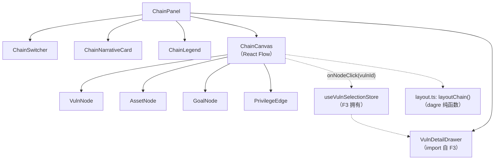
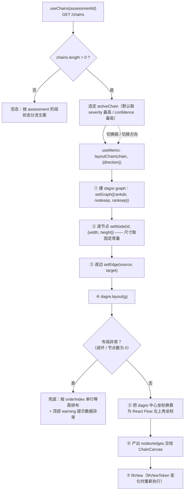
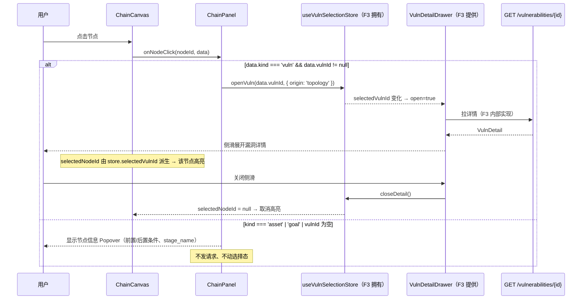
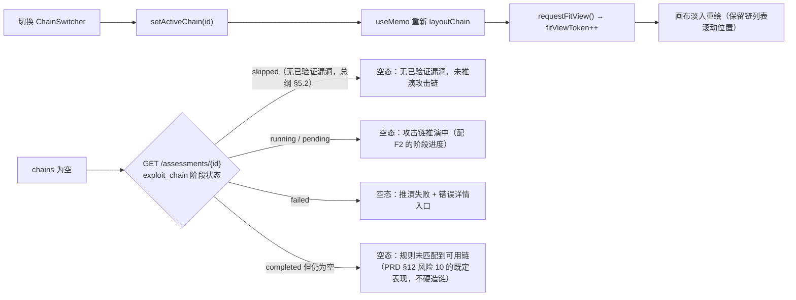

# 模块概要设计 — F4 拓扑图谱模块

| 项 | 值 |
|---|---|
| 所属层 | 前端展示层 |
| 承载位置 | 安全评估工作台 · 漏洞与攻击链路区（第二区） |
| 上游文档 | [PRD.md](../PRD.md)、[概要设计总纲.md](../概要设计总纲.md) |
| 对应需求 | 需求.md 2.5.5 |
| 文档层级 | 概要设计 |

---

## 1. 模块定位

### 1.1 职责

| # | 职责 | 说明 |
|---|---|---|
| R1 | 攻击路径有向图渲染 | 用 React Flow 渲染 `attack_chains` + `attack_chain_nodes` 组成的 DAG；边由 `parent_node_id` 自引用派生（PRD §6、§7.4） |
| R2 | 自动布局 | 用 **dagre** 做分层有向布局，前端不依赖后端坐标，链变更/筛选后自动重排 |
| R3 | 节点语义与视觉分级 | 三类节点 `vuln` / `asset` / `goal` 各自的样式、图标、tooltip；节点携带严重度与漏洞状态 |
| R4 | 边表示权限跃迁 | 边标签渲染 `权限前 → 权限后` 与命中的规则编号（R1–R8，PRD §7.4） |
| R5 | 节点点击联动 | 点击 `vuln` 节点 → 展开 F3 的漏洞详情侧滑；点击 `asset`/`goal` 节点 → 仅展示节点信息 |
| R6 | 链的选取与叙事 | 多链切换（Tabs/列表）+ 展示 `narrative` 与 `confidence`；无链时给出明确空态 |
| R7 | 节点验证状态可视化 | 按 `verification_status` 两色区分「已验证 `verified` / 已推演 `inferred`」，配图例与**无障碍标记**（总纲 §12.2 Q24 定案 = 方案 A，见 §3.4） |

### 1.2 明确不负责（边界）

- **不推演攻击链**：规则匹配与 DAG 构建属 B5（总纲 §3.1），前端不做任何「补边」「猜路径」。**攻击链的节点、边、严重度、置信度、验证状态全部由 B5 规则引擎确定性产出，LLM 不参与**（总纲 §8.5 L1）。
- **不生成攻击叙事**：`narrative` 由 LLM/降级模板产出（PRD §7.4），前端只渲染。**这与总纲 §8.5 L1「LLM 不参与判定」一致**——叙事是纯自由文本，不进入控制流，也不承载节点/边的生成。
- **不渲染漏洞详情本体**：详情面板由 F3 提供（`VulnDetailDrawer`），本模块只负责触发。
- **不做漏洞编辑与状态流转**：全部写操作归 F3 / 后端。
- **不做报告的图嵌入**：报告的图由 B6 渲染服务端静态图（PRD §7.6），与本模块无共享代码。
- **不做节点拖拽后的位置持久化**：拖拽仅为临时微调，刷新后回到 dagre 布局（详见 §7 D3）。

### 1.3 与后端接口的对应关系

| 本模块能力 | 后端接口（PRD §9） | 读写 | 备注 |
|---|---|---|---|
| 攻击链 DAG | `GET /api/v1/assessments/{id}/chains` | 读 | 返回 `nodes + edges`；**edges 由后端从 `attack_chain_nodes.parent_node_id` 自引用关系派生**，不存在独立边表（PRD §6、§7.4） |
| 节点上的漏洞摘要（严重度/状态/CVSS） | `GET /api/v1/assessments/{id}/vulnerabilities` | 读 | 与 F3 共用同一 Query 缓存，按 `vulnId` 关联，避免 N+1 详请请求 |
| 漏洞详情（侧滑内容） | `GET /api/v1/vulnerabilities/{id}` | 读 | 由 F3 的 `VulnDetailDrawer` 发出，本模块不直接调用 |
| 评估元信息（链路为空时判断原因） | `GET /api/v1/assessments/{id}` | 读 | 依据阶段状态区分「未跑到该阶段」与「跑了但无链」 |

---

## 2. 组件分解

| 组件 | 职责 | 关键 props | 依赖 |
|---|---|---|---|
| `ChainPanel` | 区域容器：链列表/切换、图例、叙事卡、空态；挂载 F3 侧滑 | `assessmentId` | TanStack Query |
| `ChainSwitcher` | 多链切换（Tabs 或分段控件），显示严重度与置信度 | `chains` / `activeChainId` / `onChange` | AntD `Tabs` / `Segmented` |
| `ChainCanvas` | React Flow 画布：受控 nodes/edges、事件绑定、自动 fitView | `nodes` / `edges` / `onNodeClick` / `selectedNodeId` | React Flow（`ReactFlowProvider`） |
| `VulnNode` | `vuln` 节点：标题、严重度色条、状态徽标、CVSS | `data` / `selected` | AntD `Tag` + F3 的 `VulnStatusTag` |
| `AssetNode` | `asset` 节点：资产/入口点标签（无漏洞时不可点开） | `data` | AntD 自定义节点 |
| `GoalNode` | `goal` 节点：最终权限/产出的终点样式（双线边框） | `data` | AntD 自定义节点 |
| `PrivilegeEdge` | 自定义边：权限跃迁标签 + 规则编号徽标 | `data` | React Flow `BaseEdge` / `EdgeLabelRenderer` |
| `ChainLegend` | 图例：节点类型色、边含义、状态徽标含义 | — | AntD |
| `ChainNarrativeCard` | 展示 `narrative`、`entryPoint`、`targetAsset`、`confidence` | `chain` | AntD `Card` / `Typography` |
| `VulnDetailDrawer` | **来自 F3**：点击节点后的详情侧滑 | 见 F3 §3.1 | 模块外依赖 |
| `layout.ts`（非组件） | dagre 布局纯函数 `layoutChain()` | — | `@dagrejs/dagre` |



**依赖说明**：本模块对 F3 的依赖只有两项——`VulnDetailDrawer` 组件与 `useVulnSelectionStore` 选择契约，对应总纲 §3.3 的「F4 → F3」。除此之外不 import F3 的任何内部实现。

---

## 3. 对外接口

### 3.1 模块导出的组件与 props 契约（TypeScript 类型签名）

```ts
export interface ChainPanelProps {
  assessmentId: number;
  /** 独立页/嵌入两种形态的密度差异，默认 'embedded' */
  variant?: 'embedded' | 'page';
}

/** 画布是被动渲染器：不做请求、不写全局状态，只上报事件 */
export interface ChainCanvasProps {
  nodes: ChainFlowNode[];                  // 已由 dagre 计算好 position
  edges: ChainFlowEdge[];
  selectedNodeId: string | null;
  onNodeClick: (nodeId: string, data: ChainNodeData) => void;
  onPaneClick: () => void;
}

export interface VulnNodeProps {
  data: ChainNodeData;                     // React Flow 注入
  selected: boolean;
}

export declare function ChainPanel(p: ChainPanelProps): JSX.Element;
export declare function ChainCanvas(p: ChainCanvasProps): JSX.Element;

/** ★ dagre 布局纯函数：输入链与方向，输出带 position 的 React Flow 图 */
export interface LayoutOptions {
  direction: 'LR' | 'TB';
  nodeSep: number;      // 同层间距，默认 60
  rankSep: number;      // 层间距，默认 90
}
export declare function layoutChain(
  chain: AttackChainDTO,
  opts?: Partial<LayoutOptions>,
): { nodes: ChainFlowNode[]; edges: ChainFlowEdge[] };

/** 拓扑模块自己的 UI 状态（不放 TanStack Query） */
export interface TopologyState {
  activeChainId: number | null;
  layoutDirection: 'LR' | 'TB';
  fitViewToken: number;                    // 自增即触发一次 fitView
  setActiveChain: (id: number) => void;
  toggleDirection: () => void;
  requestFitView: () => void;
}
export declare function useTopologyStore(): TopologyState;
```

### 3.2 依赖的后端 API

| 接口 | 方法 | 用途 | 调用时机 | 备注 |
|---|---|---|---|---|
| `/api/v1/assessments/{id}/chains` | GET | 攻击链列表（含 nodes + edges） | 进入工作台；评估完成事件（SSE `stage=exploit_chain`）后失效重拉 | 与 F2 的 SSE 阶段事件联动 |
| `/api/v1/assessments/{id}/vulnerabilities` | GET | 节点上的漏洞摘要信息 | 与 F3 共用 Query key | 只用于节点着色，不用于详情 |
| `/api/v1/assessments/{id}` | GET | 判断链为空的原因（阶段 skipped / 未执行） | 链列表为空时按需 | 用于空态文案分流 |

**本模块无写操作**，因此不涉及乐观更新与幂等设计；所有变更都来自后端（重新评估后重拉）。

### 3.3 本模块定义的数据结构（TypeScript interface）

```ts
export type ChainNodeType = 'vuln' | 'asset' | 'goal';
export type Severity = 'critical' | 'high' | 'medium' | 'low';
export type VulnStatus = 'unverified' | 'verified' | 'potential';

/** 对应后端 attack_chain_nodes（PRD §6）；DAG 的边由 parentNodeId 自引用派生，无独立边表 */
export interface AttackChainNodeDTO {
  id: number;
  chainId: number;
  nodeType: ChainNodeType;
  vulnId: number | null;          // node_type=vuln 时非空
  parentNodeId: number | null;    // ★ 自引用外键；DAG 的边由此派生，根节点为 null
  orderIndex: number;
  stageName: string;
  precondition: string | null;
  postcondition: string | null;
  label: string;
  /** ★ Q24 已定案 = 方案 A（PRD §6）：沙箱实测环标 verified，推演环标 inferred；见 §3.4 */
  verificationStatus: 'verified' | 'inferred';
}

/** 边无独立数据表，由后端从 parent_node_id 自引用派生后在 /chains 响应中输出（PRD §6） */
export interface AttackChainEdgeDTO {
  id: string;                     // 建议形如 `e-12-17`
  source: number;                 // attack_chain_nodes.id
  target: number;                 // attack_chain_nodes.id
  privilegeFrom: string;          // 如 anonymous / user / admin
  privilegeTo: string;
  ruleCode: string;               // R1–R8（PRD §7.4）
}

export interface AttackChainDTO {
  id: number;
  assessmentId: number;
  name: string;
  description: string;
  severity: Severity;
  entryPoint: string;
  targetAsset: string;
  confidence: number;             // 0–1
  narrative: string;              // LLM 或模板
  nodes: AttackChainNodeDTO[];
  edges: AttackChainEdgeDTO[];
}

/** 挂在 React Flow 节点上的业务载荷 */
export interface ChainNodeData {
  kind: ChainNodeType;
  label: string;
  stageName: string;
  orderIndex: number;
  vulnId: number | null;
  precondition: string | null;
  postcondition: string | null;
  verificationStatus: 'verified' | 'inferred';  // ★ Q24 定案：由 DTO 直传，驱动两色区分
  severity?: Severity;            // 由漏洞清单关联填充
  cvssScore?: number | null;
  status?: VulnStatus;
  confidence?: number;
}

export interface PrivilegeEdgeData {
  privilegeFrom: string;
  privilegeTo: string;
  ruleCode: string;
}

// React Flow 图元素（v12 泛型写法；v11 去掉第二个类型参数，见 §8 T1）
export type ChainFlowNode = Node<ChainNodeData, ChainNodeType>;
export type ChainFlowEdge = Edge<PrivilegeEdgeData>;
```

**DTO → React Flow 映射表**

| 来源 | 目标字段 | 映射规则 |
|---|---|---|
| `AttackChainNodeDTO.id` | `Node.id` | `n-${id}`（加前缀避免与边 id 冲突） |
| `AttackChainNodeDTO.nodeType` | `Node.type` | 直传；`nodeTypes = { vuln, asset, goal }` 三个键注册 |
| 上述业务字段 | `Node.data` | 见 `ChainNodeData`；`severity/cvssScore/status` 由漏洞清单按 `vulnId` 关联补入 |
| `AttackChainNodeDTO.verificationStatus` | `Node.data.verificationStatus` → 节点边框/状态点样式 | **Q24 定案**：`verified` 实线边框 + 实心状态点，`inferred` 虚线边框（或半透明）+ 空心状态点；**不改变 `severity` 色条语义**（§3.4） |
| — | `Node.position` | **由 dagre 计算**，DTO 不提供坐标 |
| — | `Node.sourcePosition / targetPosition` | `LR` 时为 `Right / Left`，`TB` 时为 `Bottom / Top` |
| — | `Node.width / height` | 用固定尺寸常量（vuln 232×80、asset 176×56、goal 200×64），供 dagre 计算，避免二次测量抖动 |
| `AttackChainNodeDTO.parentNodeId` | （后端已派生成 `AttackChainEdgeDTO`） | 后端把 `parent_node_id` 展开为 `source = parent` → `target = child`；前端只消费派生结果，不自行连边 |
| `AttackChainEdgeDTO.source/target` | `Edge.source / target` | 映射为 `n-${source}` / `n-${target}` |
| `privilegeFrom/To` + `ruleCode` | `Edge.data` + `Edge.label` | 标签渲染 `from → to`，`ruleCode` 作为角标徽标 |
| `Edge.type` | `'privilege'` | 注册自定义边，默认样式为动画虚线以强调方向 |

### 3.4 Q24 已定案：节点两色区分「已验证／已推演」

**总纲 §12.2（Q24）已定案 = 方案 A**：`attack_chain_nodes.verification_status`（enum `verified` | `inferred`）**正式落地**。背景是无害化闸门（PRD §7.3）规定「文件上传只传 `<nonce>.txt`、命令执行只做时间盲注」，因此 `SQL 注入 → 拿凭证 → 上传 WebShell → 宿主机 RCE` 这**最后一环只能是推演，而非实测**——**沙箱实测的环标 `verified`，推演得出的环标 `inferred`**。

> **定案为方案 A，下述改动即为最终实现要求。** 各模块设计文档已按定案对齐，后续实现不得再按备选方案（总纲 §12.2）。

**方案 A 的 F4 实现清单（必做项）**：

1. **DTO 与映射**：`AttackChainNodeDTO.verificationStatus` 为**必填** `'verified' | 'inferred'`（§3.3）；`ChainNodeData` 同步增加同名字段，由 DTO 直传。
2. **节点渲染**：`VulnNode` 增加一档视觉——`verified` 用实线边框 + 实心状态点，`inferred` 用虚线边框（或半透明）+ 空心状态点；二者**共用同一 `severity` 色条**，仅以边框/状态点区分，不改变色条语义。
3. **图例**：`ChainLegend` 增加「✓ 已验证 / ◌ 已推演」两项说明。
4. **tooltip / 叙事**：节点 tooltip 与 `ChainNarrativeCard` 增补一行「该环为已推演（未实际执行）」的说明，与后端 `narrative` 口径保持一致。
5. **布局不变**：`layoutChain()` 只依赖 `nodeType` 与固定尺寸常量，两色不改变尺寸，dagre 布局无需改动。
6. **无障碍处理（不能只靠颜色区分）**：`verified` / `inferred` 的差异必须**同时**用非颜色通道承载——边框实/虚 + 状态点实心/空心 + 节点角标图标（`✓` / `◌`），并在 `ChainLegend` 给出文字图例；节点须带 `aria-label`（如「SQL 注入（已推演）」）与可聚焦的 tooltip。仅靠两种颜色区分会让色盲用户无法分辨，不算达标。
7. **兜底**：后端历史数据缺失 `verificationStatus`（升级前的旧链）时**不显示推演标记**（按 `verified` 渲染），避免误标。

---

## 4. 关键处理流程

### 4.1 dagre 自动布局



**要点**：
1. **布局是纯派生**：`layoutChain()` 无副作用、无请求，输入 `AttackChainDTO` 输出图，可单测。因此用 `useMemo` 计算，不放进 state，避免「布局结果与链不同步」。
2. **坐标换算**：dagre 返回节点中心点，React Flow 需要左上角，需减去 `width/2`、`height/2`——这是最常见的布局偏移来源，明确写在契约里。
3. **固定尺寸**：dagre 必须在布局前知道节点尺寸。统一用常量而非 DOM 测量，换取布局的确定性与一次性渲染（代价：标签过长需省略号，见 §7 D4）。
4. **兜底布局**：后端规则引擎产出的图应为 DAG；若成环（说明后端异常，见 §6），前端不假装能画，退化为顺序排布并显式告警。

### 4.2 节点点击联动 F3（F4 → F3 契约的运行时行为）



**为什么走共享 store 而不是 props 回调**：

| 方案 | 描述 | 评估 |
|---|---|---|
| A 共享 Zustand store（**选中**） | F4 写 `openVuln()`，F3 的 Drawer 订阅 | 两个区域是 Workbench 下的兄弟组件；props 方案要求 Workbench 持有 `selectedVulnId` 并向下传 props + 向上传回调，造成「无关的父组件被迫成为状态仓库」；同时 F4 已 import F3 的 `VulnDetailDrawer`，依赖关系本就存在，多一个 store 不增加耦合面 |
| B props 回调 | Workbench 持有状态，双向透传 | 状态提升到页面层后，F3 若被 F5 或独立页复用需再包一层；且「谁打开详情」（origin）这类信息会散落在父组件 |
| C 全局事件总线 | 事件名约定 | 无类型约束，违背 TS 项目的一致性，不采用 |

**结论**：契约放在 F3（漏洞实体的前端 owner），F4 只做「写」，`selectedNodeId` 作为**派生值**（`selectedVulnId` 反查 `vulnId` 对应的节点）而非独立的 state——这样侧滑的关闭动作会自动清除画布高亮，不会出现两处高亮不一致。

### 4.3 多链切换与空态分流



---

## 5. 状态管理

| 状态 | 归属 | Key / 载体 | 理由 |
|---|---|---|---|
| 攻击链列表（含 nodes/edges） | **TanStack Query** | `['chains', assessmentId]`，`staleTime: 60s` | 服务端状态；评估完成后由 SSE 阶段事件触发 `invalidate` |
| 漏洞清单（节点着色用） | **TanStack Query** | `['vulns', assessmentId, filters]`（与 F3 同 key） | 复用 F3 已缓存的清单，避免同一数据两次请求 |
| 评估元信息（空态分流） | **TanStack Query** | `['assessment', assessmentId]` | 与 F2 共用 |
| `activeChainId` | **Zustand** | `useTopologyStore` | 工作台切区/展开折叠后需保持选中链；也便于后续做「从报告跳回某条链」的入口 |
| `layoutDirection` | **Zustand** | `useTopologyStore` | 用户偏好，跨链切换保持一致 |
| `fitViewToken` | **Zustand** | `useTopologyStore` | 用自增令牌触发一次副作用，避免把 React Flow 实例提升为全局单例 |
| **dagre 布局结果（nodes/edges）** | **不放 state** | `useMemo(() => layoutChain(chain, dir), [chain, dir])` | 纯派生数据；进 state 会产生「链更新了但图没更新」的时序 bug |
| React Flow viewport（缩放/平移） | **React Flow 内部** | `useReactFlow()` | 库自身管理，前端不接管；接管的收益（跨链记忆视角）不值得引入受控抖动 |
| 节点 hover、Popover 开合 | **组件本地 state** | 各自节点组件 | 纯 UI 瞬态 |
| `selectedNodeId` | **派生** | 由 `useVulnSelectionStore().selectedVulnId` 反查 | 避免「侧滑已关但节点仍高亮」的双真相问题（§4.2） |

---

## 6. 出错处理

| 错误场景 | 用户可见表现 | 处理策略 |
|---|---|---|
| `/chains` 返回 5xx / 网络失败 | 区域错误态 + 「重试」（`retry: 1`） | 不影响第二区其它内容；重试同 key |
| `chains = []` 且阶段为 `skipped` | 空态文案「当前评估无已验证漏洞，未推演攻击链」 | 依 §4.3 分流，不显示空画布 |
| `chains = []` 且阶段 `completed` | 空态「规则未匹配到可用攻击链」 | 对应 PRD §12 风险 10：**不硬造链**，展示单点漏洞即可 |
| 节点 `nodeType='vuln'` 但 `vulnId` 为 null | 节点正常绘制但灰显、不可点击，tooltip 说明数据缺失 | 画布健壮性优先，不因单节点异常中断整图 |
| 节点引用的漏洞已被过滤（如 rejected 被后端剔除） | 节点降级为 `asset` 样式，`status` 徽标不显示 | 关联失败即降级，不抛错 |
| 节点 `verificationStatus` 缺失（旧数据 / 后端未升级） | 不显示推演标记，按 `verified` 渲染（实线边框 + 实心点） | 见 §3.4 兜底，避免误标「已推演」 |
| `edges` 缺失（后端未派生，理论上不应发生） | 图仍绘制节点，但显示黄色提示「路径关系缺失，已按执行顺序排列」 | 前端按 `orderIndex` 兜底连线（**仅视觉连线**，不声明权限跃迁），并在提示中标明来源 |
| 图中出现环（dagre 报错或检测到环） | 触发兜底布局 + warning：「攻击链数据存在环，已按顺序排布」 | 记录到前端错误日志；这是后端规则引擎的异常信号 |
| 单链节点数过大（阈值见 §8 T3） | 图仍渲染但关闭动画与边标签，显示「较大图已简化渲染」 | 通过 `onlyRenderVisibleElements` + 关动画降级 |
| 侧滑详情加载失败 | 侧滑内错误态（F3 责任） | 画布不受影响；`selectedVulnId` 保持以便重试 |

---

## 7. 设计约束与权衡

| # | 取舍点 | 选择 | 放弃方案 | 理由 | 代价 |
|---|---|---|---|---|---|
| D1 | 图组件 | React Flow（PRD §4 已定） | D3 / G6 / ECharts graph | React 原生、节点即组件，联动写起来最直接 | 大图性能需自行优化 |
| D2 | 布局算法 | dagre | elkjs / 手工坐标 / 力导向 | 攻击链是有向分层图，dagre 的 `rankdir` 正对其语义；elkjs 体积大且本项目不需要正交路由 | 复杂交叉边的观感一般 |
| D3 | 位置是否持久化 | 不持久化，刷新重排 | 拖拽后写回后端 | 后端 `attack_chain_nodes` 无坐标字段（PRD §6），加字段为 UI 便利污染数据模型 | 用户微调是临时的 |
| D4 | 节点尺寸 | 布局用固定常量尺寸 | 布局前测量 DOM | 避免两轮渲染与抖动；尺寸确定性让布局可单测 | 长标签需省略号 + tooltip |
| D5 | 联动机制 | 共享 store（F3 拥有契约） | props 回调由 Workbench 中转 | 见 §4.2 对比表 | F4 与 F3 存在编译期耦合（已在总纲 §3.3 认可） |
| D6 | `selectedNodeId` 的存放 | 派生自 `selectedVulnId` | 独立 state | 消除「侧滑关闭后高亮残留」的双真相 | 侧滑打开非拓扑来源的漏洞时画布不高亮（预期行为） |
| D7 | 三类节点的粒度 | `vuln`/`asset`/`goal` 与后端 1:1 映射 | 前端再抽象（如合并 asset 与 goal） | 图语义即后端语义，前端做二次语义化会让 tooltip 与报告对不上 | 需要三套节点样式 |
| D8 | 边的信息量 | 标签承载权限跃迁 + 规则编号 | 边只做连线，信息放 tooltip | 需求强调「边表示权限跃迁」，标签是可见性的最低成本实现 | 边密集时标签需避让（交详细设计） |
| D9 | 多链呈现 | 一次只渲染一条链 + 顶部切换 | 多链叠在一张画布 | 叠图无法表达「不同链共享同一漏洞节点」的语义，且视觉噪音大 | 链之间无法横向比较（收益低于成本） |
| D10 | 验证状态的两色区分 | **颜色 + 非颜色通道双重编码**（边框实/虚、状态点实心/空心、`✓`/`◌` 角标、文字图例、`aria-label`） | 仅用两种颜色区分 `verified` / `inferred` | Q24 定案要求两色区分，但仅靠颜色会让色盲用户无法分辨；无障碍是硬要求而非加分项 | 节点视觉稍复杂（交详细设计定稿） |

---

## 8. 移交详细设计的待定项

| # | 待定项 | 影响 | 建议 |
|---|---|---|---|
| T1 | React Flow 版本与包名（`reactflow` v11 还是 `@xyflow/react` v12） | `Node<T>` 泛型签名与 `nodeTypes` 写法（§3.3 按 v12 写） | 建议 v12（`@xyflow/react`），PRD §4 只写了「React Flow」未锁版本 |
| T2 | 节点固定尺寸与省略策略 | 布局与视觉 | 交详细设计定稿常量表（含中文字体下的实际渲染宽度校验） |
| T3 | 大图性能阈值 | 降级开关的触发条件 | 建议 > 40 节点或 > 60 边时关闭动画与边标签 |
| T4 | `edges` 的派生 schema | 本模块的可用性 | ✅ 边的来源已明确（PRD §6）：后端从 `attack_chain_nodes.parent_node_id` 派生；仍需后端给出 `/chains` 响应契约（edge id 规则、`ruleCode` 取值） |
| T5 | 权限跃迁信息的数据来源 | 边标签的准确性 | 见 ⚠️2；若后端不提供，边标签只能退化为规则编号 |
| T6 | `asset` 节点的实体来源 | 节点能否显示资产属性（IP/端口/服务） | 见 ⚠️3；当前仅有 `chain.entry_point` / `target_asset` 两个字符串 |
| T7 | 第二区漏洞表格的归属 | 组件落点与选中态共享方式 | 见 F3 §8 T6，建议表格归本模块并以同一 store 联动画布高亮 |
| T8 | 是否需要「从报告跳回某条链」的深链 | 路由与 store 初始化 | 若做，需为 Workbench 定义 query 参数（如 `?chain=3`），当前未设计 |
| T9 | ✅ **Q24 已定案 = 方案 A**（总纲 §12.2） | — | `attack_chain_nodes.verification_status`（`verified` / `inferred`）正式落地；落地要求见 §3.4——节点两色区分、图例、**无障碍处理**均为**必做项** |

---

## ⚠️ 与上游不一致

| # | 位置 | 不一致点 | 本设计的处理 |
|---|---|---|---|
| 1 | PRD §9 vs PRD §6 | ✅ **已由上游修订解决（PRD §6 / §7.4）**：`attack_chain_nodes` 新增 `parent_node_id`（自引用外键），DAG 的边由此派生、**不建独立边表**，`GET /chains` 的 edges 由后端从 parent 关系展开。本设计（§3.3）已按此更新数据契约，记入 §8 T4 |
| 2 | PRD §7.4 vs PRD §6 | §7.4 要求「命中则连边（**记录权限跃迁**）」，但 `attack_chain_nodes` 无权限字段、且无表可存跃迁信息 | 权限跃迁被设计为边上的 `privilegeFrom/privilegeTo`（§3.3），需后端在 `/chains` 响应中输出；否则边标签退化，记入 §8 T5 |
| 3 | PRD §6 / 总纲 §7.1 | `attack_chain_nodes.node_type` 含 `asset` / `goal`，但数据模型中**没有 assets 之类的实体表**，`asset` 节点的信息来源不明 | 本设计只使用 `label` / `stage_name` / `precondition` / `postcondition` 四个已有字段渲染，不假设存在资产表；记入 §8 T6 |
| 4 | PRD §8.1 ② vs 需求 2.5.5 | §8.1 ② 把「漏洞表格（CVSS 评分、分类、状态标签、严重度色条）」放在第二区，但 2.5.5 的五个前端模块未指明该表格归属哪个模块 | ✅ **已由上游裁定**（`PRD §8.1` ②）：**区域归属即模块归属**——「漏洞与攻击链路区」整体归 **F4**（表格 + DAG 均由 F4 承载），F3 仅提供 `VulnStatusTag` 组件。原「本设计假定其归 F4」的假定已被确认为正式归属 |
| 5 | PRD §6 `attack_chain_nodes.verification_status` | ✅ **已由上游修订解决（PRD §6 / 总纲 §12.2）**：Q24 定案为方案 A——字段正式落地（`verified` / `inferred`），取值与 UI 语义已明确 | 本设计已按定案对齐：DTO 字段必填（§3.3）、节点两色区分 + 图例 + **无障碍处理**（§3.4）均为必做项；兜底为「旧数据缺失即不标记」 |
