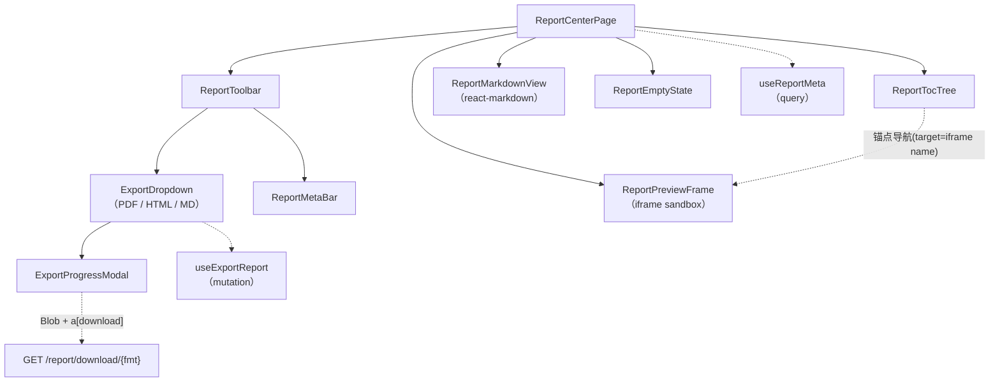
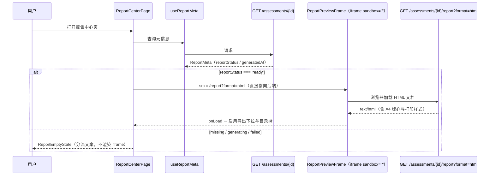
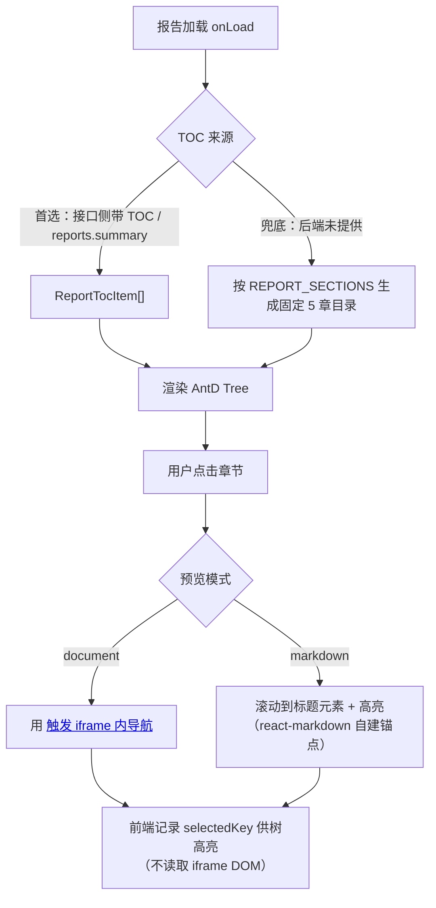
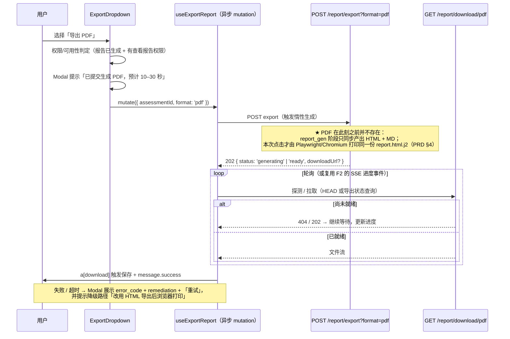

# 模块概要设计 — F5 报告导出模块

| 项 | 值 |
|---|---|
| 所属层 | 前端展示层 |
| 承载位置 | 安全报告中心页（`pages/ReportCenter/`，路由 `/reports/:assessmentId`） |
| 上游文档 | [PRD.md](../PRD.md)、[概要设计总纲.md](../概要设计总纲.md) |
| 对应需求 | 需求.md 2.5.5 |
| 文档层级 | 概要设计 |

---

## 1. 模块定位

### 1.1 职责

| # | 职责 | 说明 |
|---|---|---|
| R1 | 报告目录树 | 左侧目录树呈现报告章节，点击定位到报告正文对应位置（PRD §8.1 ③） |
| R2 | 在线预览 | 用 **iframe 内嵌后端渲染好的 HTML**（`GET /report?format=html`），保证「预览的内容 = 导出的内容」（PRD §8.2） |
| R3 | Markdown 视图 | 用 `react-markdown` 渲染 `GET /report?format=md` 的 Markdown 源，提供可复制、可搜索的文本形态 |
| R4 | 格式导出 | 「一键导出」下拉：PDF / HTML / Markdown；**PDF 惰性生成**，导出为**异步**（触发 → 等待 → 下载），HTML/MD 在报告生成阶段已就绪（PRD §9） |
| R5 | 报告元信息与状态 | 展示项目概况、评估执行信息、生成时间；报告未生成时给出明确的空态与前置动作 |
| R6 | 打印/阅读样式的宿主 | 提供 A4 版心、衬线字体、页眉页脚的**容器约束**（具体样式属详细设计） |

### 1.2 明确不负责（边界）

- **不渲染报告内容本身**：报告 HTML/MD 由 B6 用 Jinja2 从数据库快照渲染（PRD §7.6、总纲 §9.3），前端不做数据到文书的模板拼装。
- **不生成 PDF**：PDF 由后端 Playwright/Chromium 打印（PRD §4），前端不引入客户端 PDF 库。
- **不产生报告数据**：漏洞清单、攻击链、评分均来自 F3/F4 所依赖的同一批接口，本模块只读汇总。
- **不做漏洞详情复盘**：报告中漏洞条目如需深入查看，跳回工作台（给 F3 的 `origin: 'report'` 预留）。
- **不做报告编辑**：报告是产物不是草稿，无编辑与批注能力（PRD 未要求）。

### 1.3 与后端接口的对应关系

| 本模块能力 | 后端接口（PRD §9） | 读写 | 备注 |
|---|---|---|---|
| 在线预览（HTML 全文） | `GET /api/v1/assessments/{id}/report?format=html` | 读 | 直接作为 iframe 的 `src`，不进 JS 内存 |
| 目录树 | 同上接口的侧带数据，或 `reports.summary`（PRD §6） | 读 | TOC 来源见 §8 T2 |
| Markdown 视图内容 | `GET /api/v1/assessments/{id}/report?format=md` | 读 | ✅ 上游已统一读取端点，`format=md` 返回 Markdown 文本，见 §3.2 |
| 导出（PDF/HTML/MD） | `POST /api/v1/assessments/{id}/report/export?format=pdf\|md\|html` | 写 | 触发后端生成；**PDF 惰性生成**（仅点导出时才产出），异步，见 §4.3 |
| 下载 | `GET /api/v1/assessments/{id}/report/download/{fmt}` | 读 | 文件流，前端以 Blob + `<a download>` 落地 |
| 报告可用性判断（元信息与阶段状态） | `GET /api/v1/assessments/{id}` | 读 | 区分「报告未生成」与「生成失败」 |

---

## 2. 组件分解

| 组件 | 职责 | 关键 props | 依赖 |
|---|---|---|---|
| `ReportCenterPage` | 页面容器：路由参数、布局（左树右正文）、状态编排 | `assessmentId`（来自路由） | react-router |
| `ReportToolbar` | 标题、评估元信息摘要、「一键导出」下拉入口 | `meta` / `disabled` / `onExport` | AntD `Button` + `Dropdown` |
| `ExportDropdown` | PDF / HTML / Markdown 三项菜单，含权限与可用性判定 | `assessmentId` / `disabled` / `onExported` | AntD `Dropdown` / `Menu` |
| `ExportProgressModal` | 导出进行中（含耗时提示）与失败重试 | `open` / `format` / `state` / `onRetry` | AntD `Modal` / `Progress` |
| `ReportTocTree` | 左侧目录树，支持锚点定位 | `items` / `selectedKey` / `onSelect` | AntD `Tree` |
| `ReportPreviewFrame` | **iframe 宿主**：sandbox 策略、加载态、错误态 | `src` / `title` / `onLoad` / `onError` | 原生 `<iframe sandbox>` |
| `ReportMarkdownView` | `react-markdown` 渲染 MD 源，附复制按钮 | `markdown` / `loading` / `error` | `react-markdown` |
| `ReportMetaBar` | 项目概况、执行信息、生成时间、评分摘要 | `meta` | AntD `Descriptions` |
| `ReportEmptyState` | 报告尚未生成/失败时的空态与前置动作引导 | `reason` / `assessmentId` | AntD `Empty` / `Result` |
| `useReportMeta` / `useExportReport` | 元信息查询与导出 mutation | — | TanStack Query |



---

## 3. 对外接口

### 3.1 模块导出的组件与 props 契约（TypeScript 类型签名）

```ts
export interface ReportCenterPageProps {
  assessmentId: number;
}

export interface ExportDropdownProps {
  assessmentId: number;
  /** false 时禁用（报告未生成 / 无「查看报告」权限） */
  enabled: boolean;
  onExported: (format: ReportFormat, ok: boolean) => void;
}

export interface ReportTocTreeProps {
  items: ReportTocItem[];
  selectedKey: string | null;
  /** 由页面层执行实际导航（通过 target 指向 iframe 的 name）*/
  onSelect: (item: ReportTocItem) => void;
}

export interface ReportPreviewFrameProps {
  src: string | null;               // GET /assessments/{id}/report
  frameName: string;                // 供目录树 target 引用，如 'asa-report-frame'
  onLoad: () => void;
  onError: (reason: 'load' | 'timeout') => void;
}

export interface ReportMarkdownViewProps {
  /** null 表示尚未请求或请求失败 */
  markdown: string | null;
  loading: boolean;
  error: Error | null;
}

export declare function ReportCenterPage(p: ReportCenterPageProps): JSX.Element;
export declare function ExportDropdown(p: ExportDropdownProps): JSX.Element;
export declare function ReportTocTree(p: ReportTocTreeProps): JSX.Element;
export declare function ReportPreviewFrame(p: ReportPreviewFrameProps): JSX.Element;
export declare function ReportMarkdownView(p: ReportMarkdownViewProps): JSX.Element;
```

### 3.2 依赖的后端 API

| 接口 | 方法 | 用途 | 调用时机 | 备注 |
|---|---|---|---|---|
| `/api/v1/assessments/{id}/report?format=html\|md` | GET | 在线预览：`html` 作为 iframe `src`；`md` 供 react-markdown 渲染 | 进入页面 / 切换预览模式 | `html` 返回 `Content-Type: text/html; charset=utf-8`（§8 T4）；`md` 返回 `text/markdown` |
| `/api/v1/assessments/{id}/report/export?format=pdf\|md\|html` | POST | 生成并登记目标格式；**PDF 惰性生成**（`report_gen` 阶段只同步产出 HTML + MD） | 点击导出菜单项 | 异步：触发后轮询/等待再下载（§4.3） |
| `/api/v1/assessments/{id}/report/download/{fmt}` | GET | 取出已导出文件流 | 导出成功后 | 建议 `Content-Disposition: attachment` |
| `/api/v1/assessments/{id}` | GET | 报告可用性、阶段状态、时间信息 | 进入页面 | 空态分流 |

### 3.3 本模块定义的数据结构（TypeScript interface）

```ts
export type ReportFormat = 'pdf' | 'html' | 'md';
export type PreviewMode = 'document' | 'markdown';

export interface ReportMeta {
  assessmentId: number;
  projectName: string;
  projectId: number;
  generatedAt: string | null;        // null → 报告未生成
  reportStatus: 'ready' | 'generating' | 'missing' | 'failed';
  securityGrade?: 'critical' | 'high' | 'medium' | 'safe';   // ★ 项目综合等级（非漏洞严重度）
  scoringSummary?: { critical: number; high: number; medium: number; low: number }; // 漏洞严重度计数
  durationSec?: number;              // 端到端耗时（对应 PRD §1.2 硬指标）
}

/** 目录树节点；anchor 用于在 iframe 内定位（形如 'sec-3-2'）*/
export interface ReportTocItem {
  key: string;                       // 唯一键，建议直接用 anchor
  title: string;
  level: 1 | 2 | 3;
  anchor: string;                    // 与报告 HTML 中的 id 一致
  children?: ReportTocItem[];
}

/** 固定章节（PRD §8.1 ③），用于目录树缺失时的兜底与顺序校验。
 *  术语规范（PRD §6）：项目级写「项目综合等级」(critical/high/medium/safe)，
 *  漏洞级写「漏洞严重度」(critical/high/medium/low)，章节标题不得混用 */
export const REPORT_SECTIONS = [
  '项目概况与执行信息',
  '项目综合等级与风险大盘',
  '已验证漏洞清单',        // 漏洞条目按「漏洞严重度」标注
  '多步攻击路径推演',
  '安全整改建议',
] as const;

export interface ExportRequest { format: ReportFormat; }
export interface ExportResult {
  format: ReportFormat;
  /** ✅ PDF 惰性生成：触发时为 generating，就绪后为 ready（§4.3）*/
  status: 'generating' | 'ready' | 'failed';
  /** 就绪后的可下载地址；若后端直接返回文件流则此项为 null（§8 T3）*/
  downloadUrl: string | null;
  sizeBytes?: number;
  generatedAt: string;
}
```

**iframe 的 sandbox 取值（安全考虑，逐项说明）**

| sandbox 取值 | 语义 | 是否采用 | 理由 |
|---|---|---|---|
| `""`（空值） | 最大限制：唯一不透明源、禁脚本、禁表单提交、禁同源访问 | ✅ **采用** | 报告 HTML 内含**被扫描工程的源码片段与 PoC 载荷**，属不可信数据；空 sandbox 保证它无法触达父页面 |
| `allow-scripts` | 允许执行脚本 | ❌ | 报告是静态文书，无需脚本；且一旦与 `allow-same-origin` 同给，等价于无沙箱（可自行移除外层 iframe） |
| `allow-same-origin` | 允许读取父页面同源资源 | ❌ | 与 `allow-scripts` 组合是经典的沙箱逃逸组合；本模块明确禁止 |
| `allow-popups` / `allow-downloads` | 允许弹窗/下载 | ❌ | 报告内不应有下载行为，避免被诱导下载 |
| `allow-forms` | 允许提交表单 | ❌ | 报告为只读文书 |

**由此产生的约束（写入后端契约）**：报告模板 `report.html.j2` 必须**不含任何 script**；若打印样式依赖脚本（如分页计算），改为纯 CSS `@media print` 实现。这是 sandbox 空值可用的前提，记入 §8 T5。

---

## 4. 关键处理流程

### 4.1 在线预览加载



**要点**：iframe 的 `src` 直接指向后端 URL，**不把 HTML 文本 fetch 进 JS 再 `srcDoc`**。三个收益：① 浏览器可缓存该文档，切换预览模式不必重下；② 大体积 HTML 不进 JS 堆；③ 目录树的锚点导航（见 §4.2）可直接作用于文档自身。代价是失去对文档内容的 JS 访问能力——但沙箱策略本就禁止了这一点，代价为零。

### 4.2 目录树与锚点定位



**设计说明**：由于 sandbox 为空且未给 `allow-same-origin`，父页面**无法**通过 `iframe.contentWindow.location.hash` 设置锚点（跨源/沙箱阻断），也无法读取 iframe 当前的滚动位置。因此采用 `target="<iframe name>"` 的原生超链接导航——导航自身文档是 sandbox 允许的行为。树高亮由前端自己维护（记住用户点了哪一章），不依赖 iframe 反馈；这与「iframe 只是被动渲染器」的定位一致。

### 4.3 格式导出



**要点**：
1. **PDF 惰性生成 → 导出必须异步**：`report_gen` 阶段只同步产出 HTML + MD，PDF 在用户点导出时才生成。因此「一键导出 PDF」**不能假设点一下就立刻拿到文件**——流程为**触发 → 轮询/等待（进度可见）→ 下载**（PRD §9「PDF 惰性生成」）。`ExportProgressModal` 的进度由「已提交 / 生成中 / 可下载」三态驱动。
2. **轮询 vs 复用 SSE**：优先复用 F2 的 `useSSE`（报告生成进度可作为事件类型扩展）；若后端不推送，则用 `useExportReport` 内建定时轮询（建议 2s，超时 60s）。两条路都不阻塞页面。HTML/MD 已在报告生成阶段就绪，导出可近乎即时。
3. **幂等**：同一评估同一格式重复导出应命中后端缓存（已生成直接返回），前端不禁止重复点击，仅在 pending 期间禁用按钮。
4. **PDF 的字节来源**：PDF 打印的是**同一份 HTML 模板**输出，所以「预览 = 导出」在渲染层面成立；差异仅来自 `@media print` 规则（如去掉交互控件、固定分页）。这一条是本模块的核心论证，也是拒绝「前端用 react-markdown 重建报告再导出」的原因。

---

## 5. 状态管理

| 状态 | 归属 | Key / 载体 | 理由 |
|---|---|---|---|
| 报告元信息 / 可用性 | **TanStack Query** | `['report-meta', assessmentId]`，`staleTime: 30s` | 服务端状态；评估完成后需失效重拉 |
| 导出 mutation 状态 | **TanStack Query mutation** | `useExportReport`（`isPending` 驱动 Modal） | 写操作，含失败重试语义 |
| Markdown 源文本 | **TanStack Query** | `['report-md', assessmentId]`，`enabled` 仅在切到 MD 模式时启用 | 懒加载；文本量中等，进缓存可复用（与 HTML 走 iframe 的策略不同，因为 react-markdown 必须拿到字符串） |
| 报告 HTML | **不进 Query** | iframe `src` 指向后端 URL | 大文档交给浏览器缓存，塞进 JS 堆无收益（§4.1） |
| 预览模式（document / markdown） | **Zustand** | `useReportUiStore.previewMode` | 用户在树上的点击行为依赖它（§4.2 分流），且希望在同一评估内切换不丢失 |
| 目录树选中节点 `selectedKey` | **Zustand** | `useReportUiStore.selectedTocKey` | 与预览模式同源；避免每次切模式丢焦点 |
| 阅读偏好（衬线/A4 已固定，字号档位） | **Zustand（可持久化 localStorage）** | `useReportUiStore.fontScale` | 跨会话的用户偏好，非业务数据 |
| iframe 加载态 / 加载超时 | **组件本地 state** | `ReportPreviewFrame` | 纯 UI 瞬态；iframe `onLoad`/`onError` 是唯一来源 |
| 导出 Modal 开合 | **组件本地 state**（受 mutation 驱动） | `ExportProgressModal` | 生命周期与一次导出绑定 |
| 报告内容数据 | **不持有** | — | 内容由后端渲染（总纲 §9.3「报告从数据库快照生成」），前端持有会造成第二份真相 |

---

## 6. 出错处理

| 错误场景 | 用户可见表现 | 处理策略 |
|---|---|---|
| 报告未生成（`reportStatus='missing'`，如评估未完成） | 空态：「报告尚未生成」+ 跳转工作台按钮 | 不渲染 iframe；导出下拉禁用并 Tooltip 说明原因 |
| 评估 `exploit_chain` 阶段 `skipped`（总纲 §5.2） | 报告可预览，正文攻击链章节显示既定降级说明 | 属正常产物形态（PRD §12 风险 10），不算错误 |
| iframe 加载失败（`onError`） | 覆盖层：「报告内容加载失败」+ 重试 | 重试通过变更 `src` 尾附时间戳绕过缓存；连续失败提示检查后端 :8010 |
| iframe 长时间不触发 `onLoad`（超时 15s） | 覆盖层：加载超时 + 重试 | 超时判定在前端定时器，`src=null` 重挂载 |
| 报告内脚本被 sandbox 阻止（若模板误含 script） | 页面正常显示（静默） | 视为后端契约违规：前端上报前端日志；详细设计需给模板做静态检查（§8 T5） |
| 导出返回 5xx（Playwright 失败） | Modal 展示 `error_code` + `remediation`，附「重试」 | 依总纲 §9.2 的四要素错误模型展示，不只显示「导出失败」 |
| 导出超时（>60s） | 同上 + 建议降级路径「导出 HTML 后用浏览器打印」 | 不自动取消后端任务；前端解除 loading 允许重试 |
| 下载被浏览器拦截（弹窗拦截/策略） | 提示「下载被拦截，请允许本站下载」+ 提供直链 | 用 `<a>` 元素触发而非 `window.open`，降低拦截概率 |
| Markdown 接口失败 | MD 视图内错误态 + 重试；不影响 document 模式 | 懒加载失败不阻断主预览 |
| PDF 中文显示为方块（后端字体缺失） | PDF 可下载但字型异常，前端无法检测 | 前端在导出成功后附提示「若 PDF 中文异常，请检查后端 Chromium 字体配置」；根因修在后端（属 PRD §12 风险 7 同类问题） |
| 无「查看报告」权限（总纲 §8.3 权限点） | 页面级 403 提示 | 路由守卫拦截，不进入本模块 |

---

## 7. 设计约束与权衡

| # | 取舍点 | 选择 | 放弃方案 | 理由 | 代价 |
|---|---|---|---|---|---|
| D1 | 预览渲染方式 | iframe 内嵌后端 HTML | 前端用 react-markdown 从数据重建报告 | 重建等于**第二套渲染逻辑**，必然与导出产物漂移；iframe 使「预览 = 导出」成为结构性保证 | iframe 内不可被父页面脚本控制（沙箱代价，见 D2） |
| D2 | sandbox 策略 | 空 `sandbox=""` | `allow-scripts allow-same-origin` | 报告含被扫描源码与 PoC 载荷（不可信输入），组合授权等价于无沙箱；本模块不需要任何脚本能力 | 报告模板不得含 script（§8 T5）；锚点导航需用 `target` 而非 `contentWindow` |
| D3 | 为何仍保留 react-markdown | 作为第二种**文本形态**视图，且内容复用下载端点的 MD | 只留 iframe | MD 视图满足「可复制、可搜索、可 diff」的使用场景；且 PRD §8.2 已把 react-markdown 列为 F5 依赖 | 多一个视图需维护（但两者不共享渲染逻辑，不存在漂移风险） |
| D4 | MD 渲染的 HTML 处理 | 不启用 `rehype-raw`，Markdown 中的原始 HTML 一律按文本处理 | 允许原始 HTML | 报告内容含不可信片段，允许原始 HTML 等于在父文档里执行注入 | 若报告 MD 确实包含需要渲染的 HTML 表格，需改为后端输出纯 MD 语义（§8 T6） |
| D5 | 目录树数据来源 | 后端提供 TOC（接口侧带或 `reports.summary`） | 前端 `DOMParser` 解析报告 HTML 抽标题 | 解析 HTML 需要读取沙箱文档（不可能），且在**不可信文档**上跑解析器没有价值；后端知道自己有哪几章 | 依赖后端补 TOC 契约（§8 T2），缺失时用固定 5 章兜底 |
| D6 | 导出执行模型 | **异步**：触发 → 轮询/等待 → 下载（Modal 三态进度） | 同步阻塞等待 | ✅ 上游已定 PDF **惰性生成**（PRD §9）：PDF 在点导出时才产出，不能假设立即返回文件，故必须异步；报告生成 ≤30s（PRD §1.2）仍成立 | 需一次轮询或复用 F2 的 SSE 进度；Modal 需覆盖「生成中 → 可下载」 |
| D7 | 版心与字体 | A4 版心 + 衬线字体由**报告 HTML 自身**（后端模板）定义 | 前端 CSS 注入 iframe | 沙箱下前端无法注入；且「预览=导出」要求样式必须属于文档本身 | 前端只负责容器尺寸与缩放，样式调整需动后端模板 |
| D8 | 导出格式集合 | PDF / HTML / MD 三选（PRD §9） | 增加 Word/Excel | PRD 已冻结格式集合（需求 2.5.8） | 无 |

---

## 8. 移交详细设计的待定项

| # | 待定项 | 影响 | 建议 |
|---|---|---|---|
| T1 | ~~Markdown 预览端点缺失~~ | — | ✅ 已由上游修订解决（PRD §9）：读取端点统一为 `GET /assessments/{id}/report?format=html\|md`，MD 视图改用 `format=md`（§3.2） |
| T2 | TOC 的数据来源与结构 | 目录树是否精确对应章节 | 建议 `GET /assessments/{id}/report` 支持 `Accept: application/json` 返回 `{html?, toc}`，或为 `reports.summary` 定义 `toc` 字段 |
| T3 | `POST /report/export` 的响应体与异步语义 | 导出后如何取文件 | ✅ 端点已定（PRD §9，PDF 惰性生成）；响应体建议返回 `ExportResult`（含 `status` / `downloadUrl`）以支持轮询，见 §3.3 与 §4.3 |
| T4 | `GET /report` 的响应头约定 | iframe 能否内嵌（`X-Frame-Options` / CSP `frame-ancestors`） | 需后端允许同源 iframe（禁用 `DENY`），并声明 `text/html; charset=utf-8` |
| T5 | 报告模板的「无脚本」契约与校验 | 空 sandbox 的可用性前提 | 建议后端在导出时静态检查模板产物是否含 `<script>`，前端仅记录告警 |
| T6 | 报告 MD 中是否会出现原始 HTML 表格/图表 | MD 视图的呈现完整性 | 若需要，改为后端输出 Markdown 原生表格；不放开 `rehype-raw` |
| T7 | 报告章节与数据源的映射（含术语） | 是否出现空章节 / 章节标题用词 | 需明确 PRD §8.1 ③ 的五章对应哪些查询（无漏洞/无链路时是否省略）；章节标题须遵守 PRD §6 术语规范——项目级写「项目综合等级」、漏洞级写「漏洞严重度」（见 §3.3 `REPORT_SECTIONS`） |
| T8 | 是否需要「重新生成报告」入口 | 空态与失败态的补救动作 | **PRD §9 无该端点**；当前设计为空态引导「重新评估」，如需单独重生成需后端补接口 |
| T9 | iframe 宽度自适应与缩放（A4 纵向比例） | 阅读体验 | 交详细设计确定容器断点与是否提供缩放控件 |

---

## ⚠️ 与上游不一致

| # | 位置 | 不一致点 | 本设计的处理 |
|---|---|---|---|
| 1 | PRD §8.2 vs PRD §9 | ✅ **已由上游修订解决（PRD §9）**：读取端点统一为 `GET /assessments/{id}/report?format=html\|md`（在线预览），**Markdown 预览缺口已补** | Markdown 视图改用 `format=md`（§3.2）后由 react-markdown 渲染；两种形态的分工与理由见 §7 D3 |
| 2 | PRD §9 `POST /report/export` | ⚠️ **部分解决**：已明确 PDF **惰性生成**（点导出时才产出），导出为异步语义；但**响应体仍未定义**（返回文件流还是生成结果元信息） | 本设计按异步设计（§4.3），`ExportResult` 预留 `status` / `downloadUrl`（§3.3）；响应体定义仍建议后端确认，记入 §8 T3 |
| 3 | PRD §8.1 ③ vs PRD §6 `reports.summary` | §8.1 ③ 要求左侧目录树对应报告五章，但 §6 对 `reports.summary(json)` 的内容**未做定义**，接口也未声明会返回 TOC | 目录树优先取后端 TOC，缺失时按 §3.3 的 `REPORT_SECTIONS` 固定五章兜底；TOC 契约列为 §8 T2 |
| 4 | PRD §4 / §7.6 vs 需求 2.5.5 的 F5 表述 | 需求把「报告排版渲染」放在前端模块，而 PRD §4 明确报告模板为后端 Jinja2（一套数据 → HTML/PDF/MD 三格式），PDF 由后端 Playwright 打印 | 本设计严格按 PRD §4 执行：**排版渲染在后端**，F5 只做宿主、预览、目录与导出驱动；若按需求字面理解为前端排版，则与 PRD §4 的「单一数据源」决策冲突，需上游澄清 |
| 5 | PRD §9 PDF 生成时机 vs 交互预期 | 上游已定 **PDF 惰性生成**（`report_gen` 只同步产出 HTML + MD，PDF 点导出才生成），而「一键导出」的字面交互易被误解为「点一下立刻得到文件」 | 本设计把 PDF 导出改为**异步**（触发 → 轮询/等待 → 下载，Modal 三态进度），见 §4.3、§7 D6；HTML/MD 仍近乎即时 |
| 6 | PRD §6 术语规范 vs 报告章节 | 报告项目级/漏洞级术语同用四色易混用 | 本设计在 §3.3 `REPORT_SECTIONS` 与类型注释中强制：项目级写「项目综合等级」(critical/high/medium/safe)，漏洞级写「漏洞严重度」(critical/high/medium/low)；章节标题同步调整（如第 2 章改为「项目综合等级与风险大盘」） |
